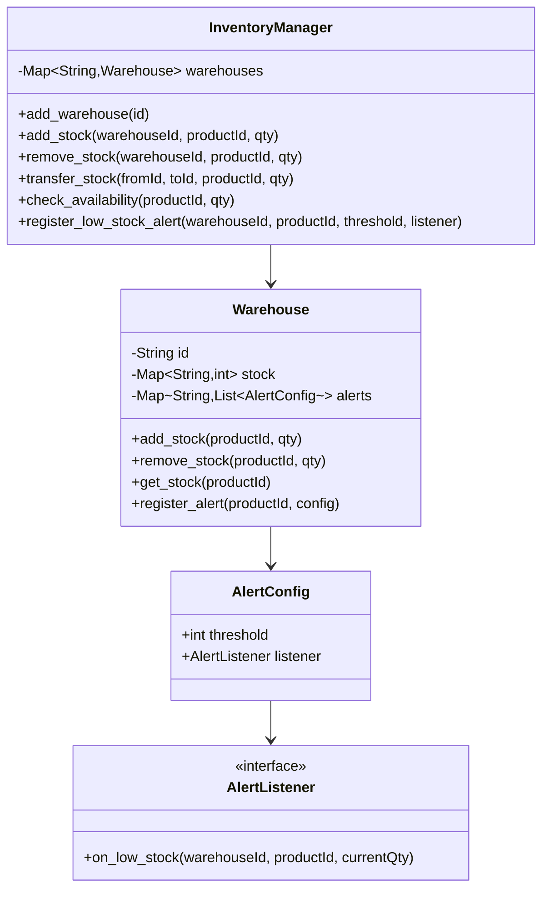

# Inventory Management — Design

## Mermaid Class Diagram

## Data Model

- `warehouses: Map<String, Warehouse>`
- `Warehouse.stock: Map<String, int>` where key is `product_id`
- `Warehouse.alerts: Map<String, List<AlertConfig>>` keyed by `product_id`

## API Contracts

### `add_stock`
- Validates positive quantity.
- Increments stock.
- Re-evaluates low-stock alert conditions.

### `remove_stock`
- Validates positive quantity.
- Rejects if stock would go negative.
- Re-evaluates low-stock alert conditions.

### `transfer_stock`
- Validates both warehouses and positive quantity.
- Source decrement and destination increment are applied atomically in-process.

### `check_availability`
- Returns warehouse IDs where `stock >= required_quantity`.

### `register_low_stock_alert`
- Adds `(threshold, listener)` mapping for a product within a warehouse.

## Concurrency (v3)

- Each `Warehouse` has an internal lock for stock + alert maps.
- `InventoryManager.transfer_stock` acquires two warehouse locks by sorted warehouse ID.
- No network/distributed lock in baseline; single-process semantics only.

## Complexity

- `add_stock` / `remove_stock`: O(1) average
- `transfer_stock`: O(1) average
- `check_availability`: O(W), where W is number of warehouses
