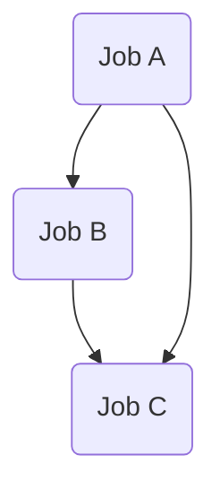

# Job Scheduler System Design

## 1. High-Level Architecture
The Job Scheduler system coordinates delayed, recurring, and dependent execution of tasks. The `v1-basic` implementation leverages an in-memory execution loop within a single process.

**Key Components:**
- **JobScheduler:** The entry point. Handles validation (cycles, missing dependencies) and lifecycle transitions (cascading DAG completion).
- **JobStore:** Abstract persistence for job states. Defaults to `InMemoryJobStore`.
- **JobExecutor:** Contains a bounded thread pool and a priority-queue (DelayQueue equivalent) for holding scheduled jobs until they are ready.
- **Clock:** An abstracted timeline to support testability without relying on real wall-clock delays.

## 2. DAG Progression and Cycle Detection
To support complex workflows, jobs specify a list of parent `dependencies`. A scheduled job remains in a `CREATED` state until all parents have successfully transitioned to `SUCCEEDED`. Cycle detection is enforced at submission time via DFS traversal. 

If Job B fails permanently, Job C will never execute (remaining stuck in `CREATED` or manually `CANCELLED`), preserving the safety of the dependent workflow.

## 3. Concurrency and Bounded Queues
The `JobExecutor` utilizes a capacity-bound Priority Queue.
- **Capacity Rejection:** If the queue exceeds `capacity`, the `JobScheduler` rejects the job admission.
- **Concurrent Pollers:** A predefined number of worker threads poll the queue concurrently. Synchronization ensures that exactly one thread acquires a due job. 
- **Graceful Shutdown:** The `.stop()` method sets a flag and interrupts the blocking poll loops.

## 4. Retries and Idempotency
Jobs can specify a `RetryPolicy` detailing `max_retries`, `initial_backoff_ms`, and `multiplier`. When an exception occurs during the job `action`, the executor computes an exponential backoff time, increments the attempt count, and places the job back into the priority queue as `RETRYING`. The action logic itself must handle side-effect idempotency.

## 5. Trade-offs and Limitations
- **In-Memory Volatility:** `v1-basic` utilizes `InMemoryJobStore`. A crash results in complete loss of scheduled jobs and state. This necessitates distributed data stores for enterprise scale (covered in later versions).
- **Single Process Coordination:** The current implementation doesn't support multiple distributed scheduler instances picking from a shared database.
- **Clock Skew:** A shared `Clock` interface is sufficient for local instances but doesn't solve NTP drift in distributed shards.

## 6. Contracts and Guarantees
To ensure robust workflow execution, the system adheres to the following explicit operational contracts:
- **Exactly-Once Execution Transitions**: When multiple worker threads poll the priority queue concurrently, synchronization guarantees that a job transitioning from `SCHEDULED` to `RUNNING` is acquired and executed by exactly one poller, preventing duplicate parallel executions of the same scheduled instance.
- **DAG Failure Isolation**: If a parent job in a dependency chain fails permanently (exceeding its retry policy and entering the `FAILED` state), the scheduler will not release its dependent child nodes. The child nodes remain securely blocked in their `CREATED` state, ensuring that downstream processes do not execute with missing or partial upstream data.
- **Deterministic Edge-Case Coverage**: The architecture relies on an injected abstract clock and bounded executor to guarantee deterministic testability across various edge cases. This approach ensures reproducible validation for structural errors (such as dependency cycles and missing parent tasks), operational edge cases (like task cancellation and preventing queue overflow during saturation), and precise chronological behaviors (such as strict due-time ordering and graceful poller shutdown).

## 7. Extensions and Versions

The project is structured into three progressive versions to demonstrate evolving complexities in a deterministic test environment.

### v1-basic: In-Memory Scheduler Loop
The baseline implementation described above. It focuses on cycle detection (DFS during scheduling), `ScheduledThreadPoolExecutor` style polling (with bounded thread pools and wait semantics), exact due-time calculation, and basic DAG progressions using in-memory state.

### v2-extended: Pluggable Abstractions
Builds upon `v1-basic` by introducing modular components:
- **Trigger Variants:** Support for `FixedIntervalTrigger`, `OneTimeTrigger`, decoupling scheduling logic from the job itself.
- **RetryPolicy Variations:** Includes `ExponentialBackoffPolicy` mapping retry attempt counts to deterministic backoff delays before requeuing as `RETRYING`.
- **Metrics and Observability:** Exposes queued, running, failed, and retrying task counts via `SchedulerMetrics`, making the system state transparent for tests and operational dashboards.

### v3-optimized: Bounded Concurrency & Dummy Distributed Concepts
Extends the design to simulate elements required in a distributed system, even while operating in a single process:
- **Bounded Task Queue:** Employs structures like `BoundedTaskQueue` (or dummy implementations representing PriorityBlockingQueue behavior) to implement strict capacity boundaries, rejecting admissions when saturated rather than degrading performance.
- **Lease & Recovery Managers:** Mock abstractions (`LeaseManager`, `RecoveryManager`) representing ownership claims over job execution (preventing concurrent distributed runners from acquiring the same job) and handling dead-node recovery protocols.
- **Idempotency & Sharding:** Dummy implementations (`IdempotencyStore`, `ShardManager`) representing deterministic hashing for execution traces and partitioning across multiple virtual shards.
