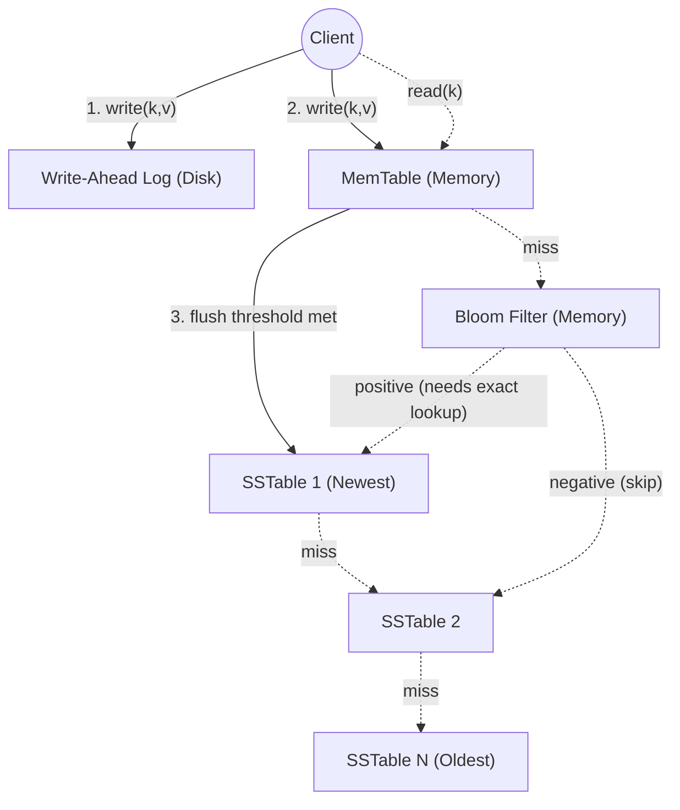

# Design: LSM-Tree Key-Value Store

## Architecture

The system consists of three main storage tiers: the Write-Ahead Log (WAL), the MemTable, and the SSTables.

### Diagram

## Data Model

- **MemTable:** `ConcurrentSkipListMap<String, String>` maintaining sorted order of keys.
- **WAL:** Append-only text file (`wal.log`), formatting entries as `key=value\n`.
- **SSTable:** Immutable text files named sequentially (e.g., timestamp or counter `.sst`), formatting entries identically to the WAL but inherently sorted.

## Components Breakdown
- **LSMStore:** The main facade handling `put`, `get`, and `delete`.
- **Flush Mechanism:** Triggered when MemTable size >= threshold. Writes all entries to a new `.sst` file.
- **Compaction Mechanism:** Triggered when the number of SSTables exceeds a limit. Merges all SSTables into one, dropping overridden values and tombstones.

## Version-Specific APIs & Contracts

*   **v1-basic API:** `put(String key, String value)`, `get(String key)`. Expects deterministic test fixtures for exact inputs/outputs.
*   **v2-extended API:** Adds `delete(String key)` emitting tombstone markers, and an internal `compact()` trigger.
*   **v3-optimized API:** Adds Bloom filter configurations.
*   **Component Contracts & Crash Points:** The system explicitly defines points of simulated failure (e.g., partial WAL writes). Acknowledged operations before a crash must strictly recover.
