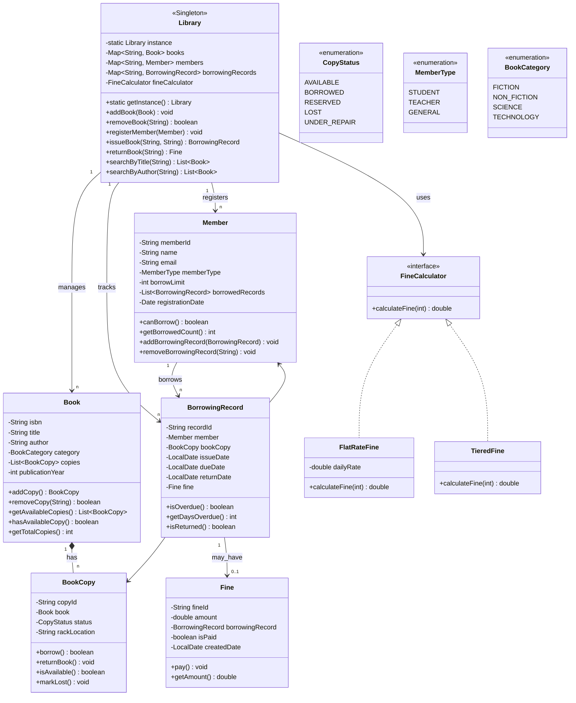
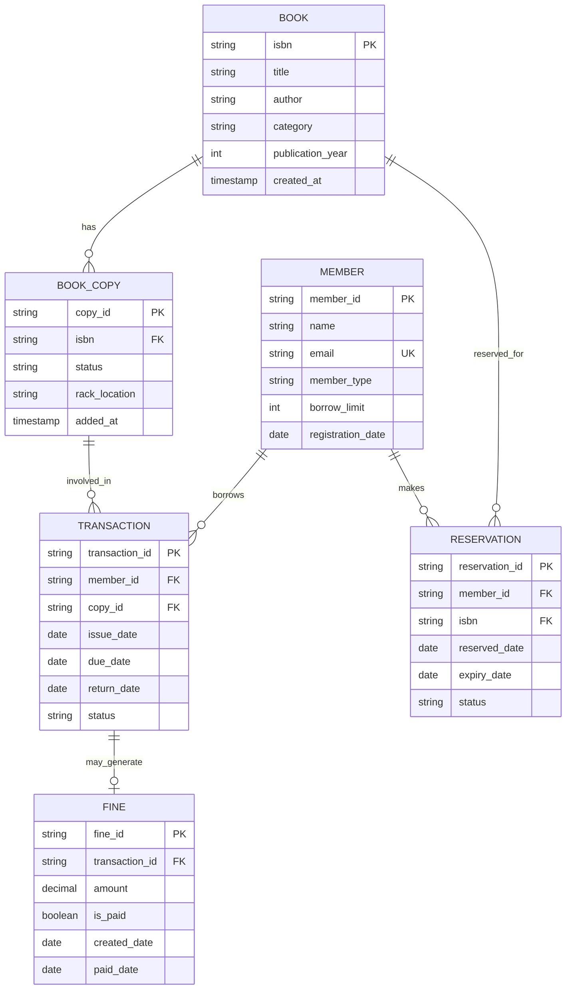

# Design for Library Management System

Complete class design with diagrams, relationships, and key decisions.

---

## Mermaid Class Diagram



## Entity-Relationship Diagram



**Schema Notes:**
- `BOOK` represents a title (ISBN), `BOOK_COPY` represents physical copies
- `TRANSACTION` tracks borrowing/returning with `FINE` for overdue returns
- `RESERVATION` allows members to reserve books not currently available
- Member's `borrow_limit` varies by `member_type`

---

## Class Diagram

```
┌─────────────────────────────────────────────────────────────────────┐
│                            Library                                   │
│                         <<Singleton>>                                │
├─────────────────────────────────────────────────────────────────────┤
│ - instance: Library                                                 │
│ - books: Map<String, Book>                                          │
│ - members: Map<String, Member>                                      │
│ - borrowingRecords: Map<String, BorrowingRecord>                    │
├─────────────────────────────────────────────────────────────────────┤
│ + getInstance(): Library                                            │
│ + addBook(book: Book): void                                         │
│ + removeBook(isbn: String): boolean                                 │
│ + registerMember(member: Member): void                              │
│ + issueBook(memberId, copyId): BorrowingRecord                      │
│ + returnBook(recordId): Fine                                        │
│ + searchByTitle(title): List<Book>                                  │
│ + searchByAuthor(author): List<Book>                                │
└───────────────────────────────┬─────────────────────────────────────┘
                                │
            ┌───────────────────┼───────────────────┐
            │                   │                   │
            ▼                   ▼                   ▼
    ┌──────────────┐   ┌──────────────┐   ┌─────────────────┐
    │     Book     │   │    Member    │   │ BorrowingRecord │
    ├──────────────┤   ├──────────────┤   ├─────────────────┤
    │ -isbn        │   │ -memberId    │   │ -recordId       │
    │ -title       │   │ -name        │   │ -member         │
    │ -author      │   │ -email       │   │ -bookCopy       │
    │ -category    │   │ -borrowLimit │   │ -issueDate      │
    │ -copies      │   │ -borrowed    │   │ -dueDate        │
    ├──────────────┤   ├──────────────┤   │ -returnDate     │
    │ +addCopy()   │   │ +canBorrow() │   ├─────────────────┤
    │ +getAvail()  │   │ +addRecord() │   │ +isOverdue()    │
    └──────┬───────┘   └──────────────┘   │ +calcFine()     │
           │                               └─────────────────┘
           │ 1
           │ has
           │ n
    ┌──────▼───────┐
    │   BookCopy   │
    ├──────────────┤
    │ -copyId      │
    │ -book        │
    │ -status      │
    ├──────────────┤
    │ +borrow()    │
    │ +return()    │
    │ +isAvail()   │
    └──────────────┘


┌─────────────────────┐        ┌─────────────────────────────────┐
│    Reservation      │        │     FineCalculator              │
│       (v2)          │        │    <<Strategy>> (v2)            │
├─────────────────────┤        ├─────────────────────────────────┤
│ -reservationId      │        │ + calculateFine(days): double   │
│ -member             │        └────────────────┬────────────────┘
│ -book               │                         │
│ -reservedDate       │            ┌────────────┴────────────┐
├─────────────────────┤            ▼                         ▼
│ +fulfill()          │   ┌─────────────────┐   ┌─────────────────┐
│ +cancel()           │   │  FlatRateFine   │   │  TieredFine     │
└─────────────────────┘   └─────────────────┘   └─────────────────┘
```

---

## Enumerations

### CopyStatus
```
CopyStatus {
    AVAILABLE,
    BORROWED,
    RESERVED,
    LOST,
    UNDER_REPAIR
}
```

### BookCategory
```
BookCategory {
    FICTION,
    NON_FICTION,
    SCIENCE,
    TECHNOLOGY,
    HISTORY,
    BIOGRAPHY,
    CHILDREN,
    REFERENCE
}
```

### MemberType
```
MemberType {
    STUDENT,    // 3 books, 14 days
    TEACHER,    // 5 books, 30 days
    GENERAL     // 3 books, 14 days
}
```

---

## Core Classes

### Library (Singleton)
- **Attributes**:
  - `instance: Library` - Static singleton instance
  - `books: Map<String, Book>` - ISBN to Book mapping
  - `members: Map<String, Member>` - ID to Member mapping
  - `borrowingRecords: Map<String, BorrowingRecord>` - Active loans
  - `fineCalculator: FineCalculator` - Strategy for fines
- **Methods**:
  - `getInstance(): Library` - Get singleton instance
  - `addBook(Book): void` - Add book to catalog
  - `removeBook(String): boolean` - Remove by ISBN
  - `registerMember(Member): void` - Register new member
  - `issueBook(String, String): BorrowingRecord` - Issue book to member
  - `returnBook(String): Fine` - Process return
  - `searchByTitle(String): List<Book>` - Search books
  - `searchByAuthor(String): List<Book>` - Search by author
- **Patterns Used**: Singleton

### Book
- **Attributes**:
  - `isbn: String` - Unique identifier
  - `title: String` - Book title
  - `author: String` - Author name
  - `category: BookCategory` - Genre/category
  - `copies: List<BookCopy>` - Physical copies
  - `publicationYear: int` - Year published
- **Methods**:
  - `addCopy(): BookCopy` - Add new copy
  - `removeCopy(String): boolean` - Remove copy by ID
  - `getAvailableCopies(): List<BookCopy>` - Get available
  - `hasAvailableCopy(): boolean` - Check availability
  - `getTotalCopies(): int` - Total copy count

### BookCopy
- **Attributes**:
  - `copyId: String` - Unique copy ID (e.g., "ISBN-001")
  - `book: Book` - Parent book reference
  - `status: CopyStatus` - Current status
  - `rackLocation: String` - Physical location
- **Methods**:
  - `borrow(): boolean` - Mark as borrowed
  - `returnBook(): void` - Mark as available
  - `isAvailable(): boolean` - Check if available
  - `markLost(): void` - Mark as lost

### Member
- **Attributes**:
  - `memberId: String` - Unique member ID
  - `name: String` - Full name
  - `email: String` - Contact email
  - `memberType: MemberType` - Type of member
  - `borrowLimit: int` - Max books allowed
  - `borrowedRecords: List<BorrowingRecord>` - Current loans
  - `registrationDate: Date` - When registered
- **Methods**:
  - `canBorrow(): boolean` - Check if can borrow more
  - `getBorrowedCount(): int` - Current borrowed count
  - `addBorrowingRecord(BorrowingRecord): void` - Add loan
  - `removeBorrowingRecord(String): void` - Remove loan

### BorrowingRecord
- **Attributes**:
  - `recordId: String` - Unique record ID
  - `member: Member` - Who borrowed
  - `bookCopy: BookCopy` - What was borrowed
  - `issueDate: LocalDate` - When issued
  - `dueDate: LocalDate` - When due
  - `returnDate: LocalDate` - When returned (null if not returned)
  - `fine: Fine` - Associated fine (if any)
- **Methods**:
  - `isOverdue(): boolean` - Check if past due
  - `getDaysOverdue(): int` - Days past due date
  - `isReturned(): boolean` - Check if returned

### Fine
- **Attributes**:
  - `fineId: String` - Unique fine ID
  - `amount: double` - Fine amount
  - `borrowingRecord: BorrowingRecord` - Related record
  - `isPaid: boolean` - Payment status
  - `createdDate: LocalDate` - When created
- **Methods**:
  - `pay(): void` - Mark as paid
  - `getAmount(): double` - Get fine amount

---

## Key Design Decisions

### Decision 1: Book vs BookCopy Separation
**Rationale**: 
- One book title can have multiple physical copies
- Each copy can be in different state (available, borrowed, lost)
- Allows tracking individual copy condition and location

**Trade-off**:
- More complex than single Book class
- Necessary for real library management

---

### Decision 2: Singleton for Library
**Rationale**:
- Centralized catalog management
- Consistent state across operations
- Simplifies access from different components

**Trade-off**:
- Harder to test
- Not suitable for multi-library systems

---

### Decision 3: Strategy Pattern for Fine Calculation
**Rationale**:
- Different fine rules for different scenarios
- Easy to add new fine policies
- Follows Open/Closed Principle

**Implementations**:
- `FlatRateFine` - $1 per day
- `TieredFine` - $0.50 first week, $1 after
- `MaxCapFine` - Fine capped at book price

---

## Complexity Analysis

### Time Complexity

| Operation | v1 Basic | v3 Optimized |
|-----------|----------|--------------|
| Search by ISBN | O(1) | O(1) |
| Search by title | O(n) | O(log n) |
| Issue book | O(copies) | O(1) |
| Return book | O(1) | O(1) |
| Member lookup | O(1) | O(1) |

### Space Complexity

| Component | Complexity | Notes |
|-----------|------------|-------|
| Book catalog | O(B) | B = total books |
| Member registry | O(M) | M = total members |
| Borrowing records | O(R) | R = active loans |
| Author index | O(B) | Author to books mapping |
| **Total** | O(B + M + R) | Linear in data size |

---

## Thread Safety (v3)

### Critical Sections:
1. **Book checkout** - Multiple members trying to borrow same copy
2. **Catalog updates** - Concurrent add/remove operations
3. **Fine calculation** - Accurate overdue calculations

### Synchronization Strategy:
```java
// Per-book locks for copy allocation
private final Map<String, ReentrantLock> bookLocks = new ConcurrentHashMap<>();

// ConcurrentHashMap for thread-safe lookups
private final Map<String, Book> catalog = new ConcurrentHashMap<>();

// Read-write lock for member operations
private final ReadWriteLock memberLock = new ReentrantReadWriteLock();
```

---

## Extension Points

| Feature | Where to Add | Pattern |
|---------|--------------|---------|
| Digital books (ebooks) | BookType enum | Factory pattern |
| Different fine policies | FineCalculator | Strategy pattern |
| Due date notifications | NotificationService | Observer pattern |
| Book recommendations | RecommendationEngine | Strategy pattern |
| Multiple libraries | Remove Singleton | Factory pattern |
