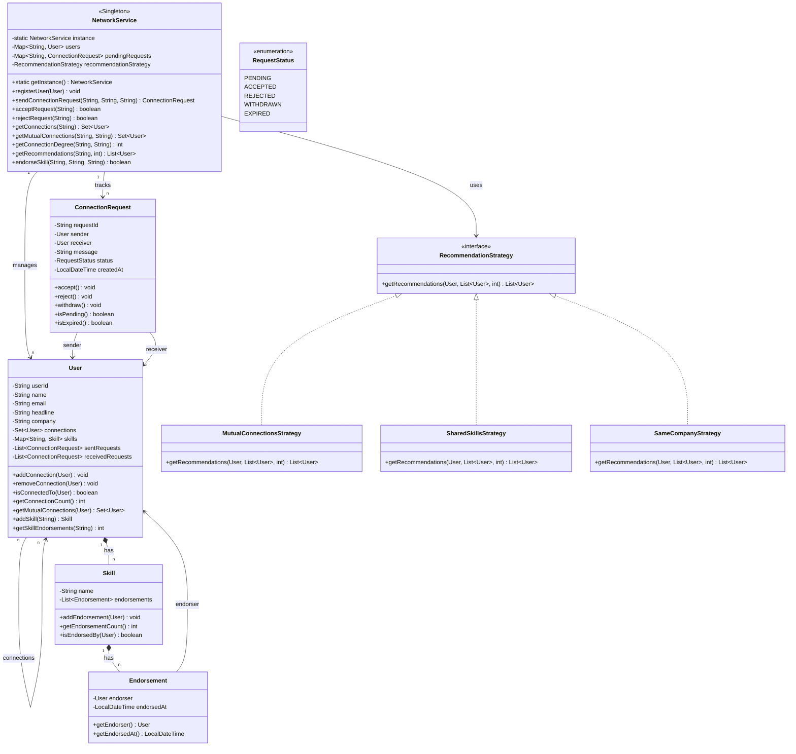
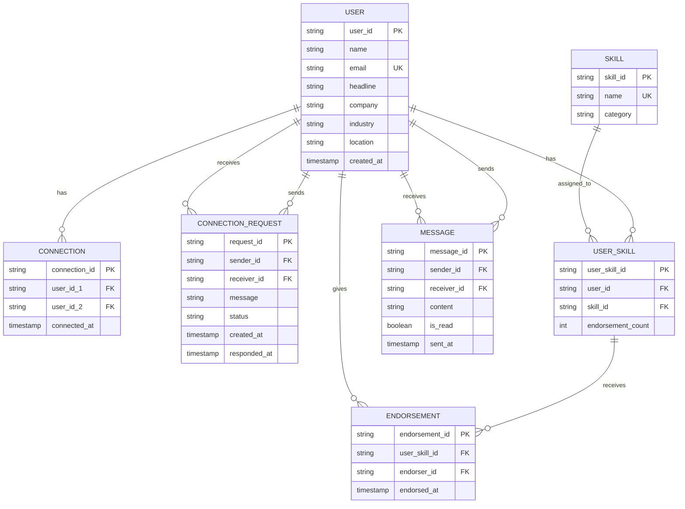

# Design for LinkedIn Connection System

Complete class design with diagrams, relationships, and key decisions.

---

## Mermaid Class Diagram



## Entity-Relationship Diagram



**Schema Notes:**
- `CONNECTION` is symmetric (user_id_1 < user_id_2 constraint)
- `USER_SKILL` caches endorsement count for performance
- `ENDORSEMENT` requires endorser to be 1st-degree connection
- BFS on `CONNECTION` table for degrees of separation

---

## Class Diagram

```
┌─────────────────────────────────────────────────────────────────────────┐
│                          NetworkService                                  │
│                           <<Singleton>>                                  │
├─────────────────────────────────────────────────────────────────────────┤
│ - instance: NetworkService                                               │
│ - users: Map<String, User>                                              │
│ - pendingRequests: Map<String, ConnectionRequest>                        │
│ - recommendationStrategy: RecommendationStrategy                         │
├─────────────────────────────────────────────────────────────────────────┤
│ + getInstance(): NetworkService                                          │
│ + registerUser(user): void                                               │
│ + sendConnectionRequest(senderId, receiverId, msg): ConnectionRequest   │
│ + acceptRequest(requestId): boolean                                      │
│ + rejectRequest(requestId): boolean                                      │
│ + getConnections(userId): Set<User>                                     │
│ + getMutualConnections(userId1, userId2): Set<User>                     │
│ + getConnectionDegree(userId1, userId2): int                            │
│ + getRecommendations(userId, count): List<User>                         │
│ + endorseSkill(endorserId, userId, skillName): boolean                  │
└───────────────────────────────────────┬─────────────────────────────────┘
                                        │ manages
                                        ▼
┌─────────────────────────────────────────────────────────────────────────┐
│                              User                                        │
├─────────────────────────────────────────────────────────────────────────┤
│ - userId: String                                                         │
│ - name: String                                                           │
│ - email: String                                                          │
│ - headline: String                                                       │
│ - company: String                                                        │
│ - connections: Set<User>                                                │
│ - skills: Map<String, Skill>                                            │
│ - sentRequests: List<ConnectionRequest>                                  │
│ - receivedRequests: List<ConnectionRequest>                              │
├─────────────────────────────────────────────────────────────────────────┤
│ + addConnection(user): void                                              │
│ + removeConnection(user): void                                           │
│ + isConnectedTo(user): boolean                                           │
│ + getConnectionCount(): int                                              │
│ + getMutualConnections(user): Set<User>                                 │
│ + addSkill(skillName): Skill                                            │
│ + getSkillEndorsements(skillName): int                                  │
└─────────────────────────────────────────────────────────────────────────┘


┌─────────────────────────────────────────────────────────────────────────┐
│                         ConnectionRequest                                │
├─────────────────────────────────────────────────────────────────────────┤
│ - requestId: String                                                      │
│ - sender: User                                                           │
│ - receiver: User                                                         │
│ - message: String                                                        │
│ - status: RequestStatus                                                  │
│ - createdAt: LocalDateTime                                              │
├─────────────────────────────────────────────────────────────────────────┤
│ + accept(): void                                                         │
│ + reject(): void                                                         │
│ + withdraw(): void                                                       │
│ + isPending(): boolean                                                   │
│ + isExpired(): boolean                                                   │
└─────────────────────────────────────────────────────────────────────────┘


┌───────────────────────────┐     ┌────────────────────────────────────────┐
│          Skill            │     │           Endorsement                  │
├───────────────────────────┤     ├────────────────────────────────────────┤
│ - name: String            │     │ - endorser: User                       │
│ - endorsements: List      │     │ - endorsedAt: LocalDateTime            │
├───────────────────────────┤     ├────────────────────────────────────────┤
│ + addEndorsement(User)    │     │ + getEndorser(): User                  │
│ + getEndorsementCount()   │     │ + getEndorsedAt(): LocalDateTime       │
│ + isEndorsedBy(User)      │     │                                        │
└───────────────────────────┘     └────────────────────────────────────────┘


┌─────────────────────────────────────────────────────────────────────────┐
│               RecommendationStrategy <<interface>>                       │
├─────────────────────────────────────────────────────────────────────────┤
│ + getRecommendations(user: User, allUsers: List<User>, count: int)      │
│   : List<User>                                                          │
└────────────────────────────────┬────────────────────────────────────────┘
                                 │
         ┌───────────────────────┼───────────────────────┐
         ▼                       ▼                       ▼
┌──────────────────┐ ┌─────────────────────┐ ┌──────────────────────┐
│ MutualConnections│ │  SharedSkills       │ │ SameCompany          │
│ Strategy         │ │  Strategy           │ │ Strategy             │
└──────────────────┘ └─────────────────────┘ └──────────────────────┘
```

---

## Enumerations

### RequestStatus
```
RequestStatus {
    PENDING,
    ACCEPTED,
    REJECTED,
    WITHDRAWN,
    EXPIRED
}
```

---

## Core Classes

### User
- **Attributes**:
  - `userId: String` - Unique identifier
  - `name: String` - Display name
  - `email: String` - Email address
  - `headline: String` - Professional headline
  - `company: String` - Current company
  - `connections: Set<User>` - 1st degree connections
  - `skills: Map<String, Skill>` - User's skills
- **Methods**:
  - `addConnection(User): void` - Add 1st degree connection
  - `removeConnection(User): void` - Remove connection
  - `isConnectedTo(User): boolean` - Check if connected
  - `getMutualConnections(User): Set<User>` - Find mutual connections
- **Patterns Used**: None (data class)

### ConnectionRequest
- **Attributes**:
  - `requestId: String` - Unique request ID
  - `sender: User` - Who sent the request
  - `receiver: User` - Who receives the request
  - `message: String` - Optional message
  - `status: RequestStatus` - Current status
  - `createdAt: LocalDateTime` - When created
- **Methods**:
  - `accept(): void` - Accept and create connection
  - `reject(): void` - Reject the request
  - `isExpired(): boolean` - Check if expired (30 days)

### Skill
- **Attributes**:
  - `name: String` - Skill name
  - `endorsements: List<Endorsement>` - Who endorsed
- **Methods**:
  - `addEndorsement(User): void` - Add endorser
  - `getEndorsementCount(): int` - Count endorsements
  - `isEndorsedBy(User): boolean` - Check if endorsed by user

### NetworkService (Facade + Singleton)
- **Attributes**:
  - `instance: NetworkService` - Singleton instance
  - `users: Map<String, User>` - All registered users
  - `pendingRequests: Map<String, ConnectionRequest>` - Active requests
  - `recommendationStrategy: RecommendationStrategy` - Current strategy
- **Methods**:
  - `getInstance()` - Get singleton
  - `sendConnectionRequest(...)` - Create and send request
  - `acceptRequest(...)` - Accept pending request
  - `getConnections(...)` - Get user's connections
  - `getMutualConnections(...)` - Find common connections
  - `getConnectionDegree(...)` - Calculate degrees of separation
  - `getRecommendations(...)` - Get suggested connections
  - `endorseSkill(...)` - Endorse a skill
- **Patterns Used**: Singleton, Facade

### RecommendationStrategy (Interface)
- **Methods**:
  - `getRecommendations(User, List<User>, int): List<User>`
- **Implementations**:
  - `MutualConnectionsStrategy` - Rank by mutual connection count
  - `SharedSkillsStrategy` - Rank by common skills
  - `SameCompanyStrategy` - Prioritize same company
- **Patterns Used**: Strategy

---

## Key Design Decisions

### Decision 1: Bidirectional Connections
**Rationale**:
- LinkedIn model requires mutual agreement
- Both users must see each other in connections
- Simplifies friend lookup

**Implementation**:
- When request accepted, add to both users' connection sets
- When removed, remove from both

---

### Decision 2: Graph Representation with Adjacency List
**Rationale**:
- Each User stores Set<User> connections
- O(1) connection lookup
- O(n) for finding all connections
- Memory efficient for sparse graphs

**Trade-off**:
- Not ideal for global graph queries
- But optimal for user-centric operations

---

### Decision 3: Strategy Pattern for Recommendations
**Rationale**:
- Multiple recommendation algorithms possible
- Easy to A/B test different strategies
- Can combine strategies

**Alternative**:
- Hardcoded algorithm (simpler but inflexible)

---

### Decision 4: BFS for Connection Degree
**Rationale**:
- Find shortest path between users
- Degree = path length
- BFS guarantees shortest path in unweighted graph

**Complexity**:
- O(V + E) where V = users, E = connections
- Optimize with bidirectional BFS for large graphs

---

## Complexity Analysis

### Time Complexity

| Operation | Complexity | Notes |
|-----------|------------|-------|
| Add connection | O(1) | HashSet add |
| Check if connected | O(1) | HashSet contains |
| Get all connections | O(n) | Return set copy |
| Mutual connections | O(min(n,m)) | Set intersection |
| Connection degree (BFS) | O(V+E) | Breadth-first search |
| Recommendations | O(V*C) | V=users, C=connections |

### Space Complexity

| Component | Complexity | Notes |
|-----------|------------|-------|
| Users storage | O(U) | U = total users |
| Connections | O(C) | C = total connections |
| Pending requests | O(R) | R = pending requests |
| BFS visited | O(V) | During degree calculation |

---

## Thread Safety (v3)

### Critical Sections:
1. **Connection modification** - Adding/removing connections
2. **Request state changes** - Accept/reject race conditions
3. **Endorsement updates** - Concurrent endorsements
4. **User registration** - Duplicate user prevention

### Synchronization Strategy:
```java
// ConcurrentHashMap for user storage
private final ConcurrentHashMap<String, User> users = new ConcurrentHashMap<>();

// Lock per user for connection modifications
private final ConcurrentHashMap<String, ReentrantLock> userLocks = new ConcurrentHashMap<>();

// Synchronized request status updates
public synchronized void accept() {
    if (status == RequestStatus.PENDING) {
        status = RequestStatus.ACCEPTED;
        // Create bidirectional connection
    }
}
```

---

## Extension Points

| Feature | Where to Add | Pattern |
|---------|--------------|---------|
| Block user | User class | State pattern |
| Connection notes | ConnectionRequest | Decorator |
| Multiple strategies | NetworkService | Composite strategy |
| Connection strength | Connection class | Attribute |
| Privacy settings | User class | Strategy |
