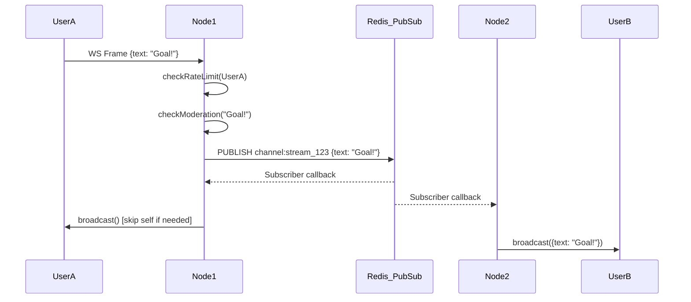

# Code Walkthrough: Live Comments

## Execution Flow Analysis
This walkthrough examines the lifecycle of a comment from ingestion to massive fan-out. The primary engineering goal is to ensure O(1) processing time before handing the payload off to the network stack, avoiding any blocking I/O on the critical path.

1. **WebSocket Ingestion and Authentication:**
   The `WebSocketHandler` receives a JSON frame. The very first step is extremely fast authentication using a pre-validated JWT token stored in the connection context established during the protocol upgrade. No database lookups occur here.
2. **Moderation and Rate Limiting:**
   The payload is passed to the `Moderator` module. We strictly avoid regex matching on this critical path as it can lead to ReDoS (Regular Expression Denial of Service). Instead, we use a fast Trie-based string matching algorithm against a dictionary of banned words. Simultaneously, a token bucket algorithm in Redis checks if the user has exceeded their post rate (e.g., 1 comment per 5 seconds).
3. **Publishing to Broker:**
   Upon validation, the `ConnectionManager` constructs a `BroadcastMessage` struct. It executes a `redis.publish("channel:stream_" + streamId, messageJSON)` command. 
4. **Local Fan-out:**
   Every `ConnectionManager` node runs a dedicated background thread listening to Redis subscriptions. When the Redis client triggers the `onMessage(channel, message)` callback, the node parses the channel to extract the `streamId`. It then accesses its local `ConcurrentHashMap` to find the list of active WebSocket sessions for that specific stream.
5. **Network Dispatch:**
   The node iterates through the local sessions and calls the non-blocking `session.sendText(message)` method, pushing the bytes to the OS socket buffer.

### Sequence Diagram


## Optimizations and Memory Management
A significant challenge in the `ConnectionManager` is managing the `ConcurrentHashMap<String, List<Session>>`.
- **Memory Leaks from Stale Connections:** If a mobile user ungracefully disconnects (e.g., driving into a tunnel), the TCP connection might hang in a half-open state. If we don't aggressively prune the `List<Session>`, the server will eventually run out of memory. We implement a Ping/Pong heartbeat mechanism at the WebSocket protocol layer. If a client fails to respond to a Ping within 30 seconds, the server forcefully closes the socket and removes the session from the map.
- **Micro-Batching:** During extreme load (e.g., a game-winning goal), publishing 10,000 individual messages per second to Redis is inefficient. The code implements a micro-batching mechanism. Messages are collected in a buffer for 50-100 milliseconds and then published to Redis as a single compressed array payload, drastically reducing CPU context switches and network I/O overhead across the entire cluster.

## Contract Implementations and Progression

### Bounded Replay Ring and Gap Detection
To handle short network drops or late joiners without querying the persistent database, a bounded in-memory structure is used. The `CircularRingBufferReplayStore` is implemented as an array-backed ring buffer. A bounded replay ring emits a documented sequence gap on overflow; subscriber disconnect cannot block unrelated subscribers indefinitely. 

When a client reconnects and provides a cursor (sequence ID), the system checks if the cursor falls behind the oldest available sequence in the buffer. If it does, a gap marker is emitted. The implementation relies strictly on native Java 11+ (SE) and Python 3.8+ standard libraries, avoiding external frameworks.

**Java Implementation Snippet:**
```java
// Inside CircularRingBufferReplayStore.RingBuffer
public synchronized List<String> replay(String cursorStr, int limit) {
    long cursor = 0;
    boolean hasCursor = cursorStr != null && !cursorStr.isEmpty();
    if (hasCursor) {
        try { cursor = Long.parseLong(cursorStr); } catch (NumberFormatException e) {}
    }
    
    long maxSeq = sequenceGenerator.get();
    long oldestAvailable = Math.max(1, maxSeq - capacity + 1);
    
    List<String> result = new ArrayList<>();
    
    // A bounded replay ring emits a documented sequence gap on overflow
    boolean isGap = hasCursor && cursor < oldestAvailable - 1;
    if (isGap) {
        result.add("[GAP] Sequence gap detected on overflow");
        cursor = oldestAvailable - 1;
    }
    
    long startSeq;
    if (hasCursor) {
        startSeq = Math.max(cursor + 1, oldestAvailable);
    } else {
        startSeq = Math.max(oldestAvailable, maxSeq - limit + 1);
    }
    
    long endSeq = maxSeq;
    
    for (long seq = startSeq; seq <= endSeq; seq++) {
        int index = (int) (seq % capacity);
        String comment = buffer[index];
        if (comment != null) {
            result.add(comment);
        }
    }
    
    if (hasCursor && result.size() > limit) {
        return result.subList(0, limit);
    }
    return result;
}
```

**Python Implementation Snippet:**
```python
# Inside circular_ring_buffer.RingBuffer
def replay(self, cursor_str: str, limit: int) -> List[str]:
    with self.lock:
        cursor = 0
        has_cursor = bool(cursor_str)
        if has_cursor:
            try:
                cursor = int(cursor_str)
            except ValueError:
                pass

        max_seq = self.sequence
        oldest_available = max(1, max_seq - self.capacity + 1)
        
        result = []
        
        # A bounded replay ring emits a documented sequence gap on overflow
        is_gap = has_cursor and cursor < oldest_available - 1
        if is_gap:
            result.append("[GAP] Sequence gap detected on overflow")
            cursor = oldest_available - 1
            
        if has_cursor:
            start_seq = max(cursor + 1, oldest_available)
        else:
            start_seq = max(oldest_available, max_seq - limit + 1)
            
        end_seq = max_seq
        
        for seq in range(start_seq, end_seq + 1):
            index = seq % self.capacity
            comment = self.buffer[index]
            if comment is not None:
                result.append(comment)
                
        if has_cursor and len(result) > limit:
            return result[:limit]
        return result
```

### Fake Transport Testing
The business logic handles complex scenarios such as duplicate message drops, moderation filtering, and gap emission entirely separate from the web layer. We test these paths thoroughly using dummy classes that simulate external infrastructure. Duplicates, reconnect cursor, moderation rejection and cancellation are tested through fake transports, not live WebSocket services.

**Python Fake Transport Test Snippet:**
```python
class FakeFanout:
    def __init__(self):
        self.broadcast_count = 0
    def broadcast(self, stream_id: str, comment_payload: str, region: str) -> None:
        self.broadcast_count += 1
        
class FakeRegistry:
    def __init__(self):
        self.sessions = set()
    def register_session(self, stream_id: str, session_id: str, user_id: str, region: str) -> None:
        self.sessions.add(session_id)
    def unregister_session(self, stream_id: str, session_id: str, region: str) -> None:
        self.sessions.discard(session_id)
    def is_registered(self, session_id: str) -> bool:
        return session_id in self.sessions

class TestV3LiveComments(unittest.TestCase):
    def test_v3_publish_and_moderation(self):
        # Idempotency duplicate
        self.service.publish_comment("s1", "Good message", "idem1", "us-east")
        res = self.service.publish_comment("s1", "Good message", "idem1", "us-east")
        self.assertFalse(res) # Duplicate rejected via fake transport

        # Moderation blocked
        res = self.service.publish_comment("s1", "This is bad", "idem2", "us-east")
        self.assertFalse(res)

    def test_gap_on_overflow_and_cursor(self):
        for i in range(12):
            self.service.publish_comment("stream1", f"msg{i}", f"idem{i}", "us-east")
            
        gap_replay = self.store.replay_with_cursor("stream1", "1", 50)
        self.assertTrue("GAP" in gap_replay[0], "Expected documented sequence gap on overflow")
        
    def test_session_cancellation(self):
        self.service.join_stream("stream1", "sess1", "user1", "us-east")
        self.assertTrue(self.service.session_registry.is_registered("sess1"))
        
        self.service.leave_stream("stream1", "sess1", "us-east")
        self.assertFalse(self.service.session_registry.is_registered("sess1"))
```
This strategy ensures fast, deterministic testing of all core contracts without needing a live WebSocket server or Redis instance.
