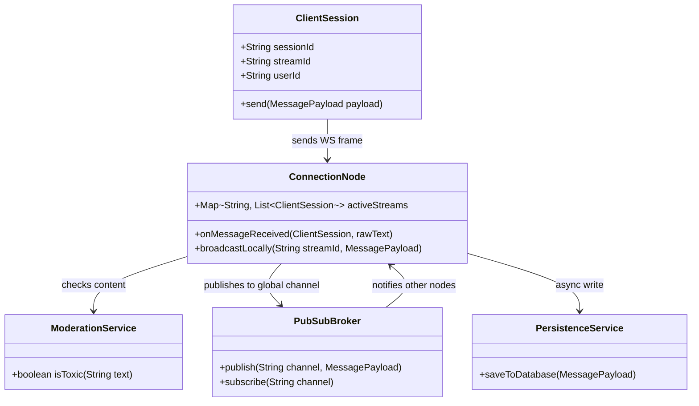

# Design Document: Live Comments

## System Architecture
The architecture is designed to decouple the ephemeral, high-velocity real-time broadcast layer from the durable, historical persistence layer.

### Core Components
1. **Load Balancer (HAProxy/Envoy):** Manages SSL termination and routes the initial HTTP upgrade requests to establish WebSocket connections across the Connection Manager fleet.
2. **Connection Manager Fleet (Node.js/Go):** Stateless servers (from a business logic perspective) that manage the persistent WebSocket TCP connections. They handle authentication, rate limiting, and local fan-out to clients.
3. **Pub/Sub Broker (Redis):** The central nervous system for real-time message distribution across the Connection Manager fleet. Redis is chosen for its extremely low latency and high throughput in Pub/Sub workloads.
4. **Persistence Service (Async):** A background service that consumes messages from a dedicated queue to write comments to long-term storage without blocking the real-time broadcast.
5. **Database (Cassandra/DynamoDB):** A wide-column NoSQL database optimized for heavy write workloads, used to store the historical comment log for replay purposes.

### Mermaid Class Diagram


## Data Model and Schema
The database schema prioritizes extremely fast insertions and chronological retrieval for users joining a stream late.
Using Cassandra, the primary table `Comments_By_Stream` is structured as:
- `stream_id` (Partition Key): Ensures all comments for a specific live stream reside on the same physical node for fast retrieval.
- `timestamp_id` (Clustering Key, TimeUUID): Automatically sorts the comments chronologically on disk.
- `user_id` (String): The author's identifier.
- `payload` (Text): The actual comment text.

## Trade-offs and Considerations
- **Persistence Asynchronicity vs. Consistency:** We explicitly prioritize the low-latency broadcast over the strong consistency of storage. When a message is received, it is published to Redis immediately, while a secondary asynchronous task handles writing to Cassandra. If the database write fails, the comment may appear briefly on active screens but will vanish if a user refreshes the page. This is an acceptable trade-off for ephemeral live chat.
- **Message Delivery Guarantees:** We implement "At-Most-Once" delivery over the WebSockets. If a client experiences a brief network drop, they will miss messages broadcast during that window. Implementing "Exactly-Once" with sequence IDs and client-side acknowledgments would introduce massive overhead and completely cripple the throughput of a million-user broadcast. Clients resolve this by fetching the last N messages from the API upon reconnection.

## Domain Contracts

The live comments system relies on strict domain contracts to ensure robust behavior across the real-time broadcast and replay functionalities:

1.  **Replay Ring Overflow and Gaps:** A bounded replay ring emits a documented sequence gap on overflow; subscriber disconnect cannot block unrelated subscribers indefinitely. A bounded replay ring is utilized to store recent comments for quick fetching by late-joining or reconnecting users. When this ring buffer overflows (exceeds its capacity), older messages are overwritten. If a client attempts to fetch messages starting from a cursor that points to an overwritten (evicted) message, the system **must** emit a documented sequence gap marker in the replay list to inform the client of missed messages.

    **Java API Contract:**
    ```java
    public interface CommentReplayStore {
        // Must emit "[GAP] Sequence gap detected on overflow" as the first element
        // if the cursor points to a message that has been evicted due to bounded capacity.
        List<String> replay(String streamId, String cursor, int limit);
    }
    ```

    **Python API Contract:**
    ```python
    class CommentReplayStore:
        def replay(self, stream_id: str, cursor: str, limit: int) -> List[str]:
            """
            Returns a list of recent comments.
            Must inject "[GAP] Sequence gap detected on overflow" at index 0
            if the provided cursor is older than the oldest available message in the bounded buffer.
            """
            pass
    ```

2.  **Subscriber Isolation:** The fan-out mechanism delivering messages to active connections must be strictly non-blocking. A slow, disconnected, or malformed subscriber connection cannot block the broadcast thread, ensuring that unrelated subscribers continue to receive messages without delay.

    **Java Subscriber Disconnect Testing Example:**
    ```java
    @Test
    void testSubscriberDisconnect() {
        WebSocketSessionPubSub pubSub = new WebSocketSessionPubSub();
        pubSub.register("stream1", "sess1", "user1");
        pubSub.register("stream1", "sess2", "user2");
        
        pubSub.addConnection("sess1", payload -> { throw new RuntimeException("Disconnect"); });
        
        boolean[] sess2Received = {false};
        pubSub.addConnection("sess2", payload -> { sess2Received[0] = true; });
        
        pubSub.fanout("stream1", "hello", 1000L);
        Assertions.assertTrue(sess2Received[0], "Disconnect should not block unrelated subscribers");
    }
    ```
    
    **Python Subscriber Disconnect Testing Example:**
    ```python
    def test_subscriber_disconnect(self):
        pubsub = v2_pubsub.WebSocketSessionPubSub()
        pubsub.register("stream1", "sess1", "user1")
        pubsub.register("stream1", "sess2", "user2")
        
        class BrokenConnection:
            def send(self, payload: str) -> None:
                raise Exception("Disconnect")
                
        class GoodConnection:
            def __init__(self):
                self.received = False
            def send(self, payload: str) -> None:
                self.received = True
                
        good_conn = GoodConnection()
        pubsub.add_connection("sess1", BrokenConnection())
        pubsub.add_connection("sess2", good_conn)
        
        pubsub.fanout("stream1", "hello", 1000)
        self.assertTrue(good_conn.received)
    ```

3.  **Transport-Agnostic Core Logic:** Core domain logic such as duplicate detection (idempotency), reconnect cursor gap handling, moderation rejections, and cancellation must be completely decoupled from the live WebSocket transport layer. Duplicates, reconnect cursor, moderation rejection and cancellation are tested through fake transports, not live WebSocket services. These behaviors are verified via fake transports and dummy dependencies in test suites, guaranteeing the business logic is sound independent of the underlying network framework. Each assigned document describes actual supported versions: Java 11+ and Python 3.8+ using only standard libraries.

    **Java Fake Transport Testing Example:**
    ```java
    @Test
    void testModerationRejection() {
        Set<String> blocked = new HashSet<>();
        blocked.add("bad");
        BasicModerationPipeline moderation = new BasicModerationPipeline(blocked);
        FakeTransport fakeTransport = new FakeTransport();
        CircularRingBufferReplayStore buffer = new CircularRingBufferReplayStore(10);
        CommentIngressServiceV2 service = new CommentIngressServiceV2(fakeTransport, fakeTransport, buffer, moderation);

        service.publishComment("s1", "u1", "good message", 100);
        service.publishComment("s1", "u1", "bad message", 101);

        Assertions.assertEquals(1, fakeTransport.broadcasted.size());
        Assertions.assertEquals("good message", fakeTransport.broadcasted.get(0));
    }
    ```
    
    **Python Fake Transport Testing Example:**
    ```python
    def test_leave_stream(self):
        self.service.join_stream("s1", "session_1", "u1")
        self.assertIn("session_1", self.pubsub.registered, "Should register through fake transport")
        
        self.service.leave_stream("s1", "session_1")
        self.assertNotIn("session_1", self.pubsub.registered, "Should cancel through fake transport")
    ```
