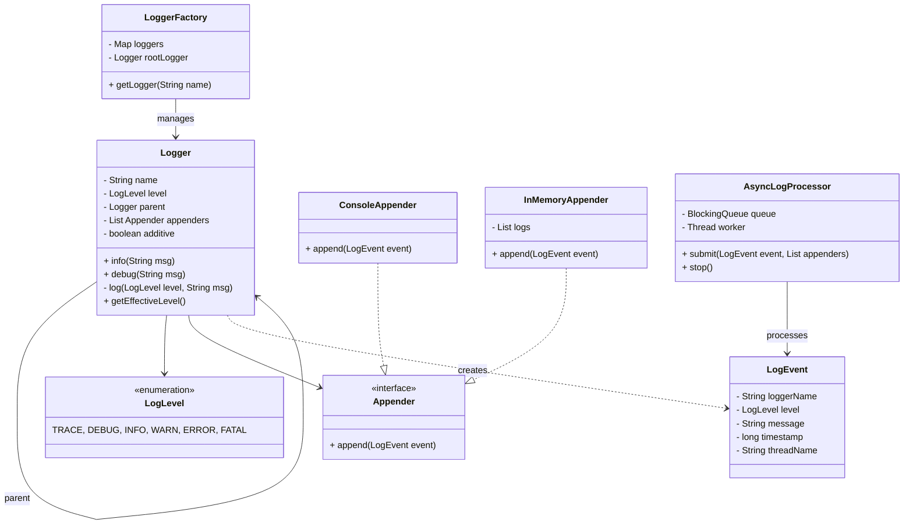
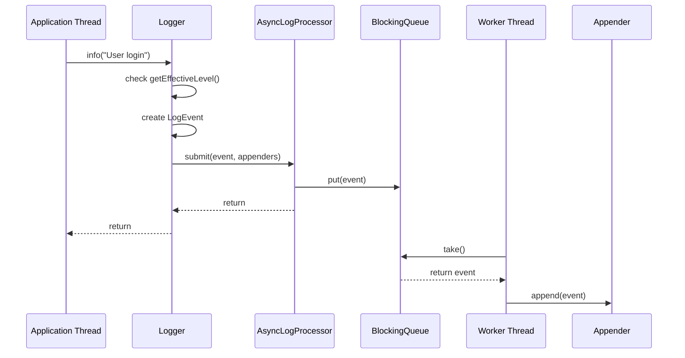

# Logging Framework - Design

## System Architecture
The application retrieves a `Logger` from the `LoggerFactory`. When a logging method (e.g., `info()`) is called, the logger checks if the event's level is enabled. If it is, a `LogEvent` is created and either sent directly to the `Appender`s (synchronous) or added to an `AsyncLogProcessor` queue (asynchronous).

## Class Diagram

## Sequence Diagram: Async Logging Pipeline

## Design Patterns Used
- **Chain of Responsibility:** Hierarchy tree for level inheritance and appender additivity.
- **Factory:** `LoggerFactory` to create and manage logger singletons per name.
- **Strategy:** `Appender` interface allows plugging in different logging destinations.
- **Producer-Consumer:** Used in `AsyncLogProcessor`.

## Cross-links
- [Problem Statement](PROBLEM.md)
- [Approach](APPROACH.md)
