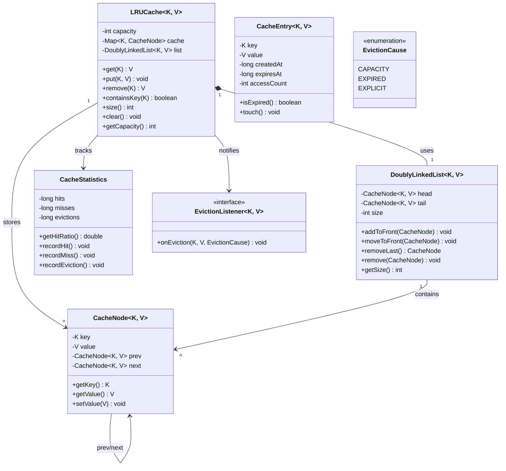
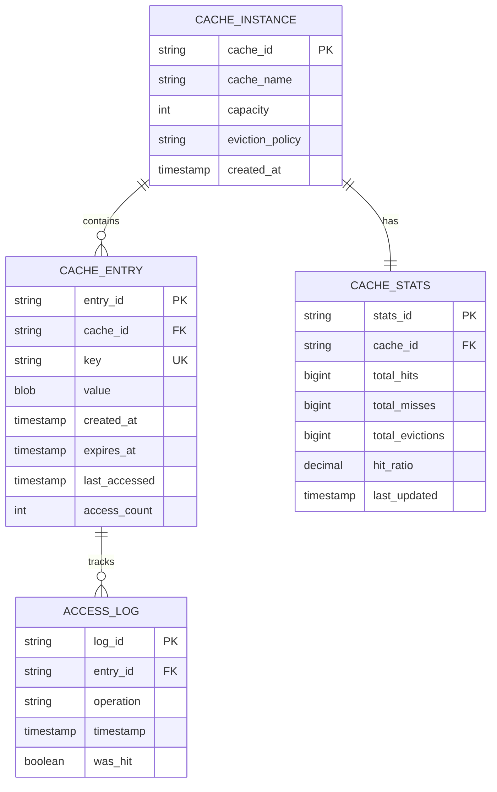

# Design for LRU Cache

Complete class design with diagrams, relationships, and key decisions.

---

## Mermaid Class Diagram



## Entity-Relationship Diagram



**Schema Notes:**
- `CACHE_ENTRY` stores key-value pairs with TTL support
- `CACHE_STATS` tracks performance metrics
- `ACCESS_LOG` for debugging/analytics (optional)
- For in-memory caches, DB is typically only for persistence/recovery

---

## Class Diagram

```
┌─────────────────────────────────────────────────────────────────────┐
│                         LRUCache<K, V>                              │
├─────────────────────────────────────────────────────────────────────┤
│ - capacity: int                                                     │
│ - cache: Map<K, CacheNode<K, V>>                                    │
│ - list: DoublyLinkedList<K, V>                                      │
├─────────────────────────────────────────────────────────────────────┤
│ + get(key: K): V                                                    │
│ + put(key: K, value: V): void                                       │
│ + remove(key: K): V                                                 │
│ + containsKey(key: K): boolean                                      │
│ + size(): int                                                       │
│ + clear(): void                                                     │
│ + getCapacity(): int                                                │
└───────────────────────────────┬─────────────────────────────────────┘
                                │
          ┌─────────────────────┴─────────────────────┐
          │                                           │
          ▼                                           ▼
┌─────────────────────────┐               ┌─────────────────────────┐
│   Map<K, CacheNode>     │               │   DoublyLinkedList      │
│       (HashMap)         │               │                         │
├─────────────────────────┤               ├─────────────────────────┤
│ O(1) key → node lookup  │               │ - head: CacheNode       │
└─────────────────────────┘               │ - tail: CacheNode       │
                                          │ - size: int             │
                                          ├─────────────────────────┤
                                          │ + addToFront(node)      │
                                          │ + moveToFront(node)     │
                                          │ + removeLast(): node    │
                                          │ + remove(node)          │
                                          └───────────┬─────────────┘
                                                      │
                                                      │ contains
                                                      ▼
                                          ┌─────────────────────────┐
                                          │   CacheNode<K, V>       │
                                          ├─────────────────────────┤
                                          │ - key: K                │
                                          │ - value: V              │
                                          │ - prev: CacheNode       │
                                          │ - next: CacheNode       │
                                          ├─────────────────────────┤
                                          │ + getKey(): K           │
                                          │ + getValue(): V         │
                                          │ + setValue(V)           │
                                          └─────────────────────────┘

Extended Version (v2):
┌─────────────────────────────────────────────────────────────────────┐
│                     CacheEntry<K, V>                                │
├─────────────────────────────────────────────────────────────────────┤
│ - key: K                                                            │
│ - value: V                                                          │
│ - createdAt: long                                                   │
│ - expiresAt: long                                                   │
│ - accessCount: int                                                  │
├─────────────────────────────────────────────────────────────────────┤
│ + isExpired(): boolean                                              │
│ + touch(): void                                                     │
└─────────────────────────────────────────────────────────────────────┘

┌─────────────────────────┐        ┌─────────────────────────────────┐
│   CacheStatistics       │        │   EvictionListener<K, V>        │
├─────────────────────────┤        │        <<interface>>            │
│ - hits: long            │        ├─────────────────────────────────┤
│ - misses: long          │        │ + onEviction(key, value, cause) │
│ - evictions: long       │        └─────────────────────────────────┘
├─────────────────────────┤
│ + getHitRatio(): double │
│ + recordHit()           │
│ + recordMiss()          │
└─────────────────────────┘
```

---

## Algorithm Details

### Get Operation
```
get(key):
    1. Check if key exists in HashMap
    2. If not found: return null (cache miss)
    3. If found:
       a. Get node from HashMap
       b. Move node to front of linked list (most recently used)
       c. Return node's value (cache hit)
    
    Time: O(1) - HashMap lookup + list node move
```

### Put Operation
```
put(key, value):
    1. Check if key exists in HashMap
    2. If exists (update):
       a. Get existing node
       b. Update node's value
       c. Move node to front of list
    3. If not exists (insert):
       a. Create new node
       b. Add to HashMap
       c. Add to front of list
       d. If size > capacity:
          - Remove last node from list (LRU)
          - Remove from HashMap
    
    Time: O(1) - HashMap operations + list operations
```

### Eviction
```
evict():
    1. Remove last node from linked list (tail.prev)
    2. Remove corresponding entry from HashMap
    3. Return evicted node (for callbacks)
    
    Time: O(1) - Direct tail access
```

---

## Core Classes

### LRUCache<K, V>
- **Attributes**:
  - `capacity: int` - Maximum number of entries
  - `cache: HashMap<K, CacheNode<K, V>>` - O(1) key lookup
  - `list: DoublyLinkedList<K, V>` - Access order tracking
- **Methods**:
  - `get(K): V` - Retrieve and mark as recently used
  - `put(K, V): void` - Insert or update entry
  - `remove(K): V` - Explicitly remove entry
  - `containsKey(K): boolean` - Check existence (doesn't update order)
  - `size(): int` - Current number of entries
  - `clear(): void` - Remove all entries

### CacheNode<K, V>
- **Attributes**:
  - `key: K` - Entry key (needed for HashMap removal on eviction)
  - `value: V` - Cached value
  - `prev: CacheNode<K, V>` - Previous node in list
  - `next: CacheNode<K, V>` - Next node in list
- **Methods**:
  - Getters and setters for all fields

### DoublyLinkedList<K, V>
- **Attributes**:
  - `head: CacheNode<K, V>` - Dummy head sentinel
  - `tail: CacheNode<K, V>` - Dummy tail sentinel
  - `size: int` - Number of real nodes
- **Methods**:
  - `addToFront(CacheNode): void` - Add after head
  - `moveToFront(CacheNode): void` - Remove and add to front
  - `removeLast(): CacheNode` - Remove before tail
  - `remove(CacheNode): void` - Remove specific node

### CacheStatistics (v2)
- **Attributes**:
  - `hits: long` - Successful gets
  - `misses: long` - Failed gets
  - `evictions: long` - Entries evicted
- **Methods**:
  - `getHitRatio(): double` - hits / (hits + misses)
  - `recordHit(): void`
  - `recordMiss(): void`
  - `recordEviction(): void`

---

## Key Design Decisions

### Decision 1: Store Key in Node
**Rationale**: 
- When evicting from tail, need key to remove from HashMap
- Without key in node, would need reverse lookup (slow)

**Trade-off**:
- Slight memory overhead per entry
- But enables O(1) eviction

---

### Decision 2: Sentinel Nodes (Dummy Head/Tail)
**Rationale**:
- Eliminates null checks at boundaries
- head.next is always first real element
- tail.prev is always last real element
- All insertions/removals use same logic

**Trade-off**:
- Two extra node allocations
- Simplifies code significantly

**Example**:
```
Without sentinels:
if (head == null) { head = newNode; tail = newNode; }
else { newNode.next = head; head.prev = newNode; head = newNode; }

With sentinels:
node.prev = head;
node.next = head.next;
head.next.prev = node;
head.next = node;
```

---

### Decision 3: Separate List Class
**Rationale**:
- Clean separation of concerns
- Linked list operations are reusable
- Easier to test and maintain

**Alternative**:
- Inline list operations in cache class
- Fewer classes but messier code

---

### Decision 4: ReadWriteLock for Thread Safety (v3)
**Rationale**:
- Multiple threads can read concurrently
- Only one thread can write at a time
- get() is read operation (mostly)
- put() is write operation

**Trade-off**:
- More complex than single lock
- Better performance for read-heavy workloads

**Note**: get() actually modifies list order, so needs write lock too.

---

## Complexity Analysis

### Time Complexity

| Operation | Time | Why |
|-----------|------|-----|
| get(key) | O(1) | HashMap lookup + list move |
| put(key, value) | O(1) | HashMap insert + list add |
| remove(key) | O(1) | HashMap remove + list remove |
| containsKey(key) | O(1) | HashMap contains |
| size() | O(1) | Stored counter |
| clear() | O(1) | Reset structures |

### Space Complexity

| Component | Space | Notes |
|-----------|-------|-------|
| HashMap | O(n) | n entries |
| Linked List | O(n) | n nodes + 2 sentinels |
| Per Entry | O(1) | key, value, 2 pointers |
| **Total** | O(n) | n = capacity |

---

## Thread Safety (v3)

### Approach: ReadWriteLock

```java
private final ReadWriteLock lock = new ReentrantReadWriteLock();
private final Lock readLock = lock.readLock();
private final Lock writeLock = lock.writeLock();

public V get(K key) {
    writeLock.lock();  // Note: write lock because we modify order
    try {
        // get implementation
    } finally {
        writeLock.unlock();
    }
}

public void put(K key, V value) {
    writeLock.lock();
    try {
        // put implementation
    } finally {
        writeLock.unlock();
    }
}

public boolean containsKey(K key) {
    readLock.lock();  // True read operation
    try {
        return cache.containsKey(key);
    } finally {
        readLock.unlock();
    }
}
```

### Alternative: Fine-Grained Locking
- Lock individual buckets instead of entire cache
- More complex but better concurrency
- Used by ConcurrentHashMap internally

---

## Extension Points

| Feature | Where to Add | Pattern |
|---------|--------------|---------|
| LFU Cache | EvictionPolicy interface | Strategy |
| Eviction callbacks | EvictionListener | Observer |
| TTL per entry | CacheEntry with expiration | - |
| Cache loading | CacheLoader interface | Strategy |
| Write-through | CacheWriter interface | Strategy |
| Size-based limits | WeightFunction | Strategy |

---

## LFU vs LRU Comparison

| Aspect | LRU | LFU |
|--------|-----|-----|
| Tracks | Last access time | Access frequency |
| Evicts | Oldest accessed | Least frequently used |
| Data Structure | HashMap + DLL | HashMap + Frequency buckets |
| Complexity | O(1) | O(1) (with optimization) |
| Use Case | Recent = important | Frequent = important |
| Problem | One-hit wonders stay | Old frequent items never evicted |
