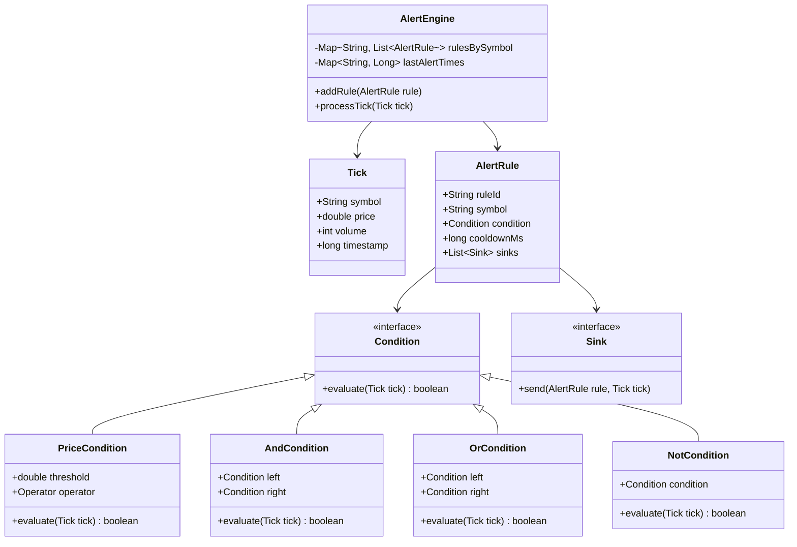

# Market Alert Engine - Design

## Architecture

The system consists of three primary components:
1.  **Tick Ingestion**: Handles incoming data and routes it to the evaluation engine.
2.  **Rule Engine**: Stores registered rules, evaluates conditions (Composite pattern), and manages cooldowns.
3.  **Notification Sinks**: Dispatches alerts to configured channels (Observer pattern).

## Class Diagram

## Cross-links
- [Problem Statement](./PROBLEM.md)
- [Approach](./APPROACH.md)
- [Rubric](./RUBRIC.md)
- [Pitfalls](./PITFALLS.md)
- [Follow-ups](./FOLLOW-UPS.md)
