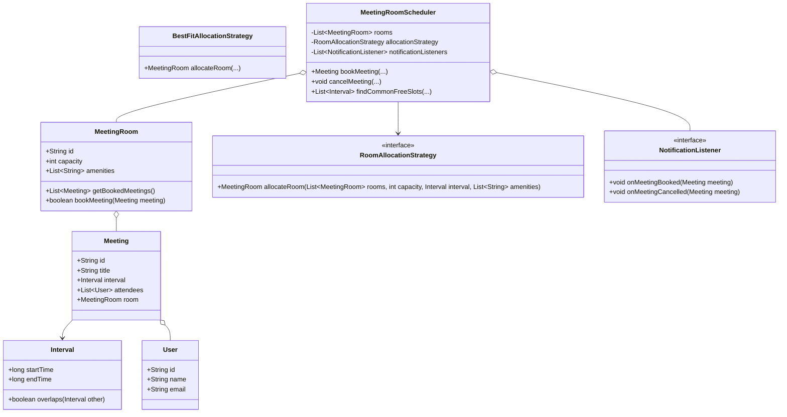
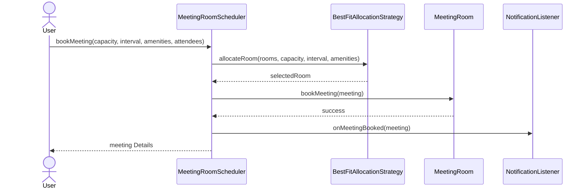

# Meeting Room Scheduler - Design

## System Architecture
The system consists of a `MeetingRoomScheduler` that orchestrates bookings, users, and rooms. It delegates room selection to an injected `RoomAllocationStrategy`. `Meeting`s trigger events that notify `NotificationListener`s.

## Class Diagram

## Sequence Diagram

