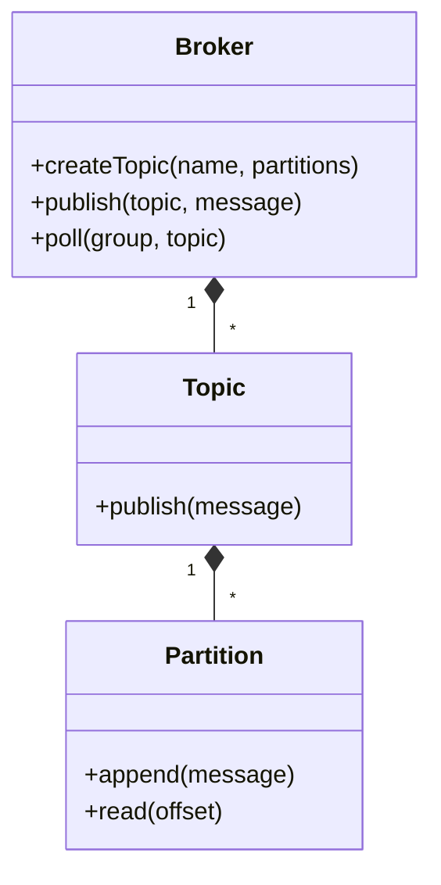
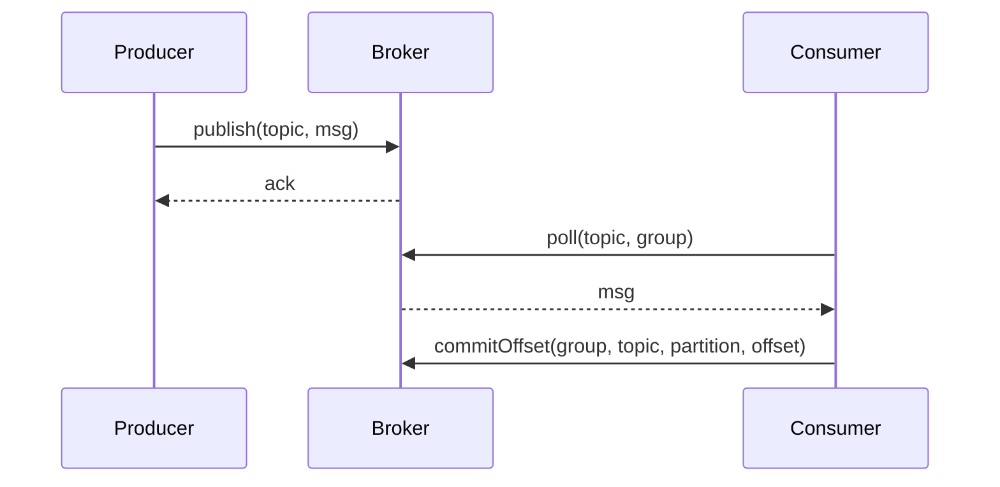

# In-Memory Message Queue - Design

## Architecture
- **MessageQueueBroker**: Central hub managing topics and consumer groups.
- **Topic**: Contains multiple partitions.
- **Partition**: Manages an ordered list of messages and handles concurrent appends.
- **Producer**: Sends messages to the broker.
- **ConsumerGroup**: Manages offsets for a group of consumers and coordinates partition reads.
- **Consumer**: Polls messages from the broker for its group.
- **SubscriberDAG**: Manages dependencies between consumer groups for a given topic.

## Class Diagram (Mermaid)

## Sequence Diagram

## Cross-links
- [PROBLEM.md](./PROBLEM.md)
- [APPROACH.md](./APPROACH.md)
