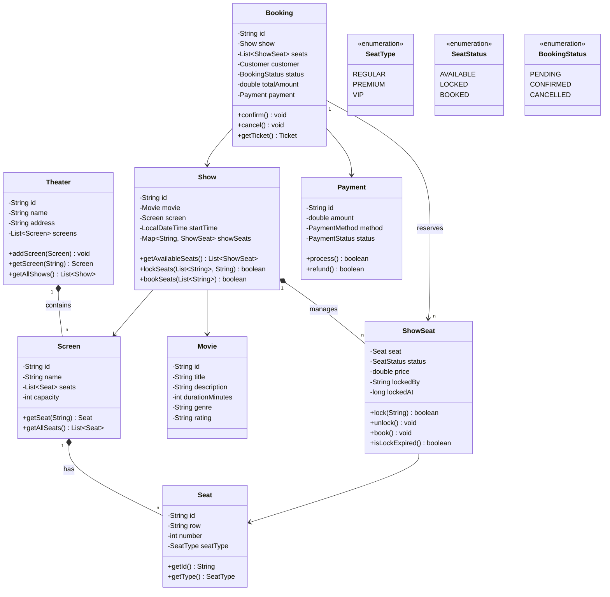
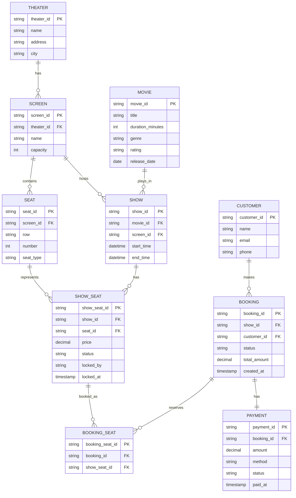

# Design for Movie Ticket Booking System

Complete class design with diagrams and key decisions.

---

## Mermaid Class Diagram



## Entity-Relationship Diagram



**Schema Notes:**
- `SHOW_SEAT` tracks seat availability per show with locking mechanism
- `locked_at` enables automatic lock expiry (10 min timeout)
- `BOOKING_SEAT` junction table for many-to-many booking relationship
- Concurrency handled via optimistic locking on `SHOW_SEAT`

---

## Class Diagram

```
┌─────────────────────┐     ┌─────────────────────┐
│       Movie         │     │      Theater        │
├─────────────────────┤     ├─────────────────────┤
│ - id: String        │     │ - id: String        │
│ - title: String     │     │ - name: String      │
│ - duration: int     │     │ - address: String   │
│ - genre: Genre      │     │ - screens: List     │
└─────────────────────┘     └──────────┬──────────┘
                                       │ contains
                                       ▼
┌─────────────────────┐     ┌─────────────────────┐
│        Show         │────>│       Screen        │
├─────────────────────┤     ├─────────────────────┤
│ - id: String        │     │ - id: String        │
│ - movie: Movie      │     │ - name: String      │
│ - screen: Screen    │     │ - seats: List<Seat> │
│ - startTime: Date   │     │ - capacity: int     │
│ - showSeats: Map    │     └─────────────────────┘
└─────────────────────┘              │ has
         │ has                       ▼
         ▼               ┌─────────────────────┐
┌─────────────────────┐  │        Seat         │
│      ShowSeat       │  ├─────────────────────┤
├─────────────────────┤  │ - id: String        │
│ - seat: Seat        │  │ - row: String       │
│ - status: SeatStatus│  │ - number: int       │
│ - price: double     │  │ - type: SeatType    │
│ - lockedBy: String  │  └─────────────────────┘
│ - lockedAt: long    │
└─────────────────────┘
         │
         │ booked in
         ▼
┌─────────────────────┐     ┌─────────────────────┐
│      Booking        │────>│      Payment        │
├─────────────────────┤     ├─────────────────────┤
│ - id: String        │     │ - id: String        │
│ - show: Show        │     │ - amount: double    │
│ - seats: List       │     │ - method: PayMethod │
│ - status: Status    │     │ - status: PayStatus │
│ - totalAmount: dbl  │     └─────────────────────┘
└─────────────────────┘

┌─────────────────────────────────────┐
│         SeatStatus <<enum>>          │
├─────────────────────────────────────┤
│ AVAILABLE, LOCKED, BOOKED           │
└─────────────────────────────────────┘

┌─────────────────────────────────────┐
│          SeatType <<enum>>           │
├─────────────────────────────────────┤
│ REGULAR, PREMIUM, VIP               │
└─────────────────────────────────────┘
```

---

## Core Classes

### Movie
- **Attributes**: `id`, `title`, `description`, `duration`, `genre`, `rating`

### Theater
- **Attributes**: `id`, `name`, `address`, `screens`
- **Methods**: `addScreen()`, `getScreen()`, `getAllShows()`

### Screen
- **Attributes**: `id`, `name`, `seats`, `capacity`
- **Methods**: `getSeat()`, `getAllSeats()`

### Seat
- **Attributes**: `id`, `row`, `number`, `seatType`
- **Patterns Used**: Factory for different types

### Show
- **Attributes**: `id`, `movie`, `screen`, `startTime`, `showSeats`
- **Methods**: `getAvailableSeats()`, `lockSeats()`, `bookSeats()`

### ShowSeat
- **Attributes**: `seat`, `status`, `price`, `lockedBy`, `lockedAt`
- **Methods**: `lock()`, `unlock()`, `book()`, `isLockExpired()`

### Booking
- **Attributes**: `id`, `show`, `seats`, `user`, `status`, `totalAmount`, `payment`
- **Methods**: `confirm()`, `cancel()`, `getTicket()`

---

## Key Design Decisions

### Decision 1: ShowSeat vs Seat
**Rationale**: 
- Seat represents physical seat (row, number, type)
- ShowSeat represents seat status for specific show
- Allows same physical seat in different shows

### Decision 2: Optimistic Locking for Seats
**Rationale**:
- Better performance than pessimistic locking
- Works well for read-heavy workloads
- Handles race conditions gracefully

### Decision 3: Seat Lock with Timeout
**Rationale**:
- Prevents indefinite seat holds
- Allows retry if payment fails
- Configurable timeout (10 min default)

---

## Thread Safety (v3)

### Critical Sections:
1. **Seat locking** - CAS operation
2. **Seat booking** - Atomic status update
3. **Lock expiry** - Scheduled cleanup

### Synchronization:
```java
// ConcurrentHashMap for show seats
private final ConcurrentHashMap<String, ShowSeat> showSeats;

// Atomic seat status update
public boolean lockSeat(String seatId, String userId) {
    return showSeats.computeIfPresent(seatId, (k, seat) -> {
        if (seat.isAvailable() || seat.isLockExpired()) {
            seat.lock(userId);
            return seat;
        }
        return seat;
    }) != null;
}
```

---

## Complexity Analysis

| Operation | Complexity |
|-----------|------------|
| Find available seats | O(n) where n = seats in show |
| Lock seat | O(1) with HashMap |
| Book seats | O(k) where k = selected seats |
| Check lock expiry | O(1) |
