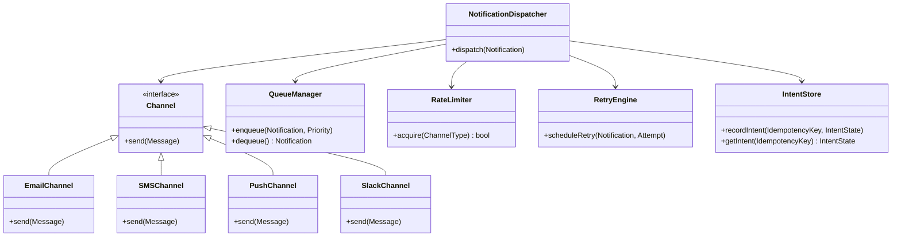
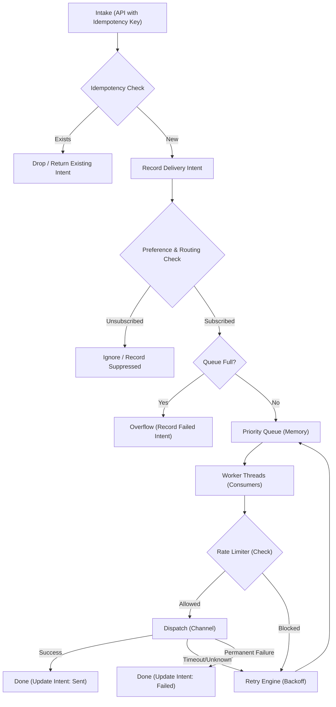

# Design

The Notification Dispatcher consists of several core components coordinating to ensure messages are delivered efficiently and reliably.

## Class Diagram

## Flow Diagram

## Flow
1. **Intake:** The dispatcher receives a notification request with an idempotency key.
2. **Idempotency Check:** Checks `IntentStore` to ensure at most one delivery intent is recorded. Duplicates are dropped.
3. **Routing & Preferences:** Evaluates recipient preferences, channels, and unsubscribe rules explicitly.
4. **Queueing:** If the queue is not full, the request is queued based on priority. Bounded queue overflow preserves the intent state as a failure.
5. **Processing:** Worker threads pull from the queue.
6. **Rate Checking:** Before sending, the rate limiter is checked for the target channel.
7. **Dispatch:** The message is sent to the target channel. It does not promise external exactly-once delivery.
8. **Retry & Failures:** If dispatch fails (e.g., rate limit, fake provider timeout), the retry engine schedules it for later using exponential backoff. Permanent failures and duplicate callbacks update the intent state appropriately.
