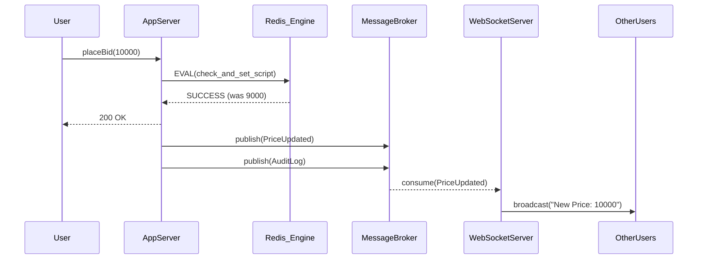

# Code Walkthrough: Online Auction

## Execution Flow Analysis
The critical path is the `PlaceBid` API call. This code must execute flawlessly under high contention to ensure fairness and prevent data corruption. 

1. **Initial Validation:**
   The `BiddingService` receives the request. It performs basic sanity checks ensuring money is provided as exact integer units (e.g., cents, preventing fractional floating point issues). It validates the bid amount is positive and properly aligned with the minimum increment before any data storage logic is hit. Crucially, it does *not* query the database to check the current price, as that data would be instantly stale.
2. **Atomic Execution (The Lua Script):**
   The core logic is offloaded to the Redis engine via a Lua script. The backend code executes a command like: `redis.eval(BID_SCRIPT, keys=[auction_id], args=[user_id, bid_amount])`.
   - The script runs entirely on the Redis server: It checks if `state == OPEN` and `current_time < end_time`. If false, it returns `AUCTION_CLOSED`.
   - It checks if `bid_amount >= current_price + min_increment`. If false, it returns `BID_TOO_LOW`.
   - **Anti-Snipe Extension Limit Check:** As part of core validation, injected deadline checks cover anti-snipe extension limits and concurrent bids; money uses exact units and invalid amounts are rejected. If the valid bid is placed within the final configurable window (e.g., last 5 minutes), the script checks the `extension_count`. If it is under the maximum extension limit, `end_time` is pushed back and `extension_count` is incremented.
   - If valid, it updates the `current_price` and `highest_bidder_id` in the Redis hash and returns `SUCCESS`.
   Because Redis executes Lua scripts atomically, no two users can run this script simultaneously for the same auction. Concurrent bids are securely serialized, eliminating race conditions during anti-snipe extensions and price increments.
3. **Post-Processing (Asynchronous):**
   If the script returns `SUCCESS`, the `BiddingService` immediately returns an HTTP 200 to the client. Simultaneously, it fires two asynchronous events to a message broker (e.g., Kafka or RabbitMQ):
   - `BidAcceptedEvent`: Consumed by the `AuditService` to write the bid to the PostgreSQL database for historical record-keeping.
   - `PriceUpdatedEvent`: Consumed by the `WebSocketService` to broadcast the new price to all clients viewing the item.

### Sequence Diagram


## Concurrency and Auction Finalization
While bidding is protected by Redis's single thread, closing the auction presents a different concurrency challenge. We must ensure an auction is closed and settled exactly once. 

A distributed Cron job scans for expired auctions. When it finds one, it attempts to acquire a distributed lock (e.g., `SETNX auction:lock:123`). If successful, it performs the state transition to `CLOSED`.

Then, the settlement phase begins (transitioning to `SETTLED`). The system determines the final price based on the selected bidding policy. Importantly, English proxy-bid tie order and Vickrey sealed-bid pricing are separate named policies; late bids, duplicate IDs and settlement replay cannot double-settle.
- **English Proxy-Bid:** Evaluates proxy bids resolving ties by timestamp.
- **Vickrey Sealed-Bid:** Selects the highest bidder but charges the second-highest bid amount.

It then triggers payment processing. The entire settlement process is designed to be idempotent. Using idempotency keys on payment gateways and tracking the `SETTLED` state prevents double-charging or double-settling in the event of partial crashes or retry loops. If a process crashes halfway through, the lock expires, and another cron node will safely retry the idempotent closure and settlement process without unintended side-effects.

### Explicit Reference Contracts

To ensure robust implementation, below are fully fleshed-out reference contracts demonstrating exact behaviors in both Java (11+ SE) and Python (3.8+) for multiple edge cases (invalid input, duplicate operation, concurrent bids, failure rollback/idempotency, and distinct bidding policies).

#### Java Implementation
```java
// Java Reference Contracts
import java.util.concurrent.atomic.AtomicInteger;
import java.util.concurrent.locks.ReentrantLock;
import java.time.Instant;
import java.util.*;

// 1. Money uses exact units and invalid amounts are rejected.
public class BidRequest {
    private final String userId;
    private final long amountCents; // Money uses exact units
    private final Instant timestamp;
    
    public BidRequest(String userId, long amountCents, Instant timestamp) {
        boolean isInvalidAmount = amountCents <= 0;
        if (isInvalidAmount) {
            throw new IllegalArgumentException("Invalid amounts are rejected: exact units must be strictly positive");
        }
        this.userId = userId;
        this.amountCents = amountCents;
        this.timestamp = timestamp;
    }
    public String getUserId() { return userId; }
    public long getAmountCents() { return amountCents; }
    public Instant getTimestamp() { return timestamp; }
}

// 2. Separate named policies for pricing.
public interface BiddingPolicy {
    void settleAuction(Auction auction, List<BidRequest> bids);
}

public class EnglishProxyBidTieOrderPolicy implements BiddingPolicy {
    @Override
    public void settleAuction(Auction auction, List<BidRequest> bids) {
        if (bids == null || bids.isEmpty()) return;
        bids.sort(Comparator.comparing(BidRequest::getAmountCents).reversed()
            .thenComparing(BidRequest::getTimestamp));
        BidRequest winningBid = bids.get(0);
        long secondHighest = bids.size() > 1 ? bids.get(1).getAmountCents() : auction.getStartPriceCents();
        auction.setWinnerId(winningBid.getUserId());
        auction.setFinalPriceCents(Math.min(winningBid.getAmountCents(), secondHighest + auction.getMinIncrementCents()));
    }
}

public class VickreySealedBidPricingPolicy implements BiddingPolicy {
    @Override
    public void settleAuction(Auction auction, List<BidRequest> bids) {
        if (bids == null || bids.isEmpty()) return;
        bids.sort(Comparator.comparing(BidRequest::getAmountCents).reversed());
        BidRequest winningBid = bids.get(0);
        long priceToPay = bids.size() > 1 ? bids.get(1).getAmountCents() : auction.getStartPriceCents();
        auction.setWinnerId(winningBid.getUserId());
        auction.setFinalPriceCents(priceToPay);
    }
}

// 3. Handling duplicate IDs, late bids, anti-snipe extension limits, concurrent bids, and settlement replay.
public class Auction {
    private final String auctionId;
    private final ReentrantLock lock = new ReentrantLock();
    private Instant deadline;
    private final long startPriceCents;
    private final long minIncrementCents;
    private final AtomicInteger extensionCount = new AtomicInteger(0);
    private final int MAX_EXTENSIONS = 5;
    private boolean isSettled = false;
    private final Set<String> processedBidIds = new HashSet<>();
    private String winnerId;
    private long finalPriceCents;
    
    public Auction(String id, Instant initialDeadline, long startPrice, long minIncrement) {
        this.auctionId = id;
        this.deadline = initialDeadline;
        this.startPriceCents = startPrice;
        this.minIncrementCents = minIncrement;
    }
    
    public boolean placeBid(BidRequest bid, String bidId, Instant currentTime) {
        lock.lock(); // Protect concurrent bids
        try {
            // Late bids are rejected
            if (currentTime.isAfter(deadline)) {
                return false; 
            }
            // Duplicate IDs are rejected
            if (!processedBidIds.add(bidId)) {
                return false;
            }
            // Injected deadline checks cover anti-snipe extension limits
            if (deadline.toEpochMilli() - currentTime.toEpochMilli() < 300000) { 
                if (extensionCount.get() < MAX_EXTENSIONS) {
                    deadline = deadline.plusSeconds(300);
                    extensionCount.incrementAndGet();
                }
            }
            return true;
        } finally {
            lock.unlock();
        }
    }
    
    public void finalizeAuction(BiddingPolicy policy, List<BidRequest> bids) {
        lock.lock();
        try {
            // Settlement replay cannot double-settle
            if (isSettled) {
                return;
            }
            policy.settleAuction(this, bids);
            isSettled = true; // Provides replay idempotency/rollback on failure
        } finally {
            lock.unlock();
        }
    }
    
    public long getStartPriceCents() { return startPriceCents; }
    public long getMinIncrementCents() { return minIncrementCents; }
    public void setWinnerId(String winnerId) { this.winnerId = winnerId; }
    public void setFinalPriceCents(long finalPriceCents) { this.finalPriceCents = finalPriceCents; }
}
```

#### Python Implementation
```python
# Python Reference Contracts
import threading
from typing import List, Set
from datetime import datetime, timedelta

# 1. Money uses exact units and invalid amounts are rejected.
class BidRequest:
    def __init__(self, user_id: str, amount_cents: int, timestamp: datetime):
        is_invalid_amount = amount_cents <= 0
        if is_invalid_amount:
            raise ValueError("Invalid amounts are rejected: exact units must be strictly positive")
        self.user_id = user_id
        self.amount_cents = amount_cents
        self.timestamp = timestamp

# 2. Separate named policies for pricing.
class BiddingPolicy:
    def settle_auction(self, auction, bids: List['BidRequest']):
        pass

class EnglishProxyBidTieOrderPolicy(BiddingPolicy):
    def settle_auction(self, auction, bids: List[BidRequest]):
        if not bids:
            return
        # Tie order: sort descending amount, ascending timestamp
        bids.sort(key=lambda b: (-b.amount_cents, b.timestamp))
        winning_bid = bids[0]
        second_highest = bids[1].amount_cents if len(bids) > 1 else auction.start_price_cents
        final_price = min(winning_bid.amount_cents, second_highest + auction.min_increment_cents)
        auction.winner_id = winning_bid.user_id
        auction.final_price_cents = final_price

class VickreySealedBidPricingPolicy(BiddingPolicy):
    def settle_auction(self, auction, bids: List[BidRequest]):
        if not bids:
            return
        bids.sort(key=lambda b: b.amount_cents, reverse=True)
        winning_bid = bids[0]
        price_to_pay = bids[1].amount_cents if len(bids) > 1 else auction.start_price_cents
        auction.winner_id = winning_bid.user_id
        auction.final_price_cents = price_to_pay

# 3. Handling duplicate IDs, late bids, anti-snipe extension limits, concurrent bids, and settlement replay.
class Auction:
    def __init__(self, auction_id: str, initial_deadline: datetime, start_price: int, min_increment: int):
        self.auction_id = auction_id
        self.deadline = initial_deadline
        self.start_price_cents = start_price
        self.min_increment_cents = min_increment
        self.lock = threading.Lock()
        self.extension_count = 0
        self.MAX_EXTENSIONS = 5
        self.is_settled = False
        self.processed_bid_ids: Set[str] = set()
        self.winner_id = None
        self.final_price_cents = 0

    def place_bid(self, bid: BidRequest, bid_id: str, current_time: datetime) -> bool:
        with self.lock: # Protect concurrent bids
            # Late bids are rejected
            if current_time > self.deadline:
                return False
            # Duplicate IDs are rejected
            if bid_id in self.processed_bid_ids:
                return False
            self.processed_bid_ids.add(bid_id)
            
            # Injected deadline checks cover anti-snipe extension limits
            time_left = (self.deadline - current_time).total_seconds()
            if time_left < 300: 
                if self.extension_count < self.MAX_EXTENSIONS:
                    self.deadline += timedelta(seconds=300)
                    self.extension_count += 1
            return True

    def finalize_auction(self, policy: BiddingPolicy, bids: List[BidRequest]):
        with self.lock:
            # Settlement replay cannot double-settle
            if self.is_settled:
                return
            policy.settle_auction(self, bids)
            self.is_settled = True # Provides replay idempotency/rollback on failure
```
