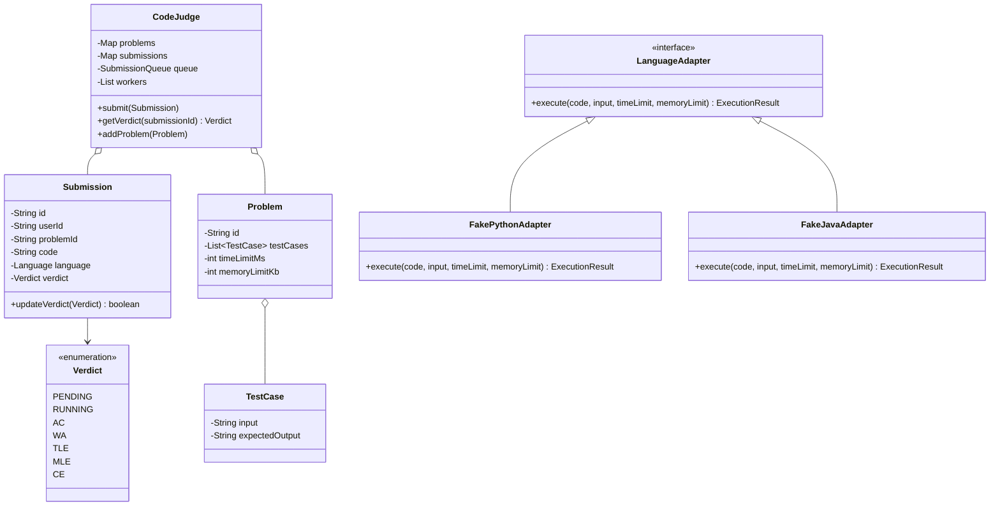

# Design: Online Code Judge

## 1. Class Diagram

## 2. Component Design
- **CodeJudge**: The main facade class interacting with the client. Stores problems, submissions, and routes to a thread-safe queue.
- **LanguageAdapter**: A simulated execution interface. `FakePythonAdapter` and `FakeJavaAdapter` deterministically map known test strings to verdicts (AC, WA, TLE, MLE, CE).
- **Worker/Dispatcher**: Continuously polls the queue, fetches problem constraints, invokes `LanguageAdapter.execute`, and securely sets the terminal verdict exactly once, rejecting duplicate or delayed updates.
