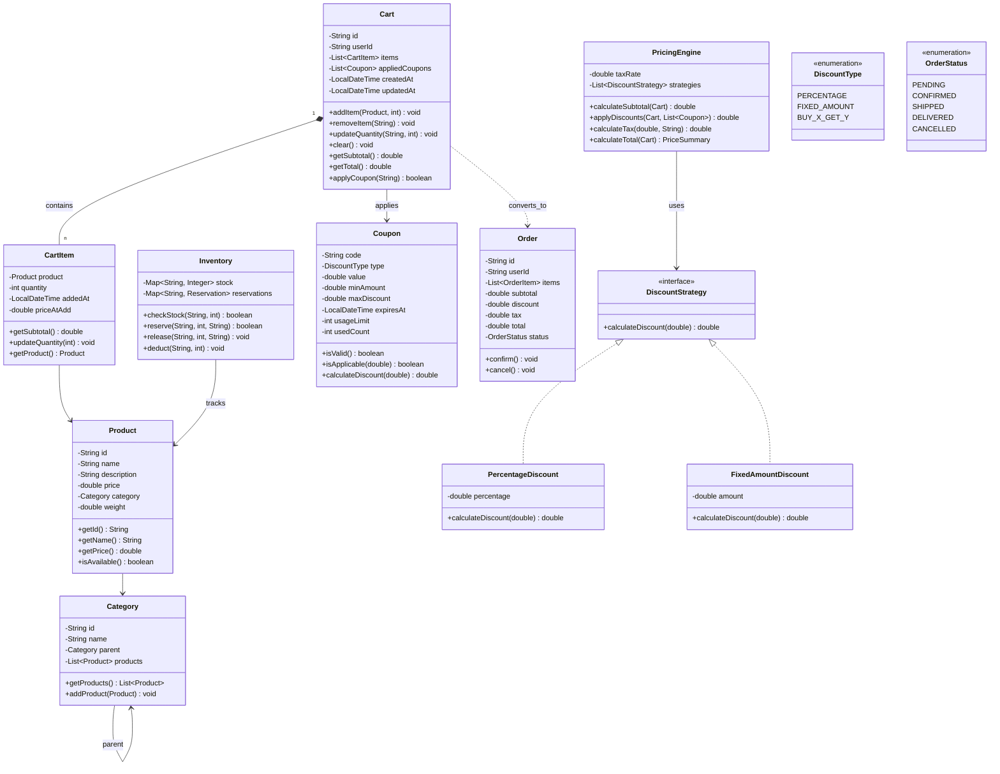
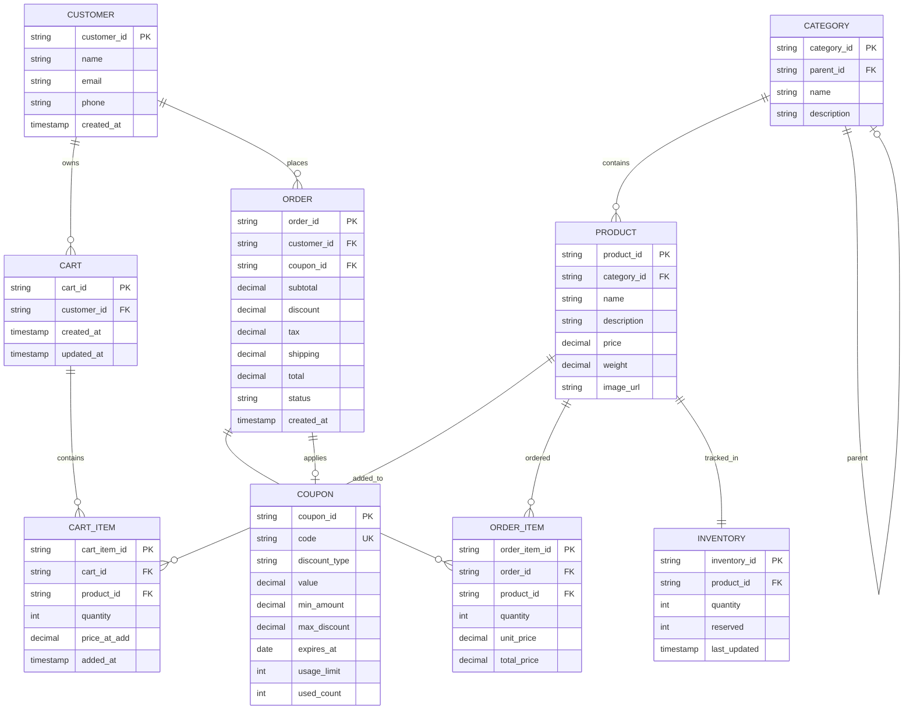

# Design for Online Shopping Cart

## Mermaid Class Diagram



## Entity-Relationship Diagram



**Schema Notes:**
- `CART_ITEM.price_at_add` captures price snapshot for session stability
- `INVENTORY.reserved` tracks items reserved during checkout
- `CATEGORY` supports hierarchical structure via self-reference
- `COUPON.used_count` enables usage limiting

---

## Class Diagram

```
┌──────────────────┐     ┌──────────────────┐
│     Category     │     │    Inventory     │
├──────────────────┤     ├──────────────────┤
│ - id: String     │     │ - stock: Map     │
│ - name: String   │     ├──────────────────┤
│ - parent: Cat    │     │ + checkStock()   │
└────────┬─────────┘     │ + reserve()      │
         │               │ + release()      │
         │1              │ + deduct()       │
         │               └────────┬─────────┘
         │N                       │1
┌────────▼─────────┐              │
│     Product      │◄─────────────┘
├──────────────────┤
│ - id: String     │
│ - name: String   │
│ - price: double  │
│ - weight: double │
└────────┬─────────┘
         │
         │1
         │
┌────────▼─────────┐     ┌──────────────────┐
│    CartItem      │     │      Cart        │
├──────────────────┤     ├──────────────────┤
│ - product: Prod  │◄────│ - id: String     │
│ - quantity: int  │     │ - userId: String │
│ - addedAt: Date  │  N  │ - items: List    │
├──────────────────┤     ├──────────────────┤
│ + getSubtotal()  │     │ + addItem()      │
│ + updateQty()    │     │ + removeItem()   │
└──────────────────┘     │ + getTotal()     │
                         │ + applyCoupon()  │
                         └────────┬─────────┘
                                  │
                                  │ uses
                                  ▼
┌──────────────────┐     ┌──────────────────┐
│     Coupon       │     │  PricingEngine   │
├──────────────────┤     ├──────────────────┤
│ - code: String   │     │ - taxRate: double│
│ - type: Enum     │◄────│ - strategies     │
│ - value: double  │     ├──────────────────┤
│ - minAmount: dbl │     │ + calcSubtotal() │
│ - expiresAt: Date│     │ + applyDiscount()│
├──────────────────┤     │ + calcTax()      │
│ + isValid()      │     │ + calcTotal()    │
│ + getDiscount()  │     └──────────────────┘
└──────────────────┘
```

## Core Classes

### Product
- **Attributes**: id, name, description, price, category, weight, imageUrl
- **Methods**: getId(), getName(), getPrice(), getWeight(), isAvailable()
- **Patterns Used**: Value object (immutable)

### Category
- **Attributes**: id, name, parentCategory, products
- **Methods**: getId(), getName(), getProducts(), addProduct()
- **Patterns Used**: Composite (hierarchical categories)

### Cart
- **Attributes**: id, userId, items, createdAt, updatedAt, appliedCoupons
- **Methods**: 
  - addItem(product, quantity)
  - removeItem(productId)
  - updateQuantity(productId, quantity)
  - clear()
  - getSubtotal()
  - getTotal()
  - applyCoupon(code)
- **Patterns Used**: Aggregate root

### CartItem
- **Attributes**: product, quantity, addedAt, priceAtAdd
- **Methods**: getSubtotal(), updateQuantity(), getProduct()
- **Patterns Used**: Value object

### Inventory
- **Attributes**: stockMap, reservations
- **Methods**:
  - checkStock(productId, quantity) → boolean
  - reserve(productId, quantity, userId) → boolean
  - release(productId, quantity, userId)
  - deduct(productId, quantity)
- **Patterns Used**: Singleton, Unit of Work

### Coupon
- **Attributes**: code, discountType, value, minAmount, maxDiscount, expiresAt, usageLimit, usedCount
- **Methods**:
  - isValid() → boolean
  - isApplicable(subtotal) → boolean
  - calculateDiscount(subtotal) → double
  - incrementUsage()
- **Patterns Used**: Strategy (discount calculation)

### DiscountStrategy (Interface)
- **Methods**: calculateDiscount(subtotal) → double
- **Implementations**:
  - PercentageDiscount
  - FixedAmountDiscount
  - BuyXGetYDiscount

### PricingEngine
- **Attributes**: taxCalculator, shippingCalculator, discountStrategies
- **Methods**:
  - calculateSubtotal(cart) → double
  - applyDiscounts(cart, coupons) → double
  - calculateTax(amount, region) → double
  - calculateShipping(cart, address) → double
  - calculateTotal(cart) → PriceSummary
- **Patterns Used**: Facade, Strategy

### Order
- **Attributes**: id, userId, items, subtotal, discount, tax, shipping, total, status, createdAt
- **Methods**: confirm(), cancel(), getStatus(), getTotal()
- **Patterns Used**: State (order status)

## Key Design Decisions

### 1. Price Snapshot in CartItem
**Decision**: Store price at time of adding to cart
**Rationale**: Prevents price fluctuation during shopping session
**Trade-off**: May show different price than current product page

### 2. Coupon Application Strategy
**Decision**: Single coupon per cart (v1), stackable with rules (v2+)
**Rationale**: Simplifies initial implementation
**Trade-off**: Less flexible for promotions

### 3. Inventory Reservation
**Decision**: Reserve inventory during checkout, not when adding to cart
**Rationale**: Prevents holding stock while browsing
**Trade-off**: May fail at checkout if sold out

### 4. Stateless Pricing Engine
**Decision**: PricingEngine has no state, takes cart as input
**Rationale**: Thread-safe, easily testable
**Trade-off**: May recalculate unnecessarily

## Complexity Analysis

### Time Complexity
| Operation | Complexity | Notes |
|-----------|------------|-------|
| Add to cart | O(1) | HashMap lookup/insert |
| Remove from cart | O(1) | HashMap delete |
| Update quantity | O(1) | HashMap update |
| Calculate subtotal | O(n) | n = items in cart |
| Apply coupon | O(c) | c = coupons to check |
| Check inventory | O(1) | ConcurrentHashMap |
| Checkout | O(n) | Reserve each item |

### Space Complexity
| Component | Complexity | Notes |
|-----------|------------|-------|
| Cart | O(n) | n = unique products |
| Inventory | O(p) | p = total products |
| Orders | O(o * i) | o = orders, i = avg items |

## Thread Safety Considerations (V3)

1. **Cart Operations**: ReentrantLock for cart modifications
2. **Inventory Updates**: ConcurrentHashMap with atomic operations
3. **Coupon Usage**: AtomicInteger for usage counter
4. **Order Creation**: Optimistic locking with version check
