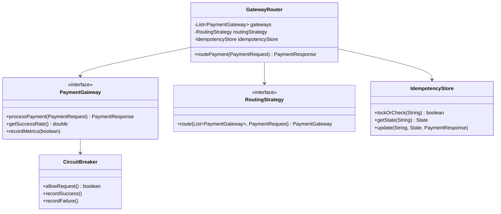
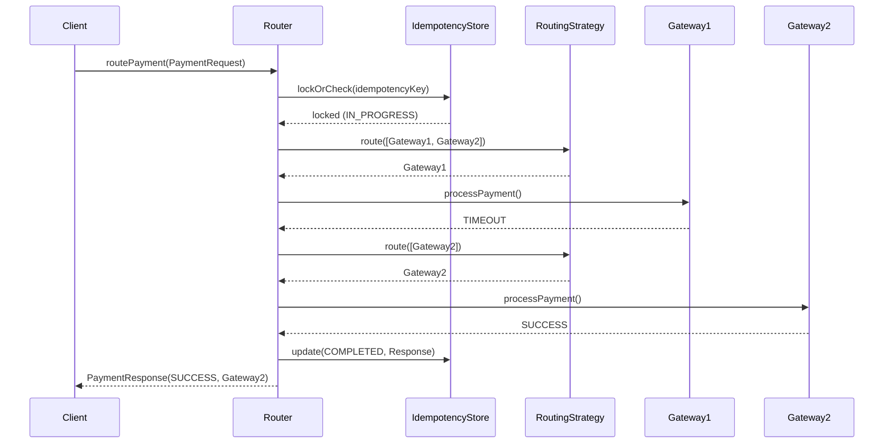
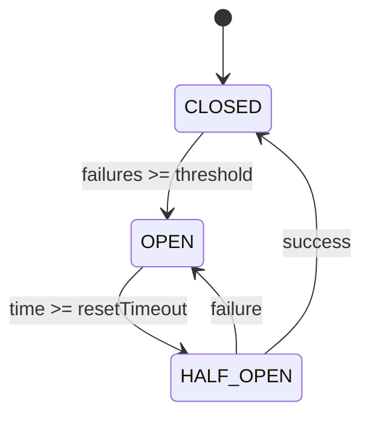

# Payment Gateway Router - Design

## Cross-links
- [Problem Statement](PROBLEM.md)
- [Approach](APPROACH.md)
- [Code Walkthrough](CODE-WALKTHROUGH.md)
- [Rubric](RUBRIC.md)
- [Pitfalls](PITFALLS.md)
- [Follow-Ups](FOLLOW-UPS.md)

## System Architecture

The Gateway Router acts as a proxy between incoming payment requests and third-party gateways. Requests flow through the router, pass idempotency checks, get assigned a gateway via the routing strategy, and are monitored by circuit breakers.

## Class Diagram

## Sequence Diagram: Payment Routing with Fallback

## Circuit Breaker State Machine

