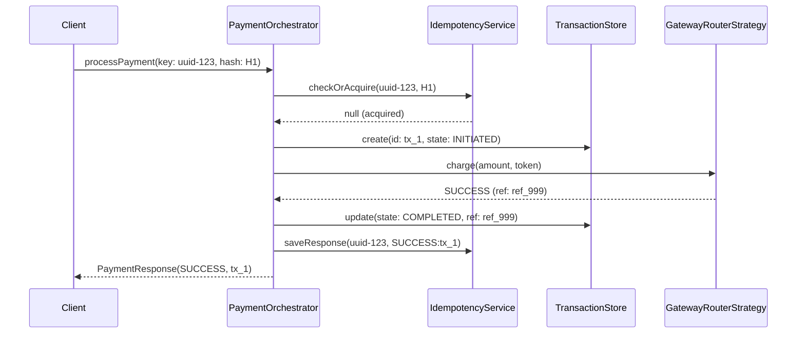

# Code Walkthrough: Payment System

## Execution Flow Analysis
This walkthrough focuses on the critical path of charging a credit card, specifically highlighting how idempotency and external API failures are handled to guarantee transactional safety.

### Normal Trace
The happy-path sequence for processing a payment intent, grounded in the `v2-extended` and `v3-optimized` implementations:
1. **Idempotency Check:** The `PaymentOrchestrator` receives the request (`PaymentRequest`) and generates a `payloadHash` (e.g., amount + currency + token). It calls `IdempotencyService.checkOrAcquire(key, payloadHash)`. The key is new, so it creates a placeholder entry and execution proceeds.
2. **Database Initialization:** The orchestrator creates a new `Transaction` in the concurrent map store with state `INITIATED` and increments the transaction counter. This ensures the intent is tracked before any external calls are made.
3. **Gateway Invocation (The Critical Section):** The state is safely updated to `GATEWAY_PENDING` using synchronization. The orchestrator invokes `GatewayRouterStrategy.charge()`. The mock call succeeds, returning `SUCCESS` and a reference ID.
4. **Success Handling:** The state is updated to `COMPLETED` within a synchronized block on the transaction, and the `gatewayReferenceId` is saved.
5. **Response and Cleanup:** The `PaymentResponse` ("SUCCESS", txId) is formulated, saved back to the `IdempotencyService` (caching the result for future identical requests), and returned to the caller.

### Failure Trace
Handling of ambiguous timeouts, out-of-order events, and payload mismatches in the in-memory implementations (`v2-extended`):
1. **Ambiguous Gateway Timeout (Preserving Money Conservation):**
   - The code invokes `GatewayRouterStrategy.charge()`. If it throws an exception with message "Ambiguous gateway timeout", the orchestrator intercepts it.
   - The system checks if an out-of-order webhook already moved the transaction to a terminal state (`COMPLETED`, `DECLINED`, `FAILED`).
   - If not, it safely returns `PENDING`, keeping the transaction in a state that can be later reconciled by webhooks or background jobs, preventing dangerous retries that could double-charge the user.
2. **Repeated Idempotency Key with Changed Payload:**
   - Client sends a request with `idempotencyKey: uuid-123` and payload parameters hashing to `H1`.
   - The same client subsequently sends a request with `idempotencyKey: uuid-123` but altered payload parameters hashing to `H2`.
   - The `IdempotencyService` recognizes the key in its concurrent store but detects a mismatch between `H1` and `H2`.
   - It throws an `IllegalArgumentException` ("Repeated idempotency key with changed payload"), rejecting the request without attempting a second charge and safely enforcing money conservation. Repeated requests with the exact same payload hash will return the cached `PaymentResponse`.
3. **Duplicate/Out-of-Order Webhook Deliveries:**
   - A webhook handler or background process attempts to reconcile a transaction state (e.g., from a gateway callback) by calling `PaymentOrchestrator.reconcileTransaction()`.
   - Before modifying the state, the orchestrator locks on the specific `Transaction` object.
   - It checks if the current state is already terminal (`COMPLETED`, `DECLINED`, `FAILED`). If so, it safely ignores the duplicate update.
   - If an out-of-order webhook arrives before the gateway synchronous call completes, `reconcileTransaction` safely moves the state to terminal. The pending synchronous call checks this terminal state within its `finally` or catch blocks and returns the correct outcome, avoiding overwriting the webhook's truth.
4. **Declined Error:**
   - The gateway explicitly returns a `DECLINED` status.
   - The orchestrator updates the internal transaction state to `DECLINED` (checking for terminal state precedence first).
   - The failed `PaymentResponse` is saved to the `IdempotencyService` and returned to the client. Future identical requests will receive the cached declined response.

### Sequence Diagram


## Concurrency and ACID Properties
Floating point numbers (`float`, `double`) are strictly forbidden in this codebase due to precision loss. In `v2-extended`, all monetary amounts are explicitly handled as integers representing the lowest denomination (cents) in both Java and Python to guarantee precise math.

Concurrency in the in-memory implementations is governed by built-in thread-safe primitives.
- `IdempotencyService` uses a `ConcurrentHashMap` (Java) / locked `dict` (Python) and synchronized blocks to prevent race conditions during the initial `checkOrAcquire`.
- `PaymentOrchestrator` uses a `ConcurrentHashMap` to store transactions. To mimic database row-level locking or optimistic concurrency control, it synchronizes on the exact `Transaction` instance before mutating states like `INITIATED` to `GATEWAY_PENDING` or when handling late arriving completions in `reconcileTransaction()`.
- The atomic increments (via `AtomicInteger` or locked counters) ensure globally unique, sequence-safe internal IDs (like `tx_1`).


### Implementation Code Snippets (Parity)

**Idempotency Key with Changed Payload (Rejection):**
*Java (`IdempotencyService.java`):*
```java
public String checkOrAcquire(String key, String payloadHash) {
    synchronized (store) {
        CacheEntry entry = store.get(key);
        if (entry != null) {
            if (!entry.payloadHash.equals(payloadHash)) {
                throw new IllegalArgumentException("Repeated idempotency key with changed payload");
            }
            return entry.response;
        }
        // ...
    }
}
```

*Python (`idempotency_service.py`):*
```python
def check_or_acquire(self, key: str, payload_hash: str) -> Optional[Dict[str, Any]]:
    with self._lock:
        if key in self._store:
            entry = self._store[key]
            if entry['payload_hash'] != payload_hash:
                raise ValueError("Repeated idempotency key with changed payload")
            return entry['response']
        # ...
```

**Webhook Reconciliation (Out-of-Order / Duplicate Tolerant):**
*Java (`PaymentOrchestrator.java`):*
```java
public void reconcileTransaction(String txId, TransactionState newState) {
    Transaction tx = transactions.get(txId);
    if (tx == null) return;
    synchronized (tx) {
        if (tx.state == TransactionState.COMPLETED || 
            tx.state == TransactionState.DECLINED || 
            tx.state == TransactionState.FAILED) {
            return;
        }
        tx.state = newState;
    }
}
```

*Python (`payment_orchestrator.py`):*
```python
def reconcile_transaction(self, tx_id: str, new_state_str: str) -> None:
    with self._lock:
        if tx_id not in self.transactions:
            return
        current_state = self.transactions[tx_id].state
        if current_state in (TransactionState.COMPLETED, TransactionState.DECLINED, TransactionState.FAILED):
            return
        # ... update state
```

