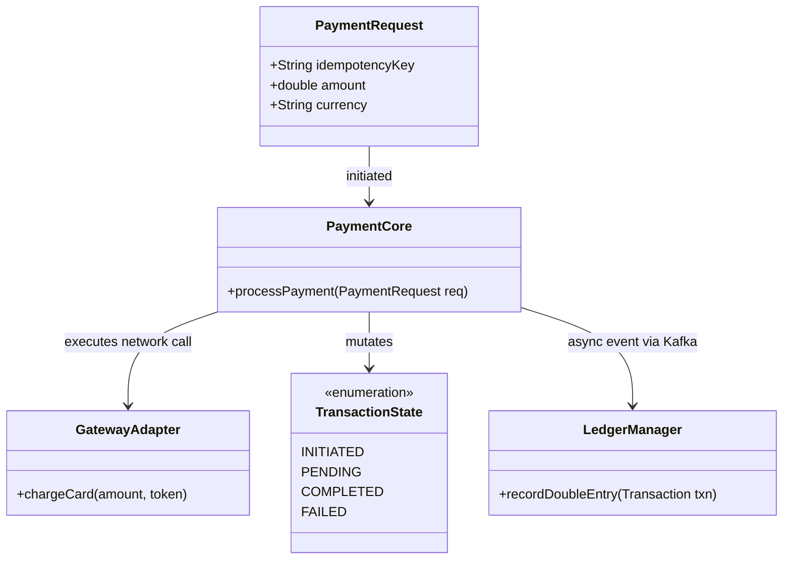

# Design Document: Payment System

## 📚 Topic Level & Prerequisites
- **Layering:** This material spans **Beginner** (understanding basic state machine for payment intent), **Core** (idempotency, webhook routing, gateway failures), and **Staff** (reconciliation against ledger, Kafka transactional outbox guarantees).
- **Prerequisites:** Familiarity with double-entry bookkeeping concepts, state machines, and basic concurrency.

## 🎯 Scope & Non-Goals
- **In Scope:** Idempotency key stores, gateway adapter patterns, payment intent state machines, and asynchronous webhook reconciliation for handling duplicates/out-of-order events.
- **Out of Scope (Non-Goals):** PCI-DSS physical compliance, live cloud deployment, production load testing, real payment network connections, or multi-region database replication semantics.

## 📊 Scenario Assumptions vs. Externally Measured Facts
- **Scenario Assumptions:** Capacity of 1,000 TPS, webhook latency within 5 seconds, Redis TTL of 24 hours. These are for scenario context and not absolute verified facts.
- **Calculations & Units:** Amounts are stored as integers (lowest denomination, e.g., cents) to prevent floating-point precision loss. If a charge is $10.50, it is represented as 1050.
- **External Facts:** Network calls can fail or hang indefinitely. PostgreSQL and Redis provide distinct transactional guarantees.

## 🔗 Provenance & Ownership
- **Primary-Source Version/Date:** Architecture aligns with Stripe's API idempotency and webhook patterns (Epoch: ~2023).
- **Diagram-Source Ownership:** Diagrams are sourced locally from the `diagrams/` folder (if applicable) or embedded as canonical Mermaid sources here.

## 🔬 Invariants, Traces, & Code Parity
- **Named Invariants:**
  - **Money Conservation:** A single idempotency key can never result in more than one successful gateway charge.
  - **State Machine Validity:** Transitions must strictly follow allowed paths (e.g., `INITIATED` -> `GATEWAY_PENDING` -> `COMPLETED`).
- **Code Parity:** Both Java 11+ and Python 3.8+ reference implementations maintain parity for these domain contracts.

## ✅ Verification & Evidence
- **Machine Checks:** Format, syntax, directory structure, and basic compilation/test-execution are validated via `scripts/check_curriculum_task.py`.
- **Semantic Review:** A separately recorded semantic review ensures reasoning regarding trade-offs (e.g., synchronous vs asynchronous webhooks) is sound and adheres to named invariants.

## System Architecture
The architecture is designed to strictly isolate the high-risk, externally facing components from the internal, highly secure financial ledger.

### Core Components
1. **API Gateway:** Handles SSL termination, rate limiting, and initial payload validation. Must be PCI-DSS compliant.
2. **Idempotency Service (Redis/ConcurrentHashMap):** A fast store that intercepts duplicate requests before they hit the core logic.
3. **Payment Core Service:** Orchestrates the state machine of a transaction.
4. **Gateway Adapters (Stripe/PayPal):** Abstracted interfaces that communicate with specific external providers. This isolates third-party SDK complexities from the core logic, allowing us to swap gateways easily.
5. **Ledger Service:** An isolated, ACID-compliant database responsible for immutable double-entry bookkeeping.

### Mermaid Class Diagram

## Data Model and Schema
The `Transactions` table must be designed for extreme auditability. It relies heavily on UUIDs and strict state enums.
- `id` (UUID): Primary key.
- `idempotency_key` (String, Unique Index): Crucial for preventing double processing at the database level.
- `amount` (BigInt): We store amounts in the smallest currency unit (e.g., cents) to completely avoid floating-point math errors.
- `state` (Enum): The current state.
- `gateway_reference_id` (String): The transaction ID returned by Stripe/PayPal, essential for the nightly reconciliation process.

## Trade-offs and Considerations
- **Microservices vs. Monolith:** We split the Payment Core and the Ledger into separate microservices. The trade-off is the loss of a single distributed database transaction. If the Payment Core updates to `COMPLETED` but the Kafka message to the Ledger is lost, the systems are out of sync. We mitigate this through guaranteed At-Least-Once event delivery (e.g., the Outbox Pattern) and idempotency on the Ledger side.
- **Synchronous vs. Asynchronous Webhooks:** External gateways often use webhooks to confirm asynchronous payments (like bank transfers). Relying entirely on webhooks means the user interface might hang waiting for confirmation. We trade off pure event-driven architecture by actively polling the gateway for status if the webhook hasn't arrived within a specific timeout, ensuring a responsive UX.

## Domain Contracts & Progression (v1 to v3)

### v1-basic: Intent + Transaction Domain Core
Focuses on the payment intent and fundamental state machine (`INITIATED`, `PENDING`, `COMPLETED`, `FAILED`).
- **Java:** `PaymentService.java` orchestrates `PaymentRequest` and uses a basic `PaymentGateway`.
- **Python:** `payment_service.py` manages `PaymentRequest` and basic state transitions.

### v2-extended: Gateway Strategy Adapter, Retry & Risk Policy
Introduces real idempotency and external gateway resilience.
- **Idempotency Contract:** 
  - *Java:* `IdempotencyService.checkOrAcquire(String key, String payloadHash)` throws `IllegalArgumentException` on payload mismatch.
  - *Python:* `IdempotencyService.check_or_acquire(key: str, payload_hash: str)` raises `ValueError` on payload mismatch.
  - *Rule:* By verifying the payload hash, the idempotency service securely bypasses execution to return the original response, explicitly rejecting mutated payloads to strictly maintain money conservation invariants without double billing.
- **Webhook Reconciliation Contract:**
  - *Java:* `WebhookHandler.handleWebhook(String txId, TransactionState newState)` and `PaymentOrchestrator.reconcileTransaction` safely ignore duplicates and out-of-order deliveries.
  - *Python:* `WebhookHandler.handle_webhook` and `PaymentOrchestrator.reconcile_transaction` explicitly lock the transaction record, rejecting any state transitions if the transaction has already reached terminal states like `COMPLETED`, `DECLINED`, or `FAILED`. This protects against late or duplicated webhook deliveries breaking the allowed state paths.

### v3-optimized: Concurrent Processing Queue & Reconciliation
Focuses on thread-safety, recovery checkpoints, and transactional outbox.
- **Java:** `OutboxPublisher.java` and `ReconciliationService.java`.
- **Python:** `outbox_publisher.py` and `reconciliation_service.py`.

