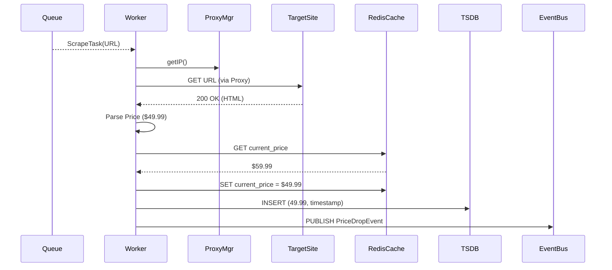

# Code Walkthrough: Price Tracking Service

## Execution Flow Analysis
The most complex and resource-intensive part of the codebase is the `ScraperWorker` execution path. This walkthrough details how we extract data reliably while managing network unreliability and bot detection.

1. **Task Acquisition:**
   The worker pops a `ScrapeTask` (containing the URL and the parser config ID) from the RabbitMQ queue.
2. **Network Execution with Retries:**
   The code does not simply execute `http.get()`. It uses a custom HTTP client wrapped in a retry mechanism with exponential backoff.
   - It requests a proxy IP from the `ProxyManager`.
   - It sets randomized headers (`User-Agent`, `Accept-Language`).
   - If it receives a 403 (Forbidden) or 429 (Too Many Requests), it assumes the proxy is burned. It reports the IP to the manager, requests a new one, and retries the request after a delay.
3. **DOM Parsing and Validation:**
   Upon receiving a 200 OK, the HTML is passed to the parsing module. Using the CSS selectors defined for that specific domain, it attempts to extract the price string.
   - **Crucial Step:** It utilizes Regex to strip currency symbols and commas, converting the string into a precise `BigDecimal`. It performs sanity checks (e.g., a $1000 TV suddenly dropping to $1 is likely a parsing error or a misconfigured third-party seller, not a legitimate price drop).
4. **Change Detection:**
   The worker queries Redis: `GET product:{id}:current_price`.
   - If the new price == cached price, the job is complete. We do not hit the TSDB to record unchanged data, saving massive amounts of I/O.
   - If the new price != cached price, the worker executes a pipeline: updates the Redis cache, inserts the new data point into the TSDB, and publishes a `PriceDroppedEvent` to Kafka.

### Sequence Diagram

## Concurrency and Error Handling
The `Worker` application is highly multi-threaded. Because the workload is I/O bound (waiting for network responses), a single node can run hundreds of concurrent scraping threads. 

To prevent memory leaks from massive HTML strings, the parsing logic is tightly scoped within `try-with-resources` blocks, ensuring the garbage collector reclaims the memory immediately after the price is extracted. If a parser fails repeatedly (e.g., throwing `ElementNotFoundException`), a Circuit Breaker trips for that specific domain, pausing all scraping for that site until the parser configuration can be manually updated, preventing us from burning through our expensive proxy pool on guaranteed failures.

## Contract Verification and Testing

To ensure deterministic testing, we inject a mock `Clock` and a mock network `Transport` into our tests. This abstracts away non-deterministic delays and external dependencies, allowing us to explicitly simulate the passage of time and simulate complex failure modes.

### Exactly-Once Threshold Crossing Scenarios

Tests are structured to walk through specific state transitions for threshold crossings.

1. **Initial State (No Alert)**:
   A user subscribes with a threshold of $10.00 (`1000` cents). The first poll returns $12.00 (`1200` cents). No alert is sent.
2. **Crossing Down (Alert Triggered)**:
   The clock advances 10 seconds. The next poll returns $9.00 (`900` cents). The threshold is crossed, and exactly one alert is sent. The state is marked as triggered.
3. **Staying Down (No Alert)**:
   The clock advances another 70 seconds. The next poll returns $8.00 (`800` cents). Because the price was already below the threshold in the previous poll, the alert is suppressed, preventing spam.
4. **Rising Back Up (Reset)**:
   The next poll returns $11.00 (`1100` cents). The state resets. The next drop below $10.00 will correctly trigger a new alert.

### Edge Case Handling

Using the injected clock and transport, we can precisely test the following edge cases:

- **Repeated Merchant Events**: If the same merchant reports the exact same price consecutively, the `PriceHistoryStore` retains it, but the crossing logic will suppress the duplicate alert because the previously crossed state hasn't reset.
- **Out-of-Order Timestamps**: A late-arriving event with a timestamp older than the current maximum timestamp for that product/merchant pair is simply ignored by comparing the incoming timestamp against `max(r.timestamp for r in history)`.
- **Missing Product**: The mock transport is programmed to return empty (`Optional.empty()` in Java / `None` in Python) for a specific "missing" product ID. The poller gracefully skips inserting a `PriceRecord`, leaving the previous known state intact without crashing.
- **Failed Polling**: Similar to missing products, network timeouts or errors simulated by the mock transport return empty, preventing the system from corrupting existing data or inadvertently triggering 0-price alerts.
- **Unsubscribe**: Calling `unsubscribe(subscriptionId)` completely removes the subscription record from `_subscriptions`. Subsequent price drops will correctly bypass the alert evaluator for that user since no subscription exists.

