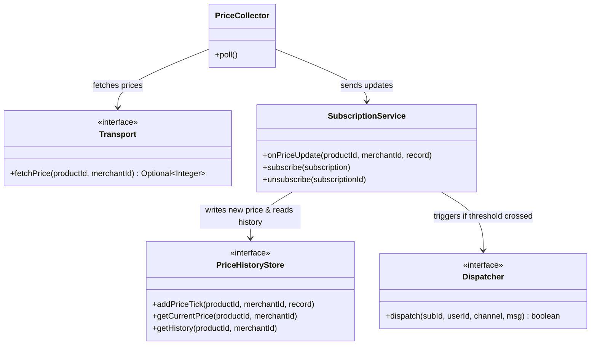

# Design Document: Price Tracking Service

## System Architecture
The architecture is designed to orchestrate price collection, historical storage, and alert evaluation using well-defined internal boundaries.

### Core Components
1. **Transport (Interface):** Defines how prices are fetched from external merchants. Implementations can be real HTTP clients or injected fakes for testing.
2. **PriceCollector:** Periodically polls the `Transport` for a set of products and merchants, feeding results into the `SubscriptionService` (or `PriceService` in Python).
3. **PriceHistoryStore:** Stores historical price records (ticks) for each product/merchant pair, enforcing retention policies.
4. **SubscriptionService / PriceService:** Manages user alerts, evaluating them against incoming price ticks from the `PriceCollector`.
5. **Dispatcher:** Handles the actual delivery of triggered alerts via various channels (e.g., Email, SMS).

### Mermaid Class Diagram


## Domain Contracts and API Boundaries

The `v2-extended` and `v3-optimized` versions introduce strict domain contracts. These ensure that business rules are enforced deterministically, regardless of transport mechanisms or concurrent execution environments.

### Price History and Retention

The `PriceHistoryStore` maintains histories per product and merchant. Exact price-unit histories maintain configured retention and trigger one alert per threshold crossing, not every poll (e.g., 3600 seconds) to bound memory growth. The store automatically purges data older than the retention window based on the injected clock's time. Out-of-order events (where a price update carries an older timestamp than the most recent one for a given product and merchant) are dropped completely rather than corrupting the timeline.

Repeated merchant events, out-of-order timestamps, missing product, failed polling, and unsubscribe are tested with injected transports/clock.

### Exactly-Once Threshold Alerting

The `SubscriptionService` (Java) / `PriceService` (Python) evaluates active `PriceAlertSubscription` records when new prices arrive. Crucially, the system ensures *exactly-one alert per threshold crossing*, avoiding spamming users on every poll when a price remains low. 
- A map (`alertState`) tracks if an alert was already triggered for a specific subscription/merchant pair.
- The condition must become true (e.g., price dips below the threshold) and the alert state must be false to dispatch.
- When the condition becomes false again (e.g., price rises above threshold), the alert state resets to false, allowing future crossings to trigger alerts again.

### Code Implementations (Java and Python Parity)

Below are the contract definitions illustrating this parity.

**Java (`PriceHistoryStore` and `SubscriptionService` Contracts)**:
```java
public interface PriceHistoryStore {
    void addPriceTick(String productId, String merchantId, PriceRecord record);
    Integer getCurrentPrice(String productId, String merchantId);
    List<PriceRecord> getHistory(String productId, String merchantId);
}

// In SubscriptionService
public void onPriceUpdate(String productId, String merchantId, PriceRecord record) {
    List<PriceRecord> history = historyStore.getHistory(productId, merchantId);
    
    // Out of order timestamps: Ignore older events
    if (!history.isEmpty()) {
        long maxTimestamp = history.stream().mapToLong(r -> r.timestamp).max().orElse(0);
        if (record.timestamp < maxTimestamp) {
            return;
        }
    }
    
    historyStore.addPriceTick(productId, merchantId, record);
    checkAlerts(productId, merchantId, record);
}

// Exactly-once alert tracking logic snippet
String alertKey = sub.id + ":" + merchantId;
boolean previouslyAlerted = alertState.getOrDefault(alertKey, false);

if (conditionMet) {
    if (!previouslyAlerted) {
        String msg = String.format("Price alert for %s: %d cents", productId, currentRecord.priceCents);
        dispatcher.dispatch(sub.id, sub.userId, sub.channel, msg);
        alertState.put(alertKey, true);
    }
} else {
    alertState.put(alertKey, false);
}
```

**Python (`PriceHistoryStore` and `PriceService` Contracts)**:
```python
class PriceHistoryStore(typing.Protocol):
    def add_price_tick(self, product_id: str, merchant_id: str, record: PriceRecord) -> None: ...
    def get_current_price(self, product_id: str, merchant_id: str) -> typing.Optional[int]: ...
    def get_history(self, product_id: str, merchant_id: str) -> typing.List[PriceRecord]: ...

# In PriceService
def on_price_update(self, product_id: str, merchant_id: str, record: PriceRecord) -> None:
    history = self.history_store.get_history(product_id, merchant_id)
    
    # Out of order timestamps
    if history:
        max_timestamp = max(r.timestamp for r in history)
        if record.timestamp < max_timestamp:
            return

    self.history_store.add_price_tick(product_id, merchant_id, record)
    self._check_alerts(product_id, merchant_id, record)

# Exactly-once alert tracking logic snippet
alert_key = f"{sub.id}:{merchant_id}"
previously_alerted = self._alert_state.get(alert_key, False)

if condition_met:
    if not previously_alerted:
        msg = f"Price alert for {product_id}: {current_record.price_cents} cents"
        self.dispatcher.dispatch(sub.id, sub.user_id, sub.channel, msg)
        self._alert_state[alert_key] = True
else:
    self._alert_state[alert_key] = False
```
