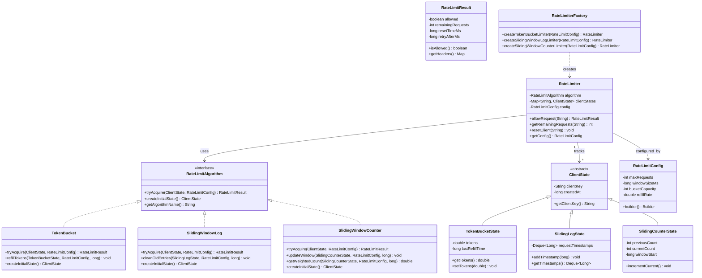
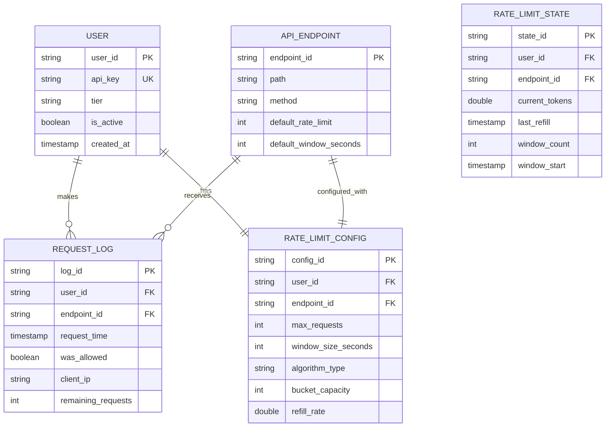

# Design for Rate Limiter

Complete class design with diagrams, relationships, and key decisions.

---

## Mermaid Class Diagram



## Entity-Relationship Diagram



**Schema Notes:**
- `USER` can have custom rate limits per `API_ENDPOINT`
- `REQUEST_LOG` tracks all requests for analytics
- `RATE_LIMIT_STATE` stores persistent state for distributed limiting
- Different `algorithm_type` values support various strategies

---

## Class Diagram

```
┌─────────────────────────────────────────────────────────────────────┐
│                           RateLimiter                               │
├─────────────────────────────────────────────────────────────────────┤
│ - algorithm: RateLimitAlgorithm                                     │
│ - clientStates: Map<String, ClientState>                            │
│ - config: RateLimitConfig                                           │
├─────────────────────────────────────────────────────────────────────┤
│ + allowRequest(clientKey: String): RateLimitResult                  │
│ + getRemainingRequests(clientKey: String): int                      │
│ + resetClient(clientKey: String): void                              │
│ + getConfig(): RateLimitConfig                                      │
└───────────────────────────────┬─────────────────────────────────────┘
                                │ uses
                                ▼
┌─────────────────────────────────────────────────────────────────────┐
│              RateLimitAlgorithm <<interface>>                       │
├─────────────────────────────────────────────────────────────────────┤
│ + tryAcquire(state: ClientState, config: Config): RateLimitResult   │
│ + createInitialState(): ClientState                                 │
│ + getAlgorithmName(): String                                        │
└───────────────────────────────┬─────────────────────────────────────┘
                                │
        ┌───────────────────────┼───────────────────────┐
        ▼                       ▼                       ▼
┌───────────────────┐  ┌───────────────────┐  ┌───────────────────────┐
│   TokenBucket     │  │ SlidingWindowLog  │  │ SlidingWindowCounter  │
├───────────────────┤  ├───────────────────┤  ├───────────────────────┤
│ + tryAcquire()    │  │ + tryAcquire()    │  │ + tryAcquire()        │
│ + refillTokens()  │  │ + cleanOldEntries │  │ + getWeightedCount()  │
└───────────────────┘  └───────────────────┘  └───────────────────────┘


┌─────────────────────────────────────────────────────────────────────┐
│                        ClientState <<abstract>>                     │
├─────────────────────────────────────────────────────────────────────┤
│ - clientKey: String                                                 │
│ - createdAt: long                                                   │
├─────────────────────────────────────────────────────────────────────┤
│ + getClientKey(): String                                            │
└───────────────────────────────┬─────────────────────────────────────┘
                                │
        ┌───────────────────────┼───────────────────────┐
        ▼                       ▼                       ▼
┌───────────────────┐  ┌───────────────────┐  ┌───────────────────────┐
│ TokenBucketState  │  │ SlidingLogState   │  │ SlidingCounterState   │
├───────────────────┤  ├───────────────────┤  ├───────────────────────┤
│ - tokens: double  │  │ - timestamps:     │  │ - prevCount: int      │
│ - lastRefill: long│  │   Queue<Long>     │  │ - currCount: int      │
└───────────────────┘  └───────────────────┘  │ - windowStart: long   │
                                              └───────────────────────┘


┌─────────────────────┐        ┌─────────────────────────────────────┐
│  RateLimitConfig    │        │         RateLimitResult             │
├─────────────────────┤        ├─────────────────────────────────────┤
│ - maxRequests: int  │        │ - allowed: boolean                  │
│ - windowSizeMs: long│        │ - remainingRequests: int            │
│ - bucketCapacity:int│        │ - resetTimeMs: long                 │
│ - refillRate: double│        │ - retryAfterMs: long                │
├─────────────────────┤        ├─────────────────────────────────────┤
│ + builder(): Builder│        │ + isAllowed(): boolean              │
└─────────────────────┘        │ + getHeaders(): Map                 │
                               └─────────────────────────────────────┘


┌─────────────────────────────────────────────────────────────────────┐
│                      RateLimiterFactory                             │
├─────────────────────────────────────────────────────────────────────┤
│ + createTokenBucketLimiter(config): RateLimiter                     │
│ + createSlidingWindowLogLimiter(config): RateLimiter                │
│ + createSlidingWindowCounterLimiter(config): RateLimiter            │
└─────────────────────────────────────────────────────────────────────┘
```

---

## Algorithm Details

### Token Bucket Algorithm

```
State: tokens (current tokens), lastRefillTime

On Request:
1. Calculate elapsed time since lastRefill
2. Add tokens: elapsed * refillRate (cap at bucketCapacity)
3. If tokens >= 1:
   - Decrement tokens by 1
   - Allow request
4. Else:
   - Reject request
   - Calculate wait time for next token

Properties:
- Allows burst up to bucket capacity
- Smooth rate limiting over time
- O(1) time and space per client
```

### Sliding Window Log Algorithm

```
State: queue of request timestamps

On Request:
1. Remove all timestamps older than (now - windowSize)
2. If queue.size() < maxRequests:
   - Add current timestamp to queue
   - Allow request
3. Else:
   - Reject request
   - Calculate wait time until oldest expires

Properties:
- Exact request counting
- Memory grows with request count
- O(n) cleanup, O(1) amortized
```

### Sliding Window Counter Algorithm

```
State: previousCount, currentCount, windowStart

On Request:
1. If current time >= windowStart + windowSize:
   - Shift windows: previous = current, current = 0
   - Update windowStart
2. Calculate weighted count:
   - weight = (windowStart + windowSize - now) / windowSize
   - count = previous * weight + current
3. If count < maxRequests:
   - Increment current
   - Allow request
4. Else:
   - Reject request

Properties:
- Approximate but accurate enough
- O(1) time and space
- Smooth window transitions
```

---

## Core Classes

### RateLimiter
- **Attributes**:
  - `algorithm: RateLimitAlgorithm` - Strategy for rate limiting
  - `clientStates: Map<String, ClientState>` - Per-client state
  - `config: RateLimitConfig` - Rate limit configuration
- **Methods**:
  - `allowRequest(String): RateLimitResult` - Main entry point
  - `getRemainingRequests(String): int` - Check remaining quota
  - `resetClient(String): void` - Clear client state
- **Patterns Used**: Strategy (for algorithm selection)

### RateLimitAlgorithm (Interface)
- **Methods**:
  - `tryAcquire(ClientState, RateLimitConfig): RateLimitResult`
  - `createInitialState(): ClientState`
  - `getAlgorithmName(): String`
- **Implementations**: TokenBucket, SlidingWindowLog, SlidingWindowCounter

### TokenBucket
- **Attributes** (in state):
  - `tokens: double` - Current available tokens
  - `lastRefillTime: long` - Last token refill timestamp
- **Methods**:
  - `refillTokens(state, config, now): void` - Add elapsed tokens
  - `tryAcquire(state, config): RateLimitResult` - Consume token if available

### SlidingWindowLog
- **Attributes** (in state):
  - `requestTimestamps: Deque<Long>` - Timestamps of requests in window
- **Methods**:
  - `cleanOldEntries(state, config, now): void` - Remove expired timestamps
  - `tryAcquire(state, config): RateLimitResult` - Check and add timestamp

### SlidingWindowCounter
- **Attributes** (in state):
  - `previousCount: int` - Requests in previous window
  - `currentCount: int` - Requests in current window
  - `windowStart: long` - Start of current window
- **Methods**:
  - `updateWindow(state, config, now): void` - Shift windows if needed
  - `getWeightedCount(state, config, now): double` - Calculate weighted count
  - `tryAcquire(state, config): RateLimitResult` - Check and increment

### RateLimitConfig
- **Attributes**:
  - `maxRequests: int` - Maximum requests allowed
  - `windowSizeMs: long` - Time window in milliseconds
  - `bucketCapacity: int` - Max tokens for token bucket
  - `refillRate: double` - Tokens per millisecond
- **Builder Pattern** for construction

### RateLimitResult
- **Attributes**:
  - `allowed: boolean` - Whether request is allowed
  - `remainingRequests: int` - Remaining requests in window
  - `resetTimeMs: long` - When limit resets (epoch ms)
  - `retryAfterMs: long` - Suggested wait time if rejected
- **Methods**:
  - `getHeaders(): Map<String, String>` - HTTP headers for response

---

## Key Design Decisions

### Decision 1: Strategy Pattern for Algorithms
**Rationale**: 
- Different algorithms have different trade-offs
- Easy to swap algorithms without changing client code
- New algorithms can be added without modifying existing code

**Trade-off**:
- Slightly more complex than single algorithm
- Need to maintain multiple implementations

**Alternative**: 
- Template Method with abstract class (less flexible)

---

### Decision 2: Separate ClientState per Algorithm
**Rationale**:
- Each algorithm needs different state
- Type safety for algorithm-specific operations
- Clear responsibility separation

**Trade-off**:
- Cannot easily switch algorithms for existing clients
- Different memory footprint per algorithm

---

### Decision 3: Immutable RateLimitResult
**Rationale**:
- Thread-safe by design
- Clear output contract
- Can be cached if needed

**Trade-off**:
- New object per request
- Slight memory overhead

---

### Decision 4: ConcurrentHashMap for Client States (v3)
**Rationale**:
- Thread-safe without external synchronization
- Good concurrent read performance
- Atomic compute operations available

**Trade-off**:
- Higher memory overhead than HashMap
- computeIfAbsent may retry under contention

---

## Complexity Analysis

### Time Complexity

| Algorithm | tryAcquire | Memory per Client |
|-----------|------------|-------------------|
| Token Bucket | O(1) | O(1) |
| Sliding Window Log | O(n) cleanup* | O(n) requests |
| Sliding Window Counter | O(1) | O(1) |

*n = requests in window, amortized O(1) per request

### Space Complexity

| Component | Complexity | Notes |
|-----------|------------|-------|
| Client states | O(C) | C = unique clients |
| Token Bucket state | O(1) | 2 numbers per client |
| Sliding Log state | O(R) | R = requests per window |
| Sliding Counter state | O(1) | 3 numbers per client |
| **Total (Token/Counter)** | O(C) | Linear in clients |
| **Total (Log)** | O(C × R) | Can grow large |

---

## Thread Safety (v3)

### Critical Sections:
1. **Client state lookup/creation** - Multiple threads for same client
2. **State modification** - Token/counter updates
3. **Window transitions** - Sliding window boundary

### Synchronization Strategy:
```java
// ConcurrentHashMap for thread-safe state storage
private final ConcurrentHashMap<String, ClientState> states = 
    new ConcurrentHashMap<>();

// Atomic operations for counters
private final AtomicInteger currentCount = new AtomicInteger();

// Per-client lock for complex updates
private final Lock stateLock = new ReentrantLock();
```

### Thread-Safe Operations:
- `computeIfAbsent` for lazy state creation
- `compareAndSet` for atomic token updates
- `synchronized` block for window transitions

---

## Extension Points

| Feature | Where to Add | Pattern |
|---------|--------------|---------|
| Redis backend | RateLimitStore interface | Strategy |
| Multiple limits | Chain of RateLimiters | Chain of Responsibility |
| Rate limit by endpoint | Map<Endpoint, RateLimiter> | Composite |
| Dynamic limits | ConfigProvider interface | Strategy |
| Metrics/Monitoring | Observer on RateLimiter | Observer |
| Request cost | Weighted tryAcquire | Method overload |

---

## Distributed Considerations

For production distributed rate limiting:

1. **Shared State**: Use Redis with Lua scripts for atomicity
2. **Eventual Consistency**: Accept some over-limiting under partition
3. **Local + Global**: Local limiter for burst, Redis for total
4. **Sticky Sessions**: Route same client to same server

```
Client Request → Local Rate Limiter → Global (Redis) Rate Limiter → Service
                    ↓                           ↓
               Fast reject              Accurate but slower
```

---

## Policy Hierarchy Design

### Policy Evaluation Order

Use deterministic ordering from broadest to most specific:

1. `GLOBAL`
2. `TENANT` or `API_KEY`
3. `IDENTITY` (`user_id`, fallback `ip`)
4. `ENDPOINT`

Each policy produces a key and an algorithm config. The first failing policy terminates evaluation and drives the `429` response metadata.

### Suggested Interfaces

```java
interface RateLimitPolicy {
    String policyId();
    String keyFor(RequestContext ctx);
    RateLimitConfig config();
}

interface DistributedQuotaStore {
    QuotaDecision consume(String key, RateLimitConfig config, long nowMs);
    QuotaSnapshot peek(String key, RateLimitConfig config, long nowMs);
}
```

This keeps evaluation logic independent from storage backend.

---

## Hot-Key Mitigation in LLD

### Local Shield Layer

- Keep a short TTL deny cache for keys already over limit.
- If a key is denied repeatedly, skip remote store reads for a few milliseconds.

### Storage-Level Mitigation

- Isolate hot namespaces in dedicated shards.
- Optionally bucket safe keys and aggregate the bucket counters.
- Track top-N hot keys continuously and auto-escalate controls.

### Required Telemetry

- per-policy QPS
- per-key deny ratio
- quota-store latency p50/p95/p99
- hot-key top list

---

## Failure Mode Strategy

Define behavior when distributed quota store is unavailable:

```java
enum FailureMode {
    FAIL_OPEN,
    FAIL_CLOSED,
    HYBRID
}
```

Recommended mapping:

- Auth, payment, high-cost writes -> `FAIL_CLOSED`
- Public reads and non-critical browse -> `FAIL_OPEN` with emergency caps
- Default unknown endpoint -> conservative fallback decided by service owner

The chosen mode should be explicit in `RateLimitResult` metadata for observability.

---

## Low-Latency Decision Path

Target limiter overhead: <= 10 ms p99.

Path:

1. Parse context and resolve policies
2. Optional local shield pre-check
3. Atomic distributed consume/check
4. Build `RateLimitResult` and headers

Keep remote round-trips minimal. Avoid separate read + write operations for one policy check.

---

## HTTP 429 Metadata Mapping

`RateLimitResult#getHeaders()` should include:

- `X-RateLimit-Limit`
- `X-RateLimit-Remaining`
- `X-RateLimit-Reset`
- `Retry-After` (when denied)
- optional `X-RateLimit-Policy` for easier client debugging

This links LLD output objects to API contract expectations from HLD interviews.

---

## HLD-to-LLD Mapping Table

| HLD Concern | LLD Construct |
|---|---|
| Multi-layer limits | `RateLimitPolicy` list + ordered evaluator |
| Distributed atomicity | `DistributedQuotaStore` implementation |
| Fail-open vs fail-closed | `FailureMode` + endpoint policy map |
| Hot-key resilience | deny cache + key analytics + shard isolation strategy |
| 429 contract | `RateLimitResult` header generation |
