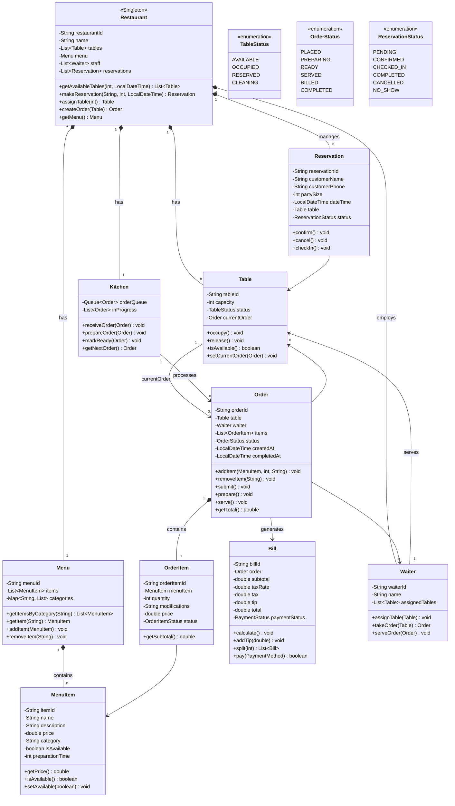
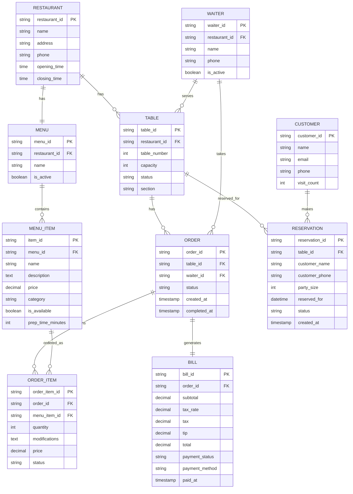

# Design for Restaurant Management System

## Mermaid Class Diagram



## Entity-Relationship Diagram



**Schema Notes:**
- `ORDER` flows through states: PLACED → PREPARING → READY → SERVED → BILLED
- `ORDER_ITEM.modifications` stores special requests (no onions, extra sauce)
- `RESERVATION` links customer to table for specific datetime
- `BILL` supports tips and multiple payment methods

---

## Class Diagram

```
┌─────────────────┐     ┌─────────────────┐     ┌─────────────────┐
│      Table      │     │   Reservation   │     │    MenuItem     │
├─────────────────┤     ├─────────────────┤     ├─────────────────┤
│ - tableId       │◄────│ - reservationId │     │ - itemId        │
│ - capacity      │     │ - customerName  │     │ - name          │
│ - status        │     │ - partySize     │     │ - price         │
│ - currentOrder  │     │ - dateTime      │     │ - category      │
└────────┬────────┘     └─────────────────┘     └────────┬────────┘
         │                                               │
         │1                                              │*
         │                                               │
         ▼*                                              ▼
┌─────────────────┐                            ┌─────────────────┐
│      Order      │◄───────────────────────────│    OrderItem    │
├─────────────────┤                            ├─────────────────┤
│ - orderId       │                            │ - menuItem      │
│ - table         │                            │ - quantity      │
│ - items         │                            │ - modifications │
│ - status        │                            │ - price         │
│ - createdAt     │                            └─────────────────┘
└────────┬────────┘
         │1
         │
         ▼1
┌─────────────────┐
│      Bill       │
├─────────────────┤
│ - billId        │
│ - subtotal      │
│ - tax           │
│ - tip           │
│ - total         │
└─────────────────┘
```

## Core Classes

### Table
- **Attributes**: tableId, capacity, status (AVAILABLE/OCCUPIED/RESERVED)
- **Methods**: occupy(), release(), isAvailable()

### TableStatus (Enum)
- AVAILABLE, OCCUPIED, RESERVED, CLEANING

### Order
- **Attributes**: orderId, table, items, status, createdAt
- **Methods**: addItem(), removeItem(), submit(), prepare(), serve()
- **Patterns Used**: State pattern

### OrderStatus (Enum)
- PLACED, PREPARING, READY, SERVED, BILLED, COMPLETED

### MenuItem
- **Attributes**: itemId, name, description, price, category
- **Methods**: getPrice(), isAvailable()

### Bill
- **Attributes**: billId, order, subtotal, taxRate, tip, total
- **Methods**: calculate(), addTip(), split()

## Key Design Decisions

1. **State for Orders**: Clean order workflow transitions
2. **Observer for Kitchen**: Real-time updates to kitchen display
3. **Strategy for Billing**: Different tax and tip calculations

## Complexity Analysis

- **Table search by capacity**: O(T) where T = tables
- **Order operations**: O(1)
- **Bill calculation**: O(I) where I = items in order
