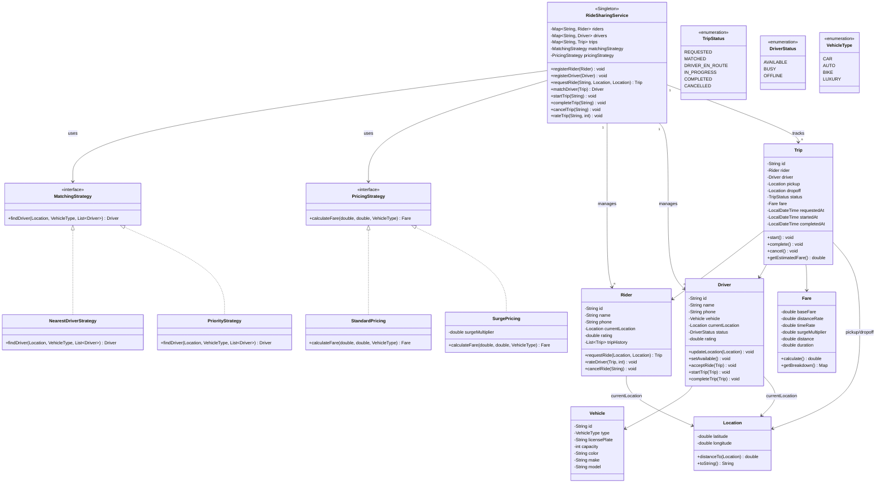
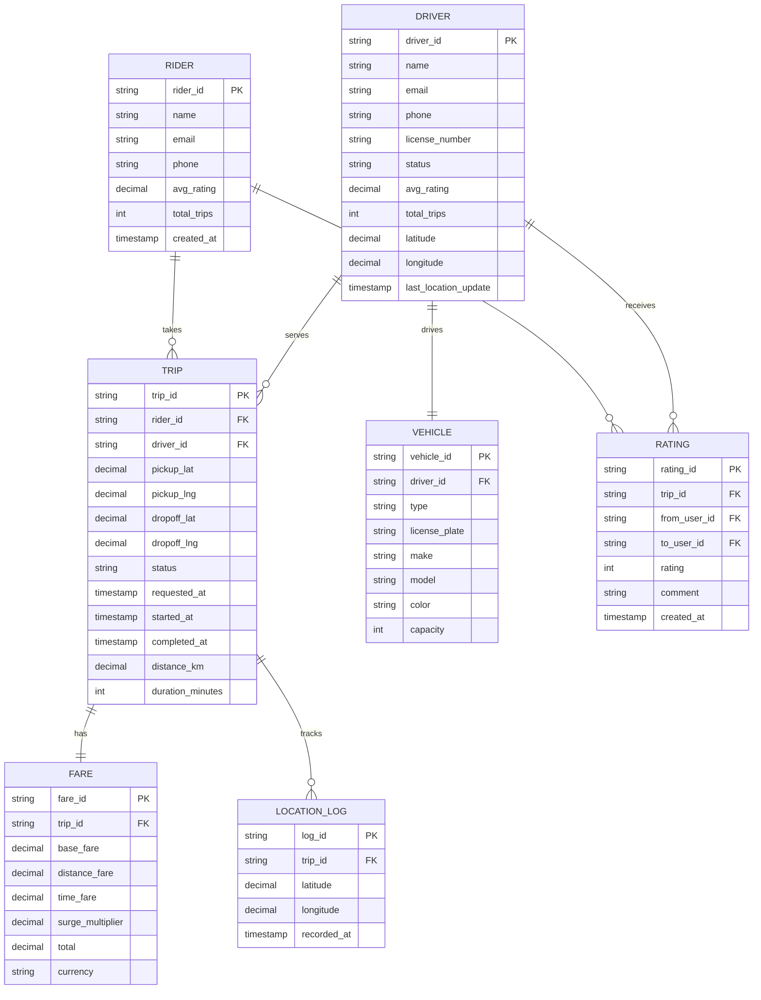

# Design for Ride Sharing System

## Mermaid Class Diagram



## Entity-Relationship Diagram



**Schema Notes:**
- `DRIVER` stores real-time location for matching
- `TRIP` records complete journey with timestamps
- `LOCATION_LOG` enables trip route tracking
- `RATING` supports bidirectional ratings (rider ↔ driver)

---

## Class Diagram

```
┌─────────────────┐       ┌─────────────────┐
│     Rider       │       │     Driver      │
├─────────────────┤       ├─────────────────┤
│ - id: String    │       │ - id: String    │
│ - name: String  │       │ - name: String  │
│ - phone: String │       │ - vehicle: Vehicle
│ - location      │       │ - location      │
│ - rating: double│       │ - status: Status│
│ - trips: List   │       │ - rating: double│
├─────────────────┤       ├─────────────────┤
│ + requestRide() │       │ + accept()      │
│ + rateDriver()  │       │ + updateLoc()   │
└────────┬────────┘       └────────┬────────┘
         │                         │
         │         ┌───────┐       │
         └────────>│ Trip  │<──────┘
                   ├───────┤
                   │-id    │
                   │-pickup│
                   │-dropoff│
                   │-status │
                   │-fare   │
                   └────┬───┘
                        │
              ┌─────────┴─────────┐
              │                   │
        ┌─────┴─────┐       ┌─────┴─────┐
        │ Location  │       │   Fare    │
        ├───────────┤       ├───────────┤
        │-latitude  │       │-baseFare  │
        │-longitude │       │-distance  │
        ├───────────┤       │-duration  │
        │+distanceTo│       │-surge     │
        └───────────┘       └───────────┘

┌─────────────────────────────────────────┐
│           RideSharingService            │
├─────────────────────────────────────────┤
│ - riders: Map<String, Rider>            │
│ - drivers: Map<String, Driver>          │
│ - trips: Map<String, Trip>              │
│ - matchingStrategy: MatchingStrategy    │
│ - pricingStrategy: PricingStrategy      │
├─────────────────────────────────────────┤
│ + registerRider()                       │
│ + registerDriver()                      │
│ + requestRide()                         │
│ + matchDriver()                         │
│ + startTrip()                           │
│ + completeTrip()                        │
└─────────────────────────────────────────┘

┌────────────────────┐    ┌────────────────────┐
│ MatchingStrategy   │    │ PricingStrategy    │
├────────────────────┤    ├────────────────────┤
│ + findDriver()     │    │ + calculateFare()  │
└────────┬───────────┘    └────────┬───────────┘
         │                         │
    ┌────┴────┐               ┌────┴────┐
    │         │               │         │
┌───┴───┐ ┌───┴───┐     ┌────┴───┐ ┌───┴────┐
│Nearest│ │Priority│     │Standard│ │ Surge  │
│Driver │ │Based   │     │Pricing │ │Pricing │
└───────┘ └───────┘     └────────┘ └────────┘
```

## Core Classes

### Location
- **Attributes**: latitude, longitude
- **Methods**: distanceTo(Location), toString()
- **Notes**: Simple coordinate representation

### Vehicle
- **Attributes**: id, type (CAR/AUTO/BIKE), licensePlate, capacity
- **Methods**: getters/setters
- **Patterns Used**: Enum for VehicleType

### Rider
- **Attributes**: id, name, phone, currentLocation, tripHistory, rating
- **Methods**: requestRide(), rateDriver(), cancelRide()
- **Notes**: Tracks trip history and ratings

### Driver
- **Attributes**: id, name, phone, vehicle, currentLocation, status, rating
- **Methods**: updateLocation(), setAvailable(), acceptRide(), startTrip()
- **Patterns Used**: Status enum (AVAILABLE, BUSY, OFFLINE)

### Trip
- **Attributes**: id, rider, driver, pickup, dropoff, status, fare, timestamps
- **Methods**: start(), complete(), cancel(), getEstimatedFare()
- **Patterns Used**: State pattern for trip status

### TripStatus (Enum)
- REQUESTED: Rider requested ride
- MATCHED: Driver assigned
- DRIVER_EN_ROUTE: Driver on way to pickup
- IN_PROGRESS: Trip started
- COMPLETED: Trip finished
- CANCELLED: Trip cancelled

### Fare
- **Attributes**: baseFare, distanceRate, timeRate, surgeMultiplier, distance, duration
- **Methods**: calculate(), getBreakdown()
- **Notes**: Encapsulates fare calculation logic

### MatchingStrategy (Interface)
- **Methods**: findDriver(Location, VehicleType, List<Driver>)
- **Implementations**: 
  - NearestDriverStrategy: Find closest available driver
  - PriorityStrategy: Consider ratings and distance
  - FairDistributionStrategy: Round-robin with distance factor

### PricingStrategy (Interface)
- **Methods**: calculateFare(distance, duration, vehicleType)
- **Implementations**:
  - StandardPricing: Base + distance + time
  - SurgePricing: Standard with multiplier
  - PromotionalPricing: Discounted rates

### RideSharingService (Singleton)
- **Attributes**: riders, drivers, trips, matchingStrategy, pricingStrategy
- **Methods**: registerRider(), registerDriver(), requestRide(), matchDriver(), 
  startTrip(), completeTrip(), cancelTrip(), rateTrip()
- **Patterns Used**: Singleton, Strategy (for matching and pricing)

## Key Design Decisions

### 1. Separation of Matching and Pricing
**Decision**: Use Strategy pattern for both
**Rationale**: 
- Different cities may have different matching algorithms
- Pricing can vary by time, demand, promotions
- Easy to A/B test different strategies

### 2. Trip State Machine
**Decision**: Explicit state transitions
**Rationale**:
- Clear lifecycle management
- Prevents invalid transitions
- Easy to audit and debug

### 3. Location as Value Object
**Decision**: Immutable Location class
**Rationale**:
- Locations don't change after creation
- Thread-safe by design
- Hashable for caching

### 4. Driver Pool Management
**Decision**: Central service manages driver availability
**Rationale**:
- Single source of truth for driver status
- Atomic matching operations
- Easy to implement surge detection

### 5. Rating System
**Decision**: Two-way rating (rider rates driver, driver rates rider)
**Rationale**:
- Improves service quality
- Mutual accountability
- Helps future matching decisions

## Complexity Analysis

### Time Complexity

| Operation | V1 Basic | V3 Optimized |
|-----------|----------|--------------|
| Find nearest driver | O(n) | O(log n) with spatial index |
| Request ride | O(n) | O(log n) |
| Start trip | O(1) | O(1) |
| Complete trip | O(1) | O(1) |
| Update location | O(1) | O(log n) to update index |

### Space Complexity

- Riders: O(r) where r = number of riders
- Drivers: O(d) where d = number of drivers  
- Trips: O(t) where t = number of trips
- Spatial Index: O(d) for driver locations
- Total: O(r + d + t)

## Thread Safety (V3)

### Protected Operations
1. Driver matching - synchronized block
2. Driver status updates - atomic operations
3. Trip state transitions - state locks
4. Rating updates - atomic counters

### Concurrent Collections Used
- ConcurrentHashMap for riders/drivers/trips
- ReentrantLock for driver matching
- AtomicInteger for counters

## Extension Points

1. **Payment Integration**: Add PaymentService
2. **Route Optimization**: Integrate mapping API
3. **Ride Sharing**: Pool multiple riders
4. **Scheduled Rides**: Add booking queue
5. **Driver Incentives**: Bonus calculation strategy
