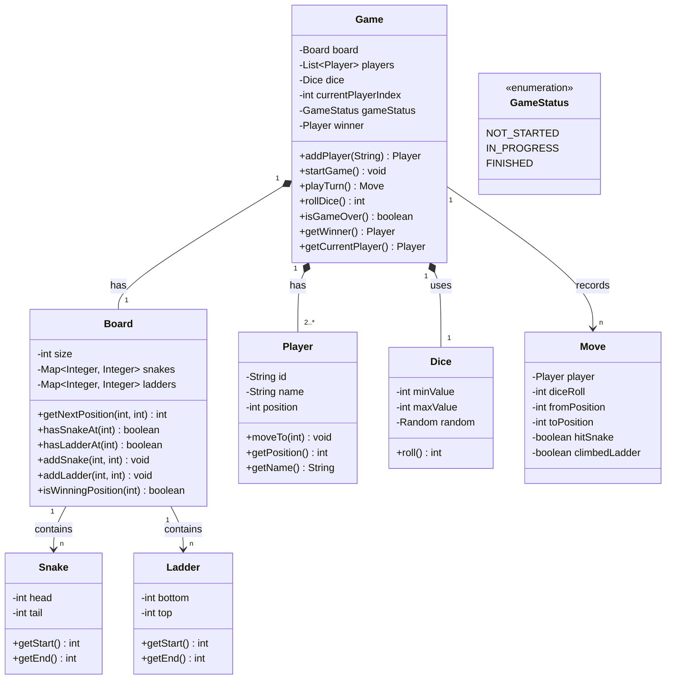
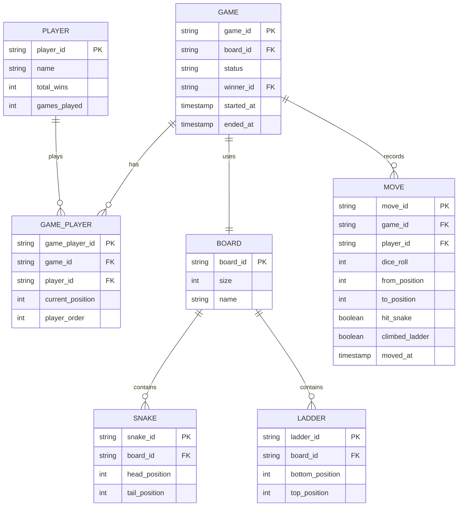

# Design for Snake and Ladder Game

Complete class design with diagrams, relationships, and key decisions.

---

## Mermaid Class Diagram



## Entity-Relationship Diagram



**Schema Notes:**
- `GAME_PLAYER` junction table tracks player positions per game
- `BOARD` can be reused with different snake/ladder configurations
- `MOVE` provides complete game replay capability
- `SNAKE` and `LADDER` validate positions (head > tail, top > bottom)

---

## Class Diagram

```
┌────────────────────────────────────────────────────────────────────────┐
│                              Game                                       │
├────────────────────────────────────────────────────────────────────────┤
│ - board: Board                                                          │
│ - players: List<Player>                                                 │
│ - dice: Dice                                                            │
│ - currentPlayerIndex: int                                               │
│ - gameStatus: GameStatus                                                │
│ - winner: Player                                                        │
├────────────────────────────────────────────────────────────────────────┤
│ + addPlayer(name: String): Player                                       │
│ + startGame(): void                                                     │
│ + playTurn(): Move                                                      │
│ + rollDice(): int                                                       │
│ + isGameOver(): boolean                                                 │
│ + getWinner(): Player                                                   │
│ + getCurrentPlayer(): Player                                            │
└───────────────────────────────┬────────────────────────────────────────┘
                                │
           ┌────────────────────┼────────────────────┐
           │ uses               │ has                │ uses
           ▼                    ▼                    ▼
┌─────────────────────┐  ┌─────────────┐  ┌─────────────────────┐
│       Board         │  │   Player    │  │       Dice          │
├─────────────────────┤  ├─────────────┤  ├─────────────────────┤
│ - size: int         │  │ - id: String│  │ - min: int          │
│ - snakes: Map       │  │ - name: Str │  │ - max: int          │
│ - ladders: Map      │  │ - position  │  │ - random: Random    │
├─────────────────────┤  ├─────────────┤  ├─────────────────────┤
│ + getNextPosition() │  │ + moveTo()  │  │ + roll(): int       │
│ + hasSnakeAt()      │  │ + getPos()  │  └─────────────────────┘
│ + hasLadderAt()     │  └─────────────┘
│ + addSnake()        │
│ + addLadder()       │
└─────────────────────┘


┌─────────────────────┐     ┌─────────────────────┐
│       Snake         │     │       Ladder        │
├─────────────────────┤     ├─────────────────────┤
│ - start: int        │     │ - start: int        │
│ - end: int          │     │ - end: int          │
├─────────────────────┤     ├─────────────────────┤
│ + getStart(): int   │     │ + getStart(): int   │
│ + getEnd(): int     │     │ + getEnd(): int     │
└─────────────────────┘     └─────────────────────┘


┌─────────────────────┐
│  GameStatus <<enum>>│
├─────────────────────┤
│ NOT_STARTED         │
│ IN_PROGRESS         │
│ FINISHED            │
└─────────────────────┘
```

---

## Enumerations

### GameStatus
```
GameStatus {
    NOT_STARTED,
    IN_PROGRESS,
    FINISHED
}
```

---

## Core Classes

### Game
- **Attributes**:
  - `board: Board` - The game board
  - `players: List<Player>` - All players
  - `dice: Dice` - Dice for rolling
  - `currentPlayerIndex: int` - Current turn
  - `gameStatus: GameStatus` - Game state
  - `winner: Player` - Winning player
- **Methods**:
  - `addPlayer(String): Player` - Add new player
  - `startGame(): void` - Initialize game
  - `playTurn(): Move` - Execute current player's turn
  - `rollDice(): int` - Roll the dice
  - `isGameOver(): boolean` - Check if game ended
  - `getWinner(): Player` - Get winner
  - `getCurrentPlayer(): Player` - Current turn player
- **Patterns Used**: None directly, uses composition

### Board
- **Attributes**:
  - `size: int` - Board size (e.g., 100)
  - `snakes: Map<Integer, Integer>` - Snake positions (head → tail)
  - `ladders: Map<Integer, Integer>` - Ladder positions (bottom → top)
- **Methods**:
  - `getNextPosition(int, int): int` - Calculate position after move
  - `hasSnakeAt(int): boolean` - Check for snake
  - `hasLadderAt(int): boolean` - Check for ladder
  - `addSnake(int, int): void` - Add snake
  - `addLadder(int, int): void` - Add ladder
  - `isWinningPosition(int): boolean` - Check if at final

### Player
- **Attributes**:
  - `id: String` - Unique identifier
  - `name: String` - Player name
  - `position: int` - Current position (starts at 0)
- **Methods**:
  - `moveTo(int): void` - Move to position
  - `getPosition(): int` - Get current position

### Dice
- **Attributes**:
  - `minValue: int` - Minimum roll (typically 1)
  - `maxValue: int` - Maximum roll (typically 6)
  - `random: Random` - Random generator
- **Methods**:
  - `roll(): int` - Generate random roll

### Snake
- **Attributes**:
  - `start: int` - Head position (higher)
  - `end: int` - Tail position (lower)
- Validation: start > end

### Ladder
- **Attributes**:
  - `start: int` - Bottom position (lower)
  - `end: int` - Top position (higher)
- Validation: start < end

---

## Key Design Decisions

### Decision 1: HashMap for Snakes/Ladders
**Rationale**: 
- O(1) lookup for snake/ladder at position
- Direct mapping from start to end position
- Memory efficient for sparse board

**Trade-off**:
- Slightly more complex than array
- Need to handle missing keys

---

### Decision 2: Position 0 as Starting Point
**Rationale**:
- Players start "off the board"
- Position 1 is first valid board square
- Clean win condition: position == boardSize

---

### Decision 3: Separate Snake/Ladder Classes
**Rationale**:
- Type safety
- Validation logic per type
- Extensible for effects

**Alternative**: 
- Single `BoardElement` with direction

---

## Complexity Analysis

### Time Complexity

| Operation | Complexity |
|-----------|------------|
| Add player | O(1) |
| Roll dice | O(1) |
| Calculate position | O(1) |
| Check snake/ladder | O(1) |
| Get next position | O(1) |

### Space Complexity

| Component | Complexity |
|-----------|------------|
| Board (snakes) | O(s) where s = snakes |
| Board (ladders) | O(l) where l = ladders |
| Players | O(p) where p = players |
| **Total** | O(s + l + p) |

---

## Thread Safety (v3)

### Critical Sections:
1. **Player position updates** - Multiple games accessing same player
2. **Dice roll** - Ensure true randomness
3. **Turn management** - Prevent double moves

### Synchronization Strategy:
```java
// Synchronized turn execution
public synchronized Move playTurn() {
    // Roll, move, check win
}

// Thread-safe dice
private final SecureRandom random = new SecureRandom();
```

---

## Extension Points

| Feature | Where to Add | Pattern |
|---------|--------------|---------|
| New dice types | DiceStrategy | Strategy |
| Board themes | BoardFactory | Factory |
| Move undo | MoveCommand | Command |
| UI updates | GameObserver | Observer |
| Special squares | BoardElement | Inheritance |
