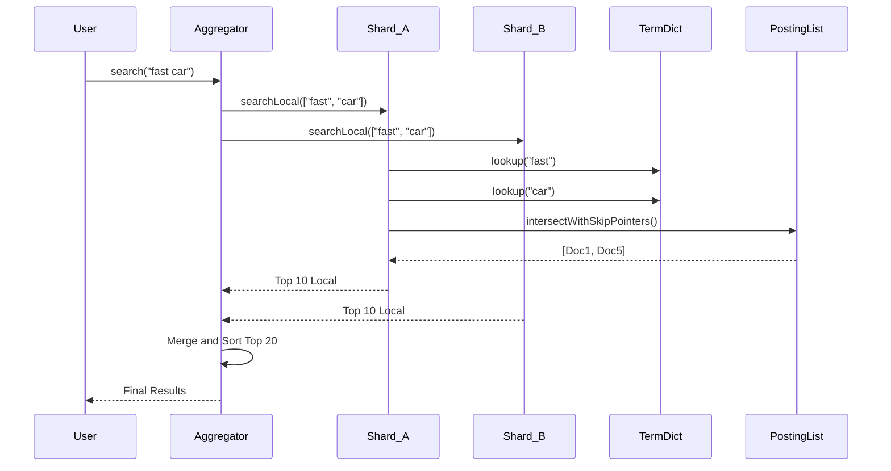

# Code Walkthrough: Social Post Search

## Execution Flow Analysis
This walkthrough focuses on the critical read path: executing a multi-term search query (e.g., "fast car") on a single `SearchShard`. The primary engineering goal is to intersect two massive `PostingLists` in the most CPU-efficient manner possible.

1. **Tokenization and Lookup (`v1-basic` to `v3-optimized`):**
   The search applies explicit stopword normalization using a fixed set of common words (e.g., "a", "the", "is") and extracts alphabetic terms. The system explicitly rejects empty tokens and missing terms, yielding precise query tokens like `["fast", "car"]`.
   ```java
   // Java v3-optimized Tokenizer explicit stopword normalization
   while (matcher.find()) {
       String token = matcher.group();
       if (!STOP_WORDS.contains(token)) {
           tokens.add(token);
       }
   }
   ```
   ```python
   # Python v3-optimized Tokenizer explicit stopword normalization
   tokens = [t for t in re.findall(r'\b\w+\b', text.lower()) if t not in cls.STOP_WORDS]
   ```

2. **Posting List Intersection (Explicit AND/OR query grammar):**
   In `v2-extended` and `v3-optimized`, the `QueryPlanner` implements an explicit AND/OR query grammar. It groups terms separated by "OR", computes intersections (AND) for terms within each group, and unions the results across groups. The naive approach (iterating through both lists completely) is O(N+M), which is too slow.
   - **Optimization 1: Start Small.** The code begins evaluations with the shortest posting lists.
   - **Optimization 2: Skip Pointers.** For large lists, posting structures use skip pointers to jump directly ahead to matching blocks, turning an O(N) scan into O(log N).

3. **Scoring and Early Termination (BM25 Ranking):**
   In `v2-extended` and `v3-optimized`, the code calculates a score using a hand-calculated BM25 ranking. This avoids arbitrary relevance recommendations by explicitly incorporating document frequency (number of posts containing the term) and average length (average words per post in the index). A deterministic tie order matches perfectly between Java and Python by sorting on `-score` and falling back to ascending Post ID. Post deletes and postings updates correctly subtract term frequencies from the index so stale metadata doesn't skew the BM25 parameters.
   ```python
   # Python v3-optimized hand-calculated BM25 and deterministic tie order
   idf = math.log(1 + (N - df + 0.5) / (df + 0.5))
   term_score = idf * ((tf * (self.k1 + 1)) / (tf + self.k1 * (1 - self.b + self.b * doc_len / (avgdl or 1))))
   scores.append((post_id, score))
   scores.sort(key=lambda x: (-x[1], x[0])) # Deterministic tie order
   ```
   ```java
   // Java v3-optimized hand-calculated BM25 and deterministic tie order
   double idf = Math.log(1 + (N - df + 0.5) / (df + 0.5));
   double termScore = idf * ((tf * (k1 + 1)) / (tf + k1 * (1 - b + b * docLen / (avgdl == 0 ? 1 : avgdl))));
   scores.sort((e1, e2) -> {
       int cmp = Double.compare(e2.getValue(), e1.getValue());
       if (cmp == 0) return e1.getKey().compareTo(e2.getKey());
       return cmp;
   });
   ```

4. **Testing Edge Cases (Empty Tokens, Missing Terms, Deletes, Updates):**
   Testing suites specifically validate these paths. Tests assert that queries composed of empty tokens or missing terms fail gracefully. Furthermore, tests ensure deletes and updates properly reflect in queries, avoiding stale indices.
   ```python
   # Python v3-optimized test excerpt testing deletes, updates, empty and missing terms
    def test_empty_and_missing_terms(self):
        self.service.upsert("p5", "Just some random text without those keywords.", "idemp5", "us-east")
        # Empty tokens behavior
        self.assertEqual(self.service.search("", "us-east"), [])
        self.assertEqual(self.service.search("   ", "us-east"), [])
        
        # Missing term
        self.assertEqual(self.service.search("zebra", "us-east"), [])
        self.assertEqual(self.service.search("zebra AND fox", "us-east"), [])

    def test_deterministic_tie_order(self):
        # p1 and p2 have the exact same length and same number of matches for "brown OR fox"
        # Since Python sort uses (-score, post_id), tie should be resolved by ascending post_id.
        results = self.service.search("brown OR fox", "us-east")
        self.assertEqual(results, ["p4", "p1", "p2"])

    def test_deletes_and_updates(self):
        self.service.upsert("up1", "apple banana cherry", "idemp_up1", "us-east")
        self.assertEqual(["up1"], self.service.search("banana", "us-east"))
        
        # Update: change text to remove banana
        self.service.upsert("up1", "apple dog cherry", "idemp_up1_2", "us-east")
        self.assertEqual([], self.service.search("banana", "us-east"))
        self.assertEqual(["up1", "p1", "p2"], self.service.search("dog", "us-east"))
        
        # Delete
        self.service.delete("up1", "us-east")
        self.assertEqual(["p1", "p2"], self.service.search("dog", "us-east"))
   ```

5. **Return Partial Results:**
   The `SearchShard` returns its top 10 results (Doc IDs and Scores) back to the `Aggregator`.

### Sequence Diagram


## Concurrency Control
The `SearchShard` handles concurrency using a multiple-readers, single-writer pattern. The on-disk index segments are immutable; therefore, search threads can read them without any locks.
When the background indexing thread flushes the in-memory index to disk to create a new segment, it atomically swaps a pointer in the `SegmentManager`. Ongoing queries continue using the old pointer, while new queries use the new pointer. Once the old queries finish, the old memory structures are safely garbage collected. This lock-free read path is essential for high-throughput search.
