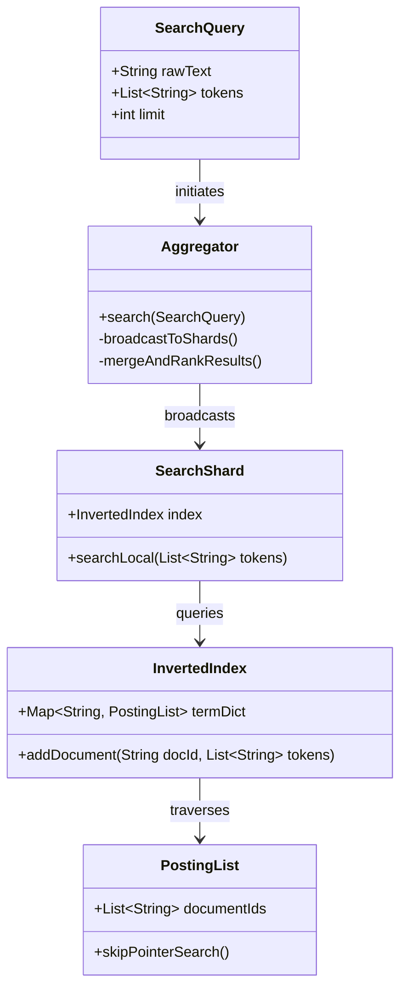

# Design Document: Social Post Search

## System Architecture
The architecture is designed to isolate the computationally expensive task of indexing from the latency-sensitive task of querying.

### Core Components
1. **API Gateway:** Routes search requests and handles authentication.
2. **Aggregator Node:** Receives a search query, broadcasts it to all search shards, waits for partial results, and performs the final merge, sort, and scoring before returning the response to the user.
3. **Search Shards (Nodes):** The workhorses. They hold a subset of the Inverted Index (partitioned by Document ID) and execute the actual intersection of term lists.
4. **Indexer Fleet:** Consumes streams of new posts, tokenizes them, and routes the updates to the appropriate Search Shards.
5. **Primary Database:** The source of truth for the raw post data, used for rebuilding the index from scratch if catastrophic failure occurs.

### Mermaid Class Diagram


## Data Model and Schema
The Inverted Index is conceptually simple but structurally complex to optimize.
- **Term Dictionary:** A B-Tree or Hash Map storing the actual string (e.g., "apple") and a pointer to the Posting List.
- **Posting List:** An ordered array of `DocumentIDs`. To optimize intersection queries (e.g., searching for "red" AND "apple"), these lists are strictly ordered.
- **Forward Index:** Maps `DocumentID` to the actual raw text and metadata (likes, timestamp). This is required for snippet generation and final scoring.

## Trade-offs and Considerations
- **Eventual Consistency:** Search results are eventually consistent. A post might be successfully saved in the primary database but take 1-2 seconds to appear in the search index due to the asynchronous indexing pipeline. This is an acceptable trade-off for decoupled performance.
- **Memory vs. Disk:** Keeping the entire Inverted Index in RAM provides incredible speed but is cost-prohibitive at scale. We trade some speed by keeping only the Term Dictionary and the most recently updated Posting Lists in memory, relying on memory-mapped files (mmap) and the OS page cache for the bulk of the historical Posting Lists on NVMe SSDs.

## Domain Contracts

### Indexing and Tokenization
- **Stopword Normalization:** Texts are tokenized into lower-cased alphanumeric strings, with strict removal of common stopwords (`a`, `an`, `the`, `and`, `or`, `but`, `in`, `on`, `at`, `to`, `for`, `is`, `are`, `was`, `were`). Empty tokens and missing terms are explicitly handled and rejected/ignored to prevent null pointer and empty string matching anomalies.

Java Parity:
```java
    public static List<String> tokenize(String text) {
        if (text == null) return new ArrayList<>();
        List<String> tokens = new ArrayList<>();
        Matcher matcher = WORD_PATTERN.matcher(text.toLowerCase());
        while (matcher.find()) {
            String token = matcher.group();
            if (!STOP_WORDS.contains(token)) {
                tokens.add(token);
            }
        }
        return tokens;
    }
```

Python Parity:
```python
    @classmethod
    def tokenize(cls, text: str) -> List[str]:
        tokens = re.findall(r'\b\w+\b', text.lower())
        return [t for t in tokens if t not in cls.STOP_WORDS]
```

- **Deletes and Updates:** Index updates correctly invalidate older mappings. Deleting a post updates the document length tracker, term frequencies, and the total document count so that subsequent rankings do not factor in stale metadata.

Java Test Parity:
```java
    @Test
    void testDeletesAndUpdates() {
        service.upsert("up1", "apple banana cherry", "idemp_up1", "us-east");
        assertEquals(Arrays.asList("up1"), service.search("banana", "us-east"));
        
        // Update: remove banana
        service.upsert("up1", "apple dog cherry", "idemp_up1_2", "us-east");
        assertEquals(java.util.Collections.emptyList(), service.search("banana", "us-east"));
        assertEquals(Arrays.asList("up1", "p1", "p2"), service.search("dog", "us-east"));
        
        // Delete
        service.delete("up1", "us-east");
        assertEquals(Arrays.asList("p1", "p2"), service.search("dog", "us-east"));
    }
```

Python Test Parity:
```python
    def test_deletes_and_updates(self):
        self.service.upsert("up1", "apple banana cherry", "idemp_up1", "us-east")
        self.assertEqual(["up1"], self.service.search("banana", "us-east"))
        
        # Update: change text to remove banana
        self.service.upsert("up1", "apple dog cherry", "idemp_up1_2", "us-east")
        self.assertEqual([], self.service.search("banana", "us-east"))
        self.assertEqual(["up1", "p1", "p2"], self.service.search("dog", "us-east"))
        
        # Delete
        self.service.delete("up1", "us-east")
        self.assertEqual(["p1", "p2"], self.service.search("dog", "us-east"))
```

### Query Grammar
- **AND/OR Resolution:** The search system strictly evaluates `AND` groups and joins them using `OR`. Explicit handling merges intersecting tokens (via standard sets in the naive version) to satisfy conjunctions and merges disjunctions across grouped term filters.

### Search Ranking (BM25)
- **Deterministic Hand-Calculated BM25:** Relevance isn't arbitrarily assigned. It utilizes a deterministic BM25 implementation.
- **Formulas and Variables:** It uses explicit total document frequency (`df`), calculated global average document length (`avgdl`), and localized term frequencies (`tf`). 

Java Parity:
```java
                double idf = Math.log(1 + (N - df + 0.5) / (df + 0.5));
                double termScore = idf * ((tf * (k1 + 1)) / (tf + k1 * (1 - b + b * docLen / (avgdl == 0 ? 1 : avgdl))));
                score += termScore;
```

Python Parity:
```python
                df = len(self.index.index.get(term, set()))
                N = self.index.total_docs
                idf = math.log(1 + (N - df + 0.5) / (df + 0.5))
                term_score = idf * ((tf * (self.k1 + 1)) / (tf + self.k1 * (1 - self.b + self.b * doc_len / (avgdl or 1))))
                score += term_score
```

- **Tie-Breaker:** When scores mathematically tie, tie order is deterministically resolved using a lexicographical fallback on the candidate Post IDs.

Java Parity:
```java
        scores.sort((e1, e2) -> {
            int cmp = Double.compare(e2.getValue(), e1.getValue());
            if (cmp == 0) return e1.getKey().compareTo(e2.getKey());
            return cmp;
        });
```

Python Parity:
```python
        scores.sort(key=lambda x: (-x[1], x[0]))
```
