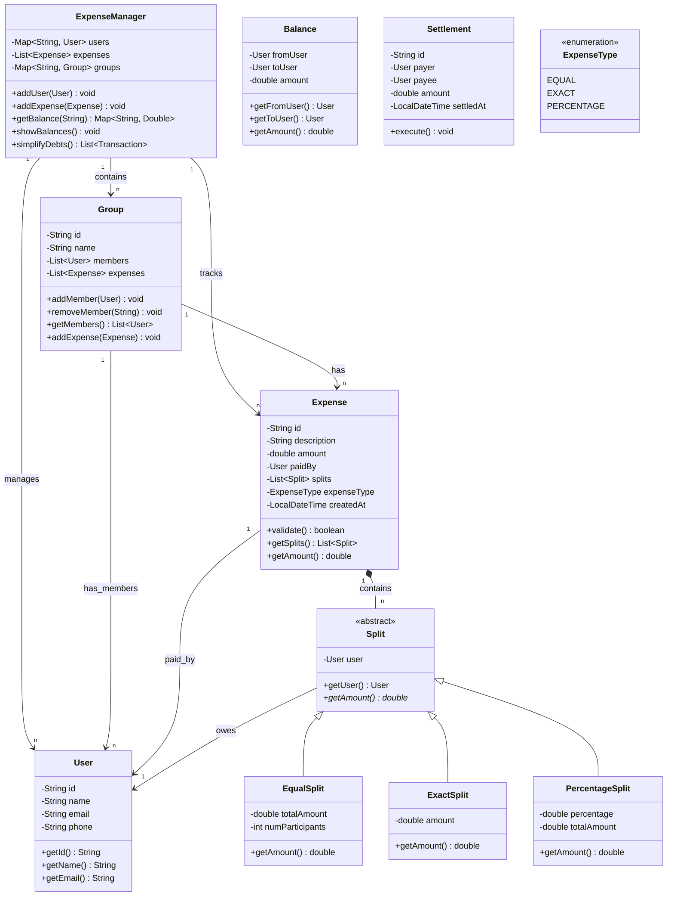
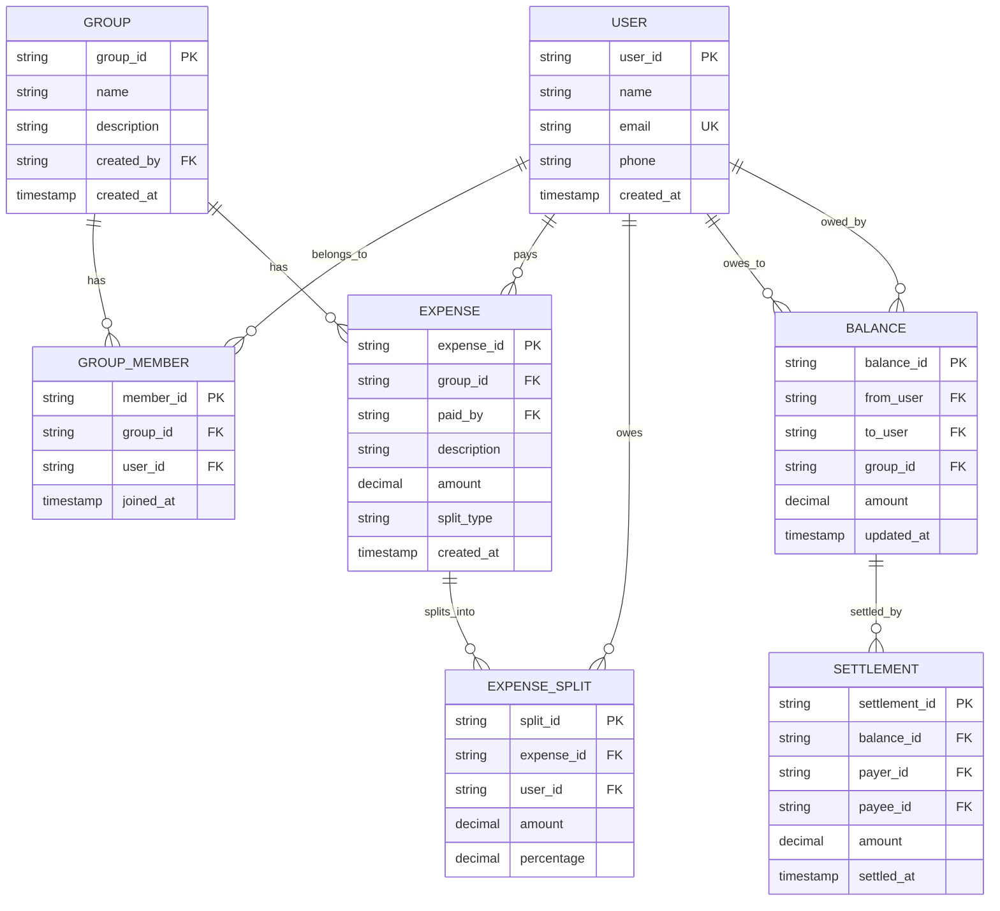

# Design for Splitwise

Complete class design with diagrams and key decisions.

---

## Mermaid Class Diagram



## Entity-Relationship Diagram



**Schema Notes:**
- `EXPENSE_SPLIT` stores each user's share of an expense
- `BALANCE` tracks net amounts owed between user pairs
- `SETTLEMENT` records when debts are paid off
- Group expenses vs individual expenses both supported

---

## Class Diagram

```
┌─────────────────────────────────────────────────────────────────────┐
│                        ExpenseManager                               │
├─────────────────────────────────────────────────────────────────────┤
│ - users: Map<String, User>                                          │
│ - expenses: List<Expense>                                           │
│ - groups: Map<String, Group>                                        │
├─────────────────────────────────────────────────────────────────────┤
│ + addUser(User): void                                               │
│ + addExpense(Expense): void                                         │
│ + getBalance(userId): Map<String, Double>                           │
│ + showBalances(): void                                              │
│ + simplifyDebts(): List<Transaction>                                │
└───────────────────────────────┬─────────────────────────────────────┘
                                │ manages
          ┌─────────────────────┼─────────────────────┐
          ▼                     ▼                     ▼
┌───────────────────┐  ┌───────────────────┐  ┌───────────────────┐
│       User        │  │     Expense       │  │      Group        │
├───────────────────┤  ├───────────────────┤  ├───────────────────┤
│ - id: String      │  │ - id: String      │  │ - id: String      │
│ - name: String    │  │ - description     │  │ - name: String    │
│ - email: String   │  │ - amount: double  │  │ - members: User[] │
├───────────────────┤  │ - paidBy: User    │  ├───────────────────┤
│ + getId()         │  │ - splits: Split[] │  │ + addMember()     │
└───────────────────┘  │ - splitType       │  │ + getMembers()    │
                       ├───────────────────┤  └───────────────────┘
                       │ + validate()      │
                       │ + getSplits()     │
                       └────────┬──────────┘
                                │ contains
                                ▼
         ┌─────────────────────────────────────────────────┐
         │              Split <<abstract>>                 │
         ├─────────────────────────────────────────────────┤
         │ - user: User                                    │
         ├─────────────────────────────────────────────────┤
         │ + getUser(): User                               │
         │ + getAmount(): double <<abstract>>              │
         └──────────────────────┬──────────────────────────┘
                                │
          ┌─────────────────────┼─────────────────────┐
          ▼                     ▼                     ▼
┌───────────────────┐  ┌───────────────────┐  ┌───────────────────┐
│    EqualSplit     │  │    ExactSplit     │  │ PercentageSplit   │
├───────────────────┤  ├───────────────────┤  ├───────────────────┤
│ - totalAmount     │  │ - amount: double  │  │ - percentage: %   │
│ - numParticipants │  ├───────────────────┤  │ - totalAmount     │
├───────────────────┤  │ + getAmount()     │  ├───────────────────┤
│ + getAmount()     │  └───────────────────┘  │ + getAmount()     │
└───────────────────┘                         └───────────────────┘
```

---

## Split Calculation

### Equal Split
```
amount = totalAmount / numberOfParticipants
// Handle rounding: give extra cents to first participant
```

### Exact Split
```
// User specifies exact amount
// Validation: sum of splits == totalAmount
```

### Percentage Split
```
amount = totalAmount * (percentage / 100)
// Validation: sum of percentages == 100
```

---

## Balance Calculation Algorithm

```
For each expense:
    payer = expense.getPaidBy()
    for each split in expense.getSplits():
        borrower = split.getUser()
        amount = split.getAmount()
        
        if borrower != payer:
            balances[borrower][payer] += amount
            balances[payer][borrower] -= amount  // Can go negative

// Simplify: if A owes B $10 and B owes A $3, net is A owes B $7
```

---

## Debt Simplification Algorithm (v3)

```
simplifyDebts():
    1. Calculate net balance for each user
       netBalance[user] = (money owed to user) - (money user owes)
    
    2. Separate into creditors (positive) and debtors (negative)
    
    3. Greedy matching:
       While there are creditors and debtors:
           Find max creditor and max debtor
           amount = min(creditor.balance, abs(debtor.balance))
           Create transaction: debtor pays creditor `amount`
           Update balances
    
    Time: O(n log n) for sorting, O(n) for matching
    
    Note: This is a heuristic. Optimal solution is NP-hard.
```

---

## Key Design Decisions

### Decision 1: Strategy Pattern for Splits
**Rationale**: 
- Different calculation logic per split type
- Easy to add new split types
- Clean separation of concerns

### Decision 2: Balance as Derived Data
**Rationale**:
- Calculate on-demand from expense history
- No sync issues between expenses and balances
- Trade-off: O(n) calculation vs O(1) lookup with caching

### Decision 3: Rounding Strategy
**Rationale**:
- Use BigDecimal/Decimal for accuracy
- Round to 2 decimal places
- Assign remaining cents to first participant

---

## Complexity Analysis

| Operation | Complexity | Notes |
|-----------|------------|-------|
| Add expense | O(k) | k = participants |
| Get balance for user | O(e * k) | e = expenses |
| Show all balances | O(n² + e*k) | n = users |
| Simplify debts | O(n log n) | Greedy approach |

---

## Extension Points

| Feature | Implementation |
|---------|----------------|
| Multiple currencies | Add currency to Amount class |
| Recurring expenses | Schedule with cron-like pattern |
| Expense categories | Add category field |
| Attachments | Link to file storage |
| Notifications | Observer pattern |
