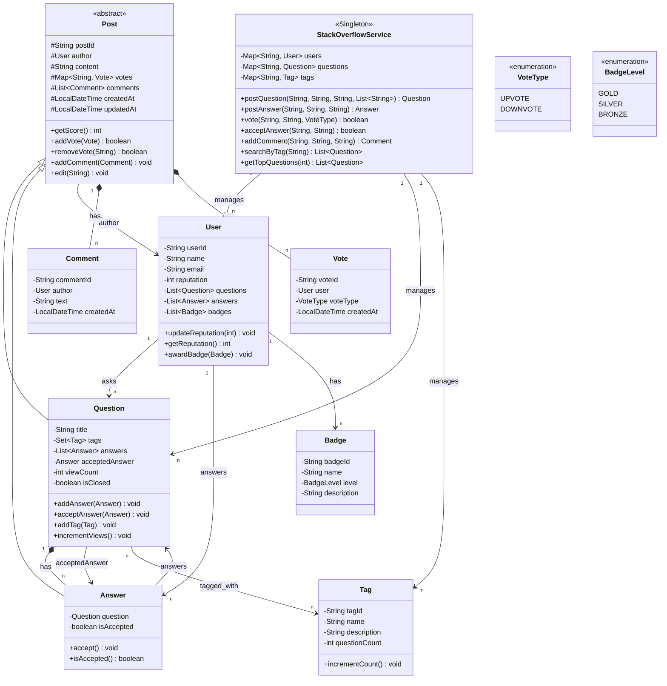
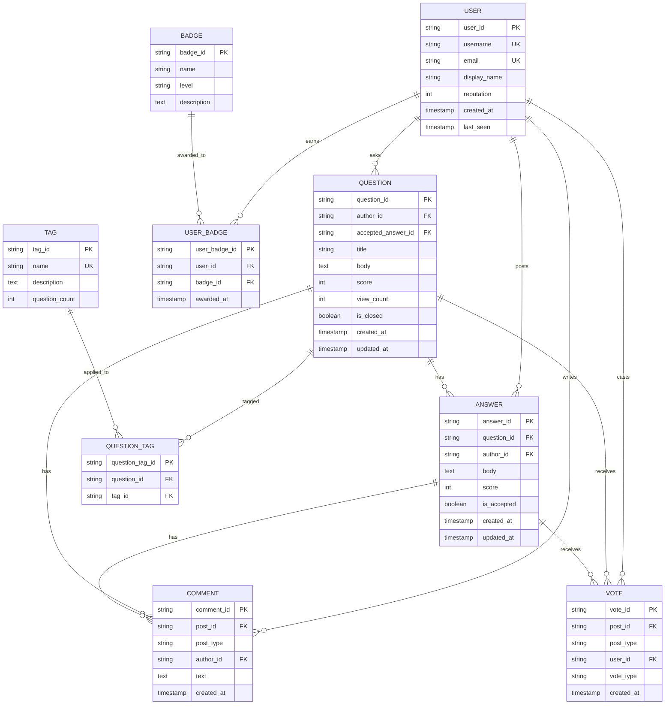

# Design for Stack Overflow

## Mermaid Class Diagram



## Entity-Relationship Diagram



**Schema Notes:**
- `VOTE` uses polymorphic association via `post_type` (question/answer)
- `COMMENT` similarly uses `post_type` for questions or answers
- `QUESTION_TAG` junction table for many-to-many tagging
- Reputation updates triggered by vote events

---

## Class Diagram

```
┌─────────────────────────────────────────────────────────────────────────┐
│                      StackOverflowService                                │
│                         <<Singleton>>                                    │
├─────────────────────────────────────────────────────────────────────────┤
│ + postQuestion(userId, title, body, tags): Question                      │
│ + postAnswer(userId, questionId, body): Answer                           │
│ + vote(userId, postId, voteType): boolean                                │
│ + acceptAnswer(userId, answerId): boolean                                │
│ + addComment(userId, postId, text): Comment                              │
│ + searchByTag(tag): List<Question>                                       │
│ + getTopQuestions(count): List<Question>                                 │
└─────────────────────────────────────────────────────────────────────────┘

┌─────────────────────────────────────────────────────────────────────────┐
│                         User                                             │
├─────────────────────────────────────────────────────────────────────────┤
│ - userId: String                                                         │
│ - name: String                                                           │
│ - reputation: int                                                        │
│ - questions: List<Question>                                              │
│ - answers: List<Answer>                                                  │
├─────────────────────────────────────────────────────────────────────────┤
│ + updateReputation(delta): void                                          │
│ + getReputation(): int                                                   │
└─────────────────────────────────────────────────────────────────────────┘

┌─────────────────────────────────────────────────────────────────────────┐
│                      Post <<abstract>>                                   │
├─────────────────────────────────────────────────────────────────────────┤
│ # postId: String                                                         │
│ # author: User                                                           │
│ # content: String                                                        │
│ # votes: Map<String, Vote>                                              │
│ # comments: List<Comment>                                                │
│ # createdAt: DateTime                                                    │
├─────────────────────────────────────────────────────────────────────────┤
│ + getScore(): int                                                        │
│ + addVote(vote): boolean                                                 │
│ + addComment(comment): void                                              │
└────────────────────────┬────────────────────────────────────────────────┘
                         │
         ┌───────────────┴───────────────┐
         ▼                               ▼
┌─────────────────────────┐   ┌────────────────────────────┐
│       Question          │   │         Answer             │
├─────────────────────────┤   ├────────────────────────────┤
│ - title: String         │   │ - question: Question       │
│ - tags: Set<Tag>        │   │ - isAccepted: boolean      │
│ - answers: List<Answer> │   ├────────────────────────────┤
│ - acceptedAnswer: Answer│   │ + accept(): void           │
├─────────────────────────┤   │ + isAccepted(): boolean    │
│ + addAnswer(answer)     │   └────────────────────────────┘
│ + acceptAnswer(answer)  │
│ + addTag(tag)           │
└─────────────────────────┘

┌─────────────────────────┐   ┌────────────────────────────┐
│         Vote            │   │        Comment             │
├─────────────────────────┤   ├────────────────────────────┤
│ - user: User            │   │ - author: User             │
│ - voteType: VoteType    │   │ - text: String             │
│ - createdAt: DateTime   │   │ - createdAt: DateTime      │
└─────────────────────────┘   └────────────────────────────┘

VoteType { UPVOTE, DOWNVOTE }
```

---

## Key Design Decisions

### Decision 1: Post as Abstract Base Class
**Rationale**: Questions and answers share voting, comments, and scoring behavior.

### Decision 2: Vote Map by User ID
**Rationale**: O(1) lookup for existing vote, prevents duplicates.

### Decision 3: Reputation as User Attribute
**Rationale**: Central tracking, updated on vote/accept events.

---

## Complexity Analysis

| Operation | Complexity |
|-----------|------------|
| Vote | O(1) |
| Get score | O(1) with cache |
| Search by tag | O(n) or O(1) with index |
| Get answers | O(k) k = answer count |

---

## Thread Safety (v3)

- AtomicInteger for vote scores
- ConcurrentHashMap for votes
- Synchronized reputation updates
