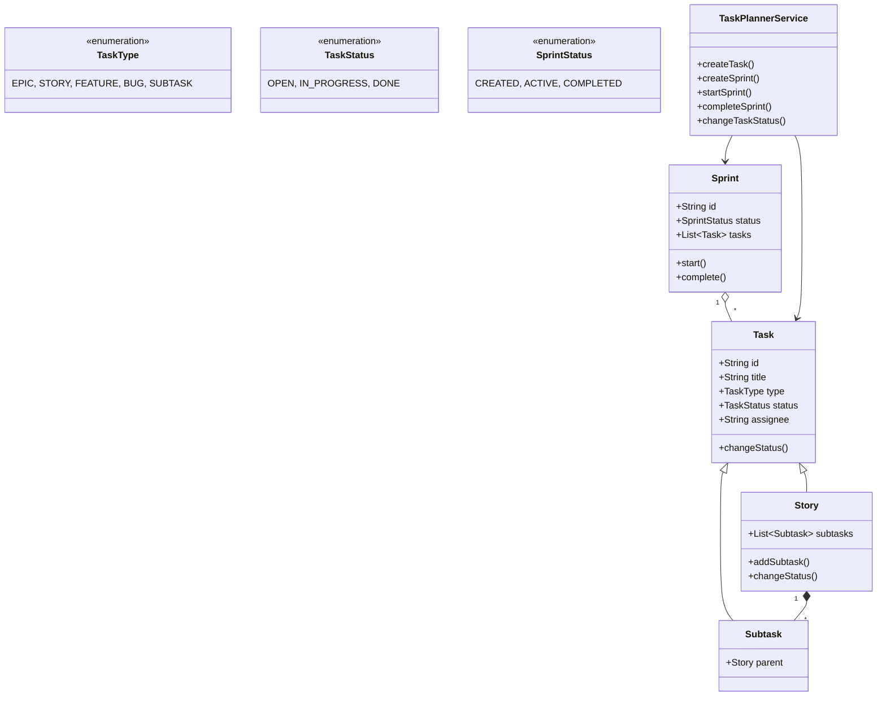
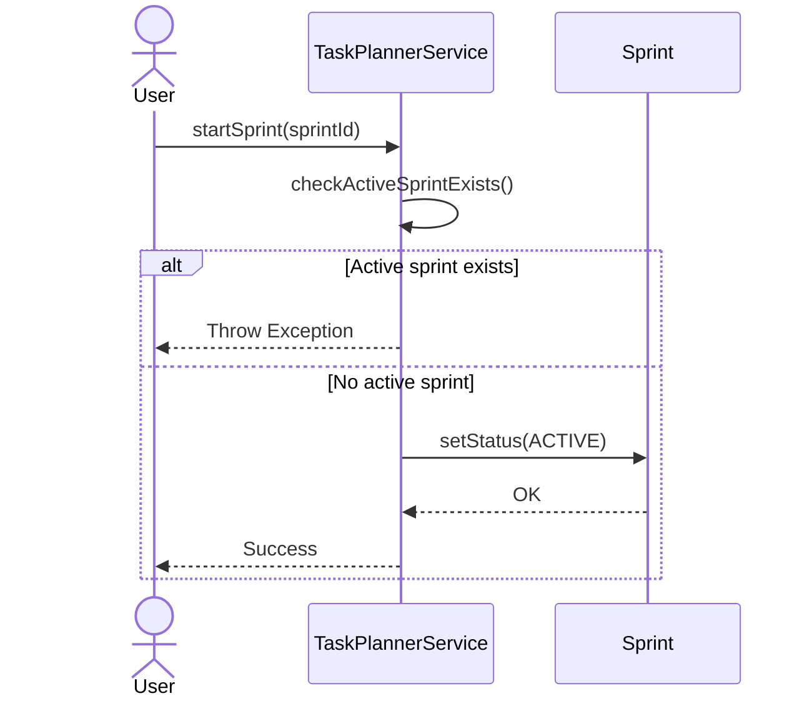
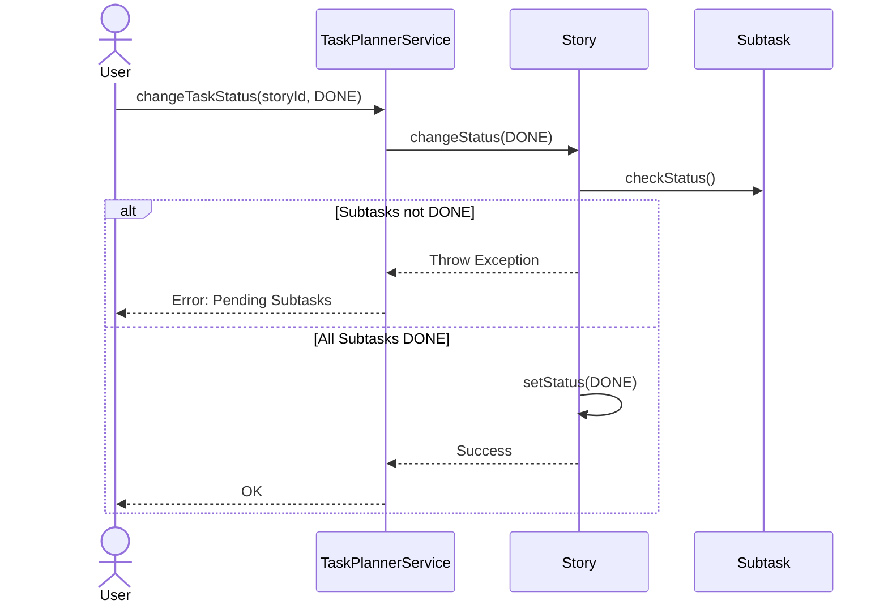

# Task Planner - Design

## System Architecture
The Task Planner consists of three main layers:
1. **Domain Entities**: `Task`, `Story`, `Subtask`, `Sprint`
2. **Business Logic Layer**: `TaskPlannerService` which enforces constraints.
3. **Data/State Layer**: In-memory data structures keeping track of tasks and sprints.

## Class Diagram

## Sequence Diagrams

### Sprint Start Validation

### Story Status Change (Checking Subtasks)

