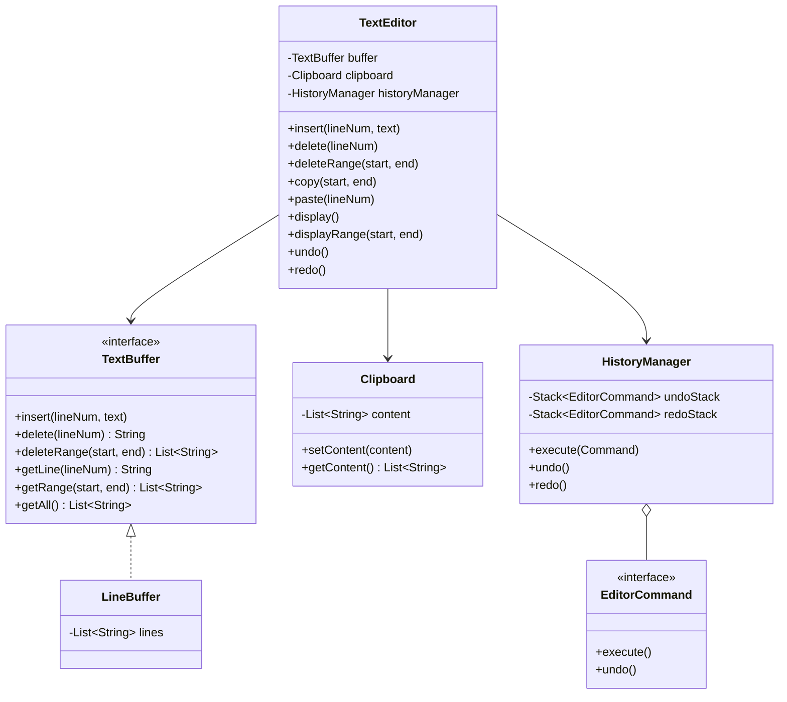
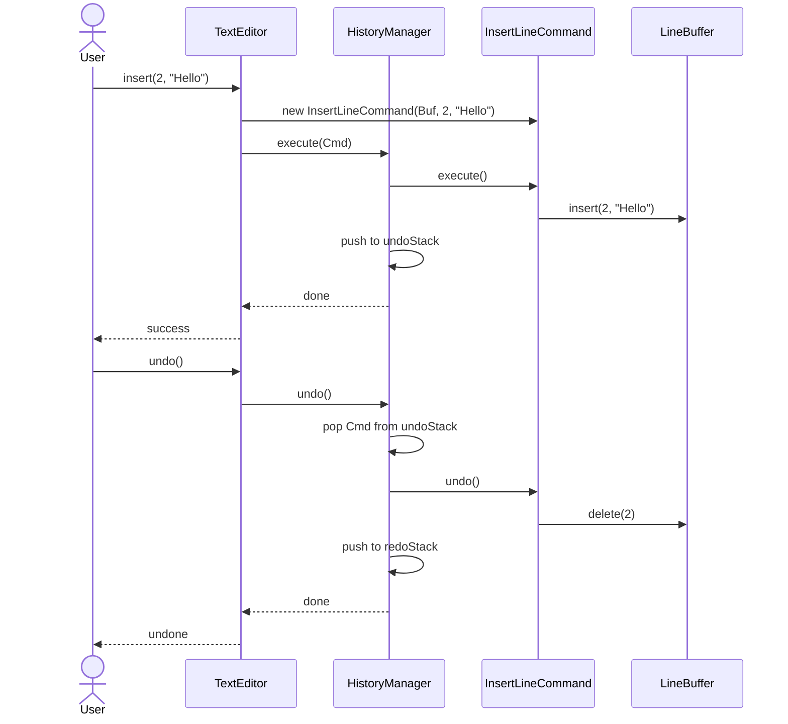

# Text Editor - Design

## Cross-links
* [Problem Statement](PROBLEM.md)
* [Approach](APPROACH.md)
* [Rubric](RUBRIC.md)
* [Pitfalls](PITFALLS.md)
* [Follow-ups](FOLLOW-UPS.md)

## System Architecture

The architecture relies on the Command Pattern to separate the editor logic from action execution and reversal.

## Sequence Diagram: Editing and Undo

## Storage Tradeoffs
- A `List<String>` representation (LineBuffer) means inserting at the beginning of a 10,000-line file takes O(N) list shifts. However, standard Python/Java lists are dynamically sized arrays, making shifts relatively fast via memmove.
- For massive files, a LinkedList might seem better for O(1) insertions, but fetching line N takes O(N). A Balanced Tree (Rope) is optimal for large-scale production editors.
