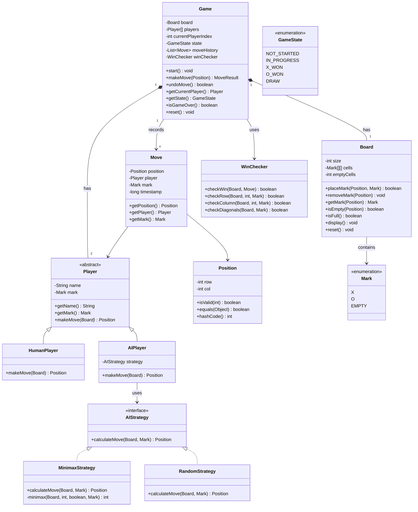
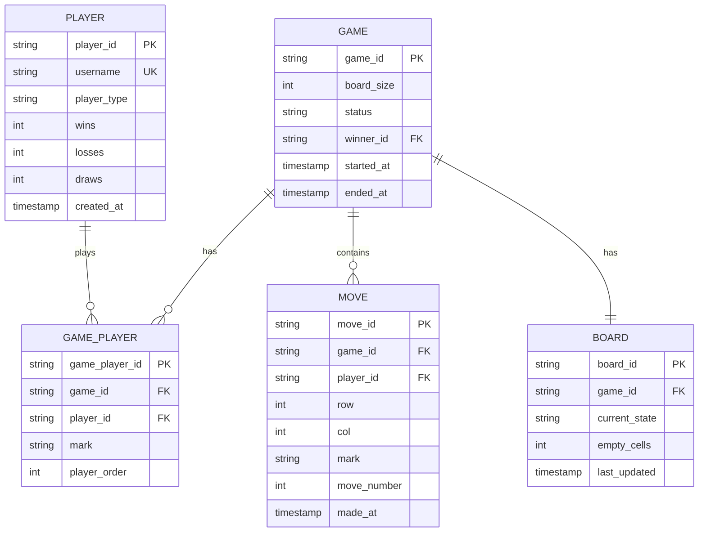

# Design for Tic-Tac-Toe

## Mermaid Class Diagram



## Entity-Relationship Diagram



**Schema Notes:**
- `GAME_PLAYER` junction table supports both 2-player and potential multi-player variants
- `MOVE` stores complete move history for replay
- `BOARD.current_state` can store serialized board as string (e.g., "XO_X_O___")
- Player stats tracked for leaderboards

---

## Class Diagram

```
┌─────────────────────────────────────────────────────────────────────────┐
│                              TIC-TAC-TOE                                 │
└─────────────────────────────────────────────────────────────────────────┘

┌─────────────┐     ┌─────────────┐     ┌─────────────┐
│  «enum»     │     │  «enum»     │     │  Position   │
│    Mark     │     │  GameState  │     ├─────────────┤
├─────────────┤     ├─────────────┤     │ -row: int   │
│ X           │     │ NOT_STARTED │     │ -col: int   │
│ O           │     │ IN_PROGRESS │     ├─────────────┤
│ EMPTY       │     │ X_WON       │     │ +isValid()  │
└─────────────┘     │ O_WON       │     └─────────────┘
                    │ DRAW        │
                    └─────────────┘

                         ┌───────────────────┐
                         │      Board        │
                         ├───────────────────┤
                         │ -size: int        │
                         │ -cells: Mark[][]  │
                         │ -emptyCells: int  │
                         ├───────────────────┤
                         │ +placeMark()      │
                         │ +removeMark()     │
                         │ +getMark()        │
                         │ +isEmpty()        │
                         │ +isFull()         │
                         │ +display()        │
                         │ +reset()          │
                         └─────────┬─────────┘
                                   │ has
                                   │
┌──────────────────────────────────┼──────────────────────────────────┐
│                                  ▼                                   │
│  ┌───────────────────────────────────────────────────────────────┐  │
│  │                          Game                                  │  │
│  ├───────────────────────────────────────────────────────────────┤  │
│  │ -board: Board                                                  │  │
│  │ -players: Player[2]                                            │  │
│  │ -currentPlayerIndex: int                                       │  │
│  │ -state: GameState                                              │  │
│  │ -moveHistory: List<Move>                                       │  │
│  │ -winChecker: WinChecker                                        │  │
│  ├───────────────────────────────────────────────────────────────┤  │
│  │ +start(): void                                                 │  │
│  │ +makeMove(position): MoveResult                                │  │
│  │ +undoMove(): boolean                                           │  │
│  │ +getCurrentPlayer(): Player                                    │  │
│  │ +getState(): GameState                                         │  │
│  │ +isGameOver(): boolean                                         │  │
│  │ +reset(): void                                                 │  │
│  └───────────────────────────────────────────────────────────────┘  │
│                                  │                                   │
│                    has 2         │                                   │
│                  ┌───────────────┴───────────────┐                   │
│                  ▼                               ▼                   │
│  ┌─────────────────────────────┐  ┌─────────────────────────────┐   │
│  │    «abstract» Player        │  │       WinChecker            │   │
│  ├─────────────────────────────┤  ├─────────────────────────────┤   │
│  │ -name: String               │  │ +checkWin(board, move)      │   │
│  │ -mark: Mark                 │  │ +checkRow()                 │   │
│  ├─────────────────────────────┤  │ +checkColumn()              │   │
│  │ +getMark(): Mark            │  │ +checkDiagonals()           │   │
│  │ +makeMove(): Position       │  └─────────────────────────────┘   │
│  └──────────────┬──────────────┘                                    │
│                 │ extends                                            │
│      ┌──────────┴──────────┐                                        │
│      ▼                     ▼                                        │
│  ┌────────────────┐  ┌────────────────┐                             │
│  │  HumanPlayer   │  │   AIPlayer     │                             │
│  ├────────────────┤  ├────────────────┤                             │
│  │ +makeMove()    │  │ -strategy      │                             │
│  │ (from input)   │  ├────────────────┤                             │
│  └────────────────┘  │ +makeMove()    │                             │
│                      │ (minimax)      │                             │
│                      └────────────────┘                             │
└─────────────────────────────────────────────────────────────────────┘

┌─────────────────────────────────────────────────────────────────────┐
│                            Move (Command)                            │
├─────────────────────────────────────────────────────────────────────┤
│ -position: Position                                                  │
│ -player: Player                                                      │
│ -mark: Mark                                                          │
│ -timestamp: long                                                     │
├─────────────────────────────────────────────────────────────────────┤
│ +getPosition(): Position                                             │
│ +getPlayer(): Player                                                 │
│ +getMark(): Mark                                                     │
└─────────────────────────────────────────────────────────────────────┘
```

## Core Classes

### Mark (Enum)
- **Values**: X, O, EMPTY
- **Purpose**: Represents the symbol placed on board cells

### GameState (Enum)
- **Values**: NOT_STARTED, IN_PROGRESS, X_WON, O_WON, DRAW
- **Purpose**: Tracks current game state

### Position
- **Attributes**: row (int), col (int)
- **Methods**: isValid(boardSize), equals(), hashCode()
- **Purpose**: Immutable value object for board coordinates

### Board
- **Attributes**: 
  - size: board dimension (N for N×N)
  - cells: 2D array of Marks
  - emptyCells: count of available positions
- **Methods**:
  - placeMark(Position, Mark): Place mark if valid
  - removeMark(Position): Remove mark (for undo)
  - getMark(Position): Get mark at position
  - isEmpty(Position): Check if cell empty
  - isFull(): Check if all cells occupied
  - display(): Print board to console
  - reset(): Clear all cells
- **Patterns Used**: None (simple data structure)

### Player (Abstract)
- **Attributes**: name, mark
- **Methods**: getMark(), makeMove(Board) [abstract]
- **Purpose**: Base class for player types

### HumanPlayer
- **Extends**: Player
- **Methods**: makeMove(Board) - gets input from console/UI
- **Purpose**: Represents human player

### AIPlayer (v2+)
- **Extends**: Player
- **Attributes**: strategy (minimax, alpha-beta)
- **Methods**: makeMove(Board) - calculates optimal move
- **Patterns Used**: Strategy (for AI algorithm)

### Move
- **Attributes**: position, player, mark, timestamp
- **Purpose**: Encapsulates a game move for history/undo
- **Patterns Used**: Command pattern

### WinChecker
- **Methods**:
  - checkWin(Board, Move): Check if move results in win
  - checkRow(Board, row, Mark): Check row for win
  - checkColumn(Board, col, Mark): Check column for win
  - checkDiagonals(Board, Mark): Check both diagonals
- **Optimization**: Only checks relevant row/col/diagonals based on last move
- **Patterns Used**: Strategy (different checkers for different board sizes)

### Game
- **Attributes**:
  - board: The game board
  - players: Array of two players
  - currentPlayerIndex: Whose turn (0 or 1)
  - state: Current game state
  - moveHistory: List of moves for undo
  - winChecker: Win detection component
- **Methods**:
  - start(): Initialize and begin game
  - makeMove(Position): Execute player move
  - undoMove(): Revert last move
  - getCurrentPlayer(): Get active player
  - isGameOver(): Check if game ended
  - reset(): Restart game
- **Patterns Used**: Template Method (game flow), State (game states)

## Key Design Decisions

### 1. Immutable Position Class
**Decision**: Position is immutable (final fields)
**Rationale**: Prevents bugs from modifying positions; safe for use as map keys; clear semantics

### 2. Mark Enum with EMPTY Value
**Decision**: Include EMPTY in Mark enum instead of null
**Rationale**: Avoids null checks; cleaner board initialization; explicit empty state

### 3. Optimized Win Checking
**Decision**: Only check row, column, and diagonals affected by last move
**Rationale**: Reduces complexity from O(N²) to O(N); last move must be part of any winning line

### 4. Separation of WinChecker
**Decision**: Extract win checking into separate class
**Rationale**: Single Responsibility; easier to test; allows different strategies for different board sizes

### 5. Move History for Undo
**Decision**: Store complete Move objects (not just positions)
**Rationale**: Contains all info needed for undo; supports replay; enables move analysis

### 6. Abstract Player with Strategy
**Decision**: Use abstract Player class with concrete Human and AI implementations
**Rationale**: Open/Closed principle; easy to add new player types; clear separation of input methods

## Complexity Analysis

### Board Operations
| Operation | Time | Space |
|-----------|------|-------|
| placeMark | O(1) | O(1) |
| removeMark | O(1) | O(1) |
| getMark | O(1) | O(1) |
| isFull | O(1) | O(1) |
| display | O(N²) | O(1) |
| reset | O(N²) | O(1) |

### Win Detection
| Operation | Time | Space |
|-----------|------|-------|
| checkRow | O(N) | O(1) |
| checkColumn | O(N) | O(1) |
| checkDiagonal | O(N) | O(1) |
| checkWin (optimized) | O(N) | O(1) |
| checkWin (naive) | O(N²) | O(1) |

### AI (Minimax)
| Algorithm | Time | Space |
|-----------|------|-------|
| Minimax (basic) | O(b^d) | O(d) |
| Alpha-Beta Pruning | O(b^(d/2)) avg | O(d) |
| With Transposition | O(b^(d/2)) | O(states) |

Where:
- N = board size
- b = branching factor (≈ empty cells)
- d = depth (remaining moves)

### Overall Game
| Operation | Time | Space |
|-----------|------|-------|
| Make move + check win | O(N) | O(1) |
| Undo move | O(1) | O(1) |
| Full game (no AI) | O(N² × N) = O(N³) | O(N²) |
| Full game (with AI) | O(N² × AI) | O(N²) |

## Thread Safety (v3)

### Synchronization Points
1. **Board state**: Read-write lock for cell access
2. **Game state**: Atomic state transitions
3. **Move history**: Concurrent-safe list
4. **Player turns**: Lock on turn switching

### Concurrent Game Sessions
- Each Game instance is independent
- Shared resources (if any) protected with locks
- No global mutable state
