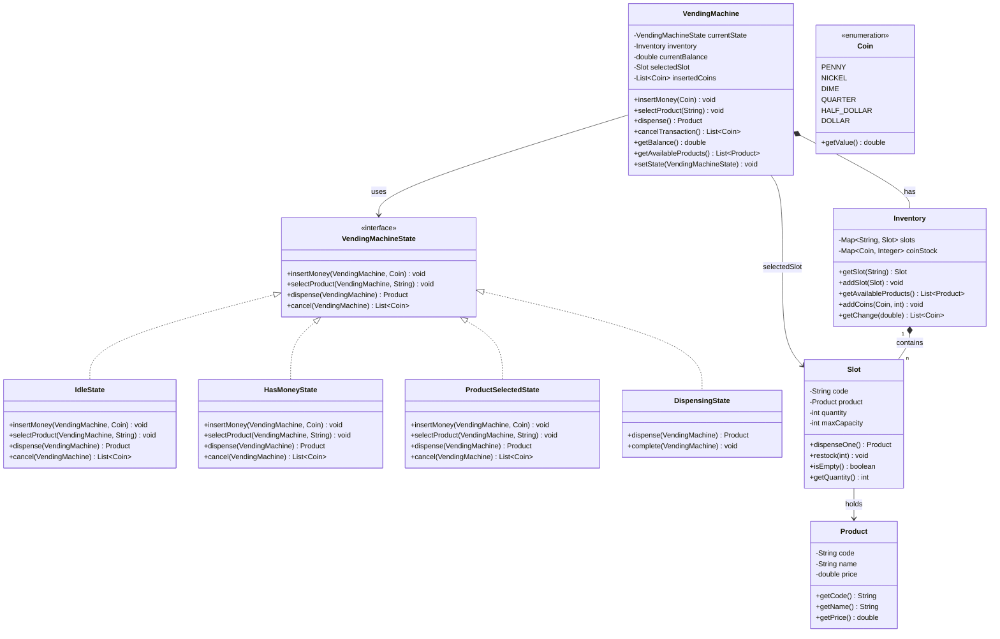
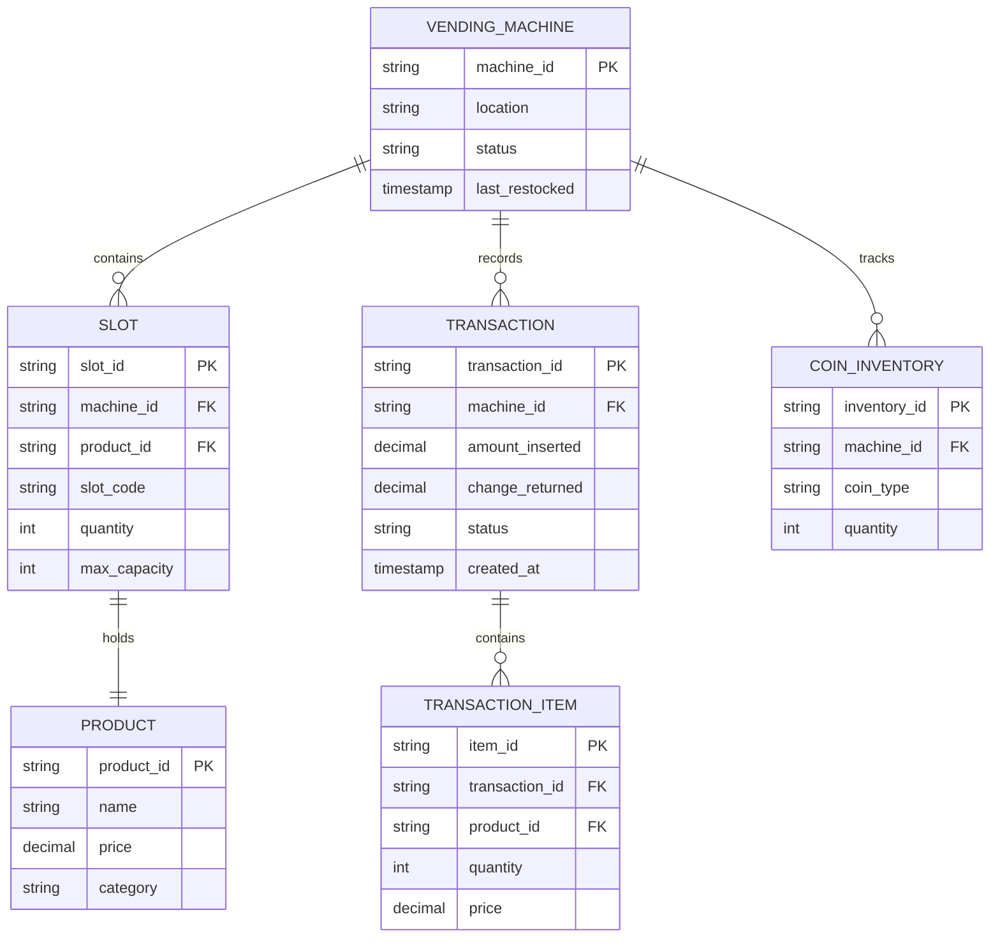

# Design for Vending Machine System

Complete class design with diagrams, relationships, and key decisions.

---

## Mermaid Class Diagram



## Entity-Relationship Diagram



**Schema Notes:**
- `VENDING_MACHINE` tracks machine state and location
- `SLOT` links products to physical slots with quantity
- `TRANSACTION` records each purchase with coins and change
- `COIN_INVENTORY` tracks available coins for change

---

## Class Diagram

```
┌────────────────────────────────────────────────────────────────────────────┐
│                            VendingMachine                                   │
├────────────────────────────────────────────────────────────────────────────┤
│ - currentState: VendingMachineState                                        │
│ - inventory: Inventory                                                      │
│ - currentBalance: double                                                    │
│ - selectedSlot: Slot                                                        │
│ - insertedCoins: List<Coin>                                                │
├────────────────────────────────────────────────────────────────────────────┤
│ + insertMoney(coin: Coin): void                                            │
│ + selectProduct(slotCode: String): void                                    │
│ + dispense(): Product                                                       │
│ + cancelTransaction(): List<Coin>                                          │
│ + getBalance(): double                                                      │
│ + getAvailableProducts(): List<Product>                                    │
│ + setState(state: VendingMachineState): void                               │
└───────────────────────────────────┬────────────────────────────────────────┘
                                    │
           ┌────────────────────────┼────────────────────────┐
           │ uses                   │ has                    │ contains
           ▼                        ▼                        ▼
┌─────────────────────┐  ┌─────────────────────┐  ┌─────────────────────┐
│ VendingMachineState │  │     Inventory       │  │        Slot         │
│    <<interface>>    │  ├─────────────────────┤  ├─────────────────────┤
├─────────────────────┤  │ - slots: Map        │  │ - code: String      │
│ + insertMoney()     │  │ - coinStock: Map    │  │ - product: Product  │
│ + selectProduct()   │  ├─────────────────────┤  │ - quantity: int     │
│ + dispense()        │  │ + getSlot(code)     │  │ - maxCapacity: int  │
│ + cancel()          │  │ + addSlot(slot)     │  ├─────────────────────┤
└─────────┬───────────┘  │ + getProducts()     │  │ + dispenseOne()     │
          │              │ + addCoins()        │  │ + restock()         │
    ┌─────┴─────────────┐│ + getChange()       │  │ + isEmpty()         │
    │                   │└─────────────────────┘  └──────────┬──────────┘
    ▼                   ▼                                    │ holds
┌───────────┐  ┌────────────────┐                           ▼
│ IdleState │  │ HasMoneyState  │                  ┌─────────────────────┐
└───────────┘  └────────────────┘                  │      Product        │
                                                   ├─────────────────────┤
┌────────────────────┐  ┌──────────────────┐      │ - code: String      │
│ProductSelectedState│  │  DispensingState │      │ - name: String      │
└────────────────────┘  └──────────────────┘      │ - price: double     │
                                                   └─────────────────────┘


┌────────────────────────────────────────────────────┐
│                    Coin <<enum>>                    │
├────────────────────────────────────────────────────┤
│ PENNY(0.01), NICKEL(0.05), DIME(0.10)              │
│ QUARTER(0.25), HALF_DOLLAR(0.50), DOLLAR(1.00)     │
├────────────────────────────────────────────────────┤
│ + getValue(): double                                │
└────────────────────────────────────────────────────┘
```

---

## State Diagram

```
                    ┌──────────────┐
                    │              │
        ┌──────────►│  IDLE STATE  │◄──────────┐
        │           │              │           │
        │           └──────┬───────┘           │
        │                  │                   │
        │                  │ insertMoney()     │
        │                  ▼                   │
        │           ┌──────────────┐           │
        │           │              │           │
        │  cancel() │  HAS_MONEY   │           │
        ├───────────│    STATE     │           │
        │           │              │           │
        │           └──────┬───────┘           │
        │                  │                   │
        │                  │ selectProduct()   │
        │                  ▼                   │
        │           ┌──────────────┐           │
        │           │   PRODUCT    │           │
        │  cancel() │   SELECTED   │           │
        ├───────────│    STATE     │           │
        │           │              │           │
        │           └──────┬───────┘           │
        │                  │                   │
        │                  │ dispense()        │
        │                  ▼                   │
        │           ┌──────────────┐           │
        │           │              │           │
        │           │ DISPENSING   │───────────┘
        │           │    STATE     │  complete()
        │           │              │
        │           └──────────────┘
        │                  │
        │                  │ returnChange()
        └──────────────────┘
```

---

## Enumerations

### Coin
```
Coin {
    PENNY(0.01),
    NICKEL(0.05),
    DIME(0.10),
    QUARTER(0.25),
    HALF_DOLLAR(0.50),
    DOLLAR(1.00)
}
```

### ProductCategory (v2)
```
ProductCategory {
    SNACK,
    BEVERAGE,
    CANDY,
    HEALTHY
}
```

---

## Core Classes

### VendingMachine
- **Attributes**:
  - `currentState: VendingMachineState` - Current operating state
  - `inventory: Inventory` - Product and coin inventory
  - `currentBalance: double` - Money inserted in current transaction
  - `selectedSlot: Slot` - Currently selected product slot
  - `insertedCoins: List<Coin>` - Coins in current transaction (for refund)
- **Methods**:
  - `insertMoney(Coin): void` - Add coin to balance
  - `selectProduct(String): void` - Select product by slot code
  - `dispense(): Product` - Dispense product and return change
  - `cancelTransaction(): List<Coin>` - Cancel and return all inserted money
  - `getBalance(): double` - Get current balance
  - `getAvailableProducts(): List<Product>` - List products with stock
- **Patterns Used**: State (delegates to current state)

### VendingMachineState (Interface)
- **Methods**:
  - `insertMoney(VendingMachine, Coin): void`
  - `selectProduct(VendingMachine, String): void`
  - `dispense(VendingMachine): Product`
  - `cancel(VendingMachine): List<Coin>`
- **Implementations**:
  - `IdleState` - Waiting for customer
  - `HasMoneyState` - Money inserted, awaiting selection
  - `ProductSelectedState` - Product selected, ready to dispense
  - `DispensingState` - Dispensing product

### IdleState
- **insertMoney()**: Accept coin, transition to HasMoneyState
- **selectProduct()**: Error - insert money first
- **dispense()**: Error - no product selected
- **cancel()**: Nothing to cancel

### HasMoneyState
- **insertMoney()**: Accept more coins, stay in state
- **selectProduct()**: Select if in stock and affordable, transition to ProductSelectedState
- **dispense()**: Error - no product selected
- **cancel()**: Return all coins, transition to IdleState

### ProductSelectedState
- **insertMoney()**: Accept more coins, stay in state
- **selectProduct()**: Change selection if affordable
- **dispense()**: Dispense product, return change, transition to DispensingState
- **cancel()**: Return all coins, transition to IdleState

### DispensingState
- **insertMoney()**: Error - transaction in progress
- **selectProduct()**: Error - transaction in progress
- **dispense()**: Error - already dispensing
- **cancel()**: Error - cannot cancel after dispense
- **complete()**: Return change, transition to IdleState

### Product
- **Attributes**:
  - `code: String` - Product code (e.g., "A1")
  - `name: String` - Product name
  - `price: double` - Price in dollars
- **Methods**:
  - Getters for all attributes

### Slot
- **Attributes**:
  - `code: String` - Slot code (e.g., "A1")
  - `product: Product` - Product type in this slot
  - `quantity: int` - Current stock
  - `maxCapacity: int` - Maximum stock
- **Methods**:
  - `dispenseOne(): Product` - Remove and return one product
  - `restock(int): void` - Add products to slot
  - `isEmpty(): boolean` - Check if out of stock
  - `getQuantity(): int` - Current stock level

### Coin (Enum)
- **Values**: PENNY, NICKEL, DIME, QUARTER, HALF_DOLLAR, DOLLAR
- **Attributes**:
  - `value: double` - Monetary value
- **Methods**:
  - `getValue(): double` - Get monetary value

### Inventory
- **Attributes**:
  - `slots: Map<String, Slot>` - Product slots by code
  - `coinStock: Map<Coin, Integer>` - Available coins for change
- **Methods**:
  - `getSlot(String): Slot` - Get slot by code
  - `addSlot(Slot): void` - Add a slot
  - `getAvailableProducts(): List<Product>` - Products in stock
  - `addCoins(Coin, int): void` - Add coins to stock
  - `getChange(double): List<Coin>` - Calculate and return change

---

## Key Design Decisions

### Decision 1: State Pattern for Machine States
**Rationale**: 
- Machine behavior changes based on current state
- Prevents invalid operations (can't dispense without money)
- Clean transition logic
- Easy to add new states

**Trade-off**:
- More classes than simple if-else
- State objects need reference to machine

**Alternative**: 
- Enum-based state with switch statements (less extensible)

---

### Decision 2: Coin Enum with Values
**Rationale**:
- Type-safe coin handling
- Prevents invalid denominations
- Easy change calculation
- Consistent across operations

**Trade-off**:
- Harder to add new denominations
- Fixed to US currency

---

### Decision 3: Slot-based Product Storage
**Approach**: Each slot holds one product type with quantity

**Rationale**:
- Matches real vending machine structure
- Easy product lookup by slot code (A1, B2, etc.)
- Clear capacity management
- Simple restocking

---

### Decision 4: Separate Inventory Class
**Rationale**:
- Single responsibility for stock management
- Reusable across machines
- Clean coin change calculation
- Testable independently

---

## Complexity Analysis

### Time Complexity

| Operation | v1 Basic | v3 Optimized |
|-----------|----------|--------------|
| Insert coin | O(1) | O(1) |
| Select product | O(1) | O(1) |
| Dispense | O(1) | O(1) |
| Calculate change | O(c × a) | O(c) greedy |
| Get available products | O(n) | O(n) |

Where:
- c = number of coin denominations (fixed, ~6)
- a = change amount
- n = number of slots

### Space Complexity

| Component | Complexity | Notes |
|-----------|------------|-------|
| Slots | O(s) | s = number of slots |
| Products | O(s × q) | q = max quantity per slot |
| Coin stock | O(c) | c = denominations (constant) |
| Transaction coins | O(t) | t = coins in transaction |
| **Total** | O(s × q) | Linear in inventory size |

---

## Thread Safety (v3)

### Critical Sections:
1. **Balance updates** - Concurrent coin insertion
2. **Product dispensing** - Race on last item
3. **Coin inventory** - Change calculation and updates
4. **State transitions** - Atomic state changes

### Synchronization Strategy:
```java
// ReentrantLock for transaction operations
private final Lock transactionLock = new ReentrantLock();

// AtomicReference for thread-safe state
private final AtomicReference<VendingMachineState> state;

// ConcurrentHashMap for coin inventory
private final ConcurrentHashMap<Coin, AtomicInteger> coinStock;
```

---

## Extension Points

| Feature | Where to Add | Pattern |
|---------|--------------|---------|
| New coin denominations | Coin enum | Enum extension |
| Credit card payment | PaymentStrategy | Strategy pattern |
| Product categories | ProductCategory enum | Enum |
| Low stock alerts | InventoryObserver | Observer pattern |
| Dynamic pricing | PricingStrategy | Strategy pattern |
| Admin interface | AdminOperations | Separate class |
