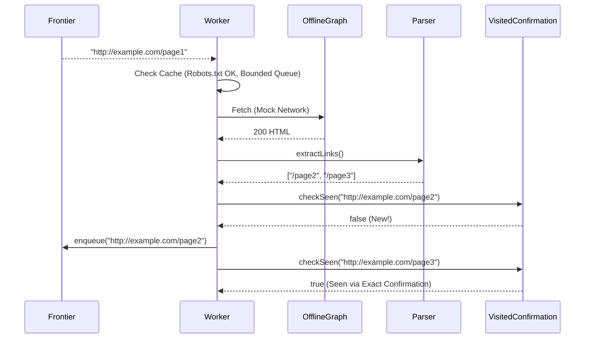

# Code Walkthrough: Web Crawler

## 📚 Topic Level & Prerequisites
- **v1-basic:** Focuses on the single-thread frontier and basic deduplication (Normal Use-Case and Duplicate Operations).
- **v2-extended:** Introduces the pluggable URL normalizer, politeness policies, and robots.txt handling (Failure Rollbacks and Empty/Invalid Input).
- **v3-optimized:** Introduces the concurrent fetch pipeline, thread-safe partitioned queues, exact visited confirmation, and bounds handling (Capacity Bounds).

## Execution Flow Analysis
This walkthrough examines the lifecycle of a single URL being processed by a `FetcherWorker`, focusing on graph traversal resilience and avoiding traps within an injected offline environment.

1. **Task Acquisition and Politeness:**
   The `Worker` requests a URL from the `URLFrontier`. The Frontier is responsible for ensuring bounded queues and that it does not give the worker a URL for a domain that was crawled within the last limit defined by the politeness policy.
2. **Robots Check and Canonicalization:**
   The worker extracts the domain and checks the mock `RobotsTxtCache`. If allowed, the URL is canonicalized (normalized) to a standard form.
3. **Graph Traversal (The Critical Section):**
   The code executes a request to the injected offline graph. Real outbound requests are forbidden. The fetch is wrapped in severe safety nets:
   - **Redirect Depth:** Limits are enforced on redirect hops to prevent infinite redirect loops.
   - **Malformed URLs & Cancellation:** Enforce bounded queues; invalid formats are dropped immediately.
4. **Parsing and Link Extraction:**
   If successful (e.g., node found in the offline graph), the HTML/document string is passed to the `Parser`. It extracts all links and canonicalizes them.
5. **Deduplication and Enqueueing:**
   For every extracted link, the worker checks the `BloomFilter` and exact set layer. The exact visited confirmation layer acts as the definitive truth, ensuring that no Bloom-filter false-positive loss occurs. If it returns `false` (definitely not seen), the worker pushes the URL back to the `URLFrontier` to be scheduled.

### Visited Confirmation (Exact vs Bloom Filter)

The `FingerprintStore` uses both a bloom filter and exact visited confirmation to ensure that no Bloom-filter false-positive loss occurs:

**Java (`v3_optimized/FingerprintStore.java`)**
```java
public class FingerprintStore {
    private final Set<String> fingerprints = new HashSet<>();
    private final Set<String> bloomFilter = new HashSet<>();

    public synchronized boolean add(String fingerprint) {
        String bloomHash = String.valueOf(Math.abs(fingerprint.hashCode()));
        if (bloomFilter.contains(bloomHash)) {
            if (fingerprints.contains(fingerprint)) {
                return false;
            }
            fingerprints.add(fingerprint);
            return true;
        }
        
        bloomFilter.add(bloomHash);
        fingerprints.add(fingerprint);
        return true;
    }
}
```

**Python (`v3-optimized/fingerprint_store.py`)**
```python
class FingerprintStore:
    def __init__(self) -> None:
        self.fingerprints: Set[str] = set()
        self.bloom_filter: Set[str] = set()
        self.lock = threading.Lock()

    def add(self, fingerprint: str) -> bool:
        with self.lock:
            bloom_hash = hashlib.md5(fingerprint.encode('utf-8')).hexdigest()[:4]
            if bloom_hash in self.bloom_filter:
                if fingerprint in self.fingerprints:
                    return False
                self.fingerprints.add(fingerprint)
                return True
            
            self.bloom_filter.add(bloom_hash)
            self.fingerprints.add(fingerprint)
            return True
```

### Safety Nets and Graph Traversal

To prove our traversal correctly visits each normalized permitted URL exactly once, testing checks loops and limits:

**Java (`tests/v3_optimized/WebCrawlerV3Test.java`)**
```java
    @Test
    void testCrawlerFlowEdgesAndCancellation() {
        Map<String, String> offlineGraph = new HashMap<>();
        offlineGraph.put("http://example.com/start", "<html><a href='http://example.com/cycle1'>Cycle 1</a><a href='bad://url'>Bad</a><a href='http://example.com/notfound'>Not Found</a></html>");
        offlineGraph.put("http://example.com/cycle1", "<html><a href='http://example.com/start'>Start</a><a href='http://example.com/deep'>Deep</a></html>");
        offlineGraph.put("http://example.com/deep", "<html><a href='http://example.com/deeper'>Deeper</a></html>");
        
        UrlFetcher fetcher = new UrlFetcher(offlineGraph);
        HtmlParser parser = new HtmlParser();
        UrlCanonicalizer canonicalizer = new UrlCanonicalizer();
        RobotsPolicy robots = new RobotsPolicy();
        PolitenessPolicy politeness = new PolitenessPolicy(0);
        
        ShardQueue queue = new ShardQueue();
        FingerprintStore store = new FingerprintStore();
        BackpressureController backpressure = new BackpressureController(5);
        
        Crawler crawler = new Crawler(queue, store, backpressure, fetcher, parser, canonicalizer, politeness, robots);
        crawler.start(Arrays.asList("http://example.com/start"), "example.com", 10, 1, 1);
        
        assertTrue(crawler.getCompleted().contains("http://example.com/start"));
        assertTrue(crawler.getCompleted().contains("http://example.com/cycle1"));
        
        crawler.cancel();
    }
```

**Python (`tests/test_web_crawler_v3.py`)**
```python
    def test_crawler_flow_edges_and_cancellation(self) -> None:
        offline_graph = {
            "http://example.com/start": "<html><a href='http://example.com/cycle1'>Cycle 1</a><a href='bad://url'>Bad</a><a href='http://example.com/notfound'>Not Found</a></html>",
            "http://example.com/cycle1": "<html><a href='http://example.com/start'>Start</a><a href='http://example.com/deep'>Deep</a></html>",
            "http://example.com/deep": "<html><a href='http://example.com/deeper'>Deeper</a></html>"
        }
        fetcher = UrlFetcher(offline_graph)
        parser = HtmlParser()
        canonicalizer = UrlCanonicalizer()
        robots = RobotsPolicy()
        politeness = PolitenessPolicy(delay_ms=0)
        
        queue = ShardQueue()
        store = FingerprintStore()
        backpressure = BackpressureController(max_concurrent=5)
        
        crawler = Crawler(queue, store, backpressure, fetcher, parser, canonicalizer, politeness, robots)
        crawler.start(["http://example.com/start"], "example.com", 10, 1, max_depth=1)
        
        completed_urls = set(crawler.completed)
        self.assertIn("http://example.com/start", completed_urls)
        self.assertIn("http://example.com/cycle1", completed_urls)
        
        crawler.cancel()
        self.assertFalse(crawler.running)
```

### Sequence Diagram


## Concurrency and Resource Management
The `Worker` application in `v3-optimized` handles concurrency using thread pools or event loops. It does not use a 1:1 thread-per-request model, which would exhaust resources immediately.
Memory management is critical. Bounded queues enforce limits per host to prevent any single domain's deep graph from exhausting memory. The combination of a memory-efficient Bloom Filter coupled with exact visited confirmation allows the system to remain highly performant while maintaining deterministic accuracy for the injected offline graph.
