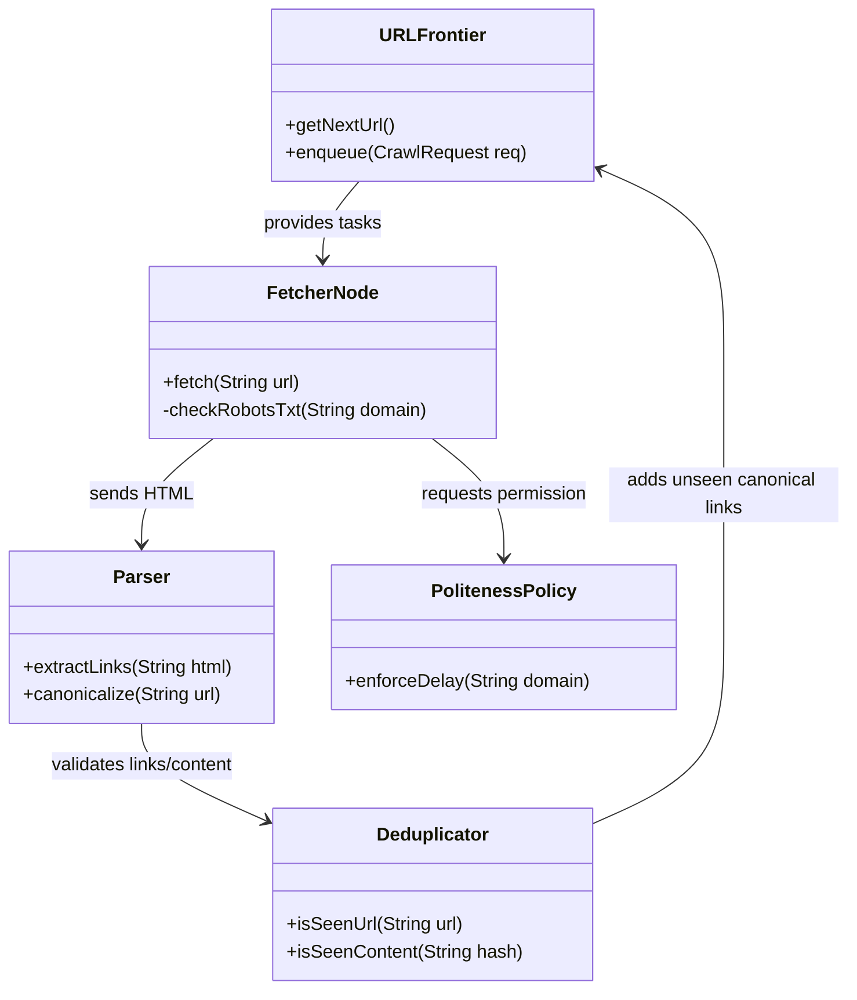

# Design Document: Web Crawler

## 📚 Topic Level & Prerequisites
- **Layering:** 
  - **Beginner (v1-basic):** Intuitive minimum single-threaded frontier, focusing on the core crawler loop, fetching, and visited set logic.
  - **Core (v2-extended):** Standard interview readiness, introducing pluggable URL canonicalization, robots.txt policies, politeness delays, and handling duplicate content.
  - **Staff (v3-optimized):** Advanced concurrency, bounded distributed queues, partition handling, backpressure, and handling of spider traps and malformed components.
- **Prerequisites:** Basic understanding of graphs (Breadth-First Search), Hash Maps, Queues, and introductory HTTP protocols.

## 🎯 Scope & Non-Goals
- **In Scope:** 
  - Manage crawl frontier from seed URLs with deterministic dequeue order.
  - URL normalization and deduplication before scheduling fetches.
  - Pluggable components for `robots.txt` compliance, host politeness delays, and retry budgets.
  - Thread-safe or partitioned frontier processing in v3.
  - Exact visited confirmation using exact sets coupled with Bloom Filters to prevent false-positive link loss.
- **Out of Scope (Non-Goals):**
  - No real outbound network requests; we strictly rely on an injected offline graph fetcher abstraction for determinism.
  - Real-world distributed deployment orchestration (e.g., Kafka/Redis clusters) - we implement machine-coding primitives.

## 📊 Scenario Assumptions vs. Externally Measured Facts
- **Scenario Assumptions:** Capacity (e.g., billions of URLs), latency constraints (e.g., 5 seconds between same-host fetches), and memory boundaries are assumed for demonstrating algorithm correctness and bounds.
- **Calculations & Units:** Any memory limits or throughput targets discussed are illustrative limits of the bounded queues, evaluated deterministically in testing.
- **External Facts:** HTTP semantics, robots.txt parsing rules, and URL standard forms are based on established external specifications.

## 🔗 Provenance & Ownership
- **Primary-Source:** Driven by standard graph traversal strategies adapted for network systems.

## 🔬 Invariants, Traces, & Code Parity
- **Named Invariants:** 
  - An injected offline graph with cycles visits each normalized permitted URL exactly once; exact visited confirmation prevents Bloom-filter false-positive loss.
  - robots/politeness policy, per-host concurrency, redirect depth, malformed URLs and cancellation enforce bounded queues and no real outbound requests.
- **Normal Trace:** A seeded URL is dequeued, canonicalized, checked against exact visited logic (and Bloom filter), validated against `robots.txt`, delayed per politeness rules, and passed to an offline network fetcher for link extraction.
- **Failure Trace:** Redirection loops, deep paths, or malformed URLs correctly trigger bounded queue drop logic, preventing infinite memory usage.
- **Code Parity:** Implemented via standardized Python 3.8+ standard libraries; ensures Java parity when both are present.

---

## System Architecture
The architecture separates stateful queue management from stateless mock execution, adhering to machine coding principles.

### Core Components
1. **URL Frontier:** Manages the queues of URLs to be visited. In v3, it implements partitioned queues to ensure thread-safe concurrency.
2. **Politeness & Robots Policy:** Enforces rate limiting per host and validates path accessibility against mock robots rules.
3. **Fetcher/Worker Fleet:** Pulls URLs from the Frontier, interacts with the offline graph to retrieve mock HTML, handles redirect budgets, and bounded timeouts.
4. **Parser & Canonicalizer:** Extracts text for deduplication and parses `href` tags to discover new links, converting them to canonical standard forms.
5. **Deduplicator (Seen Set):** An exact visited verification layer (often paired with a Bloom Filter) to confirm if a URL or document content has been seen, preventing false-positive skips and duplicates.

### Mermaid Class Diagram


## Data Model and Schema
The crawler primarily deals with queues and sets rather than relational tables.
- **URL Frontier Queue:** Conceptually `Map<Domain, Queue<URL>>` for concurrent partitioned access.
- **Seen Set:** A deterministic exact hash set, acting alongside a Bloom Filter to strictly prevent false-positive loss.
- **Document Metadata Store:** `url_hash`, `canonical_url`, `last_crawled_timestamp`, `status_code`.

## Trade-offs and Considerations
- **Breadth-First vs. Depth-First:** We strictly use a Breadth-First traversal strategy combined with redirect depth limits. Depth-First is dangerous for web crawling as a crawler can get trapped in an infinitely generating directory structure (a spider trap). Breadth-First naturally distributes the load across many domains.
- **Bloom Filter False Positives vs Exact Match:** While standard Bloom filters save memory, a false positive results in a silently dropped, unvisited URL. For deterministic exactness in interview-grade solutions, we implement an exact visited confirmation (e.g., fallback hash set for collisions or definitive state tracking) to prevent this loss.

**Java FingerprintStore Exact Validation**
```java
public class FingerprintStore {
    private final Set<String> fingerprints = new HashSet<>();
    private final Set<String> bloomFilter = new HashSet<>();

    public synchronized boolean add(String fingerprint) {
        String bloomHash = String.valueOf(Math.abs(fingerprint.hashCode()));
        if (bloomFilter.contains(bloomHash)) {
            if (fingerprints.contains(fingerprint)) {
                return false;
            }
            fingerprints.add(fingerprint);
            return true;
        }
        
        bloomFilter.add(bloomHash);
        fingerprints.add(fingerprint);
        return true;
    }
}
```

**Python FingerprintStore Exact Validation**
```python
class FingerprintStore:
    def __init__(self) -> None:
        self.fingerprints: Set[str] = set()
        self.bloom_filter: Set[str] = set()
        self.lock = threading.Lock()

    def add(self, fingerprint: str) -> bool:
        with self.lock:
            bloom_hash = hashlib.md5(fingerprint.encode('utf-8')).hexdigest()[:4]
            if bloom_hash in self.bloom_filter:
                if fingerprint in self.fingerprints:
                    return False
                self.fingerprints.add(fingerprint)
                return True
            
            self.bloom_filter.add(bloom_hash)
            self.fingerprints.add(fingerprint)
            return True
```

- **Bounded Queues:** Instead of allowing infinite memory allocation on massive offline graphs, queues enforce limits on malformed URLs, excessive redirect chains, and deep domain paths.

## Reference Contracts for Edge Cases
- **Normal Use-Case:** A standard URL is correctly dequeued, verified against robots.txt and politeness policies, fetched (simulated), parsed for outbound links, and any new valid links are enqueued.
- **Empty/Invalid Input:** Malformed URLs or empty seed lists are rejected early, triggering bounded queue drops without consuming fetch resources or causing infinite loops.
- **Duplicate Operations:** Duplicate URLs are accurately deduplicated. Exact visited confirmation ensures no Bloom-filter false positives cause unseen valid links to be dropped.
- **Capacity Bounds:** The system strictly enforces redirect depth and host-level queues, bounding max memory growth effectively simulating limited system resources.
- **Failure Rollbacks:** Unreachable offline mock nodes, timeouts, or policy violations cancel the current URL's processing. The URL is marked as failed/dropped and removed from the active processing flow, freeing up worker capacity without breaking the overall queue structure.

**Java Cancellation Logic**
```java
    public void cancel() {
        this.running = false;
    }
```

**Python Cancellation Logic**
```python
    def cancel(self) -> None:
        self.running = False
```
