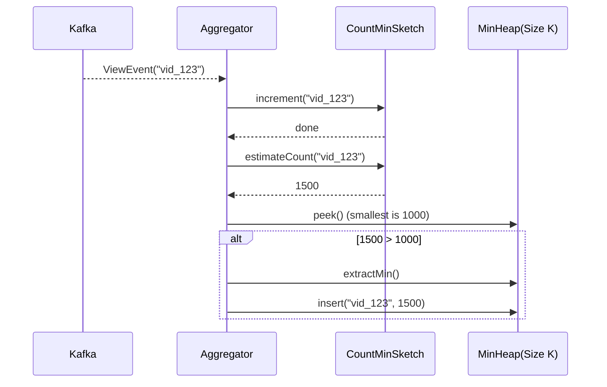

# Code Walkthrough: YouTube Top K

## Execution Flow Analysis
This walkthrough focuses on the inner loop of the `AggregatorNode`, specifically how it updates the probabilistic structures efficiently upon receiving a view event.

1. **Ingestion:**
   The worker polls a batch of `ViewEvent` objects from its assigned Kafka partition.
2. **Count-Min Sketch Update:**
   For each event, it passes the `videoId` to the `CountMinSketch.increment()` method.
   - The code generates `d` different hash values for the `videoId` (using MD5 or murmur3).
   - It maps these hashes to indices in the 2D array and increments the counter at `array[i][hash_i]`.
3. **Estimation and Heap Update:**
   Immediately after incrementing, the code calls `CountMinSketch.estimateCount(videoId)`. This returns the minimum value from the `d` counters just updated.
   - The worker compares this estimate to the root of the `TopKHeap` (which holds the *smallest* count currently in the top K).
   - If `estimate > heap.peek().count`, the code checks if the `videoId` is already in the heap.
     - If it is, it updates the count and re-heapifies.
     - If it isn't, it removes the root (the lowest of the top K) and inserts the new `videoId`, re-heapifying the structure in O(log K) time.

### Sequence Diagram

## Concurrency and Performance Optimizations
The `AggregatorNode` must process tens of thousands of events per second. 
- **Lock-Free Updates:** The `CountMinSketch` array is heavily contended. Using standard synchronization locks on the array would destroy throughput. The code implements the array using `AtomicIntegerArray` or `LongAdder` (in Java), allowing lock-free, atomic increments across multiple threads.
- **Memory Locality:** To optimize CPU cache hits, the CMS 2D array is often flattened into a 1D array in the actual implementation: `array[i * width + hash_i]`. This ensures the memory is contiguous, reducing cache misses during the multiple hash lookups required for a single increment.
- **Heap Synchronization:** The `TopKHeap` is much smaller (e.g., K=100) but also requires concurrency control. Since heap operations (insert/remove) take O(log K) time, a standard `ReentrantReadWriteLock` is used. Read locks are used for the frequent `peek()` operations, while the Write lock is only acquired on the rare occasion a video actually enters the Top K list.

## Worked Example: Probabilistic vs Exact Reference Stream
This example demonstrates the properties of the Count-Min Sketch and Bounded Min-Heap using an exact small reference stream with timestamps.

**Reference Stream (Window Size = 1 hour / 3600000 ms):**
- Window 0 (00:00 - 01:00): `[(v1, t=10), (v1, t=20), (v2, t=30), (v3, t=40), (v1, t=50), (v2, t=60), (v4, t=70), (v1, t=80)]`
- Window 1 (01:00 - 02:00): Empty stream
- Window 2 (02:00 - 03:00): `[(v5, t=7200010)]`

### Count-Min Sketch Updates and Estimation
Count-Min estimates never undercount valid nonnegative updates. It relies on deterministic hashing.

Assume `width = 5`, `depth = 3`.

When `v1` is processed, it is hashed `depth` times deterministically:
- `hash(v1, seed=0) = 2`
- `hash(v1, seed=1) = 4`
- `hash(v1, seed=2) = 1`

The sketch increments `table[0][2]`, `table[1][4]`, and `table[2][1]`. Because hashes are deterministic, subsequent views of `v1` increment the same buckets. 
If `v2` collides on `table[0][2]`, that bucket's count exceeds `v1`'s true count. However, the `estimate` function returns the minimum across all `depth` buckets. It only increments on valid view events, meaning Count-Min estimates never undercount valid nonnegative updates. The certainty of avoiding a large error is bounded by `1 - e^(-depth)`.

For Window 0:
- Exact `v1` count = 4
- CMS `v1` estimate = `min(table[0][2], table[1][4], table[2][1])`. It will be exactly 4 unless `v2`, `v3`, or `v4` collided on *all* of `v1`'s buckets.

### Bounded Memory, Ties, and Candidate Eviction (Min-Heap)
Assume `K = 2`. The min-heap tracks the top 2 elements within a bounded memory limit.

**Processing Window 0:**
1. `v1` arrives. CMS=1. Heap: `[(1, v1)]`
2. `v1` arrives. CMS=2. Heap updates: `[(2, v1)]`
3. `v2` arrives. CMS=1. Heap: `[(1, v2), (2, v1)]` (min is at root)
4. `v3` arrives. CMS=1. **Tie Case:** Heap root is `(1, v2)`. Since the estimate (1) is not strictly greater than the root count (1), `v3` does not evict `v2`. Ties favor the incumbent. Heap remains: `[(1, v2), (2, v1)]`
5. `v1` arrives. CMS=3. Heap updates: `[(1, v2), (3, v1)]`
6. `v2` arrives. CMS=2. Heap updates: `[(2, v2), (3, v1)]`
7. `v4` arrives. CMS=1. **Candidate Eviction Miss:** Less than root `2`. Heap unchanged.
8. `v1` arrives. CMS=4. Heap updates: `[(2, v2), (4, v1)]`

Top 2 query result for Window 0: `[v1, v2]`.

### Window Rotation and Empty Streams
- **Window 1 (Empty Stream):** No events arrive between 01:00 - 02:00. If a Top-K query is executed for this window, the service checks memory, gracefully falls back to the persistent store (which is empty), and returns an empty list `[]`, avoiding null pointer exceptions.
- **Window 2 (Window Rotation):** Event `(v5, t=7200010)` arrives. The timestamp falls into Window 2 (02:00 - 03:00). A fresh, independent `WindowState` (new CMS + empty Heap) is initialized in the aggregator map. `v5` is inserted. Old windows remain intact in memory (until eviction max) and storage.

## Supported Versions
This code walkthrough describes the core mechanisms that apply across the supported versions:
- `v1-basic`: Basic in-memory ranking using a standard Hash Map and Priority Queue. It does not use Count-Min Sketch or Windowed structures, so the above CMS and time-window examples do not apply.
- `v2-extended`: Introduces the Count-Min Sketch for probabilistic counting, `WindowState` tumbling windows (e.g. 1-hour windows), and abstract persistence through `WindowStateStore`.
- `v3-optimized`: Incorporates an `IdempotencyStore` to safely deduplicate stream replays per region, and standardizes distributed saving via a `DistributedRepository` (rather than basic file stores).
