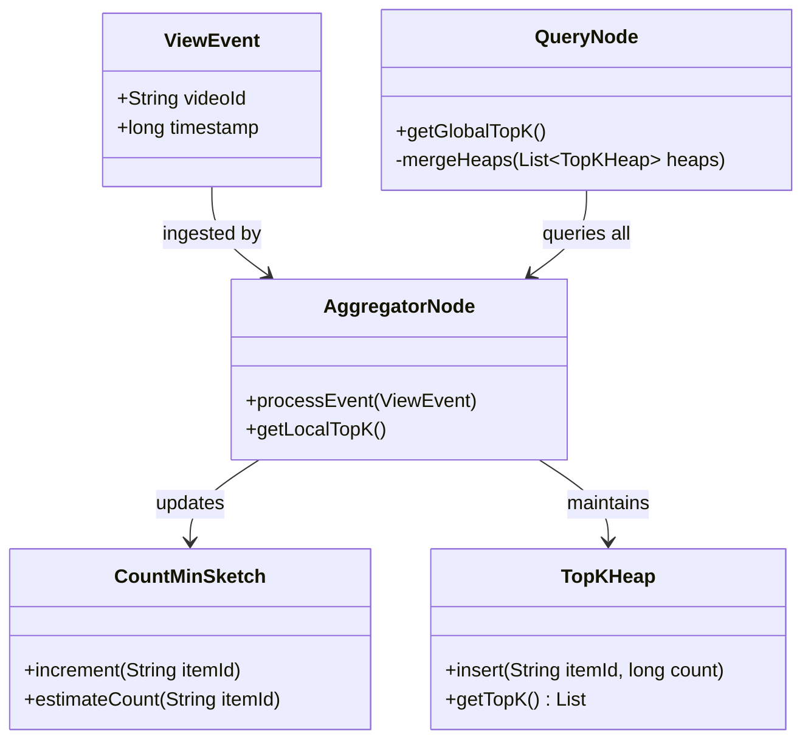

# Design Document: YouTube Top K

## System Architecture
The architecture is designed as a distributed stream processing pipeline optimized for heavy write throughput and fast, scatter-gather read queries.

### Core Components
1. **Event Ingestion (Kafka):** Buffers raw view events. Crucially, the topic is partitioned by `Video_ID` to ensure all views for a specific video hit the same downstream Aggregator.
2. **Aggregator Nodes (Stream Processors):** The workhorses. They consume from Kafka, update their local Count-Min Sketch, and maintain a local Min-Heap of the top K videos for their specific partition.
3. **Query/Merge Node:** Handles API requests for the Top K. It executes a scatter-gather operation, fetching the local Top K lists from all Aggregator nodes, merging them, and returning the definitive global Top K.
4. **Persistent Storage (HDFS/S3):** Used for checkpointing the state of the Count-Min Sketches to allow for fast recovery if an Aggregator node crashes.

### Mermaid Class Diagram

## Data Model and Schema
The system relies on probabilistic memory structures rather than a traditional database schema.
- **Count-Min Sketch Array:** A 2D integer array `int[d][w]` where `d` is the number of hash functions (depth) and `w` is the width of the array (dictating the error bounds).
- **Min-Heap:** An array-based binary heap storing objects containing `(videoId, estimatedCount)`.

## Domain Contracts and Progression

### v1-basic: In-Memory Baseline
The `v1-basic` implementation provides an in-memory proof-of-concept for single-node aggregation.
- The `VideoRankingService` provides a simplified `recordView` and `getTopK` interface. 
- It relies on simple maps and unbounded lists without any tumbling window abstraction or bounding structures.

### v2-extended: Interfaces and Bounded Structures
The `v2-extended` progression introduces abstraction boundaries and probabilistic bounds to handle real data streams over time.
- **Tumbling 1-Hour Time Window:** Ingestion buckets events into non-overlapping 1-hour windows `(eventTimeMs // windowSizeMs) * windowSizeMs`. Each window has its own independent Count-Min Sketch and Top K Heap state, allowing old windows to be safely discarded or persisted while the active window updates.
- **Probabilistic Count-Min Sketch:** Replaces precise hashing with an approximate counting data structure. By default, defined with a deterministic `width = 1000` and `depth = 5`. It relies on deterministic hashing (using MD5) seeded differently for each depth level. This trades precision for an O(1) memory bound per key. Its error probability depends on the width and the total stream size (certainty is bounded by `1 - e^(-depth)`). It is mathematically guaranteed that Count-Min estimates never undercount valid nonnegative updates; negative counts are strictly rejected.
- **Bounded Min-Heap:** Maintains the active heavy hitters. Bounded precisely to `K` elements, it provides real-time access to the current top K videos in the active window. Top-k candidate eviction, deterministic ties (broken by ascending video ID), empty stream behavior, window rotation, and bounded memory are verified by comparison with an exact small reference stream.
- **Persistence Abstract Interfaces:** Introduces `WindowStateStore` interface for checkpointing. 
- **Interface Decoupling:** `ViewEventIngestorV2` implements separate `WindowedTopKAggregator` (for writes) and `TopKQueryService` (for reads) interfaces.

### v3-optimized: Distributed-Friendly and Idempotency
The `v3-optimized` design layers resilience, cross-region storage, and idempotency for a distributed system deployment.
- **Idempotency Store Contract:** Uses `IdempotencyStore` to claim and deduplicate view events with a Time-To-Live (TTL). Example claim logic prevents double-counting the exact same event multiple times due to at-least-once stream processing retries.
- **Distributed Repository Contract:** Uses `DistributedRepository` to save and find checkpointed `WindowState` payloads, parameterized by `region` to handle global video scaling. The interface shifts from generic store abstractions to actual distributed domain contracts suitable for dynamo or wide-column stores.

## Trade-offs and Considerations
- **Accuracy vs. Memory:** This entire design is a trade-off. We accept a mathematically defined margin of error in the exact view counts in exchange for O(1) memory usage per node. If exact counts are legally required (e.g., for ad payout calculations), a secondary, slower, batch-processing system (like Hadoop/MapReduce) must run daily to calculate exact numbers, while this system serves the real-time UI.
- **Partitioning Strategy:** Partitioning by `Video_ID` ensures accurate local CMS counts. However, it can lead to "hot partitions" if a single video goes extremely viral (e.g., a new music video drop), overwhelming a single Aggregator node. We mitigate this by adding a small random salt to the hash for the top 0.01% of videos, forcing them to distribute across nodes, and summing them up at the Query Node level.
