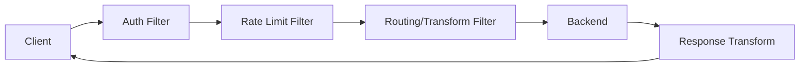

# API Gateway

## What is an API Gateway?
An API Gateway is a central management layer that sits between clients (like web browsers, mobile apps, or external third-party services) and a collection of backend services (often microservices). It acts as a reverse proxy, accepting all API calls, aggregating the various services required to fulfill them, and returning the appropriate result.

By intercepting all incoming traffic, the API Gateway centralizes routing and cross-cutting concerns, ensuring that policy enforcement, security, and observability are applied consistently before requests ever reach backend applications.

## Gateway vs Other Networking Components

Understanding the API Gateway requires distinguishing it from other similar components:

### Gateway vs Reverse Proxy / Load Balancer
- **Load Balancer (L4/L7):** Distributes traffic across a pool of servers to optimize resource utilization and prevent overload. Typically unaware of deep application semantics.
- **Reverse Proxy:** Forwards requests to backend servers and may handle SSL termination or caching, but generally lacks complex application-level policies.
- **API Gateway:** A specialized L7 proxy that understands API semantics. It applies complex routing rules, authenticates users, enforces quotas, transforms payloads, and aggregates responses.

### Gateway vs Service Mesh
- **API Gateway:** Focuses on "North-South" traffic—traffic entering the system from the outside world. It handles public-facing security, rate limiting, and client-friendly data aggregation.
- **Service Mesh:** Focuses on "East-West" traffic—internal service-to-service communication. It handles internal load balancing, mTLS between microservices, and internal retries.
- *Pattern:* Often used together, where the Gateway is the ingress point to the Service Mesh.

### Gateway vs BFF (Backend for Frontend)
- **API Gateway:** Typically a single, generalized entry point for all clients.
- **BFF:** A specialized gateway tailored to a specific client interface (e.g., one BFF for the mobile app, one for the web app). A BFF allows client teams to own their gateway layer and optimize data fetching specifically for their UI needs, without waiting on a central API team.

## Core Responsibilities

### 1. The Filter Pipeline
The heart of an API Gateway is the filter pipeline (or middleware chain). When a request arrives, it passes through a series of filters before being routed, and the response passes back through the chain.

### 2. Authentication and Authorization (AuthN/AuthZ)
- **AuthN:** Verifies *who* the caller is. The gateway often validates JWTs, OAuth tokens, or API keys, preventing unauthenticated traffic from reaching backend services. It may verify HMAC tokens to ensure data integrity and authenticity.
- **AuthZ:** Determines *what* the caller can do. While fine-grained authorization (e.g., "Can user X edit document Y?") often lives in the backend, coarse-grained authorization (e.g., "Does this token have the `admin` scope?") is efficiently handled at the Gateway.

### 3. Rate Limiting and Throttling
Protects backend services from accidental spikes or malicious abuse.
- Uses algorithms like **Token Bucket** or Leaky Bucket to track usage per client, IP, or token.
- Returns `429 Too Many Requests` when limits are exceeded.
- Can be tiered (e.g., free users get 10 req/sec, premium users get 100 req/sec).

### 4. API Composition and Aggregation
Clients often need data that spans multiple microservices (e.g., fetching a user profile might require data from the User Service, Order Service, and Review Service).
- Instead of the client making three round trips over high-latency mobile networks, the Gateway makes one concurrent call to the backends, aggregates the data into a single JSON response, and returns it to the client.

### 5. Caching
The Gateway can cache responses for frequent, read-heavy, low-volatility requests (e.g., catalog items).
- Offloads traffic from backend databases.
- Relies on standard HTTP cache headers (e.g., `Cache-Control`, `ETag`).

### 6. Resilience and Reliability
The Gateway shields the system from failures and latency spikes.
- **Timeouts:** Enforces strict upper bounds on how long to wait for a backend.
- **Retries with Budgets:** Automatically retries transient failures, but implements a *retry budget* (e.g., only retry if retries account for <10% of total traffic) to prevent retry storms.
- **Circuit Breakers:** If a backend is consistently failing or timing out, the Gateway trips the circuit breaker, immediately returning fallback responses or errors (fast failure) to allow the backend to recover.

## Architecture: Control Plane vs Data Plane

Modern API Gateways (like Envoy, Kong, or API6) split responsibilities:
- **Data Plane:** The lightweight, highly optimized proxy instances that actually handle the incoming HTTP/gRPC traffic, execute the filter chain, and forward packets. They must be stateless and fast.
- **Control Plane:** The centralized management server where administrators define routes, policies, and rate limits. It pushes these configurations asynchronously to the data plane nodes. If the control plane goes down, the data plane continues routing traffic using the last known configuration.

## Sizing and Scaling Considerations

### SPOF (Single Point of Failure)
Because the Gateway handles all ingress traffic, it is a prime SPOF. To mitigate:
- Deploy multiple redundant Gateway instances across different availability zones.
- Place them behind a highly available Layer 4 Network Load Balancer (NLB).
- Ensure Gateway nodes are strictly stateless; store rate limiting counters in a fast external store like Redis (or use local approximations for extreme scale).

### Latency Budget Example
Every hop adds latency. A Gateway must strictly manage its budget.
- Total allowable client latency: **200ms**
- Network transit (Client -> Gateway): 50ms
- Gateway processing (Auth, Rate Limit): **10ms**
- Network transit (Gateway -> Backend): 5ms
- Backend processing (Database query): 80ms
- Network transit (Backend -> Gateway -> Client): 55ms
*Total: 200ms.* If the Gateway's auth check takes 100ms instead of 10ms, the strict budget is blown.

## Failure Modes

1. **Misconfigured Routing:** A bad regex in a route configuration accidentally sends all `GET /users/*` traffic to the payment service, causing widespread 404s or 500s.
2. **Retry Storms:** A backend slows down. The Gateway times out and retries. The retries double the load on the already struggling backend, causing a cascading failure. (Mitigation: Retry budgets and circuit breakers).
3. **Rate Limit Database Contention:** The Gateway relies on a central Redis instance for token bucket rate limiting. A massive traffic spike overwhelms Redis, causing Gateway request processing to block waiting for Redis, effectively bringing down the entire API.
4. **Certificate Expiration:** The Gateway terminates TLS. If the SSL certificate expires, all client traffic is abruptly rejected by browsers or mobile OS network layers, resulting in complete outage.
5. **Thundering Herd on Cache Miss:** A popular cached item expires. Thousands of concurrent requests arrive, miss the cache, and the Gateway forwards all of them to the backend simultaneously, overwhelming it. (Mitigation: Request collapsing / coalescing).
6. **OOM due to Large Payloads:** The Gateway attempts to aggregate or transform a massive response payload (e.g., a 100MB JSON array) entirely in memory, exhausting RAM and causing the Gateway process to crash. (Mitigation: Enforcing payload size limits, streaming responses when possible).
7. **Control Plane Outage with Drift:** The control plane goes down. The data plane survives, but as new backend service instances are deployed with new IPs, the data plane cannot get the updates, leading to traffic being routed to dead IPs.
8. **Downstream Connection Exhaustion:** If backends respond slowly and the Gateway does not have strict timeouts or circuit breakers, the Gateway's connection pool to the backends can become fully exhausted. This causes the Gateway to queue or drop new incoming requests even for healthy backend services, leading to a system-wide outage.
9. **JWT Key Rotation Failure:** If the Identity Provider (IdP) rotates its signing keys but the API Gateway fails to fetch the new public keys (e.g., due to a network partition), the Gateway will suddenly reject all valid, newly minted JWTs, causing a massive authentication outage.

## More Information on API Gateway Features

### Request Collapsing / Coalescing
When multiple identical requests arrive for an uncached or expired resource simultaneously, a Gateway can use a technique called request collapsing. Instead of forwarding all requests to the backend (causing a thundering herd), the Gateway holds all but the first request, forwards that single request to the backend, and then uses the resulting response to satisfy all waiting clients. This significantly reduces backend load during cache expiration spikes.

### Payload Transformation and Adapters
Modern mobile applications might require a heavily optimized JSON payload, while legacy external partners might expect XML. An API Gateway can perform payload transformation—converting JSON to XML, dropping unnecessary fields for mobile clients to save bandwidth, or renaming fields to maintain backwards compatibility when the backend API contract changes.

### Canary Deployments and Blue-Green Deployments
API Gateways are essential for progressive delivery. During a canary deployment, the Gateway can be configured to route a small percentage (e.g., 5%) of traffic to a new version of a backend service (the canary), while sending the rest to the stable version. By monitoring error rates and latency on the canary traffic, teams can confidently promote or rollback the new version.

### Mutual TLS (mTLS)
In zero-trust networks, the API Gateway often participates in mTLS. It presents a client certificate to the backend services to prove its identity, and the backends verify that the traffic is legitimately coming from the Gateway and hasn't bypassed security controls.

### IP Whitelisting and Blacklisting
At the edge of the network, the API Gateway can drop traffic from known malicious IP addresses or restrict access to specific administrative endpoints based on an allowed list of internal company IPs. This provides an additional layer of defense-in-depth before requests reach application logic.

### Distributed Tracing Context Injection
To trace requests across a complex microservices architecture, the API Gateway typically generates or propagates trace identifiers (like W3C Trace Context headers). It attaches these correlation IDs to incoming requests, ensuring that all downstream logs and spans can be linked back to the single user action that initiated them.

### WebSockets and Persistent Connections
While Gateways excel at traditional request-response HTTP, they must also support long-lived connections for real-time updates. This involves managing WebSocket upgrades, handling idle timeouts appropriately, and ensuring load balancers distribute these long-lived connections evenly across Gateway instances.

### Geo-Routing
For globally distributed systems, an API Gateway might inspect the incoming request's source IP or specific headers to route the request to the nearest geographical datacenter, minimizing latency. It can also enforce data residency requirements by ensuring European users' data is always routed to EU-based microservices.

### Developer Portal Integration
Many API Gateway solutions integrate directly with Developer Portals. They can auto-generate API documentation (using OpenAPI specs), provide a self-service mechanism for third-party developers to register applications and obtain API keys, and offer usage dashboards for API consumers.

## Gateway Deployment Patterns

### Edge Gateway
This is the most common pattern. A single, large API Gateway sits at the edge of the network, acting as the front door for all external traffic entering the system. It handles global concerns like SSL termination and coarse-grained rate limiting.

### Microgateway Pattern
Instead of one monolithic gateway, smaller, specialized gateways are deployed closer to the microservices they protect (often as a sidecar or a dedicated proxy for a small cluster of services). This reduces the blast radius of a gateway failure and allows individual service teams more control over their gateway configurations.

### GraphQL Gateway (Federation)
When using GraphQL, the API Gateway often acts as a federated schema router. It exposes a single, unified GraphQL graph to clients, but internally delegates sub-graph queries to specific backend services (e.g., Apollo Federation). The gateway handles query parsing, validation, and complex authorization before fanning out to the microservices.

### Ingress Controller vs API Gateway
In Kubernetes environments, there is often confusion between an Ingress Controller and an API Gateway. 
- An **Ingress Controller** primarily manages HTTP/HTTPS routing based on hostnames and paths (Layer 7 routing), exposing cluster services to the outside world.
- An **API Gateway** extends this with advanced API-specific features like token validation, transformation, API versioning, and complex rate limiting. Many modern API Gateways can also function as Kubernetes Ingress Controllers (e.g., Kong Ingress, Ambassador).

## Security Best Practices

### WAF Integration
Many API Gateways integrate with or include Web Application Firewall (WAF) capabilities. This allows them to inspect incoming payloads for common vulnerabilities like SQL injection, Cross-Site Scripting (XSS), and malicious bots, blocking them before they reach the backend.

### Strict Validation
The Gateway should validate request shapes (JSON schema validation) and headers. This ensures that backend services only process well-formed requests, reducing the risk of application-level exploits and saving backend processing time on invalid requests.

### Audit Logging
The Gateway is uniquely positioned to log every access attempt. Audit logs should capture who accessed what, when, and from where. This is crucial for compliance (e.g., GDPR, HIPAA) and forensic analysis after a security incident. Sensitive fields (like passwords or PII in URLs) must be redacted before logging.

## More Failure Modes and Considerations

### Header Size Limits
If a client sends excessively large HTTP headers (e.g., massive cookies or dozens of custom headers), the Gateway might reject the request with a `431 Request Header Fields Too Large` error, or worse, crash if not configured correctly. Setting strict limits on header sizes protects both the Gateway and the backends.

### Slowloris Attacks
A malicious client might open many connections to the Gateway and send HTTP request data very slowly, attempting to exhaust the Gateway's connection pool or thread pool. Gateways must implement strict read timeouts and connection limits to mitigate these types of DoS attacks.

### Asymmetric Cryptography Overhead
Validating large numbers of JWTs using asymmetric cryptography (e.g., RSA) can be computationally expensive for the Gateway. If traffic spikes, CPU utilization on the Gateway nodes can soar, leading to increased latency. Caching the public keys and potentially using hardware acceleration or symmetric cryptography (where appropriate) can help.

### The "God Object" Gateway
As organizations scale, there is a temptation to add more and more custom business logic into the Gateway (e.g., custom plugins for specific partner workflows). This turns the Gateway into a monolithic "God Object" that is brittle, hard to test, and difficult to deploy. Best practice is to keep the Gateway strictly focused on routing and cross-cutting policies.

## Evolution of the API Gateway

### Generation 1: The ESB (Enterprise Service Bus)
Historically, SOA (Service Oriented Architecture) relied on ESBs. These were heavy, centralized systems that handled routing, transformation, and complex orchestration. They often became massive bottlenecks because all business logic was embedded in them.

### Generation 2: The Edge Proxy
With the rise of REST and microservices, the industry moved to lighter-weight edge proxies (like NGINX or HAProxy) that focused purely on load balancing and basic routing, pushing business logic back to the microservices.

### Generation 3: The API Gateway
As microservices proliferated, teams realized they needed to centralize certain cross-cutting concerns (Auth, Rate Limiting) without rebuilding the heavy ESB. The modern API Gateway emerged as a balance—a specialized L7 proxy configured dynamically via a Control Plane.

### Generation 4: Gateway + Service Mesh
Today, the trend is combining the API Gateway (for North-South edge traffic) with a Service Mesh (like Istio or Linkerd) for East-West internal traffic. Both often share the same underlying proxy technology (e.g., Envoy), providing a unified control plane for all network policies.

## Handling File Uploads and Downloads

### Presigned URLs (The S3 Pattern)
A common mistake is routing massive file uploads (e.g., 5GB videos) directly through the API Gateway. This ties up Gateway connections, wastes bandwidth, and often triggers payload size limits. The standard solution is for the client to request a short-lived "presigned URL" from the API (via the Gateway), and then the client uploads the file directly to object storage (e.g., AWS S3) bypassing the Gateway entirely.

### Chunked Transfer Encoding
When the Gateway *must* handle streaming data (e.g., proxying a real-time log stream), it should use chunked transfer encoding. This allows the Gateway to stream data through to the client without needing to buffer the entire massive payload in memory first, preventing Out-Of-Memory (OOM) crashes.

## Observability and Telemetry

### RED Metrics
Every API Gateway must export the RED metrics for every configured route:
- **R**ate: Number of requests per second.
- **E**rrors: Number of 5xx and 4xx responses.
- **D**uration: Latency distributions (p50, p90, p99).

### Access Logs
Standardized access logs (often in JSON format) are critical. A single log line per request should include the client IP, route matched, upstream latency, gateway latency, status code, and the injected Trace ID.

### The Role of Dashboards
Gateway telemetry provides the "golden signals" dashboard for the entire microservice ecosystem. Since all traffic flows through it, a spike in 500s at the Gateway immediately alerts operators that a backend service is failing, even before the backend service's own alerts might trigger.

## Advanced Routing Scenarios

### Header-Based Routing (A/B Testing)
Gateways can route traffic based on HTTP headers. For example, if a request contains `X-Beta-Tester: true`, the Gateway routes it to the `v2` microservice pool. Otherwise, it goes to the `v1` pool. This is powerful for targeted A/B testing and internal dogfooding.

### Path Rewriting and Stripping
Clients might call `GET /api/v1/users/123`. The backend User Service might only be aware of the path `/123`. The API Gateway can strip the `/api/v1/users` prefix before forwarding the request, decoupling the external public API contract from the internal service routing structure.

## Handling Legacy Systems

### Protocol Translation
Sometimes a modern mobile app expects RESTful JSON, but the backend is a legacy system that only speaks SOAP/XML. An API Gateway can be configured to perform protocol translation on the fly, bridging the gap between new clients and old servers without modifying the legacy code.

### Incremental Migration (Strangler Fig Pattern)
When migrating from a legacy monolith to microservices, the API Gateway is essential. It is placed in front of both systems. Initially, it routes all traffic to the monolith. As new microservices are built (e.g., a new User Service), the Gateway configuration is updated to route `/api/users` traffic to the new microservice, while leaving the rest of the traffic pointed at the monolith.

## Custom Plugins

### Flexibility vs Performance
Most modern Gateways (like Kong or Envoy via WebAssembly) allow operators to write custom plugins. While powerful, this should be done sparingly. Custom code running on every request can introduce significant latency and new failure modes (like memory leaks) into the data plane.

### The Sidecar Model for Custom Logic
If complex custom logic is required that doesn't fit standard Gateway features, consider using an external callout. The Gateway can make a fast gRPC call to a dedicated sidecar or policy decision point (like OPA - Open Policy Agent) before routing the main request.

## Multitenancy Support

### Tenant Isolation
In SaaS applications, an API Gateway can provide tenant isolation. It can inspect incoming requests, determine the tenant ID (e.g., from the URL or token), and enforce tenant-specific rate limits, routing, and usage quotas.

### Billing and Metering
Because all traffic passes through the Gateway, it is the ideal place to emit metering events for usage-based billing. The Gateway can reliably report that Tenant A made 50,000 API calls this month.

## Summary

The API Gateway is a crucial architectural component in distributed systems. It abstracts the complexity of the backend topology from clients, centralizes critical security and traffic management policies, and provides a unified point of observability. However, it must be carefully designed for high availability, low latency, and operational simplicity to avoid becoming a bottleneck or a monolithic point of failure.

## Related concepts and projects
- [Load Balancing](../load-balancing/)
- [Rate Limiting](../rate-limiting/)
- [Microservices Communication](../microservices-communication/)
- [Service Discovery](../service-discovery/)
- [Notification Service](../../04-hld-projects/notification-service/)
- [Chat Service](../../04-hld-projects/chat-service/)
- [WhatsApp Messaging Case Study](../../case-studies/whatsapp-messaging/)
- [HLD Concepts Quiz](../../quizzes/hld-concepts-quiz.md)
- [HLD Concepts Flashcards](../../flashcards/hld-concepts.md)
\n## Conclusion\n\nThe API Gateway is arguably the single most important architectural component in a modern, public-facing distributed system. Mastering its configuration, scaling properties, and failure modes is essential for senior backend engineers.
