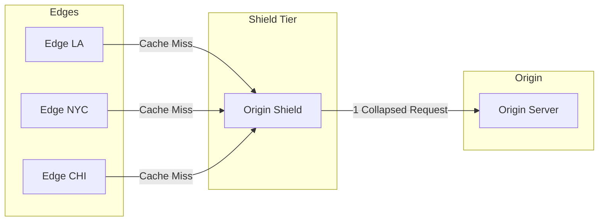
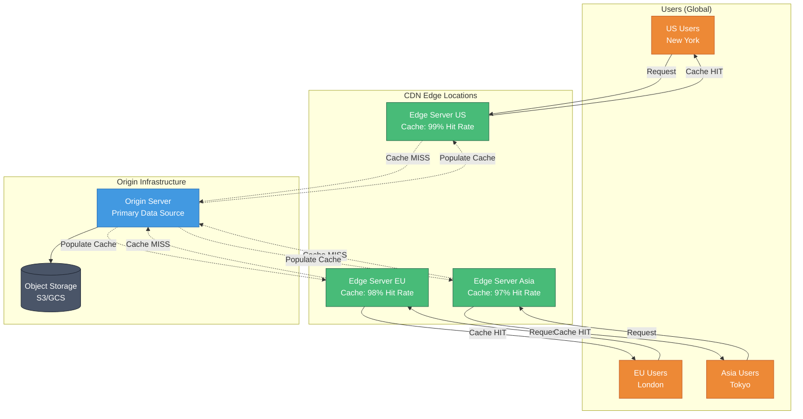

# Content Delivery Network (CDN)

## What is it?

A CDN is a geographically distributed network of proxy servers that cache and serve content from locations closer to end users, reducing latency and improving load times.

## Why do we need it?

**Problem**: Users far from the origin server experience high latency. A user in Tokyo accessing a server in New York faces ~200ms round-trip time.

**Solution**: CDN caches content at edge locations worldwide. The Tokyo user gets content from a nearby CDN node with ~20ms latency.

**Real Scenario**: Netflix serves 15% of global internet traffic. Without CDN, their origin servers would be overwhelmed and users would experience buffering.

## Types/Approaches

### 1. Pull CDN (Lazy Loading)
- CDN fetches content from origin on first request
- Caches for subsequent requests
- **Pros**: Simple, automatic, no push logic needed
- **Cons**: First user experiences cache miss latency
- **Use Case**: Most web content, APIs

### 2. Push CDN (Eager Loading)
- Origin proactively pushes content to CDN
- Content available before first request
- **Pros**: No cold cache, predictable performance
- **Cons**: Complex, requires knowing what to cache
- **Use Case**: Video streaming, software updates

### 3. Hybrid CDN
- Combines pull and push strategies
- Popular content pushed, long-tail pulled
- **Use Case**: Large-scale video platforms

## How it works

```
┌─────────────────────────────────────────────────────────────────┐
│                        CDN Architecture                          │
└─────────────────────────────────────────────────────────────────┘

User Request Flow:
                                                              
   ┌────────┐      ┌──────────┐      ┌─────────────┐      ┌────────┐
   │  User  │─────▶│   DNS    │─────▶│  Edge Node  │─────▶│ Origin │
   │(Tokyo) │      │(GeoDNS)  │      │   (Tokyo)   │      │ Server │
   └────────┘      └──────────┘      └─────────────┘      └────────┘
       ▲                                   │
       │                                   │
       └───────────────────────────────────┘
                  Cached Response

CDN Node Hierarchy:

                    ┌─────────────┐
                    │   Origin    │
                    │   Server    │
                    └──────┬──────┘
                           │
            ┌──────────────┼──────────────┐
            ▼              ▼              ▼
     ┌──────────┐   ┌──────────┐   ┌──────────┐
     │  Shield  │   │  Shield  │   │  Shield  │
     │  (US)    │   │  (EU)    │   │  (Asia)  │
     └────┬─────┘   └────┬─────┘   └────┬─────┘
          │              │              │
    ┌─────┼─────┐  ┌─────┼─────┐  ┌─────┼─────┐
    ▼     ▼     ▼  ▼     ▼     ▼  ▼     ▼     ▼
  ┌───┐ ┌───┐ ┌───┐───┐ ┌───┐ ┌───┐───┐ ┌───┐ ┌───┐
  │NYC│ │LA │ │CHI│LON│ │PAR│ │FRA│TKY│ │SIN│ │SYD│
  └───┘ └───┘ └───┘───┘ └───┘ └───┘───┘ └───┘ └───┘
         Edge PoPs (Points of Presence)
```

### Request Flow:

1. **DNS Resolution**: GeoDNS routes to nearest edge
2. **Cache Check**: Edge checks local cache
3. **Cache Hit**: Return cached content (fast path)
4. **Cache Miss**: 
   - Check shield/parent tier
   - Fetch from origin if needed
   - Cache response for future

### Cache-Control Headers & Directives:

| Directive | Purpose | Example |
|---|---|---|
| `public` | CDN can cache it | `Cache-Control: public` |
| `private` | Browser only, CDN skips | `Cache-Control: private` |
| `no-cache` | Must revalidate with origin | `Cache-Control: no-cache` |
| `max-age` | Browser/CDN cache TTL (seconds) | `max-age=3600` |
| `s-maxage` | CDN-only TTL (overrides max-age) | `s-maxage=86400` |
| `stale-while-revalidate` | Serve stale, fetch in background | `stale-while-revalidate=60` |
| `stale-if-error` | Serve stale if origin is down/5xx | `stale-if-error=86400` |

## Routing: Anycast vs GeoDNS

CDNs use two primary methods to route a user to the nearest edge:

1. **GeoDNS (Geographic DNS)**:
   - DNS server looks up user's IP in a geolocation database.
   - Returns the specific IP address of the nearest CDN edge.
   - **Pros**: Granular control, easy to weight traffic or avoid dead nodes.
   - **Cons**: DNS caching can lead to stale routing, slower failover.

2. **Anycast**:
   - The *same* IP address is announced from all edge locations worldwide using BGP.
   - The internet's routing infrastructure inherently finds the shortest topological path to the nearest edge.
   - **Pros**: Fast failover (BGP reroutes automatically if a node drops), mitigates DDoS natively.
   - **Cons**: Harder to perfectly load balance, BGP routing doesn't always map to lowest latency.

## When to use

| Scenario | CDN Benefit |
|----------|-------------|
| Static assets (JS, CSS, images) | 80-90% latency reduction |
| Video streaming | Bandwidth offload, buffering reduction |
| Global user base | Consistent performance worldwide |
| Traffic spikes | Origin protection |
| API responses | Cache GET requests |

## When NOT to use

| Scenario | Why Not |
|----------|---------|
| Real-time data | Cannot cache dynamic content |
| Personalized content | Cache key explosion |
| Single region users | No geographic benefit |
| Frequently changing data | Low cache hit rate |
| Sensitive data | Security/compliance concerns |

## Trade-offs

| Aspect | Trade-off |
|--------|-----------|
| **Latency** | Lower for cached content, higher for misses |
| **Consistency** | Stale content possible during TTL |
| **Cost** | Bandwidth costs vs origin load reduction |
| **Complexity** | Cache invalidation is hard |
| **Control** | Less control over content delivery |

## Cache Invalidation Strategies

### 1. Time-Based (TTL)
```
Cache-Control: max-age=3600  # Expires in 1 hour
```

### 2. Versioned URLs
```
/static/app.v1.2.3.js       # Change URL on update
/static/app.js?v=abc123     # Query string version
```

### 3. Purge API
```bash
curl -X POST https://cdn.example.com/purge \
  -d '{"urls": ["/images/logo.png"]}'
```

### 4. Soft Purge (Stale-While-Revalidate)
```
Cache-Control: max-age=60, stale-while-revalidate=3600
```

## Real-world examples

### Netflix
- **Open Connect**: Custom CDN with ISP partnerships
- **Strategy**: Push popular content to edge during off-peak
- **Scale**: Handles 15% of global internet traffic

### Cloudflare
- **Anycast**: Same IP announced from all edge locations
- **Workers**: Edge compute for dynamic content
- **Features**: DDoS protection, WAF, load balancing

### Akamai
- **Largest CDN**: 350,000+ servers in 135+ countries
- **Protocol optimization**: TCP/TLS optimizations
- **Predictive prefetching**: AI-based content prediction

### YouTube
- **Hybrid approach**: Hot videos at edge, cold in regional
- **Adaptive bitrate**: Different quality versions cached
- **Scale**: 1 billion hours watched daily

## Complexity Analysis

| Operation | Time Complexity | Notes |
|-----------|-----------------|-------|
| Cache lookup | O(1) | Hash-based |
| Cache store | O(1) | Hash-based |
| DNS routing | O(log n) | Geographic lookup |
| Purge single | O(e) | e = edge nodes |
| Purge wildcard | O(e × k) | k = matching keys |

**Space**: O(capacity) per edge node

## Key Metrics

| Metric | Good Value | Why |
|--------|------------|-----|
| Cache Hit Ratio | >90% | Higher = less origin load |
| Origin Offload | >80% | Traffic served by CDN |
| TTFB | <100ms | Time to first byte |
| Miss Latency | <500ms | Cache miss response time |
| Purge Time | <30s | Global invalidation speed |

## Key Takeaways

1. **Cache hit ratio is king**: Optimize for high hit rates with proper TTLs
2. **Invalidation is the hard problem**: Use versioned URLs when possible
3. **Shield/parent tiers protect origin**: Reduces origin load on cache misses
4. **GeoDNS is critical**: Proper routing determines latency
5. **Monitor everything**: Hit rates, latency percentiles, origin load
## Advanced CDN Concepts

### Origin Shield & Request Collapsing

An **origin shield** is an intermediate caching layer between the edge nodes and the origin. When a cache miss occurs at the edge, instead of all edges going to the origin, they go to the shield.

**Request Collapsing (Coalescing)**: If 100 users request a stale or missing file simultaneously, the CDN pauses 99 requests, sends *one* request to the origin/shield, caches the response, and then serves it to all 100 users.



### Cache-Key Design and `Vary`

The **Cache-Key** is the unique identifier for a cached object. By default, it is the URL: `scheme://host/path?query`.

The `Vary` header tells the CDN to include other HTTP headers in the cache key.
- `Vary: Accept-Encoding` (cache gzip and br versions separately)
- `Vary: Origin` (for CORS)
- **Warning**: High cardinality in `Vary` or query params causes cache fragmentation (poor hit rate).

### Cache Invalidation: Purge vs Versioned URLs

- **Purge**: API call to the CDN to delete a cache key. Propagation can take seconds to minutes. Complex to ensure global consistency.
- **Versioned URLs**: Change the filename on deploy (e.g., `app-v2.js`). **Preferred** because it completely bypasses stale cache without needing purge APIs, achieving instant "invalidation".

### Signed URLs & Security

For premium content (paywalls, video streams), CDNs use **Signed URLs**. The origin generates a URL with a cryptographic signature and an expiration time in the query string. The CDN verifies the signature at the edge before serving the content.

**Cache Poisoning**: An attacker sends a crafted request (e.g., weird `X-Forwarded-Host` header) that causes the origin to generate a malicious response (like a bad redirect). The CDN caches this malicious response and serves it to legitimate users.

### Range Requests & HLS

Video streaming uses HTTP Range Requests (`Range: bytes=0-1024`) or protocols like HLS/DASH (small 2-10 second video chunks like `.ts` or `.m4s`).
CDNs optimize this by caching chunks independently and using predictive prefetching to load the next chunk before the player requests it.

### Multi-CDN Failover

Large platforms use multiple CDNs (e.g., Akamai + Cloudflare). A centralized DNS or traffic management system dynamically routes users based on real-time performance telemetry or CDN availability, preventing a single CDN outage from taking down the service.

## Economics and Arithmetic

### Cost and Origin Offload (10 TB/day Example)

**Scenario**: You serve 10 TB of images per day.
- **Origin AWS Egress Cost**: ~$0.09 / GB.
- **CDN Egress Cost**: ~$0.02 / GB.

Without CDN: 10,000 GB * $0.09 = **$900 / day**
With CDN (90% Hit Rate):
- CDN serves 9,000 GB * $0.02 = $180
- Origin serves 1,000 GB * $0.09 = $90
- Total = **$270 / day** (70% savings)

### Purge-All Herd Math

**Scenario**: You issue a global purge for a highly popular API response (`/api/config`) across 200 edge nodes. Traffic is 10,000 requests per second globally.
- If the CDN doesn't support request collapsing, 200 edges *simultaneously* get a cache miss and hit the origin.
- Origin receives a burst of 200 RPS instantly.
- If the TTL was only 5 seconds, this burst happens every 5 seconds.
- **Solution**: Use an origin shield (reduces the 200 requests to 1) or `stale-while-revalidate` (serves stale while 1 edge updates it).

## Failure Modes

| Failure Mode | Symptom | Impact | Mitigation |
|---|---|---|---|
| **Origin Outage** | Origin returns 502/504 to CDN | Cache misses fail, site goes down | Use `stale-if-error` to serve stale content during origin downtime. |
| **Cache Stampede** | Sudden traffic spike on expired item | Origin overwhelmed by concurrent misses | Request collapsing (coalescing) at edge/shield. |
| **BGP Route Leak** | Traffic blackholed or latency spikes | Users unable to reach Anycast IP | Multi-CDN strategy with DNS-based failover. |
| **Cache Fragmentation** | Low hit rate, high origin load | Slower responses, higher origin costs | Normalize query strings, avoid `Vary: User-Agent`. |
| **Global Purge Delay** | Stale content served past intended time | Users see old data/bugs | Prefer versioned URLs over manual purge APIs. |
| **Bad TTL Configuration** | Dynamic content cached (e.g., user profile) | PII leakage, security breach | Strict `Cache-Control: private, no-store` on authenticated routes. |
| **Edge Node Failure** | Connections timeout to specific POP | Regional outage | DNS health checks to remove dead POPs, Anycast self-healing. |
| **Cache Poisoning** | Malicious payload served to users | Cross-site scripting (XSS), redirects | Strip unneeded headers from cache key, strict origin input validation. |

## Network Topology Diagram



