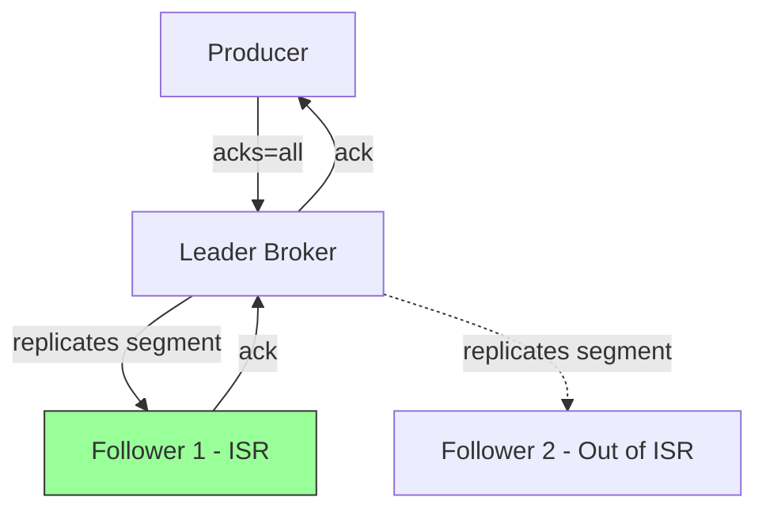
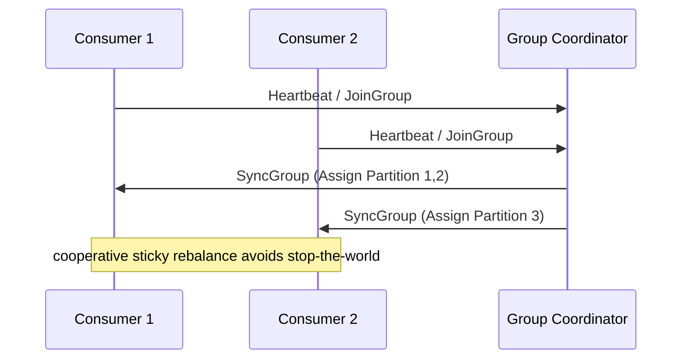
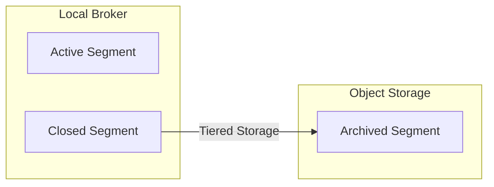

# Kafka Theory: Internals, Durability, and Operations

## Introduction
Kafka is a distributed event streaming platform built around durable append-only logs and parallel consumer processing. It fundamentally behaves as a distributed commit log, ensuring ordered, immutable sequences of events.
This document delves into staff depth topics: log segments, zero-copy, ISR, leader epoch, acks + min.insync.replicas, batching, consumer groups, cooperative rebalance protocols, EOS scope, compaction, KRaft, tiered storage, and cluster sizing.

## Core Internals
### Log Segments and Disk Usage
A Kafka topic is divided into partitions. Instead of a single infinite file, each partition log is divided into multiple log segment files. A segment has a base offset. Once a segment reaches a size limit (e.g., 1GB), it is rolled, and a new segment is created.
By splitting logs into segment files, Kafka can efficiently purge old data. A segment can be easily deleted from the filesystem without blocking operations on the active segment.
A segment comprises:
- `.log` file: The actual record data.
- `.index` file: Maps logical offsets to physical byte positions in the segment.
- `.timeindex` file: Maps timestamps to offsets in the segment.
When a segment is closed, it is immutable. A closed segment is eligible for retention policies.
The active segment is the only one written to. When `log.segment.bytes` is reached, it rolls.
Using segment files also allows zero-copy techniques on the closed segment files.
Because a segment is sequential, disk reads/writes are fast.
In Tiered storage, cold segment files are uploaded to object storage (like S3) to save local disk space.
Log compaction also operates on a per- segment basis, rewriting the segment to remove obsolete keys.
A segment is the fundamental unit of retention.

### Page Cache and Zero-Copy
Kafka avoids JVM heap overhead by relying heavily on the OS Page Cache.
When a consumer reads from a segment, Kafka uses the `sendfile()` system call (Zero-Copy). Data is copied directly from the OS Page Cache to the NIC buffer, bypassing user space entirely. This makes reading a segment extremely CPU-efficient.

### KRaft Mode (Kafka Raft)
KRaft removes the ZooKeeper dependency. In KRaft mode, brokers act as both controllers and data nodes, using Raft for controller consensus.
KRaft improves scalability, supporting millions of partitions.
The KRaft controller quorum manages cluster metadata.
KRaft treats metadata as a topic log.
In KRaft, controller failover is nearly instantaneous.
Using KRaft simplifies deployment and security.
KRaft is the production standard for Kafka 3.x.
With KRaft, the active controller epoch is clearly defined.
Migrating to KRaft eliminates Zookeeper bottlenecks.

### ISR, High Watermark, and Leader Epoch
Each partition has a leader. Followers fetch from the leader.
The In-Sync Replicas (ISR) list contains the leader and fully caught-up followers.
A follower must fetch up to the leader's Log End Offset (LEO) within `replica.lag.time.max.ms` to stay in the ISR.
The High Watermark (HW) is the minimum LEO of all replicas in the ISR. Consumers can only read up to the HW.
Leader Epoch prevents data loss during leader changes by replacing the reliance on pure offsets with a monotonicity counter (epoch).
If a replica falls out of the ISR, it must fetch up to the current HW to rejoin the ISR.
The ISR is a dynamic set that shrinks and expands based on follower lag.
When the ISR shrinks below min.insync.replicas, availability is compromised to ensure consistency.

### Durability Matrix: Acks and min.insync.replicas
When producers send data, they specify `acks`.
`acks=0`: fire-and-forget.
`acks=1`: leader writes to local segment.
`acks=all`: leader and all replicas in the ISR acknowledge the write.
For `acks=all` to be safe, `min.insync.replicas` must be set.
If ISR size < min.insync.replicas, the broker rejects the write (NotEnoughReplicas).
Example: RF=3, min.insync.replicas=2. If 2 brokers crash, ISR=1, writes fail.
Setting min.insync.replicas=2 is a common production standard for RF=3.
A cluster's durability relies on min.insync.replicas being strictly enforced.
If you set min.insync.replicas=3 for RF=3, a single broker failure halts all writes.
Always ensure min.insync.replicas < RF to tolerate failures.
Producers using acks=all alongside min.insync.replicas provide the strongest data guarantees.
The interaction between ISR and min.insync.replicas is the cornerstone of Kafka reliability.

### Consumer Groups and Rebalance Protocols
Consumers in a group share partitions.
Traditionally, eager rebalance revoked all partitions (stop-the-world).
Modern Kafka uses the cooperative sticky rebalance protocol.
The cooperative protocol only revokes partitions that must be reassigned, avoiding global pauses.
With the cooperative protocol, consumers keep unaffected partitions.
The cooperative strategy drastically reduces tail latencies during scaling events.
Implementing a cooperative rebalance mechanism allows stateful stream apps to keep local caches.
By leveraging cooperative rebalance, rolling upgrades become completely transparent to the processing pipeline.
The cooperative protocol works in multiple phases to gradually shift partition ownership.
Migrating from eager to cooperative rebalancing is essential for massive consumer fleets.

### Exactly-Once Semantics (EOS)
EOS uses Transactional Producers and Idempotent Producers to guarantee messages are written exactly once across partitions.

## Cluster Sizing Example (Numeric Arithmetic)
Scenario:
- Throughput: 200 MB/s ingress.
- Replication Factor (RF): 3.
- Retention: 7 days.

Storage Calculation:
- Daily ingress: 200 MB/s * 3600 s/hr * 24 hr/d = 17,280,000 MB/day = 17.28 TB/day.
- RF=3 multiplier: 17.28 TB * 3 = 51.84 TB/day on disk.
- 7 days retention: 51.84 TB/day * 7 days = 362.88 TB total raw storage needed.
- Factor in 20% overhead for index/segment overhead: 362.88 * 1.2 = 435.45 TB.
- If using 8TB disks, we need 435.45 / 8 = 55 disks minimum cluster-wide.

Network Calculation:
- Ingress: 200 MB/s.
- Replication traffic (RF=3): 2 * 200 MB/s = 400 MB/s internal cross-broker.
- Egress (assuming 1x read): 200 MB/s.
- Total network per second = 800 MB/s (6.4 Gbps).
Requires at least 10GbE networking infrastructure.

## Failure Modes and Metrics (>=8)
1. **Broker Disk Full**:
   - Metric: `kafka.server:type=BrokerTopicMetrics,name=BytesInPerSec` drops; OS disk utilization > 95%.
   - Fix: Lower retention, delete oldest segment files, add tier storage.
2. **Under Replicated Partitions (URP)**:
   - Metric: `kafka.server:type=ReplicaManager,name=UnderReplicatedPartitions` > 0.
   - Fix: Indicates a follower fell out of the ISR. Check follower logs and network.
3. **Offline Partitions**:
   - Metric: `kafka.controller:type=KafkaController,name=OfflinePartitionsCount` > 0.
   - Fix: No replicas in the ISR are alive. Restart brokers or enable unclean leader election.
4. **Consumer Lag Spikes**:
   - Metric: `kafka.consumer:type=consumer-fetch-manager-metrics,name=records-lag-max` increases.
   - Fix: Add consumer instances, check downstream processing bottlenecks.
5. **High Request Purgatory Size**:
   - Metric: `kafka.server:type=DelayedOperationPurgatory,name=PurgatorySize,delayedOperation=Produce` high.
   - Fix: Usually caused by producer waiting for `acks=all` but followers are slow. Check ISR health.
6. **Network Processor Overload**:
   - Metric: `kafka.network:type=SocketServer,name=NetworkProcessorAvgIdlePercent` < 0.2 (20%).
   - Fix: Increase `num.network.threads`, check for uneven load.
7. **ZooKeeper / KRaft Controller Disconnect**:
   - Metric: `kafka.server:type=SessionExpireListener,name=SessionState` (ZK) or KRaft active controller metric drop.
   - Fix: Check network between broker and KRaft controller quorum.
8. **Memory/GC Pauses (Stop The World)**:
   - Metric: JMX GC time / count spikes.
   - Fix: Increase heap size (but not too much to leave page cache), upgrade to G1GC or ZGC.

## Diagrams

### 1. Durability and Acks Matrix

### 2. Consumer Group Rebalance Protocol

### 3. Tiered Storage and Segment Archiving

## Advanced Partitioning Strategies
When designing a high-throughput event streaming architecture, selecting the correct partition key is paramount. The partition key dictates which segment a message will reside in, directly impacting load distribution across the cluster. If a chosen key exhibits low cardinality or uneven distribution (such as a generic `tenant_id` where one tenant generates the majority of traffic), it will create "hotspots". A hotspot occurs when a single partition receives disproportionately more traffic than others, overwhelming the broker hosting that partition's leader while other brokers remain underutilized. To mitigate this, engineers often employ composite keys, hashing algorithms, or even custom partitioner classes to ensure an even spread of messages. Furthermore, when strict ordering is not a strict requirement, utilizing a round-robin partitioning strategy or sticky partitioning can optimize batching efficiency and maximize producer throughput.

## Producer Batching Dynamics
To optimize for throughput rather than absolute minimal latency, Kafka producers heavily utilize batching. The `batch.size` configuration defines the maximum size (in bytes) of a single batch of messages sent to a specific partition. When a producer application calls `send()`, the message is not immediately dispatched over the network; instead, it is appended to an in-memory buffer for that partition. Concurrently, the `linger.ms` setting acts as an artificial delay, instructing the producer to wait a small fraction of time before transmitting the batch, allowing more messages to accumulate. This dual-constraint approach (send when `batch.size` is full OR when `linger.ms` expires) significantly reduces the total number of network requests and disk I/O operations, making the entire pipeline highly efficient. Tuning these parameters requires a careful balance between the desired latency envelope and the required system throughput.

## Consumer Group Dynamics in Depth
Kafka consumer groups provide a robust mechanism for parallel, fault-tolerant message processing. The group coordinator, a role assigned to one of the brokers, manages the lifecycle of the consumer group. It handles consumer joining, leaving, and the critical rebalance operations. When a consumer joins a group, it sends a `JoinGroup` request to the coordinator, which then assigns a group leader (typically the first consumer to join). The leader is responsible for determining the specific partition assignments based on the configured `partition.assignment.strategy` (e.g., Range, RoundRobin, Sticky, or CooperativeSticky). The leader then sends this assignment map back to the coordinator, which distributes it to the rest of the group via `SyncGroup` responses. This decentralized assignment logic allows developers to implement custom partition assignment strategies tailored to complex domain-specific requirements, such as rack-aware consumption or state-aware routing.

## The Role of Tombstones in Log Compaction
In scenarios where Kafka is utilized as a durable changelog for materialized views or database synchronization (e.g., Debezium CDC), log compaction is essential to manage storage growth. Unlike standard time-based retention, compaction ensures that only the latest value for a specific key is retained across the entire topic history. However, simply updating keys is insufficient; systems must also handle deletions. To permanently remove a key from a compacted topic, a producer must publish a "tombstone" message—a record containing the target key but a `null` payload. When the background log cleaner thread processes the segment files, it observes the tombstone and marks all prior occurrences of that key for permanent deletion. The tombstone itself is temporarily retained for a configurable window (`delete.retention.ms`) to allow offline or lagging consumers an opportunity to observe the deletion before the tombstone is finally expunged, ensuring eventual consistency across all downstream systems.

## Tiered Storage Economics
The introduction of Tiered Storage has fundamentally transformed the economics and operational characteristics of large-scale Kafka deployments. Historically, retaining vast amounts of historical data required scaling up expensive broker hardware equipped with dense, performant local storage (like NVMe SSDs). This tightly coupled compute and storage, often leading to over-provisioned clusters. Tiered Storage decouples this architecture by automatically offloading closed, immutable segment files from local broker disks to highly durable, cost-effective object storage systems (such as Amazon S3, Google Cloud Storage, or Azure Blob Storage). The local broker only retains the most recent, "hot" segments necessary for serving real-time consumers. When a consumer requests historical data residing in the remote tier, the broker seamlessly fetches the data from object storage on demand. This architecture not only slashes storage costs but also significantly accelerates broker recovery and rebalancing times, as there is drastically less local state to replicate during node replacements.

## The Impact of Hardware Selection
While Kafka's architecture is highly optimized for performance, the underlying hardware selection plays a critical role in achieving maximum throughput. Because Kafka heavily leverages the OS Page Cache and zero-copy techniques, it is remarkably efficient with CPU resources. The primary bottlenecks in a well-tuned Kafka cluster are typically network bandwidth and disk I/O. For high-volume workloads, deploying brokers with 10Gbps or even 25Gbps Network Interface Cards (NICs) is standard practice, as replication traffic effectively multiplies the required bandwidth. For storage, while traditional HDDs can handle sequential writes efficiently, NVMe SSDs provide vastly superior performance for complex workloads involving numerous partitions, frequent index lookups, or heavy historical consumer activity, mitigating disk seek latency and ensuring consistent tail performance under load.

## Ensuring Secure Communication
Securing a Kafka cluster requires a multi-layered approach addressing authentication, authorization, and encryption. For data in transit, configuring SSL/TLS encryption ensures that messages are secure from eavesdropping over the network. However, it is vital to note that enabling SSL/TLS encryption disables the zero-copy optimization on the broker side, as the data must be decrypted and re-encrypted in user space, significantly increasing CPU utilization. For authentication, Kafka supports various mechanisms via SASL (Simple Authentication and Security Layer), including PLAIN, SCRAM, and Kerberos, allowing integration with enterprise identity providers. Authorization is managed through Access Control Lists (ACLs), which define granular permissions, ensuring that specific users or applications can only publish or subscribe to designated topics. Implementing robust security protocols is indispensable for protecting sensitive event data and maintaining regulatory compliance.

## Strategies for Monitoring and Alerting
Effective observability is crucial for maintaining the health and performance of a Kafka cluster. Operators must track a comprehensive suite of metrics to proactively identify and resolve issues. Beyond basic hardware utilization (CPU, memory, disk, network), key Kafka-specific metrics include Under Replicated Partitions (URP), which indicates replication health and node availability; Offline Partitions, signifying severe data unavailability; and Consumer Lag, which highlights processing bottlenecks in downstream applications. Setting up automated alerts based on predefined thresholds for these metrics enables rapid incident response. Furthermore, tracking JMX metrics related to request latency, delayed operation purgatory size, and garbage collection pauses provides deep insights into broker performance tuning and capacity planning, ensuring the cluster remains resilient under dynamic workloads.

## KRaft: The Future of Kafka Metadata
The transition to KRaft (Kafka Raft) represents the most significant architectural evolution in Kafka's history. By replacing the external ZooKeeper dependency with an internal, event-driven Raft quorum, KRaft dramatically simplifies the deployment and management of Kafka clusters. In KRaft mode, a small subset of brokers acts as controllers, maintaining the cluster metadata in a specialized internal topic. This design unifies the security model, reduces operational complexity, and eliminates the dreaded "split-brain" scenarios associated with managing two distinct distributed systems. More importantly, KRaft enables Kafka to scale to support millions of partitions per cluster, a feat previously unachievable due to ZooKeeper's metadata synchronization bottlenecks. The near-instantaneous controller failover provided by the Raft consensus algorithm ensures exceptional cluster stability and availability during node failures or rolling upgrades.

## Deep Dive into Idempotent Producers
Idempotent producers are critical for ensuring exactly-once semantics. By assigning a unique Producer ID (PID) and a sequence number to each message, the broker can deduplicate messages on the server side, ensuring that even if a producer retries sending a message due to a network timeout, it is only appended to the partition once. The PID and sequence number track the ongoing session.

## Managing Poison Pill Messages
A 'poison pill' is a message that consistently causes a consumer to fail or crash, blocking the progression of the entire partition if not handled correctly. Robust consumer applications must implement Dead Letter Queues (DLQs). When a message fails processing after a configured number of retries, the consumer forwards the failing message to a separate DLQ topic, commits the original offset, and continues processing subsequent messages, ensuring the pipeline remains healthy.

## Understanding the High Watermark
The High Watermark (HW) is a crucial concept for consumer read isolation. It represents the highest offset that has been successfully replicated to all brokers currently in the In-Sync Replicas (ISR) list. Consumers are strictly prevented from reading past the HW. This mechanism guarantees that consumers never process 'dirty' or uncommitted data that could potentially be lost if the current leader broker crashes before replication completes.

## The Role of the Controller Broker
The Controller is a specialized broker responsible for managing cluster metadata and orchestrating leader elections. When a broker fails, the Controller detects the failure via heartbeat timeouts (or ZooKeeper session expiration in older architectures) and automatically promotes a follower from the ISR to become the new leader for all affected partitions. The efficiency of the Controller directly impacts the cluster's recovery time objective (RTO).

## Balancing Partitions and Consumers
The number of partitions directly dictates the maximum parallelization a topic can achieve. A consumer group cannot have more active consumers than the number of partitions in the subscribed topic. Any excess consumers will remain idle. Therefore, capacity planning must involve over-partitioning a topic upfront (e.g., creating 50 partitions for a topic that currently only needs 10 consumers) to allow for seamless horizontal scaling of the consumer application as traffic grows.

## Leveraging Kafka Connect
Kafka Connect is a powerful framework for streaming data between Kafka and other data systems without writing custom integration code. It supports Source Connectors (pulling data into Kafka from databases or message queues) and Sink Connectors (pushing data from Kafka to search indexes, data lakes, or object stores). Connect operates in a distributed, fault-tolerant manner, inherently managing offsets and scaling horizontally across worker nodes.

## Exploring Kafka Streams API
Kafka Streams is a client library for building applications and microservices, where the input and output data are stored in Kafka clusters. It allows for complex stateful operations like windowing, joins, and aggregations. Unlike external processing frameworks (e.g., Apache Flink or Spark), Kafka Streams applications are standard Java or Scala applications that can be deployed anywhere, simplifying the operational footprint of stream processing architectures.

## Tuning Fetch Requests for High Latency Networks
When deploying Kafka across Wide Area Networks (WANs) or cloud regions, tuning consumer fetch requests is vital. Increasing `fetch.min.bytes` and `fetch.max.wait.ms` encourages the broker to accumulate more data before responding to the consumer, reducing the frequency of network round trips and improving overall throughput over high-latency connections, at the acceptable cost of marginally increased processing delay.

## Addressing Data Skew in Stream Processing
Data skew occurs when certain partition keys receive disproportionately high volumes of traffic, leading to imbalanced processing loads across consumer instances. Addressing skew in stream processing applications (like Kafka Streams) often requires techniques such as 'salt and pepper' hashing, where a random suffix is appended to the original key to artificially distribute the hot key across multiple partitions, followed by a downstream re-aggregation step.

## The Implications of Unclean Leader Election
Unclean leader election is a drastic operational measure configured via `unclean.leader.election.enable`. If enabled, the cluster prioritizes availability over consistency by allowing a follower that is not in the ISR (and therefore missing recent data) to be elected as the new leader if all ISR members fail. This immediately restores read/write capabilities but permanently discards any data that was present on the old leader but not replicated to the newly elected unclean leader.

## Understanding the Impact of min.insync.replicas on Availability
While min.insync.replicas provides crucial durability guarantees when used with acks=all, it fundamentally alters the cluster's availability profile. If the active ISR size drops below min.insync.replicas (e.g., due to multiple broker crashes or severe network partitions), the partition stops accepting new writes entirely, throwing a `NotEnoughReplicasException`. Therefore, a robust cluster design always maintains a replication factor greater than min.insync.replicas (e.g., RF=3, min.insync.replicas=2) to tolerate failures without sacrificing availability.

## Optimizing Log Compaction Performance
The background log cleaner threads responsible for compaction can consume significant CPU and disk I/O. Operators must tune settings like `log.cleaner.threads` and `log.cleaner.dedupe.buffer.size` to ensure compaction keeps pace with the ingestion rate of tombstone messages and updated keys. Monitoring the 'dirty ratio' (the proportion of uncompacted data in a segment) is critical; if the ratio climbs uncontrollably, it indicates the cleaner threads are overwhelmed and require additional resources or tuning.

## Migrating from ZooKeeper to KRaft
The migration process from a legacy ZooKeeper-backed cluster to KRaft involves a careful, multi-step transition. It begins by deploying a new KRaft controller quorum alongside the existing ZooKeeper nodes. The brokers are then configured to communicate in a dual-write mode. Once metadata is fully synchronized and validated, the cluster is 'cut over' to KRaft exclusively, and the ZooKeeper infrastructure can be safely decommissioned, drastically simplifying the ongoing operational burden.

## The Mechanism of Cooperative Sticky Rebalancing
Unlike the legacy 'eager' protocol, cooperative sticky rebalancing executes in two distinct phases. In the first phase, the group coordinator revokes only the specific partitions that must be moved to accommodate a new or departed consumer, while unaffected consumers continue processing their assigned segments. In the second phase, the revoked partitions are reassigned. This nuanced, cooperative approach prevents the devastating 'stop-the-world' pauses that previously crippled massive stateful consumer applications during minor topology changes.

## Handling Hardware Failures Gracefully
In a production environment, hardware failures such as disk crashes or motherboard faults are inevitable. A robust Kafka cluster mitigates these issues through strategic replication and aggressive monitoring. By ensuring that the replication factor exceeds min.insync.replicas, the cluster maintains write availability even if a single broker fails abruptly. Operations teams must proactively monitor disk health metrics and rely on the automatic leader election mechanism provided by KRaft to quickly redirect client traffic away from failing nodes. Once a node is replaced, its storage must be rebuilt by joining the cluster and syncing the latest segment files from active leaders.

## Advanced Tuning of Segment Indexes
Kafka utilizes two primary types of segment indexes: the offset index (`.index`) and the time index (`.timeindex`). These indexes are deliberately sparse to maintain a tiny memory footprint, allowing them to remain resident in the OS Page Cache. Tuning the `index.interval.bytes` determines the density of the index. A denser index reduces the time spent sequentially scanning the raw segment file but consumes more memory. Operations teams adjusting this parameter must balance the memory overhead against the tail latencies experienced by consumers reading historical data from older, compacted log segment files.

## Scaling Cooperative Rebalancing
As a consumer group scales to hundreds or thousands of instances, the group coordinator's overhead increases. Cooperative sticky rebalancing dramatically improves the stability of large groups by avoiding global pauses. During a rolling upgrade of a large processing application, cooperative rebalance ensures that 95% of the fleet continues processing uninterrupted while the remaining 5% smoothly transitions their partition assignments. This capability is absolutely essential for organizations running mission-critical stream processing workloads, as it eliminates the massive latency spikes traditionally associated with deploying new consumer application versions.

## Leveraging the Page Cache for Real-Time Reads
Kafka's exceptional performance hinges on its architectural decision to bypass the JVM heap for message storage, directly leveraging the Linux OS Page Cache. When a producer appends a message, it is written to the page cache and asynchronously flushed to disk. For real-time consumers tailing the partition (reading the most recent offsets), the data is almost always served directly from the page cache in RAM. This means the read latency is entirely decoupled from the underlying disk I/O performance, allowing a properly sized broker with sufficient memory to serve tens of thousands of concurrent real-time consumers with millisecond latency.

## The Role of KRaft in Eliminating Split-Brain
Split-brain scenarios are a critical vulnerability in distributed systems, occurring when network partitions isolate nodes, leading to conflicting states. Historically, Kafka's reliance on ZooKeeper introduced a second point of failure and potential split-brain vectors between the ZK quorum and the Kafka controller. KRaft elegantly solves this by embedding a unified Raft quorum directly within the broker fleet. The Raft consensus algorithm inherently prevents split-brain by requiring a strict majority for leader election and state commits, guaranteeing a single, undisputed active controller manages the cluster metadata at all times.

## Understanding the Relationship Between ISR and Durability
The In-Sync Replicas (ISR) list dynamically tracks the set of brokers that have successfully replicated the latest state of a partition. The intersection of the ISR mechanism and the producer's `acks` configuration determines the system's durability. When a producer configures `acks=all`, it delegates the durability guarantee to the broker, which waits for the entire ISR to acknowledge the write. However, if the ISR shrinks to just the leader, `acks=all` devolves into a single-node guarantee unless bounded by `min.insync.replicas`. This is why setting `min.insync.replicas` greater than 1 is the most critical configuration for data integrity.

## Managing Segment Lifecycles
The lifecycle of a segment begins when it is actively written to by the partition leader. Once it reaches the configured `segment.bytes` limit, it is 'rolled'—closed for writing and replaced by a new active segment. The closed segment is now immutable and subject to retention and compaction policies. Background threads periodically scan these closed segment files, identifying those that exceed `retention.ms` or `retention.bytes` limits. The entire segment file is then deleted from the filesystem in a single, efficient operation. This segment-based approach entirely avoids the severe disk fragmentation and performance degradation associated with attempting to delete individual messages from a continuous file.

## Deploying Brokers Across Availability Zones
To ensure high availability and disaster recovery, production Kafka clusters should deploy brokers across multiple physical availability zones (AZs) or racks. The `broker.rack` configuration allows Kafka's partition assignment logic to automatically distribute a partition's replicas across different racks. This rack-aware replica assignment ensures that even if an entire datacenter or AZ experiences a power outage or network isolation, the partition remains available, provided the surviving replicas satisfy the `min.insync.replicas` threshold. This topological awareness is critical for maintaining robust service level agreements (SLAs).

## The Complexities of End-to-End Exactly-Once Processing
Achieving true exactly-once semantics requires a combination of idempotent producers, transactional APIs, and careful downstream integration. In a typical read-process-write stream processing application, a transaction encompasses reading an offset, computing state changes, and publishing the result to a new topic. The Kafka Transactions API ensures these operations commit atomically. If the process crashes mid-transaction, the transaction is aborted, and the consumer's offset is not advanced. The system then relies on the idempotent producer to safely retry the operation without duplicating the final output, providing a seamless exactly-once experience despite transient infrastructure failures.

## Monitoring Cluster Health and Performance
Proactive monitoring goes beyond simple CPU and disk checks; it requires deep visibility into Kafka-specific JMX metrics. Operators closely monitor 'BytesInPerSec' to understand traffic patterns and 'UnderReplicatedPartitions' to detect failing nodes or network saturation. Additionally, the 'ActiveControllerCount' metric (which should always be exactly 1 in a healthy KRaft or ZK cluster) provides immediate indication of control plane stability. Analyzing 'RequestHandlerAvgIdlePercent' reveals whether the broker's thread pools are adequately sized for the current workload or if they require immediate scaling to handle increased producer or consumer request rates.

## Configuring Producer Retries
The `retries` setting determines how many times a producer will attempt to resend a message after a transient failure. In robust systems, this should be set to a high value (or left at the default `MAX_INT`). When combined with `enable.idempotence=true`, the producer can safely retry operations indefinitely without the risk of duplicating messages on the broker side, maximizing delivery reliability.

## Managing Large Messages in Kafka
While Kafka excels at handling small, high-frequency events, it can be configured to manage larger payloads (e.g., multi-megabyte XML or JSON blobs). Operators must tune `message.max.bytes` on the broker and `max.request.size` on the producer to accommodate these larger payloads. However, large messages increase memory pressure on the broker's page cache and can dramatically slow down replication traffic, meaning they should be used sparingly.

## Using Compression for Efficiency
To reduce network bandwidth utilization and save disk space, producers typically configure a compression algorithm like Snappy, LZ4, or Zstandard via the `compression.type` setting. Compression works most effectively when combined with batching; a larger batch of messages compresses much better than individual events. The broker simply writes the compressed batch directly to the disk segment, delegating decompression entirely to the downstream consumers, thereby saving significant broker CPU cycles.

## Understanding Kafka Transactions
The Transactions API enables a producer to write messages to multiple partitions atomically—meaning all messages are committed together, or none are. This relies on the internal `__transaction_state` topic, where the Transaction Coordinator tracks the ongoing state of each transaction. If a producer crashes before committing, the coordinator automatically rolls back the pending writes, ensuring that downstream consumers with `isolation.level=read_committed` never process partial data.

## Troubleshooting Missing Data
When an application reports missing events, operators must trace the message flow end-to-end. First, verify the producer's acks and retry configurations. Then, inspect the broker's logs for dropped messages or retention policy expirations. Finally, examine the consumer group's offset commits. Often, 'missing' data is the result of a consumer prematurely committing an offset before successfully processing the message, rather than a failure within the cluster itself.

## Capacity Planning for Compaction
When utilizing log compaction heavily, capacity planning must account for the CPU and I/O overhead generated by the background cleaner threads. If the cluster lacks sufficient resources, the dirty ratio of compacted topics will steadily climb, consuming excessive disk space and slowing down consumer bootstrap operations. Operators must ensure adequate headroom on the broker nodes to allow these maintenance tasks to execute promptly without impacting real-time read and write workloads.

## Designing Resilient Consumers
A resilient consumer application must be designed to handle intermittent network failures, broker restarts, and brief periods of unavailability. Utilizing robust backoff strategies when encountering connection errors prevents the consumer from spamming the broker during an outage. Furthermore, segregating the consumer's polling loop from its actual message processing logic (e.g., using an internal bounded queue and worker threads) allows the application to maintain its heartbeat with the group coordinator even if processing temporarily stalls.

## The Role of JMX in Kafka Observability
Java Management Extensions (JMX) is the primary mechanism for exposing internal Kafka broker metrics. Tools like Prometheus often use a JMX Exporter to scrape these metrics and visualize them in dashboards. Monitoring critical MBeans, such as the `ReplicaFetcherManager` to track replication latency, or the `LogCleaner` to monitor compaction progress, is essential for maintaining cluster health and preemptively addressing potential bottlenecks before they impact production workloads.

## Mitigating the Impact of Slow Consumers
A slow consumer group can cause issues by forcing the broker to constantly fetch historical data from older, cold segment files residing on disk, rather than serving data directly from the hot page cache in memory. This increased disk I/O can degrade the performance of the entire broker, impacting other, faster consumers. Setting strict retention policies, aggressively monitoring consumer lag, and utilizing tiered storage can help mitigate the blast radius of these poorly performing applications.

## Future Trends in Event Streaming
The event streaming ecosystem continues to evolve rapidly. The widespread adoption of KRaft has drastically simplified operations, while Tiered Storage has reshaped storage economics. Looking forward, innovations in compute-storage separation, serverless Kafka offerings, and native integration with cloud-native data warehouses are poised to further reduce operational overhead and expand the scope of real-time analytical capabilities across modern enterprises.

## Dealing with Schema Evolution
As applications evolve, event schemas invariably change. A robust architecture incorporates a Schema Registry (e.g., Confluent Schema Registry) to manage these changes securely. The registry enforces compatibility rules (such as backward, forward, or full compatibility) before producers can publish new event formats. This prevents 'poison pill' scenarios where downstream applications crash upon receiving unfamiliar fields, ensuring the long-term stability of the data pipeline.

## Optimizing JVM Heap for Brokers
Unlike most Java applications, a Kafka broker does not require an enormous JVM heap because it relies extensively on the OS page cache for data storage. Over-allocating the heap can be detrimental, as it starves the OS of memory needed for the page cache and increases the duration of Garbage Collection (GC) pauses. Operators typically configure a moderate heap size (e.g., 6GB) and utilize a modern garbage collector like G1GC or ZGC to maintain predictable, low-latency performance.

## Understanding Message Delivery Semantics
Kafka natively supports at-least-once delivery semantics, where the producer ensures the message is committed to the broker, and the consumer ensures it processes the message before committing its offset. While this prevents data loss, it requires downstream systems to be idempotent. Achieving at-most-once semantics (fire and forget) is possible by configuring producers with `acks=0` and consumers with auto-commit, prioritizing low latency over reliability, suitable only for non-critical telemetry data.

## Strategies for Multi-Region Deployments
Deploying a single cluster spanning multiple geographical regions is generally discouraged due to the latency requirements of the consensus protocol and replication mechanisms. Instead, organizations employ multiple independent clusters and utilize tools like MirrorMaker 2 or Confluent Replicator to asynchronously mirror data across regions. This active-active or active-passive architecture provides disaster recovery capabilities and data locality for geographically distributed consumers.

## The Importance of Network Topologies
The physical network topology significantly impacts cluster performance. Brokers communicating across overloaded top-of-rack switches or inter-zone links can experience high latency and packet loss, leading to degraded replication speed and shrinking ISRs. A best practice is to deploy brokers within a single, high-bandwidth zone and utilize rack awareness solely for fault tolerance, minimizing cross-zone traffic costs while maximizing internal replication throughput.

## Custom Partitioner Strategies
While the default partitioner (which hashes the message key) is sufficient for most use cases, specialized domains may require custom routing logic. For example, a financial application might need all trades for a specific symbol to land in the same partition while actively preventing a highly traded stock from overwhelming a single node. In such cases, developers can implement a custom `Partitioner` interface, injecting domain-aware load balancing logic directly into the producer client.

## Leveraging the Admin API for Automation
Modern operational practices rely on Infrastructure as Code (IaC). The Kafka `AdminClient` API empowers operators to programmatically manage topics, ACLs, and cluster configurations without relying on shell scripts. Integrating the Admin API into deployment pipelines allows for the automated, version-controlled provisioning of necessary infrastructure before deploying the corresponding producer and consumer applications, streamlining the software delivery lifecycle.

## Handling Consumer Group Failures
When a consumer node fails unexpectedly, the group coordinator initiates a rebalance to redistribute the deceased node's partitions among the surviving members. While cooperative sticky rebalancing minimizes disruption, operators must still ensure that the consumer application can gracefully handle the sudden influx of additional load. Proper capacity planning dictates maintaining enough headroom in the consumer fleet to absorb these transient spikes without severely breaching processing SLA targets.

## The Role of ZooKeeper in Legacy Systems
In legacy architectures prior to the widespread adoption of KRaft, ZooKeeper served as the authoritative source of truth for cluster metadata, including broker registrations, topic configurations, and leader elections. While effective, ZooKeeper introduced a second distributed system that operators had to monitor, secure, and maintain. Understanding ZooKeeper's role remains necessary for maintaining older clusters and executing safe, systematic migrations to the unified KRaft architecture.

## Maximizing Efficiency with Record Batching
Record batching is not merely a producer-side optimization; it deeply influences the entire pipeline's efficiency. When a batch of messages is compressed and written to a segment file, it is stored as a single, contiguous block. When a consumer fetches data, the broker transmits this compressed block directly from the page cache. The consumer application then decompresses the entire batch locally. This end-to-end batch preservation drastically minimizes CPU overhead on the broker and maximizes network utilization.

## The Criticality of Offset Management
The `__consumer_offsets` topic is arguably the most critical internal structure within the cluster. It durably records the progress of every consumer group. Because it experiences extremely high write throughput, it is aggressively partitioned (default 50) and heavily compacted. Operators must monitor this topic closely; if consumers fail to commit their offsets properly, or if the internal topic becomes unavailable, consumers will re-process massive amounts of historical data upon restart, leading to downstream data duplication.

## Configuring Log Roll Strategies
Kafka administrators must carefully configure how often an active segment rolls over into a closed, immutable file. The `log.roll.ms` (or `log.roll.hours`) setting determines the maximum time a segment remains open, regardless of size. This is particularly important for low-volume topics where a segment might take days to reach `segment.bytes`. Timely rolling is essential because retention policies and log compaction only apply to closed segments; an infinitely open segment prevents older data from being purged, potentially leading to disk exhaustion.

## The Cost of Synchronization in Producers
When producers are configured with `acks=all`, they implicitly depend on the cluster's synchronization speed. The latency of each produce request becomes bound by the time it takes the slowest follower in the ISR to fetch the data and acknowledge it back to the leader. Therefore, maintaining a highly performant network between brokers is paramount. If inter-broker network links are saturated, the resulting latency spikes will backpropagate to the producers, causing thread exhaustion or timeout exceptions in the upstream applications.

## Scaling Out the Controller Quorum
In a KRaft-based architecture, the controller quorum is responsible for maintaining consensus on the cluster metadata. For massive deployments, administrators must appropriately size the controller quorum (typically 3 or 5 nodes) to balance fault tolerance with commit latency. Deploying the controller roles on dedicated, highly provisioned virtual machines—separated from the data-bearing broker roles—ensures that heavy data replication traffic does not interfere with the critical metadata consensus operations required for cluster stability.

## The Implications of Unbounded Partitions
While creating more partitions increases parallel consumption capabilities, an unbounded proliferation of partitions introduces severe overhead. Each partition incurs a memory cost on the broker for maintaining index structures and active segment file handles. Furthermore, in legacy ZooKeeper clusters, excessive partitions drastically slow down leader elections during broker failures. Even with KRaft's improved scalability, administrators must enforce governance policies to prevent teams from creating topics with unjustifiably high partition counts that degrade overall cluster health.

## Handling Security Incidents and Audits
In enterprise environments, security compliance requires maintaining robust audit trails. Kafka can be configured to integrate with centralized logging platforms to capture authentication successes and authorization failures. When investigating a security incident, operators must analyze these logs alongside the cluster's JMX metrics to identify suspicious patterns, such as an unauthorized application attempting to repeatedly fetch data from restricted topics or modify critical cluster configurations via the Admin API.

## Optimizing Consumer Polling Strategies
The consumer's `poll()` loop is the heartbeat of any stream processing application. Developers must ensure that the processing logic executed between polls completes within the `max.poll.interval.ms` timeout. If the processing takes too long (e.g., due to a slow external database call), the consumer will fail to send a heartbeat in time, prompting the group coordinator to erroneously assume the consumer has died and trigger a rebalance. To avoid this, heavy processing should be decoupled from the polling thread using asynchronous worker pools.

## Fine-Tuning Consumer Group Rebalances
While cooperative rebalancing significantly smooths transitions, operators can further fine-tune the behavior using `group.initial.rebalance.delay.ms`. This setting forces the group coordinator to wait for a short period before initiating the first rebalance after a new consumer joins. This is extremely beneficial during a massive application deployment where dozens of instances start concurrently, as it prevents the coordinator from executing a separate rebalance for every single joining node, thereby reducing overall disruption.

## Managing Inter-Broker Communication
The internal communication between brokers—primarily driven by followers fetching data from leaders—can consume massive amounts of network bandwidth. Administrators should segregate this replication traffic from the primary client traffic by configuring dedicated network listeners and physical interfaces (`listeners` and `inter.broker.listener.name`). This physical and logical isolation ensures that a spike in producer ingress does not starve the cluster's internal replication mechanisms, which could otherwise lead to shrinking ISRs and compromised durability.

## The Importance of Disk Hardware Tuning
Beyond selecting NVMe SSDs, the filesystem configuration on the broker's underlying OS can significantly impact performance. Kafka recommends using the XFS or ext4 filesystems. Furthermore, configuring the OS to mount the data directories with the `noatime` option prevents the kernel from writing to the disk every time a segment file is read. Since consumers constantly read from these files, disabling access time updates eliminates an enormous amount of unnecessary disk I/O, freeing up IOPS for actual data ingestion.

## Architecting for Multi-Tenancy
Running a multi-tenant Kafka cluster requires strict resource isolation to prevent the 'noisy neighbor' problem, where one misconfigured application impacts the performance of others. Administrators must implement quotas (`producer_byte_rate`, `consumer_byte_rate`, and `request_percentage`) applied via the Admin API. These quotas throttle applications that exceed their allocated bandwidth or CPU utilization, ensuring that critical production workloads maintain predictable performance even when sharing the infrastructure with analytical or development teams.

## Disaster Recovery and Backup Strategies
While Kafka's replication provides high availability, it is not a substitute for true disaster recovery. Accidental deletion of a topic or a catastrophic software bug that corrupts data across all replicas necessitates a backup strategy. Tools like Confluent Replicator or MirrorMaker 2 can mirror data to a remote 'cold' cluster. Additionally, organizations can leverage Tiered Storage to continuously archive segment files to immutable object storage, providing a secure, point-in-time recovery mechanism against both hardware failures and human error.

## Evaluating Network Infrastructure Costs
When deploying Kafka in public clouds, the sheer volume of data transferred can lead to exorbitant network egress costs. Because replication inherently duplicates traffic across availability zones, configuring `replica.selector.class` to prioritize local reads (RackAwareReplicaSelector) allows consumers to fetch data from a follower broker residing in the same availability zone rather than traversing the AZ boundary to reach the leader. This simple architectural change can slash inter-zone data transfer costs by over 50% for read-heavy workloads.
