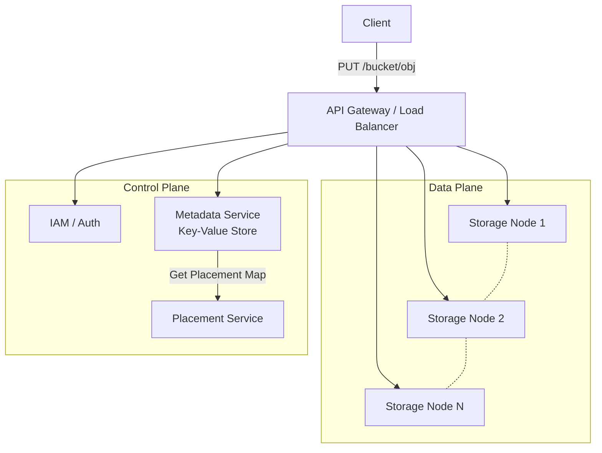
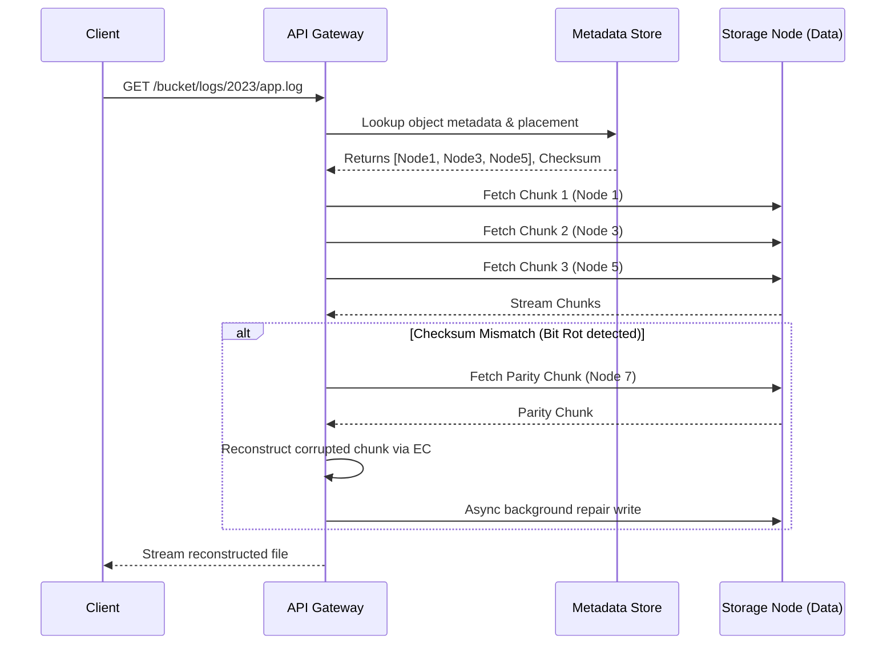

# Object Storage (S3-style)

Object storage has become the de facto standard for storing vast amounts of unstructured data (images, videos, backups, logs, ML datasets) in the cloud. Instead of managing data as a hierarchy of files or blocks on a disk, object storage manages data as objects within a flat namespace (a bucket).

## 1. Object vs Block vs File

When designing storage systems, you generally choose between three paradigms:

### Block Storage
- **How it works:** Data is divided into raw, unformatted blocks of fixed size (e.g., 4KB) managed directly by an OS filesystem (like ext4) over SAN/iSCSI.
- **Pros:** Ultra-low latency, high IOPS, allows modifying small parts of a file (e.g., updating a database record).
- **Cons:** Tightly coupled to a single OS instance; scaling requires complex clustered filesystems.
- **Use Cases:** Databases, VM boot volumes (AWS EBS, GCP Persistent Disk).

### File Storage
- **How it works:** Data is organized in a hierarchical directory structure (trees, folders) accessible over network protocols like NFS/SMB.
- **Pros:** Native shared access across multiple clients, familiar POSIX semantics, file locking.
- **Cons:** Overhead of managing complex metadata hierarchies limits massive scale (directories become bottlenecks).
- **Use Cases:** Shared corporate drives, distributed rendering, ML training nodes (AWS EFS).

### Object Storage
- **How it works:** Data is bundled with metadata and a globally unique identifier (URI) and stored in a flat namespace.
- **Pros:** Infinite horizontal scalability via HTTP/REST APIs, robust metadata capabilities, high durability across geographic regions, cost-effective for petabyte-scale data.
- **Cons:** High time-to-first-byte latency; immutable (cannot modify a single byte—must rewrite the whole object); eventual/strong consistency nuances instead of POSIX locks.
- **Use Cases:** Media storage, backups, data lakes, static web hosting (AWS S3, Google Cloud Storage, MinIO).

## 2. S3-like Architecture

An object storage system like Amazon S3 or MinIO requires decoupling the control plane (metadata/routing) from the data plane (actual byte storage).

### Key Components

1. **Frontend / API Gateway:** Handles HTTP REST requests (PUT, GET, DELETE), authenticates the user, handles rate limiting, and routes requests to the appropriate metadata servers.
2. **Metadata Index (Control Plane):** A highly available, consistent key-value store (often using distributed databases like Cassandra, CockroachDB, or custom Raft-based metadata rings). It maps the logical Object URI (`bucket/prefix/object.jpg`) to the physical placement map (which storage nodes and disks hold the data chunks).
3. **Placement & Routing Service:** Determines where new objects should be stored based on cluster topology, node health, disk capacity, and the chosen replication/erasure coding strategy.
4. **Storage Nodes (Data Plane):** Commodity servers packed with dense HDDs (or NVMe for performance tiers) that physically store the object chunks and parities. They perform local checksumming and background scrubbing.

### The Read/Write Path
- **Write (PUT):** 
  1. Client sends object data to Frontend.
  2. Frontend streams data to the Placement Service (or directly coordinates storage nodes).
  3. Data is chunked, erasure-coded (or replicated), and written to multiple Storage Nodes.
  4. Only after the storage nodes acknowledge the writes (e.g., a quorum), the Metadata Index is updated.
  5. Success is returned to the client.
- **Read (GET):**
  1. Client requests object.
  2. Frontend asks Metadata Index where the chunks are.
  3. Frontend fetches chunks from Storage Nodes, decodes/assembles them, and streams back to the client.

## 3. Replication vs Reed-Solomon Erasure Coding

To achieve high durability (e.g., 11 nines: 99.999999999%), data must survive hardware failures.

### Replication
- **Mechanism:** Store $N$ full copies of the object across different nodes/racks/zones. Typically, $N=3$.
- **Pros:** Fast reads (can read from the closest replica), simple recovery (just copy the file from another node), high read throughput.
- **Cons:** Massive storage overhead (300% for 3x replication).

### Erasure Coding (Reed-Solomon)
- **Mechanism:** Break data into $K$ data chunks and calculate $M$ parity chunks using polynomial arithmetic (Reed-Solomon). The object can be reconstructed if *any* $K$ out of the $K+M$ chunks are available.
- **Pros:** Significantly lower storage overhead compared to replication while maintaining high durability.
- **Cons:** High CPU overhead for encoding/decoding, cross-network penalty for degraded reads and rebuilds (requires fetching $K$ chunks to rebuild 1 lost chunk).

### 10 PB Arithmetic Example
Let's compare the cost of storing 10 PB of logical data using 3x Replication vs a $12+4$ Erasure Coding scheme.

- **3x Replication:**
  - Storage multiplier = 3
  - Raw storage needed = $10 \text{ PB} \times 3 = 30 \text{ PB}$
  - Fault tolerance: Can survive 2 simultaneous node failures per object.

- **Erasure Coding ($K=12, M=4$):**
  - Storage multiplier = $\frac{K+M}{K} = \frac{16}{12} = 1.33$
  - Raw storage needed = $10 \text{ PB} \times 1.33 = 13.33 \text{ PB}$
  - Fault tolerance: Can survive 4 simultaneous chunk/node failures.

**Savings:** Erasure coding saves $16.67 \text{ PB}$ of raw storage for this 10 PB dataset, translating to millions of dollars in hardware, power, and cooling savings at cloud scale.

## 4. Checksums and Scrubbing

Bit rot (silent data corruption on disks) is a statistical certainty at exabyte scales.
- **Inline Checksums:** When an object is uploaded, a checksum (e.g., MD5, CRC32C, SHA-256) is calculated and stored in metadata. During reads, the chunk is verified against the checksum before returning to the client.
- **Background Scrubbing:** A daemon continuously crawls storage disks, verifying checksums of resting data. If bit rot is detected, the scrubber triggers a repair task, utilizing erasure-coded parity or replicas from other nodes to rewrite the corrupted chunk.

## 5. Strong Read-After-Write Consistency

Historically, S3 offered *eventual consistency* (if you overwrote an object, a subsequent read might return the old version). Since late 2020, AWS S3 provides **Strong Read-After-Write Consistency**.
- **How it's achieved:** Modern object stores implement strongly consistent metadata layers using consensus protocols (like Paxos or Raft) or highly tuned distributed databases. 
- When an object is written, the data chunks are persisted, and the metadata update is committed via consensus. Any read request immediately following the write will hit the updated metadata and fetch the new chunks.
- Caveat: This adds latency to the write path (due to consensus coordination) but simplifies application logic immensely.

## 6. Versioning

Versioning protects against accidental deletes or overwrites.
- Instead of mutating the object in place, every PUT creates a new physical object with a unique Version ID.
- The Metadata Index maintains a linked list or ordered index of versions for a given key.
- A DELETE request does not delete the physical bytes; it writes a "Delete Marker" as the latest version.
- Background lifecycle policies (garbage collection) eventually purge old versions to reclaim space.

## 7. Multipart Uploads

For large objects (e.g., a 100 GB video), uploading in a single HTTP stream is fragile. If the connection drops at 99 GB, the entire upload must restart.
- **Mechanism:** The client breaks the file into smaller parts (e.g., 50 MB to 5 GB).
- The client calls `CreateMultipartUpload` to get an Upload ID.
- The client uploads parts concurrently via `UploadPart`, specifying the Upload ID and Part Number. Each part gets its own ETag (checksum).
- Finally, the client calls `CompleteMultipartUpload` passing the list of ETags. The metadata server stitches them together logically as a single object.
- **Benefits:** Resiliency (retry only failed parts), concurrency (faster uploads), and ability to stream data of unknown final size.

## 8. Prefix Partitioning and Performance

Object stores organize metadata in lexicographical order (like a massive B-tree or LSM-tree by object key).
- **The Problem:** If millions of objects are written to the same prefix (`mybucket/logs/2023-10-01/`), they map to the same metadata shard, creating a massive hot spot.
- **The Solution:** Systems like S3 now automatically repartition metadata based on request rate. However, to guarantee high IOPS, it is still a best practice to introduce entropy in the prefix.
  - Bad: `bucket/logs/2023/10/01/app1.log`
  - Good: `bucket/logs/3f2a/2023/10/01/app1.log` (where `3f2a` is a hash of the object name)

## 9. Small-File Packing

Storing billions of 10 KB files using erasure coding is inefficient (metadata overhead per file exceeds data size, and padding for erasure chunks wastes space).
- **Mechanism (Packing/Haystack):** The system buffers small objects in memory or an SSD staging area, appending them into a large "needle" container file (e.g., a 64 MB block).
- Once the container is full, it is sealed, erasure-coded, and written to dense storage.
- The metadata index maps the logical object key to `[Container ID, Offset, Length]`.
- This drastically reduces IOPS on underlying HDDs and minimizes metadata bloat.

## 10. Storage Classes and Cost Model

Object storage tiers balance storage cost vs. retrieval latency/cost.
- **Standard (Hot):** $0.023/GB. Synchronous reads (milliseconds). Best for active assets.
- **Infrequent Access (Cool):** $0.012/GB. Lower storage cost, but incurs a data retrieval fee ($0.01/GB) and minimum storage duration (e.g., 30 days).
- **Archive (Cold/Glacier):** $0.004/GB. Requires asynchronous retrieval (minutes to hours). Data is often powered down on tape drives or dense spun-down HDDs.
- **Intelligent Tiering:** An automated lifecycle engine that moves objects between tiers based on access patterns, optimizing cost without application changes.

## 11. Failure Modes

Object storage at exabyte scale experiences constant component failures.

| Failure Mode | Detection | Mitigation / Repair |
|--------------|-----------|----------------------|
| **1. HDD Crash** | OS I/O error, SMART alerts, node heartbeat loss. | Node marks disk offline. Rebalancer schedules rebuilding all lost chunks using Erasure Coding from surviving chunks onto spare capacity across the cluster. |
| **2. Silent Bit Rot** | Background scrubber or read path checksum mismatch (Data != MD5). | Scrubber/read-path fetches EC parity, reconstructs the correct chunk, and overwrites the corrupted bytes. |
| **3. Metadata Hotspot** | Elevated 503 Slow Down responses for a specific prefix. | Metadata service dynamically splits the prefix partition and moves half the range to another metadata server (auto-sharding). |
| **4. Network Partition** | Node heartbeat times out; nodes appear dead to coordinator. | System continues degraded reads via EC. Writes may be rejected if quorum is lost, prioritizing consistency (CP in CAP theorem). |
| **5. Data Center Outage** | Entire AZ goes offline. | If using cross-region replication (CRR) or multi-AZ erasure coding (e.g., chunks spread across 3 AZs), data remains available for read/write. |
| **6. Accidental Deletion** | Valid API call from user deleting critical data. | Versioning retains the physical data. Multi-Factor Authentication (MFA) Delete or Object Lock (WORM) prevents permanent purging. |
| **7. Slow/Straggler Disk** | 99th percentile latency spikes for reads. | **Tail Latency Mitigation:** The frontend sends concurrent read requests to $K+1$ nodes, cancelling the slowest response (hedged requests). |
| **8. Incomplete Multipart** | Upload started but client crashed. Parts are left orphaned. | Bucket Lifecycle policies automatically abort and clean up incomplete multipart uploads older than $X$ days to save cost. |

## 12. Lifecycle Management and Tiering Details

A critical operational requirement for object storage is managing data across its lifecycle to minimize cost without violating compliance or access requirements.

### Lifecycle Policies
Object stores execute asynchronous, background jobs to evaluate rules against millions of objects:
- **Transition Rules:** Move objects to a cheaper storage class after $X$ days (e.g., move to Infrequent Access after 30 days, then to Archive after 365 days).
- **Expiration Rules:** Permanently delete objects (or specific old versions) after $Y$ days (e.g., expire logs after 90 days).
- **Prefix Filters:** Apply rules only to a subset of data (e.g., only objects under `tmp/` expire in 7 days).

### Intelligent Tiering Mechanics
Because developers often don't know the exact access patterns in advance, Intelligent Tiering relies on the Metadata Index tracking an `AccessTime` or `LastAccessed` field.
1. All data lands in a Hot tier.
2. A background worker periodically queries the Metadata Index for objects where `LastAccessed > 30 days ago`.
3. Identified objects are flagged and physically moved by the Placement Service to dense, low-power storage nodes.
4. If an object is later read, it is synchronously moved back to the Hot tier.
5. The tradeoff is a small monthly monitoring and automation fee per 1,000 objects.

## 13. Security and Access Control

Object storage must tightly integrate with Identity and Access Management (IAM) systems.

- **Bucket Policies:** JSON-based rules attached at the bucket level defining coarse-grained access (e.g., "allow public Read to `images/*`", "deny non-SSL requests").
- **IAM User Roles:** Fine-grained permissions defining what a specific application or user can do (e.g., "AppX can PUT but not DELETE").
- **Access Control Lists (ACLs):** Legacy, object-level permissions (largely superseded by Bucket Policies).
- **Pre-signed URLs:** A mechanism where a backend server generates a time-limited URL signed with cryptographic keys. The client can use this URL to directly upload or download from the object store without passing the data through the backend server (offloading bandwidth).

### Encryption at Rest
- **SSE-S3:** Server-side encryption using keys managed by the object storage provider. Data is encrypted just before writing to disks.
- **SSE-KMS:** Server-side encryption using keys managed by a Key Management Service, allowing detailed audit trails and key rotation.
- **SSE-C:** Server-side encryption using customer-provided keys. The object store does not persist the key; it uses it in memory during the request and discards it.
- **Client-Side Encryption:** The client encrypts the data before transmitting it over the network. The object store is completely blind to the plaintext.

## 14. Object Lock and WORM

For compliance (e.g., SEC, healthcare), data must be immutable.
- **WORM (Write Once, Read Many):** Once written, the object cannot be overwritten or deleted until a specified retention period expires.
- **Governance Mode:** Prevents deletion by standard users, but administrators with special privileges can bypass it.
- **Compliance Mode:** Strict enforcement. Neither the user, the root account, nor the storage provider can delete the data until the retention date passes. This requires specialized hardware locking logic at the storage node level to ensure the disks are not accidentally formatted.

## 15. Real-World Use Cases and Limitations

### When NOT to use Object Storage:
- **Databases:** Relational databases need millisecond latency, block-level locking, and partial updates (updating one row in a 10 GB file). Object storage forces you to read the entire 10 GB file, update the row in memory, and upload a new 10 GB file.
- **OS Boot Volumes:** Operating systems expect standard block device APIs (SCSI/SATA commands), not HTTP REST calls.
- **High-throughput append-only logs:** While possible, systems like Kafka or direct filesystem appends are better suited for microsecond-latency event streaming.

### Architecting Around Object Storage Constraints:
- **Latency:** Because TTFB (Time to First Byte) is often in the tens to hundreds of milliseconds, place a **CDN** (Content Delivery Network) or an in-memory cache (like Redis) in front of object storage for hot assets.
- **Consistency:** If relying on strict sequencing, always use unique version identifiers in your application database to map to the exact object version in storage.
- **Throughput Limits:** When uploading massive datasets, aggressive parallelization across multiple prefixes is required to avoid hitting partition rate limits.

## 16. Cross-Region Replication (CRR)

For disaster recovery and reducing latency for global users, data is often replicated across geographic regions.
- **Asynchronous Replication:** When a client uploads an object to the primary region (e.g., US-East-1), the frontend acknowledges the write immediately after local consistency is met. A background queue then asynchronously copies the object to the secondary region (e.g., EU-West-1).
- **Latency Implications:** The RPO (Recovery Point Objective) is typically a few minutes, meaning data written right before a primary region outage might be lost in the secondary region.
- **Conflict Resolution:** If Active-Active multi-region writes are enabled, the Metadata Index must employ vector clocks, Last-Writer-Wins (LWW) timestamps, or CRDTs to resolve conflicting writes to the same key across regions.

## 17. Batch Operations and Data Processing

Modern object stores are not just dumb storage; they support in-place processing.
- **S3 Select / Glacier Select:** Instead of downloading a 50 GB CSV file to run a SQL `SELECT` statement locally, the client pushes the SQL query to the Object Storage API. The storage nodes execute the query directly on the raw disks, returning only the filtered 5 MB of results, massively saving network bandwidth.
- **Event Notifications:** Object creations (PUTs) or deletions (DELETEs) can trigger serverless functions (like AWS Lambda) or publish messages to a queue (SNS/SQS). This enables event-driven architectures (e.g., immediately processing a video as soon as it lands in the bucket).
- **Batch Jobs:** Managing billions of objects manually is impossible. Batch APIs allow users to define a manifest (a list of object keys) and execute operations (e.g., copy, change storage class, run a Lambda function) concurrently across all of them using managed compute resources provided by the storage vendor.

## 18. Analytics and Data Lakes

Object storage is the foundation of the modern Data Lake architecture.
- **Decoupled Compute and Storage:** Historically, Hadoop/HDFS colocated compute (MapReduce) and storage (DataNodes) on the same physical servers. This forced scaling them symmetrically, which is inefficient.
- By moving the data to an object store, organizations can scale storage independently. Compute engines (like Spark, Presto, Trino, or Snowflake) spin up dynamically, pull data from the object store, process it in memory, and spin down.
- **Columnar Formats:** To optimize this, data in object storage is typically structured in columnar formats like Parquet or ORC. These formats compress well and allow compute engines to use byte-range GET requests to fetch only the specific columns needed for a query, drastically reducing network I/O.
- **Table Formats (Iceberg, Hudi, Delta Lake):** Since object stores lack ACID transactions across multiple files, modern table formats build a transactional metadata layer (manifest lists) *on top* of object storage. This enables features like time travel, atomic schema evolution, and concurrent reads/writes on the data lake without relying on a relational database.

## 19. Hardware Innovations

At the lowest level, object storage providers continuously optimize hardware to push down cost-per-byte.
- **SMR Drives (Shingled Magnetic Recording):** Traditional HDDs leave gaps between magnetic tracks. SMR overlaps tracks like roof shingles, increasing capacity by ~25%. The tradeoff is that random writes require reading and rewriting large zones of data. Because object storage is largely sequential writes and immutable objects, SMR drives are a perfect fit.
- **Cold Storage Tape:** For Archive/Glacier tiers, robotic tape libraries are still used. They offer extreme density and zero power consumption when idle, but retrieval requires physical robots to fetch the tape, mount it, and spool it to the correct offset (hence the hours-long retrieval times).

