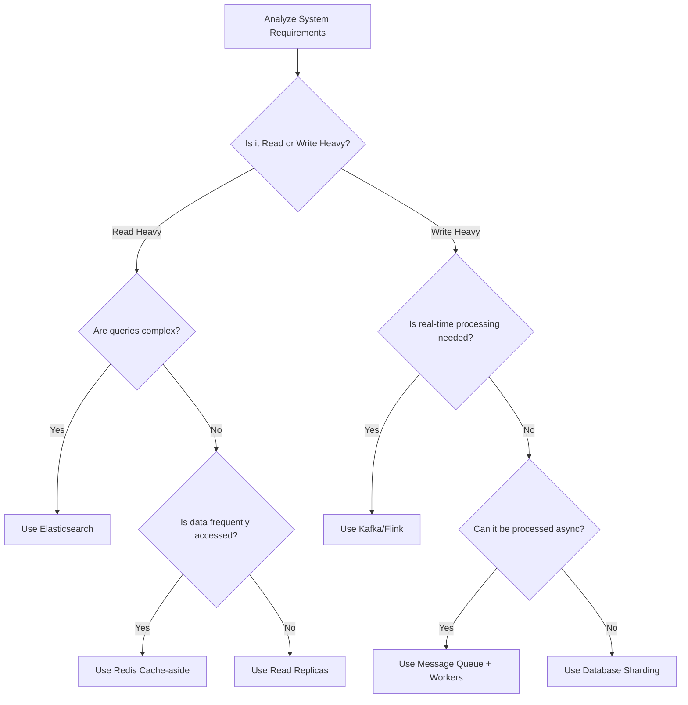

# Pattern Selection for HLD Interviews

A decision framework for choosing system-design patterns quickly and defensibly.

## What is it?

Pattern selection maps requirements and constraints to repeatable approaches (for example caching, async jobs, sharding, or concurrency controls).

## Why do we need it?

Without a selection framework, interviews drift into random component lists. A pattern-first approach helps you:
- Reach a working architecture faster
- Explain trade-offs clearly
- Avoid premature complexity
- Show senior-level judgment under time pressure

## Requirements and Constraints

Before selecting patterns, lock these:
- Primary bottleneck category: reads, writes, coordination, latency, or data size
- Correctness level: strict consistency vs acceptable staleness
- User experience target: synchronous response vs async completion
- Data access shape: point lookup, feed/timeline, search, analytics, blob transfer
- Failure tolerance: retry-safe, dedupe-safe, and region-failure expectations

## Pattern Decision Matrix

| Situation | Default Pattern | When to Escalate | Typical Risk |
|---|---|---|---|
| Frequent repeated reads | Cache-aside + TTL | Read replicas + multi-layer cache | Stale reads, stampede |
| Heavy or slow operations | Queue + worker pool | Workflow orchestration + DLQ | Orphaned jobs, retries |
| Shared-resource conflicts | DB transaction + optimistic lock | Distributed lock or serialized queue | Deadlocks, lock contention |
| Read throughput growth | Index tuning + denormalization | Read replicas + CDN | Replica lag, invalidation |
| Write throughput growth | Batching + partition-aware key design | Sharding + async fanout | Hot partitions |
| Large media or file payloads | Blob storage + metadata DB | CDN + multipart upload/resume | Broken references, orphan blobs |
| Multi-step business transactions | [Distributed transaction strategy](../distributed-transactions/THEORY.md) with saga compensations | State machine + durable outbox | Partial completion |

## Real-time Channel Selection Matrix

| Interaction Pattern | Default | Use When | Caveats |
|---|---|---|---|
| Polling | Periodic GET | Low event rate, tolerant of seconds of staleness | Wastes calls; cache aggressively |
| Long Polling | Hanging GET that returns on change | Moderate event rate where infra cannot keep open sockets | Extra latency on reconnect storms |
| Server-Sent Events (SSE) | One-way server→client stream over HTTP | High fan-out, uni-directional updates (feeds, dashboards) | No binary frames; fallback to polling for older proxies |
| WebSocket | Bidirectional, low-latency channel | Chat, collaborative editing, presence, fast acks | Requires heartbeat, backpressure, auth refresh |
| WebRTC (optional) | Peer-to-peer media with signaling side-channel | Audio/video or large payloads offload from servers | NAT traversal; still need WebSocket/SSE for signaling |

**Fallback rule:** Always define downgrade paths (WebSocket → SSE → long polling) and reconnection with `lastSeenId` to enable replay and idempotent delivery.

## Contention Escalation Matrix

| Conflict Signal | Default | Escalate To | Trade-off |
|---|---|---|---|
| Low write conflicts (<1%) | Optimistic locking + retries | — | Occasional retry cost |
| Moderate conflicts, small scope | Pessimistic lock (`SELECT … FOR UPDATE`) | — | Throughput drops under burst |
| Hotspot on a single entity | Serialized queue per key | Smooths spikes; adds latency |
| Cross-service critical section | Distributed lock (lease + fencing token) | Highest correctness, least availability | Risk of deadlock or lock orphaning |

**Safety controls:** jittered retries, lock timeouts, deadlock detection, and idempotency keys for all side-effecting operations.

## Durable Orchestration Triggers

Introduce an orchestrator (workflow engine, saga coordinator, or state machine) when:
- A flow spans **≥3 steps** or **>5s** wall-clock time.
- Steps involve **multiple systems** (payments, inventory, notifications) that must commit or compensate together.
- You need **exactly-once user experience** over at-least-once infrastructure (outbox + idempotent handlers).
- There is a **human-in-the-loop** or scheduled wait (email verification, SLA wait windows).
- Rollback requires **domain compensation**, not just a transaction rollback.

**Implementation guardrails:**
- Persist workflow state before each transition; emit events via **durable outbox**.
- Require **idempotency keys** per step; include versioning for in-flight definitions during upgrades.
- Keep **compensation steps** first-class (e.g., `reserveInventory` ↔ `releaseInventory`).

## Scoring Rubric (Interview Use)

| Score | Signal |
|---|---|
| 1 | Pattern named with no relation to constraints |
| 3 | Correct pattern family but weak trigger reasoning |
| 5 | Pattern choice tied to metrics, failure mode, and fallback plan |

## Common Pitfalls

- Picking WebSockets for all realtime problems without proving bidirectional need
- Putting every operation behind a queue even when sync is simpler and adequate
- Proposing sharding before index/caching/read replica limits are approached
- Ignoring idempotency in async retry pipelines
- Using distributed locks where DB-level atomicity already solves the issue

## Follow-up Questions

1. What metric tells you this pattern is failing?
2. What is your rollback path if this pattern underperforms?
3. Which consistency compromise are you accepting?
4. How will you debug this pattern in production?
5. What is your v1 simpler alternative?

## Variants and Extensions

- **Low-latency variant:** Add edge cache and locality-aware routing
- **Strict-consistency variant:** Reduce async fanout and favor transactional boundaries
- **Burst-traffic variant:** Add queue buffering, load shedding, and priority lanes
- **Geo-distributed variant:** Region partitioning plus asynchronous replication strategy

## 🔗 Cross-References

- [Caching](../caching/THEORY.md)
- [Database Sharding](../database-sharding/THEORY.md)
- [Load Balancing](../load-balancing/THEORY.md)
- [Message Queues](../message-queues/THEORY.md)
- [Distributed Transactions](../distributed-transactions/THEORY.md)
- [Consistent Hashing](../consistent-hashing/THEORY.md)
- [CAP Theorem](../../00-theory/system-design-fundamentals/cap-theorem.md)
- [HLD Design Template](../../04-hld-projects/DESIGN-TEMPLATE.md)

## Pattern Chooser Flowchart

