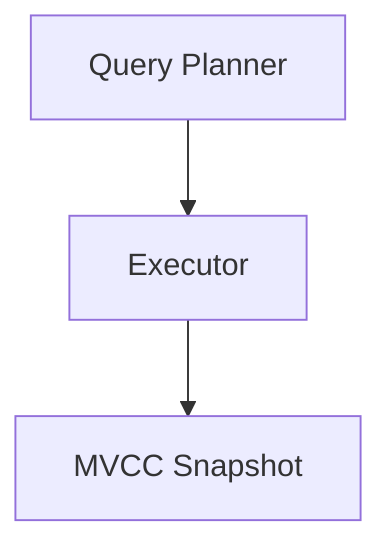

# PostgreSQL

**Deep dive**: See [Relational Databases](../relational-databases/THEORY.md) for canonical theory.

## What is it?
PostgreSQL is an advanced open-source relational database management system emphasizing extensibility, standards compliance, and data integrity. It supports both SQL (relational) and JSON (non-relational) querying, making it highly versatile for modern applications.

## Isolation-Level Anomaly Matrix
PostgreSQL uses MVCC to manage concurrent access.

| Isolation Level | Dirty Read | Non-Repeatable Read | Phantom Read | Serialization Anomaly |
|---|---|---|---|---|
| Read Uncommitted | Not possible | Possible | Possible | Possible |
| Read Committed (RC) | Not possible | Possible | Possible | Possible |
| Repeatable Read (RR) | Not possible | Not possible | Not possible | Possible |
| Serializable (SSI) | Not possible | Not possible | Not possible | Not possible |

## EXPLAIN ANALYZE Reading Guide
Using `EXPLAIN ANALYZE` allows you to see both the planned execution and the actual runtime statistics.

```sql
EXPLAIN ANALYZE SELECT * FROM users WHERE status = 'active';
```
**Sample Plan:**
```
Seq Scan on users  (cost=0.00..10.00 rows=100 width=50) (actual time=0.012..0.050 rows=100 loops=1)
  Filter: (status = 'active'::text)
  Rows Removed by Filter: 900
```
- **cost**: Estimated startup and total cost.
- **rows**: Estimated rows vs actual rows.
- **loops**: How many times the node was executed.

## Index-Type Table

| Index Type | Use Case |
|---|---|
| B-tree | Default index type. Good for equality and range queries (`=`, `<`, `>`). |
| GIN | Generalized Inverted Index. Good for arrays, JSONB, full-text search. |
| GiST | Generalized Search Tree. Good for geometric data (PostGIS) and full-text search. |
| BRIN | Block Range Index. Very small index, good for large tables with naturally correlated data (e.g., time-series). |
| Partial | Index only a subset of rows (e.g., `WHERE status = 'active'`). Saves space. |
| Covering | Includes extra columns (`INCLUDE (col)`) to allow index-only scans. |

## HOT Updates
Heap-Only Tuples (HOT) is an optimization in Postgres where if an update to a row does not modify any indexed columns and there is enough free space on the page, the new version of the row is stored on the same page. This avoids the need to update indexes, greatly reducing write amplification.

## Autovacuum Knobs
Autovacuum cleans up dead tuples. Important knobs:
- `autovacuum_vacuum_scale_factor`: Fraction of table size before vacuum triggers (default 0.2).
- `autovacuum_analyze_scale_factor`: Fraction before analyze triggers (default 0.1).
- `autovacuum_vacuum_cost_limit`: Limits I/O impact of autovacuum.
- `autovacuum_max_workers`: Number of parallel workers.

## Pool-Size Math
Setting connection pool size:
`pool_size = ((core_count * 2) + effective_spindle_count)`
Too many connections cause CPU context switching overhead. Use PgBouncer for multiplexing connections.

## Replication-Slot WAL Risk
Replication slots ensure the primary retains WAL logs until the replica consumes them. If a replica disconnects or falls far behind, the primary will accumulate WAL files and may eventually run out of disk space, bringing down the primary database.

## Declarative Partitioning
Allows splitting large tables into smaller logical pieces (partitions) by range, list, or hash.
```sql
CREATE TABLE measurements (
    id int,
    logdate date
) PARTITION BY RANGE (logdate);
```

## SKIP LOCKED Queues
PostgreSQL can be used as a simple queue using `SKIP LOCKED`.
```sql
SELECT * FROM jobs
WHERE status = 'pending'
FOR UPDATE SKIP LOCKED
LIMIT 1;
```
This allows concurrent workers to grab distinct rows without blocking each other.

## Lifecycle Mermaid Diagram



## Code and Tests
This directory (`postgresql/`) is the canonical location for implementation examples and tests.
