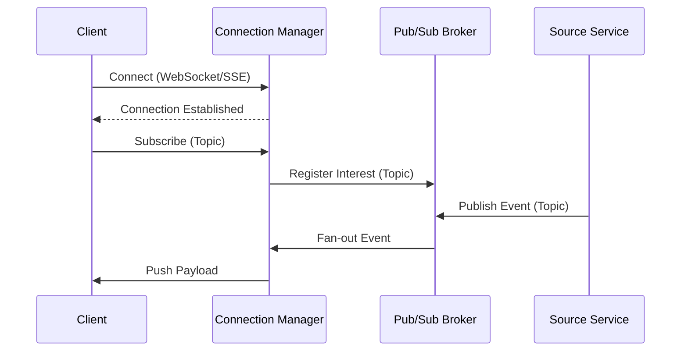
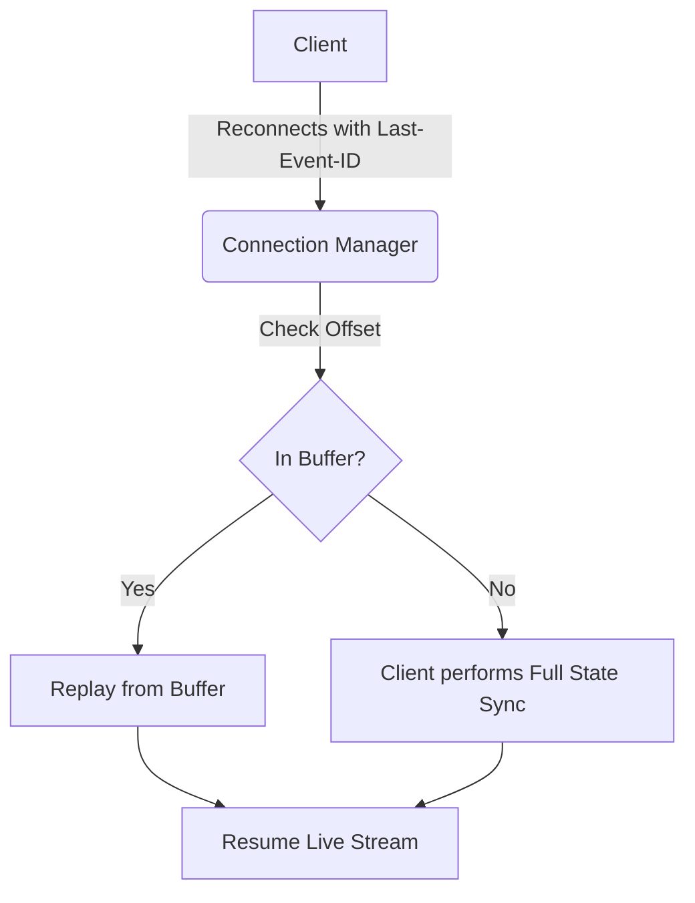

# Real-time Updates

Real-time updates deliver state changes to clients with low delay while balancing connection cost, ordering, and failure handling.

## What is it?

Real-time updates are patterns for pushing changes from backend systems to connected clients without forcing constant refresh polling.

## Why do we need it?

- Poll-heavy systems waste CPU/network with mostly empty responses.
- Product UX often requires sub-second updates for active sessions.
- Push channels change scaling constraints (persistent connections, fanout, reconnect logic).

## Types/Approaches

### 1. Polling Family
- **Simple polling**: periodic pull (easy, higher waste).
- **Long polling**: server holds request until data is ready (better freshness, still request-heavy).

### 2. Push Channels
- **SSE**: server-to-client stream over HTTP; good for one-way updates.
- **WebSocket**: bidirectional persistent channel; best when client events are frequent.
- **WebRTC data channel**: peer-first low-latency niche, higher setup complexity.

### 3. Backend Fanout Models
- **Sticky connection routing** (affinity hash / consistent hashing).
- **Pub/sub fanout** to connection managers.
- **Hybrid**: direct local push + broker for cross-node delivery.

## How it works

1. Client negotiates channel (SSE/WebSocket/etc).
2. Connection manager registers subscription state.
3. Domain event is published from source service.
4. Router resolves target connections and pushes payload.
5. Client ACK/reconnect policy protects ordering and gap recovery.

## When to use

- Chat, collaborative editing, live dashboards, ride tracking, notification inboxes.

## When NOT to use

- Low-frequency updates where periodic pull is sufficient.
- Endpoints with no active session semantics.

## Trade-offs and Decision Table

| Approach | Protocol | Communication | Overhead | Connection state | Best for |
|---|---|---|---|---|---|
| **Simple Polling** | HTTP/1.1 | Unidirectional (Pull) | High (Headers/TLS per req) | Stateless | Low-frequency checks |
| **Long Polling** | HTTP/1.1 | Unidirectional (Pull) | Medium | Semi-stateful | Occasional updates |
| **SSE** | HTTP/1.1/2 | Unidirectional (Server Push) | Low | Stateful | Live scores, feeds |
| **WebSocket** | TCP/WSS | Bidirectional | Lowest | Highly Stateful | Chat, multiplayer |

## Requirements and Constraints

- **LB and idle-timeout requirements:** Persistent connections require load balancers to support long-lived TCP sessions. Idle timeouts must be configured carefully (e.g., 5-10 minutes) so LBs don't aggressively drop quiet connections.
- **Heartbeats:** Application-level or protocol-level (ping/pong) heartbeats are essential to detect zombie connections and prevent LB timeouts.
- **Replay Buffer and Resume:** Clients supply a `Last-Event-ID` or sequence number on reconnect. The server must maintain a replay buffer (e.g., in memory or Redis) to resume the stream seamlessly and deliver missed messages exactly once.
- **Slow-Consumer Policies:** The server must detect clients that can't read fast enough (e.g., TCP backpressure). Policies include dropping the connection, skipping messages, or buffering (which risks OOM). Disconnecting the slow consumer is safest.
- **Fan-out Architecture with Pub/Sub:** A single update must reach multiple servers holding client connections. A pub/sub broker (like Redis Pub/Sub or Kafka) handles this cross-node fanout.
- **Celebrity-Channel Strategy:** A single channel with millions of subscribers (e.g., a viral live stream) can overwhelm a single node. You need hierarchical fanout or local aggregation per connection manager.

## Sizing and Estimation

- **Per-connection memory:** A single WebSocket connection might consume 10-50KB in the connection manager.
- **5M-connection sizing arithmetic:**
  - Memory: $5,000,000 \times 20\text{KB} = 100\text{GB}$.
  - Distributed across nodes with 16GB RAM: $100\text{GB} / 16\text{GB} \approx 7 \text{ nodes}$. Adding 50% buffer, we need ~10-12 nodes just to hold connections.
- **Jittered Reconnect Storm Math:** If a node crashes, 500K connections drop. If they all retry instantly, the LB and auth services fail. 
  - Assuming the system handles 50K auth req/s, a flat retry takes 10s.
  - Adding exponential backoff with jitter spreads 500K retries over 30-60s, keeping the peak request rate well under 50K/s and saving the system.

## Failure Modes

1. **Connection Manager Crash (Thundering Herd):** When a node holding 100k connections dies, clients instantly reconnect, DDOSing the load balancer. Mitigate with jittered exponential backoff.
2. **Pub/Sub Broker Bottleneck:** Broker becomes saturated by fan-out amplification. Mitigate with batched publishing and multiple broker partitions.
3. **Slow Consumer OOM:** Clients on slow networks cause OS TCP buffers and application queues to grow, leading to OOM. Mitigate with bounded queues and aggressive disconnect policies.
4. **Load Balancer Connection Exhaustion:** Load balancers run out of ports or memory to track stateful connections. Mitigate by horizontally scaling L2/L4 LBs or using direct server return.
5. **Zombie Connections (Half-Open):** Client drops silently (e.g., enters tunnel); server thinks it's still connected. Wastes resources. Mitigate with ping/pong heartbeats.
6. **Missed Updates During Reconnect Gap:** Client misses critical state changes while disconnected. Mitigate using sequence numbers, Last-Event-IDs, and replay buffers.

## Scoring rubric

| Dimension | Strong signal | Weak signal |
|---|---|---|
| Channel choice | Mapped to bidirectional need and scale | Uses WebSocket by default everywhere |
| Failure handling | Reconnect, replay, ordering, fallback | Happy-path only |
| Scale model | Connection + fanout strategy quantified | No connection capacity reasoning |
| Trade-offs | Explicit latency vs cost discussion | Generic statements |

## Common pitfalls

- Using bidirectional channels when one-way push is enough.
- Ignoring reconnection gaps and missed-event replay.
- Treating load balancers as transparent for sticky channels.
- No plan for multi-device and duplicate delivery control.

## Follow-up questions

1. How do you recover missed updates after reconnect?
2. Where do you enforce ordering: per stream, partition, or user?
3. When do you switch from long polling to SSE/WebSocket?
4. What is your failure mode when pub/sub is degraded?
5. How do you support one user connected from many devices?

## Variants and extensions

- Active-user push + inactive-user pull hybrid.
- Priority channels for critical events.
- Region-local fanout with async cross-region replication.
- Edge push gateway for geo-latency optimization.

## 📊 Diagrams

- [Channel selection flow](./diagrams/channel-selection-flow.mmd): how update frequency and direction pick the channel, from simple polling through long polling and SSE up to WebSocket for frequent bidirectional traffic.

## Related concepts

- [Load Balancing](../load-balancing/THEORY.md)
- [Message Queues](../message-queues/THEORY.md)
- [Pattern Selection for HLD Interviews](../pattern-selection/THEORY.md)
- [Chat Service HLD](../../04-hld-projects/chat-service/)
- [News Feed HLD](../../04-hld-projects/news-feed/)

---

## Source 14 Integration: Live Comment Streams

Live comments emphasize asymmetric one-to-many broadcast, reconnect replay by cursor, and strict connection-management budgets under viral stream fanout.
