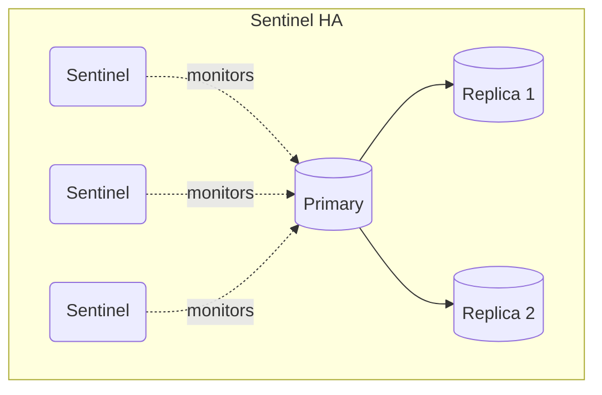
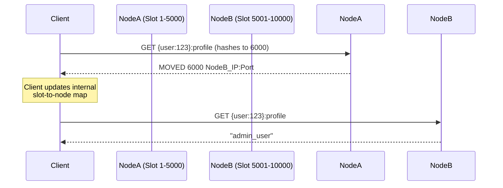

# Redis: Deep Dive and Architecture (Staff Level)

Redis (Remote Dictionary Server) is a high-performance, in-memory data structure store that is often used as a database, cache, message broker, and streaming engine. While early in a career it is easy to view Redis simply as a "cache", mastering Redis requires understanding its internal encodings, clustering mechanisms, persistence trade-offs, and how it handles concurrency and failure.

## 1. Event Loop and Threading Model
Historically, Redis has been famously single-threaded. It uses a reactor pattern driven by an event loop (using `epoll`/`kqueue`/`select` depending on the OS) to multiplex I/O operations.

### The Single-Threaded Execution
All user commands are executed sequentially in a single main thread. This provides a crucial guarantee: command execution is atomic. There is no need for locks around data structures, which eliminates lock contention and context switching overhead. This is why multi-key operations (like Lua scripts or transactions) can guarantee isolation.

### Threading in Modern Redis (Redis 6+)
While command *execution* remains single-threaded, Redis 6+ introduced I/O threading.
When I/O threading is enabled, Redis delegates the reading of client sockets, parsing of client buffers, and writing to client sockets to a pool of I/O threads.
The lifecycle is:
1. I/O threads read requests from sockets and parse them.
2. The main thread executes the parsed commands synchronously and sequentially.
3. I/O threads write the responses back to the sockets.

This significantly increases throughput for network-bound workloads while preserving the lock-free data structure manipulation of the main thread.

## 2. Data-Structure Encodings
Redis presents abstract data types (Strings, Lists, Hashes, Sets, Sorted Sets) to the user, but under the hood, it dynamically selects the most memory-efficient encoding based on the size and number of elements.

- **Strings**: Can be encoded as `int` (if the string represents an integer), `embstr` (for short strings, allocated contiguous with the object header), or `raw` (dynamically sized strings using Simple Dynamic Strings - SDS).
- **Lists**: Used to be ZipList or LinkedList, now typically a `quicklist` (a linked list of ZipLists or listpacks).
- **Hashes**: Small hashes use a `ziplist` (or `listpack`), storing keys and values adjacent in a contiguous memory block. Large hashes upgrade to a real hash table (`dict`).
- **Sets**: Small sets of integers use `intset` (a compact, sorted array of integers). Large sets or sets with strings use a hash table.
- **Sorted Sets**: Small ones use a `ziplist`/`listpack`. Large ones use a dual structure: a hash table (for O(1) score lookups) and a `skiplist` (for efficient range queries).

## 3. Command Complexity Table
Understanding command complexity is critical because a long-running O(N) command blocks the single main thread.

| Command | Complexity | Notes |
|---------|------------|-------|
| `GET`/`SET` | O(1) | Basic string operations. |
| `MGET`/`MSET` | O(N) | N is the number of keys. |
| `HGETALL` | O(N) | N is the size of the hash. Dangerous for huge hashes. |
| `SMEMBERS` | O(N) | N is the size of the set. Prefer `SSCAN`. |
| `ZADD` | O(log N) | Adds an element to the skiplist. |
| `ZRANGE` | O(log N + M) | M is the number of elements returned. |
| `KEYS *` | O(N) | N is keyspace size. Never use in production; blocks the thread. |
| `SCAN` | O(1) | Returns a cursor and a small batch of keys. Safe for production. |
| `UNLINK` | O(1)* | O(1) per key to remove from keyspace; memory reclamation is async. |

## 4. Expiry and Eviction Policies

### Expiry Mechanics
When a TTL is set on a key, Redis tracks it in a separate expires dictionary. Redis uses two approaches to expire keys:
1. **Passive**: When a client tries to access a key, Redis checks the TTL. If expired, it's deleted and returns nothing.
2. **Active**: Redis periodically (10 times per second) samples keys from the expires dictionary. If expired, they are deleted. If a large percentage of sampled keys are expired, it samples again immediately.

### Eviction
When Redis hits its memory limit (defined by `maxmemory`), it must free memory according to the `maxmemory-policy`.
Common policies:
- `noeviction`: Returns errors on writes.
- `allkeys-lru`: Evicts the least recently used keys out of all keys.
- `volatile-lru`: Evicts LRU keys out of those with an expiration set.
- `allkeys-lfu`: Evicts least frequently used keys (using the Morris counter).
- `volatile-ttl`: Evicts keys with the shortest remaining TTL.

*Staff Tip*: Always explicitly configure `maxmemory` and `maxmemory-policy`, or Redis may cause OOM kills on the host OS.

## 5. Persistence: RDB, AOF, and Hybrid

Redis provides multiple persistence strategies:

### RDB (Redis Database)
RDB creates point-in-time snapshots of the dataset at specified intervals.
- **Mechanism**: The main thread uses `fork()` to create a child process. The child writes the memory snapshot to a temporary `.rdb` file, then replaces the old one.
- **Pros**: Compact, fast restarts, minimal performance impact on parent (mostly CoW overhead).
- **Cons**: Data loss window (e.g., losing up to 5 minutes of writes if snapshotted every 5 mins). `fork()` can be expensive and cause memory spikes due to Copy-on-Write if writes are heavy during the snapshot.

### AOF (Append Only File)
AOF logs every write operation.
- **Mechanism**: Commands are appended to an AOF buffer, which is synced to disk based on `appendfsync` (always, everysec, no).
- **Pros**: Highly durable (usually max 1 second data loss with `everysec`).
- **Cons**: Files get huge. Requires periodic AOF rewrites (also uses `fork()`) to compact the log. Slower restarts.

### Hybrid (Redis 5+)
Combines both. The AOF rewrite process creates an RDB preamble (for fast loading) and appends incremental AOF data (for durability). This is the modern standard for durable Redis.

## 6. Replication, Sentinel, and Cluster

### Replication
Redis supports asynchronous primary-replica replication. The primary sends a stream of commands to replicas. Replicas are usually read-only.
If connection breaks, replicas attempt a partial resync using a backlog buffer. If impossible, a full resync (RDB transfer) occurs.

### Sentinel vs Cluster
When scaling out, you must choose between Sentinel and Cluster.

**Redis Sentinel** provides High Availability for a single-primary setup.
- Sentinels monitor the primary and replicas.
- If primary fails, Sentinels elect a replica and promote it.
- **Architecture**: All data fits in one node. Clients query Sentinel for the current primary address.

**Redis Cluster** provides High Availability AND Sharding.
- The keyspace is divided into exactly 16384 hash slots.
- Every key maps to a slot: `CRC16(key) mod 16384`.
- Nodes communicate via a gossip protocol to share state and detect failures.

### MOVED, ASK, and Hash Tags
In Redis Cluster, clients must be cluster-aware.
- **MOVED**: If a client asks a node for a key belonging to a slot it doesn't own, the node returns a `MOVED <slot> <ip:port>` error. The client caches this new routing and retries.
- **ASK**: Used during slot migration. The node says "I'm moving this slot, ASK the new node just for this command." The client shouldn't update its long-term cache yet.
- **Hash Tags**: Multi-key operations must resolve to the same slot. By wrapping a part of the key in `{...}`, only that part is hashed. E.g., `{user:123}:profile` and `{user:123}:orders` both hash to `user:123`, landing on the same slot.

## 7. Lua Scripts, Transactions, and Pipelining

- **Transactions (`MULTI`/`EXEC`)**: Queues commands and executes them atomically. Unlike RDBMS, if one command fails (runtime error), the rest still execute. No rollback.
- **Lua Scripts**: Scripts execute atomically on the server. They provide flow control and conditional logic (e.g., fetch A, if > 10, set B). Always use `EVALSHA` to avoid sending script text every time.
- **Pipelining**: Not an atomic construct, but a network optimization. The client sends multiple commands without waiting for replies, then reads all replies at once. Drastically reduces RTT (Round Trip Time).

## 8. Streams vs Pub/Sub

- **Pub/Sub**: Fire-and-forget message broadcasting. If a subscriber is disconnected, messages are permanently lost. High throughput, low latency.
- **Streams**: Append-only log data structure. Supports consumer groups, message persistence, explicit acknowledgment (`XACK`), and pending-message tracking (`XPENDING`). Use Streams when you cannot tolerate message loss and need durable queuing.

## 9. Lock Caveats (Distributed Locks)

Implementing distributed locks with `SET key random_value NX PX 30000` is common but fraught with edge cases:
1. **Clock Drift**: Redis nodes might have slightly different clocks.
2. **GC Pauses**: If the client pauses, the lock might expire in Redis, another client grabs it, and the first client wakes up thinking it still has the lock. Always validate lock ownership before mutating shared resources.
3. **Unlock Safety**: You must check that the value matches your `random_value` before deleting the lock, requiring a Lua script to ensure atomic compare-and-delete.
4. **Redlock**: For multi-node lock safety, Redlock algorithm exists, but it is heavily debated regarding its safety under network partitions and clock jumps.

## 10. Big Keys and Hot Keys

- **Big Keys**: A key with a huge value (e.g., a Hash with 10M fields). Blocking operations (like `DEL`) on big keys will freeze the server.
  - *Fix*: Use `UNLINK` (async delete) or delete in chunks using `HSCAN`/`HDEL`.
- **Hot Keys**: A single key accessed thousands of times per second, overwhelming a single shard.
  - *Fix*: Implement a local hot-key cache in the application layer, or duplicate the key across multiple slots (e.g., `key_1`, `key_2`) and randomly read from them.

## 11. Sizing Example for 50M Keys

Let's calculate the memory required for 50 Million Session Keys.
- Key format: `session:uuid4` (e.g., `session:123e4567-e89b-12d3-a456-426614174000`) -> ~45 bytes.
- Value format: A short JSON string (e.g., `{"user_id": 123456, "role": "admin"}`) -> ~50 bytes.
- Redis overhead per key (dict entry, object headers, expiration pointers): ~64 bytes.

Calculation per key:
Key (45) + Value (50) + Overhead (64) = 159 bytes.
We use the allocator overhead (jemalloc) so call it 192 bytes aligned.
192 bytes * 50,000,000 keys = 9,600,000,000 bytes.
9,600,000,000 / 1024 / 1024 / 1024 = ~8.94 GB.

Rule of thumb for peak memory: You need at least 2x the memory if using RDB snapshots due to Copy-on-Write overhead during `fork()`.
So we should provision at least 18-20 GB of RAM for this cluster.

## 12. 8+ Failure Modes to Handle

1. **OOM Kills**: Redis memory exceeds OS limits and the OS kills the process. *Mitigation*: Set `maxmemory`, `maxmemory-policy`, and leave headroom for `fork()`.
2. **Network Partitions**: A split-brain scenario in Sentinel or Cluster. *Mitigation*: Ensure proper quorum configs; accept some availability loss for consistency.
3. **Fork Blocking**: `bgsave` or AOF rewrite takes too long to `fork()` on huge datasets, blocking the main thread for hundreds of milliseconds. *Mitigation*: Keep shard sizes small (e.g., < 10GB per node).
4. **Cache Stampede**: A hot key expires, and thousands of clients simultaneously hit the DB to regenerate it. *Mitigation*: Use probabilistic early expiration or mutex locks for regeneration.
5. **Replica Sync Storm**: A primary restarts and all replicas request full RDB syncs simultaneously, saturating network and CPU. *Mitigation*: Diskless replication and properly sized repl-backlog.
6. **Eviction Thrashing**: Maxmemory is reached and high write throughput causes constant eviction computation, degrading CPU. *Mitigation*: Scale memory or shard the cluster.
7. **Client Buffer Exhaustion**: A slow client (e.g., Pub/Sub subscriber) causes the output buffer to grow infinitely. *Mitigation*: Configure `client-output-buffer-limit`.
8. **Cross-Slot Errors in Cluster**: An application updates to use multi-key commands but hits keys on different slots. *Mitigation*: Strict code reviews for hash tag `{}` usage.
9. **Slowlog Buildup**: Developers accidentally run `KEYS *` or huge `HGETALL` in production, causing multi-second latency spikes. *Mitigation*: Rename/disable dangerous commands in config; monitor slowlog.

## Architecture Diagrams

Here is a diagram showing the difference between standard Master-Replica with Sentinel, and Redis Cluster.

And here is a diagram of the Client tracking a MOVED redirect in Redis Cluster:

## Wrapping Up
Redis is not just a cache; it is a distributed data structure server. At the staff level, you are expected to reason about memory alignment, thread utilization, persistence stalls, and complex multi-shard topologies. Always benchmark with realistic data sizes and measure P99 latency during snapshot events.

## 13. Deep Dive into Data Structure Encodings
Redis's memory efficiency relies on its sophisticated internal encoding system, which is entirely transparent to the user but critical for capacity planning.

### Strings: INT, EMBSTR, and RAW
When you store a string, Redis examines the value.
1. **INT**: If the string represents an integer within a 64-bit signed range (and no other string manipulation is performed), Redis uses the `INT` encoding. This saves significant memory as it avoids allocating a string buffer and stores the integer directly in the pointer space of the Redis object header.
2. **EMBSTR**: For short strings (typically under 44 bytes), Redis allocates the object header (metadata like LRU bits, ref count) and the string value in a single contiguous block of memory. This improves CPU cache locality and requires only one `malloc` call, speeding up creation and access.
3. **RAW**: For longer strings, Redis allocates the header and the string buffer (an SDS - Simple Dynamic String) separately. SDS tracks the string length explicitly, allowing O(1) length retrieval and preventing buffer overflows, unlike standard C strings.

### Hashes: ZIPLIST/LISTPACK to HASHTABLE
Hashes begin as `ziplists` (or `listpacks` in Redis 7+). A listpack is a contiguous block of memory storing key-value pairs sequentially. 
- *Advantages*: Extremely memory efficient. Iteration is fast because elements are adjacent in memory, minimizing cache misses.
- *Disadvantages*: Modifying a listpack requires reallocating the entire block, which becomes slow as the listpack grows.
- *Thresholds*: When the hash exceeds a configured size (e.g., `hash-max-listpack-entries` usually 512) or any value exceeds a length limit (e.g., `hash-max-listpack-value` usually 64 bytes), Redis automatically upgrades the encoding to a full hash table (`dict`), trading memory efficiency for O(1) read/write performance.

### Sorted Sets: ZIPLIST to SKIPLIST+DICT
Small sorted sets use the same listpack optimization. However, large sorted sets are the most complex structure in Redis, utilizing a dual-encoding:
1. **Hash Table (`dict`)**: Maps elements to their scores. This guarantees O(1) performance for operations like `ZSCORE`.
2. **Skip List (`skiplist`)**: A probabilistic data structure that maintains elements in sorted order by score. It provides O(log N) performance for insertions, deletions, and most importantly, range queries (`ZRANGE`, `ZRANGEBYSCORE`). Skip lists are used instead of balanced trees because they are simpler to implement, faster to update concurrently (though Redis is single-threaded), and use less memory overhead per node.

## 14. Advanced Clustering and Sharding Strategies

### The Gossip Protocol Lifecycle
Redis Cluster does not rely on a central coordinator like Zookeeper or etcd. Instead, it uses a decentralized Gossip protocol over a dedicated cluster bus (typically client port + 10000).
- **Meet**: Nodes are introduced using `CLUSTER MEET`.
- **Ping/Pong**: Nodes constantly exchange Ping packets containing information about themselves and a few randomly selected known nodes.
- **State Propagation**: This propagates the slot map, node states (master/replica), and failure information.

### Failure Detection and Failover
The Gossip protocol is the mechanism for failure detection:
1. **PFAIL (Possible Failure)**: If Node A sends a Ping to Node B and doesn't receive a Pong within the `cluster-node-timeout`, Node A marks Node B as PFAIL. This is a local state.
2. **FAIL**: As Nodes gossip, they share PFAIL statuses. If Node A receives PFAIL reports for Node B from a majority of master nodes in the cluster within a specific time window, Node A upgrades Node B's state to FAIL and broadcasts a FAIL message to all nodes, forcing immediate recognition of the failure.
3. **Failover Election**: Once a master is marked FAIL, its replicas initiate an election. Replicas broadcast a request for votes (`FAILOVER_AUTH_REQUEST`) to the surviving master nodes. The replica that receives a majority of votes promotes itself to the new master and takes ownership of the failed master's slots.

### Dealing with Split-Brain in Cluster
A split-brain scenario occurs during a network partition if a minority of nodes (including clients) get separated from the majority.
- The minority partition might contain a master. The clients connected to it will continue writing.
- The majority partition will detect the master's absence, elect its replica, and continue writing.
- When the partition heals, the old master in the minority partition will be demoted to a replica of the newly elected master. **All writes accepted by the old master during the partition will be lost.**
- *Mitigation*: To minimize data loss, configure `cluster-require-full-coverage yes` (the cluster stops accepting writes if any slot is unassigned) or use `WAIT` to synchronously ensure replication to a majority before acknowledging a write to the client, though this heavily impacts performance.

## 15. Real-world Memory Troubleshooting

When Redis memory usage spikes, staff engineers don't just blindly increase `maxmemory`. They analyze the composition.

### 1. Fragmentation
Redis allocates memory using an allocator (usually jemalloc). When keys are deleted, the memory is returned to the allocator, but not necessarily to the OS immediately, leading to fragmentation.
- `info memory` -> check `mem_fragmentation_ratio`.
- If > 1.5, there is significant fragmentation. You can enable active defragmentation (`activedefrag yes`) in Redis 4+ to slowly compact memory in the background, or restart the node (which rebuilds contiguous memory from the RDB/AOF).

### 2. Client Output Buffers
If a client issues a massive `KEYS *` or `HGETALL`, or if a Pub/Sub subscriber is too slow to read messages, the results pile up in the server's output buffer for that client, consuming RAM rapidly.
- *Fix*: Monitor `client list` for high `obl` (output buffer length) or `omem` (output memory). Configure `client-output-buffer-limit` to automatically kill slow clients before they crash the server.

### 3. Copy-on-Write (CoW) Spikes
During `bgsave` (RDB) or `bgrewriteaof`, Redis forks. If the application writes heavily to existing keys during this process, the OS must duplicate the memory pages.
- A 10GB Redis instance under heavy writes could temporarily require nearly 20GB of RAM during a snapshot.
- *Fix*: Monitor `latest_fork_usec`. Ensure you have sufficient OS memory headroom (no swap), or stagger snapshot times across cluster nodes to prevent simultaneous CoW spikes.

## 16. Performance Benchmarking and Profiling

Understanding how to benchmark and profile Redis is crucial for identifying bottlenecks before they impact production.

### Using redis-benchmark
Redis includes a built-in benchmarking tool, `redis-benchmark`, which allows you to simulate high-throughput traffic and measure latency distributions.
- Basic usage: `redis-benchmark -q -n 100000 -c 50 -P 16`
  - `-q`: Quiet mode, showing only query/sec values.
  - `-n`: Total number of requests.
  - `-c`: Number of parallel connections.
  - `-P`: Pipelining, sending N commands at once (crucial for realistic throughput).
- *Staff insight*: Always benchmark with payloads that match your production data sizes (`-d` flag). Benchmarking with 3-byte strings will give you 200k ops/sec, but if your production uses 5KB JSON blobs, the real throughput will be dramatically lower due to network bandwidth saturation and memory allocation overhead.

### The Slow Log
The slow log is your primary tool for identifying commands that block the main thread.
- It is memory-only, keeping the last N slow queries.
- Configure `slowlog-log-slower-than` (in microseconds, typically 10000 for 10ms) and `slowlog-max-len` (e.g., 128).
- Retrieve with `SLOWLOG GET`. It shows the timestamp, execution time, and the command with arguments.
- *Actionable advice*: If you see `KEYS` or large `HGETALL`/`SMEMBERS` in the slow log, immediately refactor the application to use `SCAN`, `HSCAN`, or `SSCAN`.

### Latency Monitor
For tracking system-wide latency spikes (like `fork()` stalls or disk I/O pauses), Redis provides the Latency Monitor framework.
- Enable with `CONFIG SET latency-monitor-threshold 100` (in milliseconds).
- View histograms of latency events using `LATENCY LATEST` and `LATENCY HISTORY`.
- This can reveal if latency is caused by command execution (software) or host system pauses (hardware/OS).

## 17. Security Best Practices

Redis was originally designed to run in trusted environments and lacked robust security features. Modern deployments require strict hardening.

### Network and Access Control
1. **Never expose Redis to the public internet.** Bind it only to internal loopback or specific private VPC IP addresses (`bind 127.0.0.1 10.0.0.1`).
2. **Authentication**: Use `requirepass` to mandate a password. In Redis 6+, use ACLs (Access Control Lists) to create specific users with least-privilege permissions.
   - Example: Create a user that can only run `GET` on keys prefixed with `cache:` and has no access to dangerous commands like `FLUSHALL`.

### Command Renaming/Disabling
In environments where you don't use ACLs, you can completely disable dangerous commands by renaming them to empty strings in the configuration.
- `rename-command FLUSHALL ""`
- `rename-command KEYS ""`
- `rename-command DEBUG ""`

### TLS Encryption
Historically, Redis traffic was unencrypted plaintext. Redis 6+ natively supports TLS.
- Enable TLS for both client-server communication and cluster bus gossip.
- This introduces a slight CPU overhead but is mandatory for compliance (SOC2, HIPAA) in cloud environments.

## 18. Alternatives and Competitors

While Redis is the dominant in-memory store, a staff engineer must know when to choose alternatives.

### KeyDB
KeyDB is a high-performance fork of Redis that utilizes true multithreading for command execution, not just I/O. It can significantly outperform Redis on a single large multi-core instance, reducing the need for complex cluster sharding.

### Memcached
Memcached is much simpler, purely acting as a volatile LRU cache. It supports multithreading natively. Choose Memcached only if you strictly need a simple key-value cache and want to maximize CPU utilization on large instances without managing cluster topologies.

### Dragonfly
Dragonfly is a modern, highly optimized in-memory store compatible with the Redis API. It claims massively higher throughput than Redis by using a shared-nothing architecture and advanced cache eviction algorithms (Dash Cache) that outperform LRU/LFU.

### DynamoDB (with DAX)
For AWS-native architectures, DynamoDB combined with DAX (DynamoDB Accelerator) provides microsecond latency caching natively integrated with a highly durable NoSQL database, eliminating the need to manage cache invalidation manually in the application layer.
