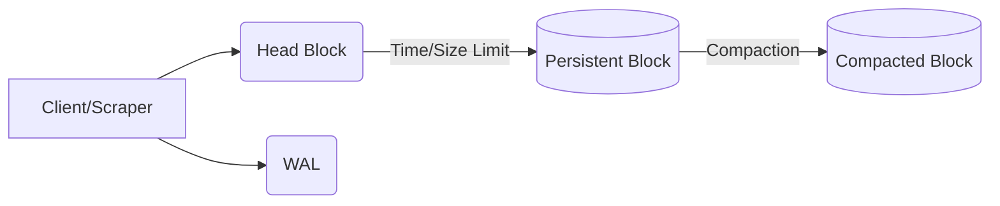
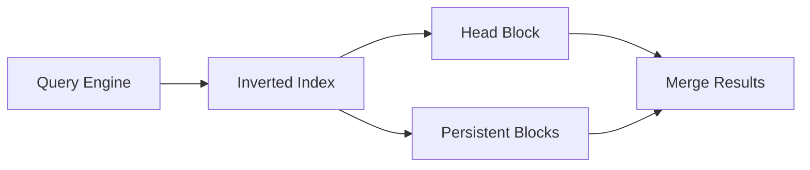

# Time Series Databases

## What is it?

A time-series database (TSDB) is a datastore optimized for timestamped measurements, especially high-ingest append workloads and time-range query patterns.
These systems efficiently store sequences of (timestamp, value) pairs where each stream represents a metric evolving over time.
Instead of updating existing records, a TSDB is designed heavily around appending new immutable data points at a rapid pace.

## Why do we need it?

Observability, IoT, and event telemetry systems produce massive streams where general-purpose schemas become expensive to write, store, and query.
Relational databases rely on B-trees which suffer from write amplification when ingesting thousands of points per second.
TSDBs optimize for:
- High write throughput via sequential disk I/O.
- Time-window queries via time-partitioned blocks.
- Compression and retention efficiency via domain-specific codecs.
- Pre-aggregation for historical analytics, lowering the CPU cost for dashboards.

## Series Data Model

The data model for time-series is simple yet powerful, avoiding rigid relational schemas.

- **Metric**: The measurement name representing the phenomenon (e.g., `cpu_usage`, `network_bytes_in`).
- **Tags/Labels**: Key-value pairs identifying the exact source of the series (e.g., `host=A`, `region=us-east`).
- **Timestamp**: The time of the measurement, often tracked in milliseconds or nanoseconds.
- **Value**: Typically a 64-bit float representing the magnitude of the metric.

Together, the metric name and its unique tag combination define a single **series**.
If you have a metric `cpu_usage` and labels `{host="A"}`, that is one series. 
If you have `cpu_usage` with `{host="B"}`, that is a completely different series.

## The Write Path: WAL, Head, and Blocks

TSDBs often employ an architecture tailored for rapid ingest without blocking:

1. **WAL (Write-Ahead Log)**: Every incoming point is first appended to a sequential disk log to ensure durability against crashes before acknowledging the write.
2. **Head Block (Memory)**: Recent data is kept in memory (the "head"), allowing extremely fast writes and instantaneous recent queries. The Head acts as a write buffer.
3. **Persistent Blocks**: Once the head block reaches a size or time limit (e.g., 2 hours of data), it is flushed to disk as an immutable block, usually highly compressed and indexed.

## Gorilla Delta-of-Delta and XOR Compression

Time-series data is highly compressible because measurements happen at regular intervals, and values change slowly. The "Gorilla" paper from Facebook introduced efficient techniques now standard in the industry:

### Delta-of-Delta (Timestamps)
Instead of storing full 64-bit timestamps for every point, we store the delta of the delta between timestamps. For a steady 15s interval, the delta is always 15. Therefore, the delta-of-delta (DoD) is 0, which encodes into a single bit!

*Worked Bit Count Example:*
Suppose we have the following timestamps: `T0, T1=T0+15, T2=T1+15, T3=T2+16`
- **T0**: Store the full 64 bits.
- **T1**: Delta is 15. Store the Delta in 32 bits (as it is the first delta).
- **T2**: Delta is 15. Delta-of-delta (DoD) is 15 - 15 = 0. We store a single bit `0`. (Total: 1 bit)
- **T3**: Delta is 16. DoD is 16 - 15 = 1. The value `1` falls in the [-63, 64] range.
  - We store the prefix `10` (2 bits) + value `1` (7 bits) = 9 bits.
Total bits for 4 timestamps: 64 + 32 + 1 + 9 = 106 bits (averaging 26.5 bits/timestamp instead of 64).

### XOR Compression (Values)
Values often change slightly (e.g., CPU goes from 50.1 to 50.2). We XOR the current float with the previous float. If the XOR is exactly 0 (value didn't change), store a single bit `0`. If non-zero, store only the meaningful bits, discarding leading/trailing zeros, significantly reducing payload size.

## Label Inverted Index and Cardinality Math

To query series quickly (e.g., `cpu_usage{region="us-east"}`), TSDBs use an inverted index mapping labels to internal series IDs.

**Cardinality Math**:
Cardinality is the combinatorial product of all tag values.
If you have 10 regions, 50 microservices, and 500 instances per microservice:
Total unique series = 10 * 50 * 500 = 250,000 unique series.
If developers add a `user_id` tag with 1 million unique users, cardinality explodes to 250,000,000,000 series. High cardinality causes index bloat, OOM crashes, and drastically slows down queries because the inverted index becomes massive.

## Retention, Downsampling, and Compaction

- **Retention**: Because blocks cover specific time ranges (e.g., 00:00 to 02:00), deleting old data is an O(1) operation—you just delete the directory on disk. This is vastly superior to row-by-row `DELETE` statements in relational DBs.
- **Downsampling**: Coarsening data to save space. For example, keeping 1-second resolution points for 2 days, then aggregating them into 1-minute averages for 30 days, and 1-hour averages for a year.
- **Compaction**: A background process that merges smaller blocks into larger ones, physically dropping deleted series, and rebuilding indices to improve read efficiency and compression ratios.

## Out-of-Order Writes

Handling late-arriving data is notoriously difficult because flushed blocks are immutable. Solutions include:
- A separate out-of-order buffer managed in the Head block.
- Allowing overlapping blocks on disk, which get resolved at query time via merge-sort, or eventually resolved during the next background compaction cycle.

## Push vs Pull Models

- **Push Model**: Clients explicitly send metrics directly to the TSDB endpoint (e.g., InfluxDB). Good for ephemeral jobs and NAT-restricted clients.
- **Pull Model**: The TSDB scrapes a `/metrics` HTTP endpoint exposed by the client (e.g., Prometheus). Good for centralized control and detecting dead services instantly (if a scrape fails, the service is down).

## Long-term Storage

For multi-year retention, modern TSDB architectures often upload compacted blocks to object storage (like AWS S3 or GCS) instead of keeping them on expensive local SSDs. 
Systems like Thanos or Cortex query the local Head and the S3 blocks simultaneously, merging the results. This trades slightly higher latency for massive cost savings.

## Sizing Example

Imagine storing 1M series at a 15-second scrape interval for 30 days.

- **Points per second** = 1,000,000 / 15 ≈ 66,666 pts/sec
- **Bytes per point** (with Gorilla DoD + XOR compression): ~1.5 to 2 bytes per point. Let's use 2 bytes.
- **Ingest Throughput** = 66,666 * 2 bytes = 133 KB/s. Very manageable for network and disk!
- **Storage for 30 days** = 133 KB/s * 86400 seconds * 30 days ≈ 344 GB.
Without compression, at 16 bytes per point (8b TS, 8b Val), this would be ~2.7 TB.

## Failure Modes

1. **Cardinality Explosion**: A high-entropy tag like `user_id` or `session_id` is accidentally added to a metric. This creates millions of new series, inflating the inverted index and crashing the node via Out-Of-Memory (OOM).
2. **Slow Scrapes (Pull)**: If the target application is overloaded and takes too long to respond to a `/metrics` request, the TSDB might time out, dropping the scrape entirely and leaving gaps in the graph.
3. **Thundering Herd (Push)**: A network partition resolves, and thousands of agents simultaneously flush their locally buffered metrics to the TSDB, overwhelming the ingest endpoint.
4. **Compaction Spiral**: Compaction requires CPU and disk I/O. If ingest is too high, compaction falls behind, disk fills up with uncompacted blocks, and query latency spikes because queries must merge too many small blocks on the fly.
5. **Head Block OOM**: An unexpectedly high ingestion rate fills the memory faster than the WAL can flush to disk, or faster than the Head can cut a persistent block, leading to the OS OOM-killing the process.
6. **Clock Skew**: The server and client clocks differ drastically. A client pushes data stamped an hour in the future, causing the TSDB to reject it for being out-of-bounds or out-of-order.

## Architecture Diagrams

### Write Path

### Read Path

## Advanced Considerations

When deploying TSDBs at scale, additional challenges emerge around multi-tenancy and high availability.
- **High Availability**: Often handled by running duplicated pairs of scrapers (e.g., Prometheus HA pairs) that both scrape the same targets independently.
- **Multi-Tenancy**: Requires strong isolation. Label injection (e.g., forcefully adding `tenant_id="X"` to all ingested series) ensures users can only query their own data, but adds complexity to the inverted index.
- **Query Fan-out**: For long time ranges, a query might need to hit dozens of blocks. Query engines must parallelize these block reads to maintain acceptable latency.
- **Rollup Rules**: Defining exactly how data is aggregated during downsampling. A metric measuring "errors" should use a SUM rollup, while a metric measuring "latency" should use an AVG or MAX rollup.
This expansion details the importance of block management and memory constraints. 
TSDBs continuously balance memory consumption for the Head block and the disk I/O required for the Write-Ahead Log.
Memory tuning is the most critical operational task for TSDB administrators.
If the Head block is configured too small, it flushes tiny blocks to disk rapidly, triggering constant compactions.
If the Head block is configured too large, the process risks an OOM kill.
Furthermore, the WAL must be periodically truncated; otherwise, it grows indefinitely and makes crash recovery take hours.
When a TSDB restarts, it replays the WAL into the Head block. A massive WAL means extended downtime.

The inverted index implementation is typically a heavily optimized trie or a set of posting lists.
When a query arrives, the engine parses the PromQL (or equivalent query language), identifies the required labels, and intersects the posting lists.
For example, `series WHERE app="web" AND region="eu" AND status="500"` requires intersecting three massive lists of integers (series IDs).
Using Roaring Bitmaps for these posting lists is a common optimization to drastically speed up intersection operations.
The performance of a TSDB is essentially bound by two factors: how fast it can intersect these lists, and how fast it can decompress the Gorilla-encoded chunks.

Data durability is another nuanced topic. 
While the WAL ensures data is not lost on crash, disk failures still pose a risk.
This is why enterprise TSDB deployments either rely on replicated block storage (like EBS or Ceph) or application-level replication.
Uploading blocks to S3 provides immense durability but adds eventual consistency challenges.
When a block is uploaded, there is a race condition where a query might read from the local disk and from S3 simultaneously, yielding duplicated points if the engine doesn't explicitly deduplicate based on block boundaries.

Finally, consider the ecosystem around the TSDB. 
A database is only as good as its visualization and alerting tools. 
Grafana dominates the visualization space, but alerting requires a separate evaluation layer.
This layer periodically executes queries against the TSDB and fires webhooks if thresholds are breached.
If the TSDB is slow, the alerting system backs up, leading to delayed incident response.
Therefore, ensuring predictable P99 query latency is not just a nice-to-have, but a hard requirement for system reliability.
Let us delve deeper into specific compaction strategies.
Compaction is typically leveled or size-tiered.
In leveled compaction, blocks are organized into levels of exponentially increasing time spans (e.g., 2h, 8h, 32h).
When enough blocks exist at a lower level, they are merged into a block at the next level.
This ensures a query spanning 30 days only needs to hit a few large blocks rather than hundreds of 2h blocks.
However, merging blocks requires decompressing them, re-sorting points, resolving any out-of-order overlaps, and re-compressing them.
This is heavily CPU intensive. 
Operators must carefully monitor the `compaction_queue_length` metric; if it grows unboundedly, the node is under-provisioned.

Another fascinating aspect of TSDB design is the handling of staleness.
How does the database know when a series has stopped emitting data vs when it's just a temporary network blip?
In Prometheus, this is handled via explicit staleness markers.
If a target disappears from service discovery, Prometheus immediately writes a special "stale" NaN value to all series associated with that target.
This prevents graphs from interpolating lines between the last known value and a value that arrives hours later when the service returns.
It ensures that alerts based on `rate()` or `deriv()` functions behave correctly without throwing errors over missing data gaps.

Memory-mapped files (mmap) are widely used for persistent blocks.
Instead of the TSDB application explicitly allocating memory and issuing `read()` syscalls for queries, it mmaps the block file.
This delegates cache management to the OS page cache.
If a query hits recent data, it's likely already in the OS page cache and returns instantly.
This simplifies TSDB memory management but requires the operator to leave substantial free RAM for the OS to utilize; a common rule of thumb is leaving 50% of system memory for the page cache.
If the JVM or Go runtime is configured to consume 90% of RAM, queries against disk blocks will cause severe thrashing and latency spikes.

Let's also discuss the distinction between Gauge and Counter metrics, which heavily influences TSDB usage.
A Gauge is a snapshot value (e.g., current memory usage, temperature). It can go up or down.
A Counter is a cumulatively increasing value (e.g., total HTTP requests served).
Counters reset to 0 when a service restarts.
TSDB query languages must provide functions like `rate()` or `increase()` that mathematically handle these resets.
If the TSDB stores values [10, 20, 30, 2, 12], the function must detect the drop from 30 to 2 as a service restart and calculate the true increase correctly.
This logic heavily depends on the TSDB accurately preserving the exact raw values and timestamps, which is why lossy compression algorithms are strictly avoided for the base data in TSDBs.

Scaling TSDBs horizontally is the final frontier.
Because series data is highly sequential and partitioned by time, sharding is complex.
If you shard by time, writes are completely unbalanced (the node holding the "current" time gets 100% of write traffic).
If you shard by metric name or label hash, writes are distributed, but queries spanning multiple series require a scatter-gather fan-out across all nodes.
This scatter-gather can overwhelm the network and the query coordinator.
Modern distributed TSDBs like M3DB or VictoriaMetrics use sophisticated hashing rings with replication and specialized query coordinators to minimize this fan-out cost.
They often enforce limits on how many shards a single query is allowed to hit, returning a "query too complex" error if the limit is breached, forcing the user to refine their dashboard.

In conclusion, a Time-Series Database is a beautiful symphony of tradeoffs.
It trades the flexible schema and transactionality of an RDBMS for extreme ingest speed and time-range query efficiency.
It trades precise point lookups for bulk analytical scans.
And it trades operational simplicity for the necessity of strict cardinality management and memory tuning.
Understanding these tradeoffs is crucial for any engineer building observable systems.
Let's dive deeper into the mathematics of Delta-of-Delta compression, to truly understand its power.
Assume a timestamp uses 8 bytes (64 bits). 
If we have 1,000,000 data points, storing full timestamps takes 8 MB.
With Delta-of-Delta, a perfectly steady time series (e.g., exactly 15s between points) has a DoD of 0.
A DoD of 0 is encoded as a single '0' bit.
Therefore, the timestamps for 1,000,000 points take roughly 1,000,000 bits, which is exactly 125 KB!
This is a staggering 64x compression ratio purely on the timestamp column.
But the real world is messy. Network jitter, GC pauses, and scheduler anomalies mean scrapes aren't perfectly on time.
Let's analyze a jittery sequence:
1. `T0`: 64 bits (base)
2. `T1`: Delta is 15.002s. Stored in 32 bits.
3. `T2`: Delta is 14.998s. DoD is -4ms. This falls in the `[-63, 64]` range. Encodes as 2 prefix bits + 7 value bits = 9 bits.
4. `T3`: Delta is 15.001s. DoD is +3ms. Falls in `[-63, 64]` range. Encodes as 9 bits.
Even with jitter, the average size is just 9 bits per timestamp!
This is why Gorilla-style compression revolutionized the TSDB landscape; it practically eliminated the storage cost of the time dimension.

Now, let's explore XOR value compression.
Floating-point numbers in IEEE 754 format (64-bit) are tricky to compress because a tiny change in value can radically alter the binary representation.
However, XORing consecutive values reveals a pattern: if the values are close, the XOR result often has many leading and trailing zeros.
The compressor stores the number of leading and trailing zeros, and only saves the "meaningful" bits in between.
Example:
Value 1: `2.0` (Binary: `0100000000000000000000000000000000000000000000000000000000000000`)
Value 2: `2.0` (Binary: `0100000000000000000000000000000000000000000000000000000000000000`)
XOR Result: `0`. Encodes as `0` (1 bit).
Value 3: `2.0001` (Binary differs slightly at the end).
XOR Result: Many leading zeros, a few meaningful bits, some trailing zeros.
We encode: `11` (prefix indicating block size changed) + `Leading Zeros` (5 bits) + `Meaningful Length` (6 bits) + `Meaningful Bits`.
This typically compresses 64-bit floats down to 10-20 bits on average for slow-moving metrics.

Putting it all together, a time series point (64-bit TS + 64-bit Value = 128 bits) can compress down to ~12 bits (timestamp) + ~14 bits (value) = 26 bits (~3.25 bytes).
This incredible density is what allows modern observability platforms to retain months of high-resolution data economically.

We must also consider the role of block downsampling in cost optimization.
A typical retention strategy:
- Raw data (15s resolution): Retained for 14 days. Useful for debugging immediate incidents.
- 5m rollups: Retained for 90 days. Useful for monthly SLAs and capacity planning.
- 1h rollups: Retained for 1 year. Useful for year-over-year trend analysis.
Downsampling is not a simple "average" operation. 
When downsampling a block, the TSDB usually calculates `min`, `max`, `sum`, and `count` simultaneously for the wider bucket.
This allows the query engine to accurately compute averages (`sum/count`) or plot error bounds (`min/max`) even on historical data.

The engineering complexity of TSDBs is often hidden behind simple APIs.
When you run a PromQL query like `sum(rate(http_requests_total{status="500"}[5m])) by (service)`, an immense amount of work occurs:
1. Inverted index lookup for `status="500"`.
2. Resolving the resulting series IDs to physical block locations.
3. Memory-mapping the relevant block chunks.
4. Gorilla-decompressing the bits back into 64-bit integers and floats.
5. Calculating the 5-minute rate per series, handling potential counter resets.
6. Grouping the results by the `service` label.
7. Summing the grouped rates.
8. Serializing the final JSON response.
All of this must happen in milliseconds.
It is a testament to the power of append-only architectures and bit-packing that this is achievable at the scale of millions of points per second.
Lastly, let's look at the push vs pull architectural debate from a resilience perspective.
In a pull model, the TSDB acts as a centralized orchestrator. It knows exactly who it should scrape and when.
If a target goes down, the TSDB instantly records a scrape failure. This creates a highly reliable heartbeat mechanism.
However, pull models struggle with ephemeral jobs (like a serverless function that runs for 2 seconds and dies before the next scrape interval).
Push models solve the ephemeral job problem elegantly. The short-lived job simply pushes its metrics right before it terminates.
But push models suffer from the "thundering herd" problem and lack an implicit heartbeat. If a service stops pushing, is it dead, or is the network partitioned?
To mitigate this, push-based systems often require services to push a separate, dedicated heartbeat metric.
The industry is currently coalescing around a hybrid approach (like OpenTelemetry), where agents pull from local services and push to a centralized TSDB, combining the best of both worlds.

The evolution of TSDBs is far from over.
As Kubernetes and microservices architectures drive cardinality higher and higher, the limits of the inverted index are being tested.
Newer architectures are exploring column-store hybrids (like ClickHouse) where the strict distinction between labels and values is blurred, allowing for high-cardinality tags without the massive inverted index penalty.
Regardless of the specific implementation, the core concepts—append-only writes, Gorilla compression, and time-partitioned blocks—will remain the foundation of time-series data management for years to come.
This architectural evolution is driven by the reality that telemetry is now a first-class citizen in software engineering.
A decade ago, metrics were an afterthought, relegated to a few CPU and memory graphs on a dusty dashboard.
Today, metrics drive automated scaling, canary deployments, and automated rollbacks.
The TSDB is no longer just a passive observer; it is in the critical path of the control plane.
This elevated status means that the latency, durability, and availability of the TSDB must match or exceed the systems it is monitoring.
If the TSDB fails, the auto-scaler cannot make decisions, and the system flies blind.
Therefore, understanding the deep mechanics of TSDBs—how they flush blocks, how they compress bits, and how they resolve cardinality—is essential knowledge for any modern infrastructure engineer.
