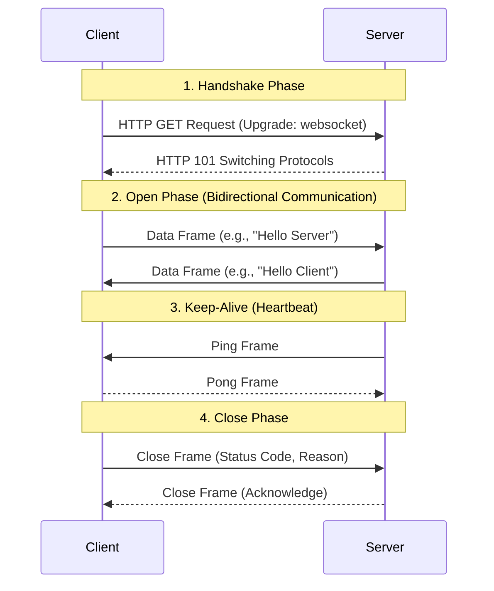

# WebSockets Theory

## 1. Introduction

WebSockets provide a full-duplex communication channel over a single, long-lived TCP connection. 
Introduced in 2011 (RFC 6455), the WebSocket protocol revolutionized real-time web applications by enabling low-latency, bidirectional communication between a client (typically a web browser) and a server. 

Before WebSockets, real-time communication on the web was achieved through hacks and workarounds like HTTP Long Polling, HTTP Streaming, and plugins like Adobe Flash or Java Applets. WebSockets standardize this capability directly into web platforms.

### Key Characteristics
1. **Full-Duplex:** Both client and server can send messages to each other independently and simultaneously.
2. **Persistent Connection:** The TCP connection stays open until either party explicitly closes it, reducing the overhead of establishing new connections for every message.
3. **Low Latency:** Messages are sent as lightweight frames with very little overhead compared to HTTP requests, making WebSockets ideal for latency-sensitive applications.
4. **Stateful:** The server can maintain state about the connected clients, which simplifies building interactive applications.
5. **Cross-Origin Capability:** WebSockets support cross-origin communication (controlled via the `Origin` header), unlike traditional AJAX which is bound by the Same-Origin Policy (though CORS mitigates this for HTTP).

## 2. History and Evolution

### The Pre-WebSocket Era
Before WebSockets, the web was inherently request-response driven (HTTP/1.0 and HTTP/1.1). A client had to explicitly ask the server for data. If a server wanted to push an event to the client (e.g., a new chat message), it couldn't initiate the transfer.

Developers used several techniques to emulate server push:
- **Short Polling:** The client repeatedly sends AJAX requests to the server (e.g., every 1 second) asking, "Do you have new data?" This is incredibly inefficient, wasting bandwidth and server resources with empty responses.
- **Long Polling (Comet):** The client sends a request, and the server holds the connection open until it has data to send or a timeout occurs. Once the client receives the response (or a timeout), it immediately sends a new request. This is better than short polling but still incurs HTTP header overhead for every message and latency during reconnection.
- **HTTP Streaming:** The server holds the connection open and continuously pushes data as it becomes available. However, proxies often buffer this data, breaking the real-time nature, and the client still can't send data back over the same stream efficiently.
- **Server-Sent Events (SSE):** A standard for server-to-client push over HTTP. Excellent for one-way event streams, but doesn't solve bidirectional communication.

### The Standardization
The need for a true bidirectional socket in the browser led to the development of WebSockets. It started as part of the HTML5 specification but was eventually moved to its own standard, RFC 6455, published by the IETF. The corresponding JavaScript API was standardized by the W3C.

## 3. The Connection Lifecycle

A WebSocket connection follows a specific lifecycle:

1.  **Handshake (Upgrade):** The client initiates a standard HTTP request asking the server to "upgrade" the connection to WebSockets.
2.  **Open:** If the server agrees, the connection is established, and data can flow in both directions.
3.  **Message Exchange:** Client and server exchange data frames (Text or Binary).
4.  **Ping/Pong (Keep-Alive):** Control frames used to ensure the connection is still active and prevent intermediaries from closing it due to inactivity.
5.  **Close:** Either party can initiate a closing handshake to terminate the connection gracefully.

### Sequence Diagram



## 4. The Handshake Protocol in Detail

The WebSocket protocol is designed to work over HTTP ports 80 and 443 to pass through enterprise firewalls and proxies. Therefore, every WebSocket connection begins as an HTTP request.

### The Client Request

The client sends a standard HTTP `GET` request, but with specific headers indicating the desire to upgrade:

```http
GET /chat HTTP/1.1
Host: server.example.com
Upgrade: websocket
Connection: Upgrade
Sec-WebSocket-Key: dGhlIHNhbXBsZSBub25jZQ==
Origin: http://example.com
Sec-WebSocket-Protocol: chat, superchat
Sec-WebSocket-Version: 13
```

Key headers:
- `Upgrade: websocket`: Signals the intent to switch protocols.
- `Connection: Upgrade`: Required when specifying `Upgrade`.
- `Sec-WebSocket-Key`: A base64-encoded, 16-byte random value. Crucial for security and verification (explained below).
- `Sec-WebSocket-Version`: Must be `13` (the version defined in RFC 6455).
- `Origin`: Used by the server for security (to prevent CSRF-like attacks).
- `Sec-WebSocket-Protocol`: (Optional) The sub-protocols the client supports (e.g., WAMP, STOMP, or a custom application protocol).

### The Server Response

If the server accepts the connection, it responds with an HTTP `101 Switching Protocols` status code:

```http
HTTP/1.1 101 Switching Protocols
Upgrade: websocket
Connection: Upgrade
Sec-WebSocket-Accept: s3pPLMBiTxaQ9kYGzzhZRbK+xOo=
Sec-WebSocket-Protocol: chat
```

### The `Sec-WebSocket-Accept` Calculation

The `Sec-WebSocket-Accept` header is critical. It proves to the client that the server genuinely understands the WebSocket protocol and didn't just accidentally accept the upgrade.

The calculation steps are hardcoded in the protocol:
1.  **Concatenate:** The server takes the value of the `Sec-WebSocket-Key` sent by the client.
2.  **Append Magic String:** It appends a globally unique identifier (GUID) defined in the RFC: `258EAFA5-E914-47DA-95CA-C5AB0DC85B11`.
3.  **Hash:** It computes the SHA-1 hash of this concatenated string.
4.  **Encode:** It encodes the resulting hash using Base64.

**Example Calculation:**
- Client Key: `dGhlIHNhbXBsZSBub25jZQ==`
- Concatenated: `dGhlIHNhbXBsZSBub25jZQ==258EAFA5-E914-47DA-95CA-C5AB0DC85B11`
- SHA-1 (Hex): `b37a4f2cc0624f1690f64606cf385945b2bec4ea`
- Base64: `s3pPLMBiTxaQ9kYGzzhZRbK+xOo=` (This becomes the `Sec-WebSocket-Accept` value).

Once this handshake is complete, the HTTP protocol is discarded, and the TCP connection is used exclusively for WebSocket framing.

## 5. The Framing Protocol

Unlike HTTP, which is stream-oriented (sending text until a termination sequence or content length is reached), WebSockets are message-oriented. Data is chunked into "frames".

A WebSocket frame consists of a header and a payload.

### Frame Header Structure

The header is highly optimized, starting at just 2 bytes.

```text
 0                   1                   2                   3
 0 1 2 3 4 5 6 7 8 9 0 1 2 3 4 5 6 7 8 9 0 1 2 3 4 5 6 7 8 9 0 1
+-+-+-+-+-------+-+-------------+-------------------------------+
|F|R|R|R| opcode|M| Payload len |    Extended payload length    |
|I|S|S|S|  (4)  |A|     (7)     |             (16/64)           |
|N|V|V|V|       |S|             |   (if payload len==126/127)   |
| |1|2|3|       |K|             |                               |
+-+-+-+-+-------+-+-------------+ - - - - - - - - - - - - - - - +
|     Extended payload length continued, if payload len == 127  |
+ - - - - - - - - - - - - - - - +-------------------------------+
|                               |Masking-key, if MASK set to 1  |
+-------------------------------+-------------------------------+
| Masking-key (continued)       |          Payload Data         |
+-------------------------------- - - - - - - - - - - - - - - - +
:                     Payload Data continued ...                :
+ - - - - - - - - - - - - - - - - - - - - - - - - - - - - - - - +
|                     Payload Data continued ...                |
+---------------------------------------------------------------+
```

**Key Fields:**
- **FIN (1 bit):** Indicates if this is the final fragment of a message. WebSockets support message fragmentation, allowing a large message to be sent across multiple frames. If FIN=1, it's the final (or only) fragment.
- **RSV1, RSV2, RSV3 (1 bit each):** Reserved for extensions. Usually 0.
- **Opcode (4 bits):** Defines the type of frame.
    - `0x0`: Continuation Frame (part of a fragmented message).
    - `0x1`: Text Frame (UTF-8).
    - `0x2`: Binary Frame.
    - `0x8`: Connection Close.
    - `0x9`: Ping.
    - `0xA`: Pong.
- **MASK (1 bit):** Indicates if the payload is masked. All messages from the client to the server **must** be masked to prevent cache poisoning attacks against legacy infrastructure. Messages from the server to the client must **not** be masked.
- **Payload len (7 bits):** The length of the payload.
    - If `0-125`: This is the actual length.
    - If `126`: The following 2 bytes contain the extended length (up to 64KB).
    - If `127`: The following 8 bytes contain the extended length (up to 16EB).
- **Masking-key (0 or 4 bytes):** If MASK=1, this contains a 32-bit value used to unmask the payload.
- **Payload Data:** The actual application data.

### Masking Algorithm

The masking algorithm is simple XOR masking. It is not encryption; its purpose is solely to prevent intermediate proxies from recognizing the payload as an HTTP request and misinterpreting it (a security vulnerability known as cross-protocol attack).

To unmask data, the server iterates through the payload and XORs each byte with the corresponding byte of the masking key (cycling through the 4-byte key).

## 6. Scaling WebSockets (High-Level Design)

Scaling WebSockets is significantly more complex than scaling stateless HTTP APIs. Because WebSocket connections are persistent, they are "stateful". A server cannot simply shut down without dropping active connections.

### The Challenge of Stateful Connections

In a traditional stateless architecture, a load balancer distributes HTTP requests randomly (or round-robin) among a pool of web servers. Any server can handle any request.

With WebSockets, a client establishes a connection with *Server A*. Subsequent messages must go to *Server A*. If *Server A* fails, the client must reconnect (potentially to *Server B*), and the state must be rebuilt.

### 6.1. Load Balancing WebSocket Connections

You need a load balancer capable of routing TCP or HTTP connections and keeping them alive.

1.  **Layer 4 (Transport) Load Balancing:** The LB operates at the TCP level (e.g., HAProxy in TCP mode). It forwards the initial connection to a backend server. The connection remains pinned to that server for its lifetime. This is efficient but prevents the LB from inspecting the HTTP handshake (e.g., for routing based on headers or path).
2.  **Layer 7 (Application) Load Balancing:** The LB terminates the SSL connection, parses the HTTP upgrade request, and establishes a WebSocket connection with a backend server. Modern LBs like Nginx, Envoy, and AWS Application Load Balancer (ALB) support WebSockets natively.

**Sticky Sessions (Session Affinity):** While not strictly required for the WebSocket protocol itself (because the connection is inherently pinned), sticky sessions might be needed if your application relies on short-polling fallbacks before upgrading to WebSockets, ensuring all requests from a client hit the same server until the upgrade is complete.

### 6.2. The Pub/Sub Backplane (Broadcasting)

Consider a chat application with 10,000 users. User Alice is connected to *Server 1*. User Bob is connected to *Server 2*.

If Alice sends a message to a chat room that Bob is in, *Server 1* receives the message. How does *Server 1* tell *Server 2* to push the message down its WebSocket connection to Bob?

Servers cannot communicate only with their connected clients; they must communicate with each other. This is achieved using a publish/subscribe (pub/sub) message broker acting as a "backplane".

**Architecture:**
1.  **Client Connects:** Bob connects to *Server 2*.
2.  **Server Subscribes:** *Server 2* subscribes to a specific channel on the Redis/Kafka cluster (e.g., `channel:chat_room_123`).
3.  **Message Sent:** Alice connects to *Server 1* and sends a message to `chat_room_123`.
4.  **Server Publishes:** *Server 1* publishes the message to the Redis/Kafka topic `channel:chat_room_123`.
5.  **Broker Distributes:** The broker distributes the message to all subscribed servers (including *Server 2*).
6.  **Server Pushes:** *Server 2* receives the message from the broker and pushes it down the WebSocket connection to Bob.

**Common Technologies for the Backplane:**
- **Redis Pub/Sub:** Excellent for low-latency, transient message broadcasting. It's fast but doesn't guarantee message delivery if a server is temporarily down.
- **Apache Kafka:** Provides durability and replayability. Better for complex event processing but has higher latency than Redis.
- **RabbitMQ:** Good balance of routing capabilities and reliability.
- **NATS:** Extremely high-performance messaging system often used in microservices.

### 6.3. Connection Management and State

Tracking who is connected to which server becomes critical.

- **Local State:** Every server maintains an in-memory hash map of active connections (e.g., `Map<UserId, WebSocketConnection>`).
- **Global State (Presence):** To show "who is online," servers must update a global store (like Redis). When a user connects, the server sets a key in Redis (`user:123:status = online`). When they disconnect, the server removes the key.
    - *Challenge:* Handling abnormal disconnects (server crash). The global store must use TTLs (Time-To-Live) or heartbeat mechanisms to eventually mark users offline if the server crashes before cleaning up.

### 6.4. The C10K and C10M Problems

Handling millions of concurrent connections (C10M) requires specific architectural choices:

1.  **Asynchronous I/O:** You cannot dedicate a whole OS thread to every WebSocket connection (10,000 threads will crush a standard server due to context switching and memory overhead).
    - Use non-blocking, event-driven servers (Node.js, Netty in Java, asyncio in Python, Go goroutines, Rust/Tokio).
    - These technologies use epoll/kqueue under the hood to manage thousands of sockets with a small pool of threads.
2.  **OS Tuning:** Increase limits on open file descriptors (`ulimit -n`), adjust ephemeral port ranges, and tune TCP memory settings (`tcp_rmem`, `tcp_wmem`).
3.  **Horizontal Scaling:** Distribute connections across many relatively small servers rather than a few massive ones. This isolates failures.

## 7. Security Considerations

WebSockets introduce specific security challenges compared to standard REST APIs.

### WSS (WebSocket Secure)
Always use `wss://` instead of `ws://` in production. WSS encrypts the WebSocket traffic using TLS/SSL, preventing man-in-the-middle (MITM) attacks and eavesdropping. The TLS handshake happens *before* the HTTP WebSocket upgrade request.

### Cross-Site WebSocket Hijacking (CSWSH)
WebSockets do not inherently enforce the Same-Origin Policy. If a user is logged into `bank.com`, a malicious script on `evil.com` could open a WebSocket connection to `wss://bank.com/api`. If `bank.com` relies solely on ambient credentials (like cookies) for authentication, the connection will succeed, and `evil.com` can send commands as the user.

**Mitigation:**
The server *must* validate the `Origin` header during the handshake. If the origin is not an allowed domain, the server must reject the handshake (return HTTP 403).

### Authentication and Authorization
Because the connection is long-lived, authentication strategies differ from REST.

1.  **Handshake Auth:** Authenticate during the initial HTTP upgrade request using standard HTTP headers (e.g., `Authorization: Bearer <token>`) or cookies (if validated with Origin/CSRF tokens).
2.  **Post-Connect Auth:** Allow the connection, but require the very first WebSocket frame from the client to be an authentication message containing a token. Until this message is received and validated, drop all other messages. This is common because browser WebSocket APIs do not always allow setting custom HTTP headers easily.

### Rate Limiting and DoS Protection
A malicious client can establish a single connection and spam millions of messages, overwhelming the server.
- **Message Rate Limiting:** Enforce limits on the number of messages or bytes per second *per connection*.
- **Connection Rate Limiting:** Limit the number of connections from a single IP address to prevent resource exhaustion (running out of file descriptors or memory).
- **Payload Size Limits:** Reject frames that exceed a maximum allowed size to prevent memory exhaustion attacks.

## 8. Summary

WebSockets provide the foundation for modern real-time web applications. While the protocol itself (RFC 6455) is relatively straightforward, the architectural implications of maintaining thousands or millions of stateful, persistent connections demand robust distributed systems design, relying heavily on asynchronous programming, specialized load balancing, and pub/sub message brokers for inter-node communication.

*(End of Theory Document)*

## 9. Advanced Protocol Details

To truly understand WebSockets for production use cases, it is important to look deeper into the protocol's mechanics, specifically regarding how fragmentation and control frames are handled.

### Message Fragmentation

As mentioned earlier, the `FIN` bit in the WebSocket header allows for message fragmentation. This is crucial for several reasons:

1.  **Unknown Size:** A server or client might begin transmitting a message before knowing its total final size (e.g., streaming a dynamically generated report).
2.  **Memory Constraints:** Instead of buffering a massive 100MB message in memory before sending, an application can stream it in smaller 1MB chunks.
3.  **Multiplexing (Theoretical):** While the base WebSocket protocol does not natively support multiplexing multiple logical channels over one connection, fragmentation is a building block that extensions use to implement it.

**How Fragmentation Works:**

-   **First Fragment:** `FIN` is set to 0. The `opcode` indicates the type of data (Text `0x1` or Binary `0x2`).
-   **Middle Fragments:** `FIN` is set to 0. The `opcode` is set to Continuation (`0x0`).
-   **Final Fragment:** `FIN` is set to 1. The `opcode` is set to Continuation (`0x0`).

The receiver must buffer these fragments until the final one arrives before passing the complete message to the application layer. It is invalid to interleave fragments of different messages. If you start sending fragments for Message A, you must finish Message A before sending fragments for Message B. (Control frames, however, *can* be injected between data fragments).

### Control Frames

Control frames are used to manage the state of the connection itself. They are identified by opcodes where the most significant bit is 1 (opcodes `0x8` to `0xF`).

Crucial rules for control frames:
1.  **Cannot be fragmented:** The `FIN` bit must always be 1.
2.  **Payload limit:** The payload must not exceed 125 bytes.
3.  **Interleaving:** They can be injected in the middle of a fragmented data message.

The three defined control frames are:

*   **Close (Opcode 0x8):** Contains an optional status code (e.g., `1000` for Normal Closure, `1006` for Abnormal Closure) and a UTF-8 reason string. The connection enters the "CLOSING" state. The receiving peer must reply with a Close frame to acknowledge it, after which the underlying TCP connection is terminated.
*   **Ping (Opcode 0x9):** Can contain a small payload. Used as a keep-alive heartbeat or to measure latency.
*   **Pong (Opcode 0xA):** Must be sent in response to a Ping. It must contain the exact same payload that was in the Ping frame. A peer may also send unsolicited Pongs as a one-way heartbeat.

### Handling Unclean Disconnects

A major operational challenge with WebSockets is the "half-open" connection. If a client's network drops abruptly (e.g., driving through a tunnel), the OS network stack on the client side fails, but the server side might not receive a TCP FIN or RST packet immediately.

The server's socket remains open, holding memory and resources, believing the client is simply quiet.

**The Solution: Application-Layer Heartbeats**

While TCP keepalives exist, they are often too slow (defaulting to hours) or stripped by intermediate proxies. Therefore, WebSocket applications must implement their own heartbeats using Ping/Pong frames.

*   The server schedules a recurring task (e.g., every 30 seconds) to send a Ping frame to all connected clients.
*   If a client fails to respond with a Pong within a specific timeout (e.g., 10 seconds), the server assumes the connection is dead.
*   The server proactively closes the socket on its end, freeing up resources and triggering the "disconnect" logic in the application (like updating presence in Redis).

## 10. Alternatives and When NOT to Use WebSockets

WebSockets are powerful, but they add operational complexity. They should not be the default choice for every application.

### When WebSockets are Overkill

1.  **Rare Updates:** If an application only needs to receive data from the server once an hour, establishing and maintaining a persistent WebSocket connection is a waste of resources. Long polling or simple polling is sufficient.
2.  **Stateless Request/Response:** Standard CRUD operations (Create, Read, Update, Delete) are perfectly suited for HTTP/REST. WebSockets lack native routing and semantics (like HTTP verbs and status codes). You would have to reinvent this wheel on top of WebSockets (e.g., using JSON-RPC).
3.  **One-Way Streaming (Server to Client):** If the application only needs real-time data pushed *from* the server (e.g., a stock ticker display, live sports scores) and rarely sends data back, Server-Sent Events (SSE) is often a better choice.

### WebSockets vs. Server-Sent Events (SSE)

| Feature | WebSockets | SSE |
| :--- | :--- | :--- |
| **Directionality** | Full Duplex (Bidirectional) | Simplex (Server to Client only) |
| **Protocol** | Custom framing over TCP | Standard HTTP/1.1 |
| **Data Types** | Text and Binary | Text only (UTF-8) |
| **Multiplexing** | Requires custom implementation | Native over HTTP/2 |
| **Auto-Reconnect** | Must be implemented manually | Built-in by the browser |
| **Proxy Support** | Can be problematic with older proxies | Excellent (standard HTTP) |
| **Complexity** | High (Stateful, requires backplane) | Low (Stateless, standard scaling) |

**Conclusion:** Use SSE when you only need to push data to the client. Use WebSockets when you need low-latency, frequent, bidirectional communication (chat, multiplayer games, collaborative editing).

## 11. Testing WebSockets

Testing stateful, asynchronous protocols requires different tooling than standard REST APIs.

### Tooling

1.  **wscat:** A command-line tool (Node.js based) acting like `curl` but for WebSockets. Excellent for basic connectivity and manual message testing.
2.  **Postman / Insomnia:** Modern GUI API clients now have excellent built-in support for establishing WebSocket connections, saving message templates, and inspecting the frame history.
3.  **Load Testing (Artillery / K6):** Traditional HTTP load testing tools like JMeter or Apache Bench struggle with WebSockets. Tools like Artillery or K6 are designed to handle concurrent, persistent connections and can script complex message exchange scenarios to truly stress test the pub/sub backplane and server memory limits.

### Testing Strategies

When designing automated tests for WebSockets, consider these scenarios:

*   **Connection Establishment:** Verify the handshake succeeds with valid credentials and fails correctly with invalid origins or missing tokens.
*   **Message Echo:** Send a message and assert the server echoes it back (or processes it correctly).
*   **Broadcast Verification:** Connect Client A and Client B. Send a message from A and assert B receives it. This tests the pub/sub backplane integration.
*   **Abnormal Disconnect:** Forcefully kill a client process (simulating network drop) and verify the server detects the timeout and cleans up internal state (e.g., removes the user from the "online" list).
*   **Reconnection Logic:** Verify that when a client loses connection, it successfully reconnects with exponential backoff to prevent thundering herd problems.

## 12. WebSocket Subprotocols

The WebSocket protocol itself is merely a transport mechanism. It delivers frames of text or binary data, but it does not dictate what that data means. If a client sends the string `{"action": "join", "room": "lobby"}`, the WebSocket standard has no concept of what "action" or "room" implies.

This is where **subprotocols** come into play. A subprotocol defines the application-level structure and semantics of the messages exchanged over the WebSocket connection.

### Negotiation During Handshake

When a client initiates a WebSocket connection, it can propose one or more subprotocols it supports using the `Sec-WebSocket-Protocol` header:

```http
GET /stream HTTP/1.1
Host: api.example.com
Upgrade: websocket
Connection: Upgrade
Sec-WebSocket-Key: ...
Sec-WebSocket-Protocol: v1.myapp, v2.myapp, wamp
```

The server inspects this list. If it supports one of the requested subprotocols, it selects it and confirms the choice in its response:

```http
HTTP/1.1 101 Switching Protocols
Upgrade: websocket
Connection: Upgrade
Sec-WebSocket-Accept: ...
Sec-WebSocket-Protocol: v2.myapp
```

If the server does not support *any* of the requested subprotocols, it should theoretically abort the handshake (though in practice, some servers might just accept the connection without specifying a protocol, leaving it up to the application layer to figure it out, which is bad practice).

### Common Standard Subprotocols

While you can invent your own JSON-based subprotocol (like `v2.myapp`), several standardized subprotocols exist to solve common patterns:

1.  **STOMP (Simple (or Streaming) Text Oriented Messaging Protocol):**
    *   Originally designed for message-oriented middleware (like ActiveMQ or RabbitMQ).
    *   It provides a frame-based structure over WebSockets with commands like `CONNECT`, `SUBSCRIBE`, `SEND`, `ACK`, and `DISCONNECT`.
    *   It gives a REST-like semantic structure to the WebSocket stream, making it easy to route messages to specific destinations (e.g., `/topic/chat`).

2.  **WAMP (Web Application Messaging Protocol):**
    *   Provides two main messaging patterns:
        *   **Publish & Subscribe (PubSub):** For routing events to multiple subscribers.
        *   **Remote Procedure Calls (RPC):** For requesting a specific action from a remote endpoint and awaiting a response.
    *   WAMP is highly structured and uses a central router to manage the communication.

3.  **GraphQL over WebSockets (e.g., `graphql-ws`):**
    *   Used specifically to support GraphQL Subscriptions.
    *   It defines messages for initiating a subscription (`subscribe`), pushing data when an event occurs (`next`), handling errors (`error`), and terminating the subscription (`complete`).

By relying on standard subprotocols, developers can use existing client and server libraries rather than writing custom parsers and state machines for every new application.
