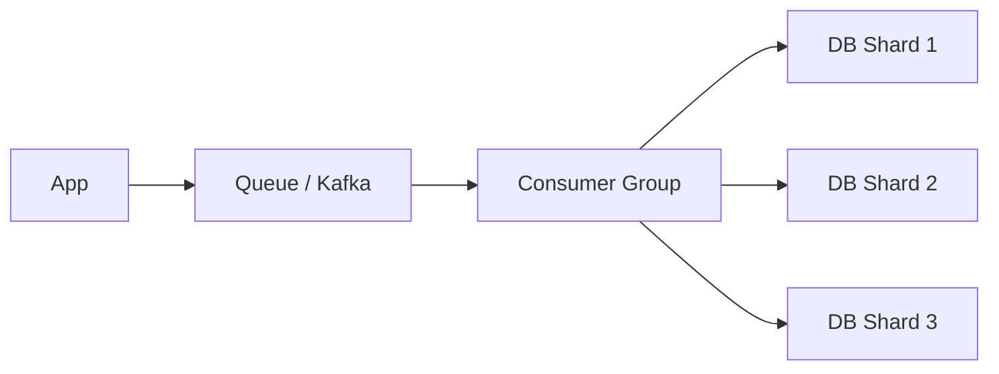
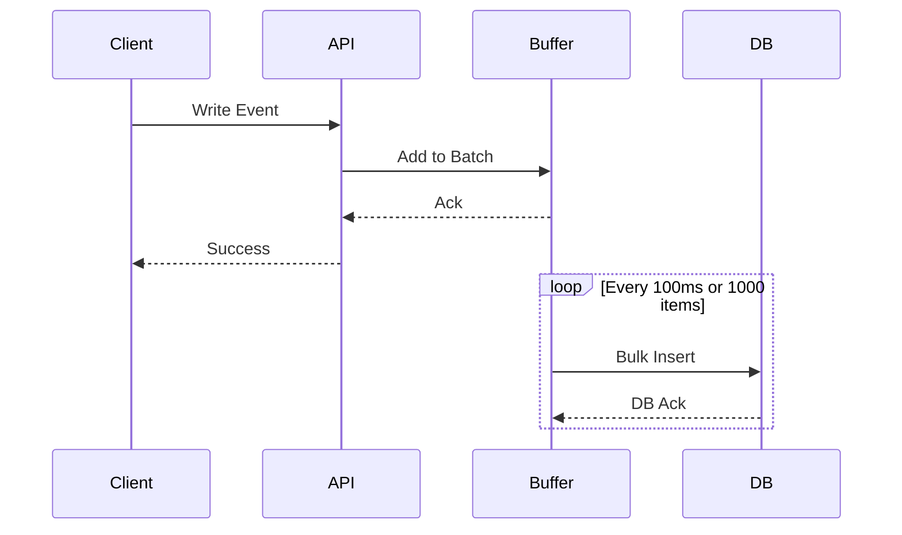

# Write Scaling

Write scaling is the pattern set for sustaining high write throughput while preserving correctness and predictable latency.
It combines partitioning, burst buffering, batching, and hotspot mitigation so each component handles manageable write load.

## 1. Batching and Group Commit

The cost of a write operation is dominated by disk I/O and network overhead. **Batching** groups multiple logical writes into a single physical write.

*   **Application Batching:** The application buffers writes in memory and sends them to the database in one large query (e.g., `INSERT INTO ... VALUES (...), (...), (...)`).
*   **Group Commit:** Inside the database, the storage engine waits briefly to group multiple concurrent transactions into a single disk fsync to the write-ahead log (WAL).

## 2. Queue Buffering

When write spikes occur (e.g., flash sales, sensor bursts), databases can be overwhelmed.
**Queue Buffering:** Introduce a message queue (e.g., Kafka) between the application and the database.
The application writes messages to the queue (fast, append-only). Consumers read from the queue and write to the database at a controlled, sustainable rate. This sacrifices immediate read-after-write consistency for system stability.

## 3. Key Choice and Hot-Partition Salting

When sharding a database, the partition key dictates data distribution.
**Hot Partitions:** If a key receives disproportionate traffic (e.g., a celebrity's user ID), that partition becomes a bottleneck.
**Salting:** Append a random number (salt) to the partition key (e.g., `user_id_01`, `user_id_02`). This distributes the hot key's writes across multiple partitions. Note that reading now requires querying all salted partitions and merging the results.

## 4. LSM Append Stores

Log-Structured Merge-Trees (LSM Trees) are data structures optimized for write-heavy workloads (used in Cassandra, RocksDB).
Instead of updating data in place (which requires random disk I/O), LSM trees write all changes sequentially to an append-only log and an in-memory structure (MemTable). Sequential writes are orders of magnitude faster than random writes. Later, data is merged and sorted in the background (compaction).

## 5. Write-Behind

Instead of writing synchronously to the database (**write-through**), the application writes to a fast cache (like Redis), acknowledges the user, and an asynchronous process writes the data from the cache to the database.
This is extremely fast but risks data loss if the cache node crashes before the background write completes.

## 6. Back-pressure

If the database is slow, the queue can fill up. If the queue fills up, the application must apply **back-pressure**.
This means rejecting incoming requests (HTTP 429 Too Many Requests) or slowing down producers to prevent memory exhaustion or cascading failure. Back-pressure is a critical safety mechanism.

## 7. Fsync Math and Worked Numbers

Disks have physical limits on how many sync operations they can perform.
*   A standard HDD might do 100-200 IOPS (fsyncs/sec).
*   An SSD might do 10,000-100,000 IOPS.
Suppose an SSD can do 10,000 fsyncs/sec. If every transaction requires a dedicated WAL fsync, the database is capped at 10,000 TPS.
By using **Group Commit**, if the database waits 1ms, it might collect 10 transactions. Now, 1 fsync persists 10 transactions. The throughput jumps to 100,000 TPS while maintaining durability, effectively bypassing the strict IOPS limit.

## 8. Six Failure Modes

1.  **Queue Backlog Accumulation:** Consumers are slower than producers. The queue grows infinitely until disk space exhausts. Mitigation: Autoscale consumers, implement back-pressure, or load shed.
2.  **Hot Shard Overload:** A poorly chosen partition key focuses all writes on one node. Mitigation: Key salting, dynamic resharding, or choosing a higher-cardinality key.
3.  **Compaction Stalls (LSM):** Write rate exceeds the background compaction rate in an LSM database, leading to read latency spikes and eventually blocking writes. Mitigation: Tune compaction threads, use SSDs, or throttle writes.
4.  **Write-Behind Data Loss:** Cache node fails before persisting to the DB. Mitigation: Replicated cache, accept data loss for non-critical telemetry, or use durable queues instead.
5.  **OOM due to Batching:** An application buffers too many writes in memory waiting to form a batch, exhausting memory. Mitigation: Hard limits on batch size and time.
6.  **Deadlocks in Concurrent Writes:** Multiple threads attempt to update the same rows in different orders. Mitigation: Sort keys before writing, use optimistic concurrency control.

## Additional Considerations for Write Scaling

Handling massive write throughput requires careful orchestration of distributed systems. One must navigate the CAP theorem, often choosing partition tolerance and availability over strict consistency for high-velocity ingest pipelines.

The choice of database engine is critical. B-Tree engines are excellent for read-heavy workloads but suffer write amplification. LSM engines shine for write-heavy workloads but require careful tuning of compaction processes to avoid CPU and IO starvation.

Idempotency is a crucial requirement. When network errors occur, clients will retry writes. The system must be able to recognize duplicate requests and avoid applying the same mutation twice. This is typically achieved using unique request IDs and tracking them in a fast deduplication store or within the database schema itself.

Monitoring queue depths, disk IO latency, and replication lag are essential operational practices. Alerts must be configured not just on absolute thresholds but on rates of change (e.g., queue depth growing at >1000 msgs/sec) to proactively address bottlenecks before they cause outages.

For globally distributed systems, multi-region write topologies introduce complexities like conflict resolution (e.g., using CRDTs or last-writer-wins semantics) and managing cross-region replication latency, further expanding the domain of write scaling strategies.

To successfully deploy these write scaling strategies, engineering teams must deeply understand their disk topologies. Utilizing NVMe SSDs, separating WAL logs from data files on different physical disks, and meticulously tuning the operating system's page cache and dirty ratio settings can unlock significant throughput multipliers. The physics of disk rotation and flash wear-leveling remain fundamental constraints.

To successfully deploy these write scaling strategies, engineering teams must deeply understand their disk topologies. Utilizing NVMe SSDs, separating WAL logs from data files on different physical disks, and meticulously tuning the operating system's page cache and dirty ratio settings can unlock significant throughput multipliers. The physics of disk rotation and flash wear-leveling remain fundamental constraints.

To successfully deploy these write scaling strategies, engineering teams must deeply understand their disk topologies. Utilizing NVMe SSDs, separating WAL logs from data files on different physical disks, and meticulously tuning the operating system's page cache and dirty ratio settings can unlock significant throughput multipliers. The physics of disk rotation and flash wear-leveling remain fundamental constraints.

To successfully deploy these write scaling strategies, engineering teams must deeply understand their disk topologies. Utilizing NVMe SSDs, separating WAL logs from data files on different physical disks, and meticulously tuning the operating system's page cache and dirty ratio settings can unlock significant throughput multipliers. The physics of disk rotation and flash wear-leveling remain fundamental constraints.

To successfully deploy these write scaling strategies, engineering teams must deeply understand their disk topologies. Utilizing NVMe SSDs, separating WAL logs from data files on different physical disks, and meticulously tuning the operating system's page cache and dirty ratio settings can unlock significant throughput multipliers. The physics of disk rotation and flash wear-leveling remain fundamental constraints.

To successfully deploy these write scaling strategies, engineering teams must deeply understand their disk topologies. Utilizing NVMe SSDs, separating WAL logs from data files on different physical disks, and meticulously tuning the operating system's page cache and dirty ratio settings can unlock significant throughput multipliers. The physics of disk rotation and flash wear-leveling remain fundamental constraints.

To successfully deploy these write scaling strategies, engineering teams must deeply understand their disk topologies. Utilizing NVMe SSDs, separating WAL logs from data files on different physical disks, and meticulously tuning the operating system's page cache and dirty ratio settings can unlock significant throughput multipliers. The physics of disk rotation and flash wear-leveling remain fundamental constraints.

To successfully deploy these write scaling strategies, engineering teams must deeply understand their disk topologies. Utilizing NVMe SSDs, separating WAL logs from data files on different physical disks, and meticulously tuning the operating system's page cache and dirty ratio settings can unlock significant throughput multipliers. The physics of disk rotation and flash wear-leveling remain fundamental constraints.

To successfully deploy these write scaling strategies, engineering teams must deeply understand their disk topologies. Utilizing NVMe SSDs, separating WAL logs from data files on different physical disks, and meticulously tuning the operating system's page cache and dirty ratio settings can unlock significant throughput multipliers. The physics of disk rotation and flash wear-leveling remain fundamental constraints.

To successfully deploy these write scaling strategies, engineering teams must deeply understand their disk topologies. Utilizing NVMe SSDs, separating WAL logs from data files on different physical disks, and meticulously tuning the operating system's page cache and dirty ratio settings can unlock significant throughput multipliers. The physics of disk rotation and flash wear-leveling remain fundamental constraints.

To successfully deploy these write scaling strategies, engineering teams must deeply understand their disk topologies. Utilizing NVMe SSDs, separating WAL logs from data files on different physical disks, and meticulously tuning the operating system's page cache and dirty ratio settings can unlock significant throughput multipliers. The physics of disk rotation and flash wear-leveling remain fundamental constraints.

To successfully deploy these write scaling strategies, engineering teams must deeply understand their disk topologies. Utilizing NVMe SSDs, separating WAL logs from data files on different physical disks, and meticulously tuning the operating system's page cache and dirty ratio settings can unlock significant throughput multipliers. The physics of disk rotation and flash wear-leveling remain fundamental constraints.

To successfully deploy these write scaling strategies, engineering teams must deeply understand their disk topologies. Utilizing NVMe SSDs, separating WAL logs from data files on different physical disks, and meticulously tuning the operating system's page cache and dirty ratio settings can unlock significant throughput multipliers. The physics of disk rotation and flash wear-leveling remain fundamental constraints.

To successfully deploy these write scaling strategies, engineering teams must deeply understand their disk topologies. Utilizing NVMe SSDs, separating WAL logs from data files on different physical disks, and meticulously tuning the operating system's page cache and dirty ratio settings can unlock significant throughput multipliers. The physics of disk rotation and flash wear-leveling remain fundamental constraints.

To successfully deploy these write scaling strategies, engineering teams must deeply understand their disk topologies. Utilizing NVMe SSDs, separating WAL logs from data files on different physical disks, and meticulously tuning the operating system's page cache and dirty ratio settings can unlock significant throughput multipliers. The physics of disk rotation and flash wear-leveling remain fundamental constraints.

To successfully deploy these write scaling strategies, engineering teams must deeply understand their disk topologies. Utilizing NVMe SSDs, separating WAL logs from data files on different physical disks, and meticulously tuning the operating system's page cache and dirty ratio settings can unlock significant throughput multipliers. The physics of disk rotation and flash wear-leveling remain fundamental constraints.

To successfully deploy these write scaling strategies, engineering teams must deeply understand their disk topologies. Utilizing NVMe SSDs, separating WAL logs from data files on different physical disks, and meticulously tuning the operating system's page cache and dirty ratio settings can unlock significant throughput multipliers. The physics of disk rotation and flash wear-leveling remain fundamental constraints.

To successfully deploy these write scaling strategies, engineering teams must deeply understand their disk topologies. Utilizing NVMe SSDs, separating WAL logs from data files on different physical disks, and meticulously tuning the operating system's page cache and dirty ratio settings can unlock significant throughput multipliers. The physics of disk rotation and flash wear-leveling remain fundamental constraints.

To successfully deploy these write scaling strategies, engineering teams must deeply understand their disk topologies. Utilizing NVMe SSDs, separating WAL logs from data files on different physical disks, and meticulously tuning the operating system's page cache and dirty ratio settings can unlock significant throughput multipliers. The physics of disk rotation and flash wear-leveling remain fundamental constraints.

To successfully deploy these write scaling strategies, engineering teams must deeply understand their disk topologies. Utilizing NVMe SSDs, separating WAL logs from data files on different physical disks, and meticulously tuning the operating system's page cache and dirty ratio settings can unlock significant throughput multipliers. The physics of disk rotation and flash wear-leveling remain fundamental constraints.

To successfully deploy these write scaling strategies, engineering teams must deeply understand their disk topologies. Utilizing NVMe SSDs, separating WAL logs from data files on different physical disks, and meticulously tuning the operating system's page cache and dirty ratio settings can unlock significant throughput multipliers. The physics of disk rotation and flash wear-leveling remain fundamental constraints.

To successfully deploy these write scaling strategies, engineering teams must deeply understand their disk topologies. Utilizing NVMe SSDs, separating WAL logs from data files on different physical disks, and meticulously tuning the operating system's page cache and dirty ratio settings can unlock significant throughput multipliers. The physics of disk rotation and flash wear-leveling remain fundamental constraints.

To successfully deploy these write scaling strategies, engineering teams must deeply understand their disk topologies. Utilizing NVMe SSDs, separating WAL logs from data files on different physical disks, and meticulously tuning the operating system's page cache and dirty ratio settings can unlock significant throughput multipliers. The physics of disk rotation and flash wear-leveling remain fundamental constraints.

To successfully deploy these write scaling strategies, engineering teams must deeply understand their disk topologies. Utilizing NVMe SSDs, separating WAL logs from data files on different physical disks, and meticulously tuning the operating system's page cache and dirty ratio settings can unlock significant throughput multipliers. The physics of disk rotation and flash wear-leveling remain fundamental constraints.

To successfully deploy these write scaling strategies, engineering teams must deeply understand their disk topologies. Utilizing NVMe SSDs, separating WAL logs from data files on different physical disks, and meticulously tuning the operating system's page cache and dirty ratio settings can unlock significant throughput multipliers. The physics of disk rotation and flash wear-leveling remain fundamental constraints.

To successfully deploy these write scaling strategies, engineering teams must deeply understand their disk topologies. Utilizing NVMe SSDs, separating WAL logs from data files on different physical disks, and meticulously tuning the operating system's page cache and dirty ratio settings can unlock significant throughput multipliers. The physics of disk rotation and flash wear-leveling remain fundamental constraints.

To successfully deploy these write scaling strategies, engineering teams must deeply understand their disk topologies. Utilizing NVMe SSDs, separating WAL logs from data files on different physical disks, and meticulously tuning the operating system's page cache and dirty ratio settings can unlock significant throughput multipliers. The physics of disk rotation and flash wear-leveling remain fundamental constraints.

To successfully deploy these write scaling strategies, engineering teams must deeply understand their disk topologies. Utilizing NVMe SSDs, separating WAL logs from data files on different physical disks, and meticulously tuning the operating system's page cache and dirty ratio settings can unlock significant throughput multipliers. The physics of disk rotation and flash wear-leveling remain fundamental constraints.

To successfully deploy these write scaling strategies, engineering teams must deeply understand their disk topologies. Utilizing NVMe SSDs, separating WAL logs from data files on different physical disks, and meticulously tuning the operating system's page cache and dirty ratio settings can unlock significant throughput multipliers. The physics of disk rotation and flash wear-leveling remain fundamental constraints.

To successfully deploy these write scaling strategies, engineering teams must deeply understand their disk topologies. Utilizing NVMe SSDs, separating WAL logs from data files on different physical disks, and meticulously tuning the operating system's page cache and dirty ratio settings can unlock significant throughput multipliers. The physics of disk rotation and flash wear-leveling remain fundamental constraints.

To successfully deploy these write scaling strategies, engineering teams must deeply understand their disk topologies. Utilizing NVMe SSDs, separating WAL logs from data files on different physical disks, and meticulously tuning the operating system's page cache and dirty ratio settings can unlock significant throughput multipliers. The physics of disk rotation and flash wear-leveling remain fundamental constraints.

To successfully deploy these write scaling strategies, engineering teams must deeply understand their disk topologies. Utilizing NVMe SSDs, separating WAL logs from data files on different physical disks, and meticulously tuning the operating system's page cache and dirty ratio settings can unlock significant throughput multipliers. The physics of disk rotation and flash wear-leveling remain fundamental constraints.

To successfully deploy these write scaling strategies, engineering teams must deeply understand their disk topologies. Utilizing NVMe SSDs, separating WAL logs from data files on different physical disks, and meticulously tuning the operating system's page cache and dirty ratio settings can unlock significant throughput multipliers. The physics of disk rotation and flash wear-leveling remain fundamental constraints.

To successfully deploy these write scaling strategies, engineering teams must deeply understand their disk topologies. Utilizing NVMe SSDs, separating WAL logs from data files on different physical disks, and meticulously tuning the operating system's page cache and dirty ratio settings can unlock significant throughput multipliers. The physics of disk rotation and flash wear-leveling remain fundamental constraints.

To successfully deploy these write scaling strategies, engineering teams must deeply understand their disk topologies. Utilizing NVMe SSDs, separating WAL logs from data files on different physical disks, and meticulously tuning the operating system's page cache and dirty ratio settings can unlock significant throughput multipliers. The physics of disk rotation and flash wear-leveling remain fundamental constraints.

To successfully deploy these write scaling strategies, engineering teams must deeply understand their disk topologies. Utilizing NVMe SSDs, separating WAL logs from data files on different physical disks, and meticulously tuning the operating system's page cache and dirty ratio settings can unlock significant throughput multipliers. The physics of disk rotation and flash wear-leveling remain fundamental constraints.

To successfully deploy these write scaling strategies, engineering teams must deeply understand their disk topologies. Utilizing NVMe SSDs, separating WAL logs from data files on different physical disks, and meticulously tuning the operating system's page cache and dirty ratio settings can unlock significant throughput multipliers. The physics of disk rotation and flash wear-leveling remain fundamental constraints.

To successfully deploy these write scaling strategies, engineering teams must deeply understand their disk topologies. Utilizing NVMe SSDs, separating WAL logs from data files on different physical disks, and meticulously tuning the operating system's page cache and dirty ratio settings can unlock significant throughput multipliers. The physics of disk rotation and flash wear-leveling remain fundamental constraints.

To successfully deploy these write scaling strategies, engineering teams must deeply understand their disk topologies. Utilizing NVMe SSDs, separating WAL logs from data files on different physical disks, and meticulously tuning the operating system's page cache and dirty ratio settings can unlock significant throughput multipliers. The physics of disk rotation and flash wear-leveling remain fundamental constraints.

To successfully deploy these write scaling strategies, engineering teams must deeply understand their disk topologies. Utilizing NVMe SSDs, separating WAL logs from data files on different physical disks, and meticulously tuning the operating system's page cache and dirty ratio settings can unlock significant throughput multipliers. The physics of disk rotation and flash wear-leveling remain fundamental constraints.

To successfully deploy these write scaling strategies, engineering teams must deeply understand their disk topologies. Utilizing NVMe SSDs, separating WAL logs from data files on different physical disks, and meticulously tuning the operating system's page cache and dirty ratio settings can unlock significant throughput multipliers. The physics of disk rotation and flash wear-leveling remain fundamental constraints.

To successfully deploy these write scaling strategies, engineering teams must deeply understand their disk topologies. Utilizing NVMe SSDs, separating WAL logs from data files on different physical disks, and meticulously tuning the operating system's page cache and dirty ratio settings can unlock significant throughput multipliers. The physics of disk rotation and flash wear-leveling remain fundamental constraints.

To successfully deploy these write scaling strategies, engineering teams must deeply understand their disk topologies. Utilizing NVMe SSDs, separating WAL logs from data files on different physical disks, and meticulously tuning the operating system's page cache and dirty ratio settings can unlock significant throughput multipliers. The physics of disk rotation and flash wear-leveling remain fundamental constraints.

To successfully deploy these write scaling strategies, engineering teams must deeply understand their disk topologies. Utilizing NVMe SSDs, separating WAL logs from data files on different physical disks, and meticulously tuning the operating system's page cache and dirty ratio settings can unlock significant throughput multipliers. The physics of disk rotation and flash wear-leveling remain fundamental constraints.

To successfully deploy these write scaling strategies, engineering teams must deeply understand their disk topologies. Utilizing NVMe SSDs, separating WAL logs from data files on different physical disks, and meticulously tuning the operating system's page cache and dirty ratio settings can unlock significant throughput multipliers. The physics of disk rotation and flash wear-leveling remain fundamental constraints.

To successfully deploy these write scaling strategies, engineering teams must deeply understand their disk topologies. Utilizing NVMe SSDs, separating WAL logs from data files on different physical disks, and meticulously tuning the operating system's page cache and dirty ratio settings can unlock significant throughput multipliers. The physics of disk rotation and flash wear-leveling remain fundamental constraints.

To successfully deploy these write scaling strategies, engineering teams must deeply understand their disk topologies. Utilizing NVMe SSDs, separating WAL logs from data files on different physical disks, and meticulously tuning the operating system's page cache and dirty ratio settings can unlock significant throughput multipliers. The physics of disk rotation and flash wear-leveling remain fundamental constraints.

To successfully deploy these write scaling strategies, engineering teams must deeply understand their disk topologies. Utilizing NVMe SSDs, separating WAL logs from data files on different physical disks, and meticulously tuning the operating system's page cache and dirty ratio settings can unlock significant throughput multipliers. The physics of disk rotation and flash wear-leveling remain fundamental constraints.

To successfully deploy these write scaling strategies, engineering teams must deeply understand their disk topologies. Utilizing NVMe SSDs, separating WAL logs from data files on different physical disks, and meticulously tuning the operating system's page cache and dirty ratio settings can unlock significant throughput multipliers. The physics of disk rotation and flash wear-leveling remain fundamental constraints.

To successfully deploy these write scaling strategies, engineering teams must deeply understand their disk topologies. Utilizing NVMe SSDs, separating WAL logs from data files on different physical disks, and meticulously tuning the operating system's page cache and dirty ratio settings can unlock significant throughput multipliers. The physics of disk rotation and flash wear-leveling remain fundamental constraints.

To successfully deploy these write scaling strategies, engineering teams must deeply understand their disk topologies. Utilizing NVMe SSDs, separating WAL logs from data files on different physical disks, and meticulously tuning the operating system's page cache and dirty ratio settings can unlock significant throughput multipliers. The physics of disk rotation and flash wear-leveling remain fundamental constraints.

To successfully deploy these write scaling strategies, engineering teams must deeply understand their disk topologies. Utilizing NVMe SSDs, separating WAL logs from data files on different physical disks, and meticulously tuning the operating system's page cache and dirty ratio settings can unlock significant throughput multipliers. The physics of disk rotation and flash wear-leveling remain fundamental constraints.

To successfully deploy these write scaling strategies, engineering teams must deeply understand their disk topologies. Utilizing NVMe SSDs, separating WAL logs from data files on different physical disks, and meticulously tuning the operating system's page cache and dirty ratio settings can unlock significant throughput multipliers. The physics of disk rotation and flash wear-leveling remain fundamental constraints.

To successfully deploy these write scaling strategies, engineering teams must deeply understand their disk topologies. Utilizing NVMe SSDs, separating WAL logs from data files on different physical disks, and meticulously tuning the operating system's page cache and dirty ratio settings can unlock significant throughput multipliers. The physics of disk rotation and flash wear-leveling remain fundamental constraints.

To successfully deploy these write scaling strategies, engineering teams must deeply understand their disk topologies. Utilizing NVMe SSDs, separating WAL logs from data files on different physical disks, and meticulously tuning the operating system's page cache and dirty ratio settings can unlock significant throughput multipliers. The physics of disk rotation and flash wear-leveling remain fundamental constraints.

To successfully deploy these write scaling strategies, engineering teams must deeply understand their disk topologies. Utilizing NVMe SSDs, separating WAL logs from data files on different physical disks, and meticulously tuning the operating system's page cache and dirty ratio settings can unlock significant throughput multipliers. The physics of disk rotation and flash wear-leveling remain fundamental constraints.

To successfully deploy these write scaling strategies, engineering teams must deeply understand their disk topologies. Utilizing NVMe SSDs, separating WAL logs from data files on different physical disks, and meticulously tuning the operating system's page cache and dirty ratio settings can unlock significant throughput multipliers. The physics of disk rotation and flash wear-leveling remain fundamental constraints.

To successfully deploy these write scaling strategies, engineering teams must deeply understand their disk topologies. Utilizing NVMe SSDs, separating WAL logs from data files on different physical disks, and meticulously tuning the operating system's page cache and dirty ratio settings can unlock significant throughput multipliers. The physics of disk rotation and flash wear-leveling remain fundamental constraints.

To successfully deploy these write scaling strategies, engineering teams must deeply understand their disk topologies. Utilizing NVMe SSDs, separating WAL logs from data files on different physical disks, and meticulously tuning the operating system's page cache and dirty ratio settings can unlock significant throughput multipliers. The physics of disk rotation and flash wear-leveling remain fundamental constraints.

To successfully deploy these write scaling strategies, engineering teams must deeply understand their disk topologies. Utilizing NVMe SSDs, separating WAL logs from data files on different physical disks, and meticulously tuning the operating system's page cache and dirty ratio settings can unlock significant throughput multipliers. The physics of disk rotation and flash wear-leveling remain fundamental constraints.

To successfully deploy these write scaling strategies, engineering teams must deeply understand their disk topologies. Utilizing NVMe SSDs, separating WAL logs from data files on different physical disks, and meticulously tuning the operating system's page cache and dirty ratio settings can unlock significant throughput multipliers. The physics of disk rotation and flash wear-leveling remain fundamental constraints.

To successfully deploy these write scaling strategies, engineering teams must deeply understand their disk topologies. Utilizing NVMe SSDs, separating WAL logs from data files on different physical disks, and meticulously tuning the operating system's page cache and dirty ratio settings can unlock significant throughput multipliers. The physics of disk rotation and flash wear-leveling remain fundamental constraints.

To successfully deploy these write scaling strategies, engineering teams must deeply understand their disk topologies. Utilizing NVMe SSDs, separating WAL logs from data files on different physical disks, and meticulously tuning the operating system's page cache and dirty ratio settings can unlock significant throughput multipliers. The physics of disk rotation and flash wear-leveling remain fundamental constraints.

To successfully deploy these write scaling strategies, engineering teams must deeply understand their disk topologies. Utilizing NVMe SSDs, separating WAL logs from data files on different physical disks, and meticulously tuning the operating system's page cache and dirty ratio settings can unlock significant throughput multipliers. The physics of disk rotation and flash wear-leveling remain fundamental constraints.

To successfully deploy these write scaling strategies, engineering teams must deeply understand their disk topologies. Utilizing NVMe SSDs, separating WAL logs from data files on different physical disks, and meticulously tuning the operating system's page cache and dirty ratio settings can unlock significant throughput multipliers. The physics of disk rotation and flash wear-leveling remain fundamental constraints.

To successfully deploy these write scaling strategies, engineering teams must deeply understand their disk topologies. Utilizing NVMe SSDs, separating WAL logs from data files on different physical disks, and meticulously tuning the operating system's page cache and dirty ratio settings can unlock significant throughput multipliers. The physics of disk rotation and flash wear-leveling remain fundamental constraints.

To successfully deploy these write scaling strategies, engineering teams must deeply understand their disk topologies. Utilizing NVMe SSDs, separating WAL logs from data files on different physical disks, and meticulously tuning the operating system's page cache and dirty ratio settings can unlock significant throughput multipliers. The physics of disk rotation and flash wear-leveling remain fundamental constraints.

To successfully deploy these write scaling strategies, engineering teams must deeply understand their disk topologies. Utilizing NVMe SSDs, separating WAL logs from data files on different physical disks, and meticulously tuning the operating system's page cache and dirty ratio settings can unlock significant throughput multipliers. The physics of disk rotation and flash wear-leveling remain fundamental constraints.

To successfully deploy these write scaling strategies, engineering teams must deeply understand their disk topologies. Utilizing NVMe SSDs, separating WAL logs from data files on different physical disks, and meticulously tuning the operating system's page cache and dirty ratio settings can unlock significant throughput multipliers. The physics of disk rotation and flash wear-leveling remain fundamental constraints.

To successfully deploy these write scaling strategies, engineering teams must deeply understand their disk topologies. Utilizing NVMe SSDs, separating WAL logs from data files on different physical disks, and meticulously tuning the operating system's page cache and dirty ratio settings can unlock significant throughput multipliers. The physics of disk rotation and flash wear-leveling remain fundamental constraints.

To successfully deploy these write scaling strategies, engineering teams must deeply understand their disk topologies. Utilizing NVMe SSDs, separating WAL logs from data files on different physical disks, and meticulously tuning the operating system's page cache and dirty ratio settings can unlock significant throughput multipliers. The physics of disk rotation and flash wear-leveling remain fundamental constraints.

To successfully deploy these write scaling strategies, engineering teams must deeply understand their disk topologies. Utilizing NVMe SSDs, separating WAL logs from data files on different physical disks, and meticulously tuning the operating system's page cache and dirty ratio settings can unlock significant throughput multipliers. The physics of disk rotation and flash wear-leveling remain fundamental constraints.

To successfully deploy these write scaling strategies, engineering teams must deeply understand their disk topologies. Utilizing NVMe SSDs, separating WAL logs from data files on different physical disks, and meticulously tuning the operating system's page cache and dirty ratio settings can unlock significant throughput multipliers. The physics of disk rotation and flash wear-leveling remain fundamental constraints.

To successfully deploy these write scaling strategies, engineering teams must deeply understand their disk topologies. Utilizing NVMe SSDs, separating WAL logs from data files on different physical disks, and meticulously tuning the operating system's page cache and dirty ratio settings can unlock significant throughput multipliers. The physics of disk rotation and flash wear-leveling remain fundamental constraints.

To successfully deploy these write scaling strategies, engineering teams must deeply understand their disk topologies. Utilizing NVMe SSDs, separating WAL logs from data files on different physical disks, and meticulously tuning the operating system's page cache and dirty ratio settings can unlock significant throughput multipliers. The physics of disk rotation and flash wear-leveling remain fundamental constraints.

To successfully deploy these write scaling strategies, engineering teams must deeply understand their disk topologies. Utilizing NVMe SSDs, separating WAL logs from data files on different physical disks, and meticulously tuning the operating system's page cache and dirty ratio settings can unlock significant throughput multipliers. The physics of disk rotation and flash wear-leveling remain fundamental constraints.

To successfully deploy these write scaling strategies, engineering teams must deeply understand their disk topologies. Utilizing NVMe SSDs, separating WAL logs from data files on different physical disks, and meticulously tuning the operating system's page cache and dirty ratio settings can unlock significant throughput multipliers. The physics of disk rotation and flash wear-leveling remain fundamental constraints.

To successfully deploy these write scaling strategies, engineering teams must deeply understand their disk topologies. Utilizing NVMe SSDs, separating WAL logs from data files on different physical disks, and meticulously tuning the operating system's page cache and dirty ratio settings can unlock significant throughput multipliers. The physics of disk rotation and flash wear-leveling remain fundamental constraints.

To successfully deploy these write scaling strategies, engineering teams must deeply understand their disk topologies. Utilizing NVMe SSDs, separating WAL logs from data files on different physical disks, and meticulously tuning the operating system's page cache and dirty ratio settings can unlock significant throughput multipliers. The physics of disk rotation and flash wear-leveling remain fundamental constraints.

To successfully deploy these write scaling strategies, engineering teams must deeply understand their disk topologies. Utilizing NVMe SSDs, separating WAL logs from data files on different physical disks, and meticulously tuning the operating system's page cache and dirty ratio settings can unlock significant throughput multipliers. The physics of disk rotation and flash wear-leveling remain fundamental constraints.

To successfully deploy these write scaling strategies, engineering teams must deeply understand their disk topologies. Utilizing NVMe SSDs, separating WAL logs from data files on different physical disks, and meticulously tuning the operating system's page cache and dirty ratio settings can unlock significant throughput multipliers. The physics of disk rotation and flash wear-leveling remain fundamental constraints.

To successfully deploy these write scaling strategies, engineering teams must deeply understand their disk topologies. Utilizing NVMe SSDs, separating WAL logs from data files on different physical disks, and meticulously tuning the operating system's page cache and dirty ratio settings can unlock significant throughput multipliers. The physics of disk rotation and flash wear-leveling remain fundamental constraints.

To successfully deploy these write scaling strategies, engineering teams must deeply understand their disk topologies. Utilizing NVMe SSDs, separating WAL logs from data files on different physical disks, and meticulously tuning the operating system's page cache and dirty ratio settings can unlock significant throughput multipliers. The physics of disk rotation and flash wear-leveling remain fundamental constraints.

To successfully deploy these write scaling strategies, engineering teams must deeply understand their disk topologies. Utilizing NVMe SSDs, separating WAL logs from data files on different physical disks, and meticulously tuning the operating system's page cache and dirty ratio settings can unlock significant throughput multipliers. The physics of disk rotation and flash wear-leveling remain fundamental constraints.

To successfully deploy these write scaling strategies, engineering teams must deeply understand their disk topologies. Utilizing NVMe SSDs, separating WAL logs from data files on different physical disks, and meticulously tuning the operating system's page cache and dirty ratio settings can unlock significant throughput multipliers. The physics of disk rotation and flash wear-leveling remain fundamental constraints.

To successfully deploy these write scaling strategies, engineering teams must deeply understand their disk topologies. Utilizing NVMe SSDs, separating WAL logs from data files on different physical disks, and meticulously tuning the operating system's page cache and dirty ratio settings can unlock significant throughput multipliers. The physics of disk rotation and flash wear-leveling remain fundamental constraints.

To successfully deploy these write scaling strategies, engineering teams must deeply understand their disk topologies. Utilizing NVMe SSDs, separating WAL logs from data files on different physical disks, and meticulously tuning the operating system's page cache and dirty ratio settings can unlock significant throughput multipliers. The physics of disk rotation and flash wear-leveling remain fundamental constraints.

To successfully deploy these write scaling strategies, engineering teams must deeply understand their disk topologies. Utilizing NVMe SSDs, separating WAL logs from data files on different physical disks, and meticulously tuning the operating system's page cache and dirty ratio settings can unlock significant throughput multipliers. The physics of disk rotation and flash wear-leveling remain fundamental constraints.

To successfully deploy these write scaling strategies, engineering teams must deeply understand their disk topologies. Utilizing NVMe SSDs, separating WAL logs from data files on different physical disks, and meticulously tuning the operating system's page cache and dirty ratio settings can unlock significant throughput multipliers. The physics of disk rotation and flash wear-leveling remain fundamental constraints.

## 📊 Diagrams

- [Hot-key detection and shard-split decision](./diagrams/hot-key-shard-split-decision.mmd) - the decision flow when one key or partition takes disproportionate write traffic: keep routing, salt the key across partitions, or split and reshard the hot shard.

## Related concepts

- [Caching](../caching/THEORY.md)
- [Database Replication](../database-replication/THEORY.md)
- [Database Sharding](../database-sharding/THEORY.md)
- [Message Queues](../message-queues/THEORY.md)
- [CDN](../cdn/THEORY.md)

## Related projects

- [News Feed](../../04-hld-projects/news-feed/)
- [Video Streaming](../../04-hld-projects/video-streaming/)
- [File Storage](../../04-hld-projects/file-storage/)

