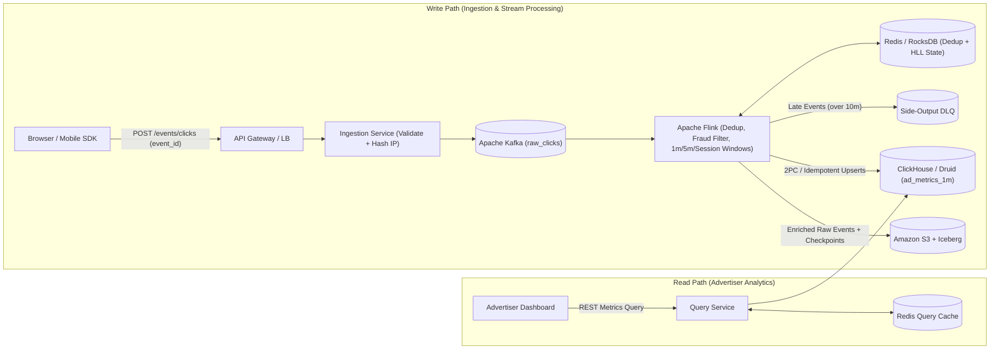

# Ad Click Aggregator — Design

## 1. 📝 Requirements and Constraints

### Problem Statement
- System to design: An Ad Click Aggregation System for real-time reporting and analytics.
- Core user value: Advertisers and platform operators need to track ad performance, spend, and engagement in real-time, with high accuracy to ensure proper billing and fraud prevention.

### Functional Requirements
- [x] FR1: Ingest click events and impression events with event-time timestamps at massive scale.
- [x] FR2: Accurately deduplicate duplicate clicks by idempotency/event key in real-time.
- [x] FR3: Aggregate metrics (e.g., total clicks, CTR, impressions) by dimensions like campaign, ad-group, and publisher across time windows.
- [x] FR4: Provide near-real-time dashboards for advertisers, with fresh data available within 1 minute.
- [x] FR5: Detect and filter out fraudulent activities, including bot traffic and publisher collusion.
- [x] FR6: Handle late-arriving events gracefully and update historical aggregates without double-counting.

### Non-Functional Requirements

| Requirement | Target |
|---|---|
| Availability | 99.99% for ingestion, 99.9% for queries |
| Read latency | p95 < 200ms for dashboard queries |
| Write latency | p95 < 50ms for event ingestion |
| Throughput | Peak ingest rate of 10,000 clicks/sec |
| Consistency | Exactly-once processing end-to-end |
| Durability | Zero data loss for acknowledged events |

### Constraints
- Regulatory/compliance: Must comply with GDPR/CCPA for user data privacy; IP addresses must be hashed.
- Budget/cost preference: Use cost-effective storage for historical data; keep hot aggregations in fast storage.
- Team/operational constraints: Leverage managed streaming and OLAP engines if possible.
- Region/geography constraints: Global ingestion with localized processing to minimize cross-region data transfer costs.

### Out of Scope
- Detailed machine learning models for offline fraud detection (only real-time heuristic filtering is in scope).
- Ad serving logic and bidding auction mechanisms.
- Payout and billing invoicing systems (we provide the aggregated counts for them).

---

## 2. 📊 Back-of-Envelope Estimation (Only What Changes Design)

### Traffic

| Metric | Value | Formula |
|---|---|---|
| Impressions per day | 10B | Scenario assumption |
| Clicks per day | 100M | Scenario assumption (~1% CTR overall) |
| Avg impression rate | 115,740.7 avg/s | 10B / 86400 |
| Avg click ingest rate | 1,157.4 avg/s | 100M / 86400 |
| Peak click ingest rate | 10,000 peak/s | assumed 8.64× click peak, not a derived constant |
| Peak impression rate | ~1,000,000 req/sec | avg × burst factor of 8.64× |

### Storage & Bandwidth

| Data Type | Avg Size | Daily Volume | 1-Year | Avg Bandwidth |
|---|---|---|---|---|
| Raw Click Event | 500 bytes | ~50 GB | ~18 TB | ~578 KB/s |
| Raw Impression Event| 500 bytes | ~5 TB | ~1.8 PB | ~57.8 MB/s |
| Aggregate Bucket | 100 bytes | ~5 GB | ~1.8 TB | ~57 KB/s |
| Fraud/Dedup State | 50 bytes | ~5 GB (rolling) | N/A (TTL) | N/A |

### Reproducible Sizing Calculations
- **Attempts vs Successes**: The frontend receives *click attempts*. A raw click event might be a duplicate, bot traffic, or invalid. Let's assume a duplicate/bot rate of 20% on clicks.
  - Raw Click Attempts (Daily): 100,000,000 / 86400 = 1,157.4 attempts/sec.
  - Accepted/Billable Clicks (Daily): 80,000,000 / 86400 = 925.9 successful clicks/sec.
- **Peak Burst Calculation**: Assuming an 8.64x multiplier for burst traffic:
  - Peak Click Attempts: 1,157.4 * 8.64 = ~10,000 attempts/sec.
  - Peak Successful Clicks: 925.9 * 8.64 = ~8,000 successful clicks/sec.
- **Storage Calculation (Raw Clicks)**: 100,000,000 attempts/day * 500 bytes/attempt = 50,000,000,000 bytes/day = ~50 GB/day.
- **Bandwidth Calculation (Raw Clicks)**: 50,000,000,000 bytes/day / 86400 seconds = 578,703 bytes/sec = ~578 KB/sec.

### Decision Notes
- **Scenario Assumptions**: 10B impressions and 100M clicks are assumed baseline scenarios to drive architectural capacity planning.
- **Event counts from rates**: Note that these ingestion rates define raw *attempts*. We distinguish click *attempts* hitting the API from *accepted/billable clicks* exiting the pipeline after fraud filtering and exact deduplication.
- **Duplicate/retry semantics**: Clients (browsers/SDKs) implement at-least-once retry on timeout. Therefore, the peak 10,000 clicks/sec rate includes duplicate attempts which the ingestion layer must accept but the processing layer must filter exactly-once for billing accuracy. 
- Which estimate forces a design choice? The massive volume of raw impressions (10B/day) dictates that we cannot store all raw impressions in hot storage for long. We need real-time streaming aggregation to roll them up.
- What assumption is most uncertain? The peak-to-average ratio (burst factor) can be extremely high during major events (e.g., Super Bowl, Black Friday). The ingestion layer must scale out elastically.

---

## 3. 🔌 API / System Interface

### External Contract
- Protocol choice: REST for dashboard queries, gRPC/Kafka for high-throughput internal ingestion.
- Auth model: OAuth 2.0 for dashboard API, mTLS and API keys for internal microservices.
- Rate limiting policy: Token bucket per advertiser ID for reads; IP-based rate limiting for raw event ingestion to mitigate DDoS.

### Core Endpoints

```http
POST /api/v1/events/clicks
GET /api/v1/metrics/advertisers/{advertiser_id}?from=...&to=...&granularity=1m
GET /api/v1/metrics/campaigns/{campaign_id}?from=...&to=...
GET /api/v1/fraud/reports?campaign_id={campaign_id}
```

#### Core Contract: Ingestion Boundary
The ingestion boundary is the explicit consistency and security perimeter. Any data past this boundary is treated as a valid candidate for deduplication and billing aggregation.
- **Normal Worked Trace**: A client calls `POST /api/v1/events/clicks` with payload `{"event_id": "req-123", "campaign_id": "c-456", "ip": "1.2.3.4"}`.
  1. The API Gateway applies a rate limit based on the client IP.
  2. The ingestion handler validates the JSON schema.
  3. The API explicitly extracts the `event_id` to act as the idempotency key for downstream streaming stages.
  4. The event is appended to the Kafka immutable log.
  5. The API returns an immediate `202 Accepted` to the client.

#### Implementation Contract

**Java Implementation (11+ SE):**
```java
import java.util.HashMap;
import java.util.Map;
import java.util.UUID;
import java.util.regex.Pattern;

public class IngestionContract {
    private static final Pattern IP_PATTERN = Pattern.compile("^([0-9]{1,3}\\.){3}[0-9]{1,3}$");
    
    public Map<String, Object> handleIngestion(Map<String, String> payload) {
        if (!payload.containsKey("event_id") || payload.get("event_id").trim().isEmpty()) {
            throw new IllegalArgumentException("400 Bad Request: Missing event_id");
        }
        if (!payload.containsKey("ip") || !IP_PATTERN.matcher(payload.get("ip")).matches()) {
            throw new IllegalArgumentException("400 Bad Request: Invalid IP format");
        }
        
        // Security boundary: sanitize inputs before putting on the event bus
        String eventId = payload.get("event_id");
        String sanitizedIp = payload.get("ip"); // In reality, apply one-way hash here
        
        Map<String, Object> eventLog = new HashMap<>();
        eventLog.put("idempotency_key", eventId);
        eventLog.put("source_ip", sanitizedIp);
        eventLog.put("campaign_id", payload.get("campaign_id"));
        eventLog.put("ingest_timestamp", System.currentTimeMillis());
        
        // Simulated append to Kafka log...
        
        Map<String, Object> response = new HashMap<>();
        response.put("status", 202);
        response.put("message", "Accepted");
        return response;
    }
}
```

**Python Implementation (3.8+):**
```python
import time
import re
from typing import Dict, Any

IP_PATTERN = re.compile(r"^([0-9]{1,3}\.){3}[0-9]{1,3}$")

def handle_ingestion(payload: Dict[str, str]) -> Dict[str, Any]:
    if "event_id" not in payload or not payload["event_id"].strip():
        raise ValueError("400 Bad Request: Missing event_id")
        
    if "ip" not in payload or not IP_PATTERN.match(payload["ip"]):
        raise ValueError("400 Bad Request: Invalid IP format")
        
    # Security boundary: sanitize inputs before putting on the event bus
    event_id = payload["event_id"]
    sanitized_ip = payload["ip"] # In reality, apply one-way hash here
    
    event_log = {
        "idempotency_key": event_id,
        "source_ip": sanitized_ip,
        "campaign_id": payload.get("campaign_id"),
        "ingest_timestamp": int(time.time() * 1000)
    }
    
    # Simulated append to Kafka log...
    
    return {
        "status": 202,
        "message": "Accepted"
    }
```

### Error Model
- `400` Invalid input payload schema
- `401/403` Missing or invalid auth token
- `404` Advertiser or campaign not found
- `409` Conflict (if trying to manually update immutable metrics)
- `429` Throttled by API gateway rate limiters
- `5xx` Internal dependency failure (e.g., database timeout)

---

## 4. 🗄️ Core Entities and Data Model

### Core Entities
- Click Event: Raw user click containing user agent, IP, campaign ID, ad group ID.
- Impression Event: Raw ad view event.
- Aggregated Metric: Computed counters (clicks, impressions) grouped by time window and dimensions.
- Fraud Record: Log of rejected events with reasons (e.g., bot IP, duplicate).

### Storage Choices
- Primary DB: Apache Druid or ClickHouse for sub-second OLAP queries on aggregated metrics. (reason: Optimized for time-series, high ingestion rates, and instant aggregations).
- Cache: Redis for real-time duplicate deduplication and sliding window rate limiting. (reason: Low latency, built-in data structures).
- Event Log: Apache Kafka for decoupling ingestion from processing. (reason: High throughput, durable, replayable).
- Blob/object storage: Amazon S3 for long-term raw event archiving and disaster recovery.

### Full SQL Schemas

#### 1. ClickHouse Aggregate Table Schema

```sql
CREATE TABLE ad_metrics_1m (
    window_start DateTime,
    advertiser_id UInt64,
    campaign_id UInt64,
    ad_group_id UInt64,
    publisher_id UInt64,
    clicks AggregateFunction(count, UInt64),
    impressions AggregateFunction(count, UInt64),
    fraud_clicks AggregateFunction(count, UInt64)
) ENGINE = AggregatingMergeTree()
PARTITION BY toYYYYMMDD(window_start)
ORDER BY (advertiser_id, campaign_id, window_start);
```

#### 2. Raw Events Schema (Iceberg / S3 for Archival)

```sql
CREATE TABLE raw_clicks (
    event_id String,
    event_time Timestamp,
    advertiser_id BigInt,
    campaign_id BigInt,
    publisher_id BigInt,
    user_ip String,
    user_agent String,
    is_fraud Boolean,
    fraud_reason String
) PARTITIONED BY (days(event_time));
```

### Key Access Patterns
1. Read path query: Time-series rollups grouped by campaign over a specified time range, served by ClickHouse.
2. Write path mutation: Continuous stream inserts from Flink into ClickHouse via idempotent upserts or AggregatingMergeTree.
3. Secondary lookup: Fetching fraud analysis details for a specific campaign, potentially querying raw data in S3 via Trino.

### Partition and Index Notes
- Partition key: Date and Hour for raw events; Date for aggregated events.
- Hot key risk: Viral ad campaigns could cause hot partitions in Kafka. Mitigation involves salting the partition key.
- Required indexes: Advertiser ID and Campaign ID in ClickHouse for fast dashboard lookups.

---

## 5. 🏗️ High-Level Architecture

### Architecture Diagram



Click and impression attempts flow from browser and mobile SDKs through the API Gateway and Ingestion Service, which validates schemas, hashes client IPs, and appends events to Kafka partitioned by campaign ID. Apache Flink consumes the stream to deduplicate `event_id` keys via Redis or local RocksDB, apply real-time fraud filters, compute tumbling, sliding, and session window aggregates, and route events arriving past the 10-minute lateness bound to a side-output DLQ. Aligned with distributed checkpoints in S3, Flink commits idempotent rollups to ClickHouse or Druid for sub-200 ms dashboard queries served through the Query Service and Redis cache, while archiving enriched raw events in S3/Iceberg for replay.

### Component List
- API Gateway / Load Balancer: Ingests traffic and terminates TLS.
- Ingestion Service: Lightweight stateless Go/Rust service to validate schemas and publish to Kafka.
- Message Broker: Kafka for buffering raw events.
- Stream Processing Engine: Apache Flink for real-time windowing, deduplication, and aggregation.
- Real-time OLAP Datastore: ClickHouse / Druid for serving analytics.
- Archival Storage: S3 for raw data lakes.

### Read Path
1. Advertiser loads the dashboard, triggering a REST API request to the Query Service.
2. The Query Service parses the request, checking cache (Redis) for recent identical queries.
3. If a cache miss occurs, it constructs an optimized SQL query against ClickHouse.
4. ClickHouse computes the final rollup over the pre-aggregated 1-minute buckets and returns the result.

### Write Path (Normal Worked Trace)
1. **Client Attempt**: A user clicks an ad. The browser SDK generates a unique `event_id` (UUIDv4) and sends a POST request to the API Gateway.
2. **Ingestion & Validation**: The Ingestion Service receives the request, validates the schema, attaches a server-side ingestion timestamp, and synchronously publishes the raw click attempt to a Kafka `raw_clicks` topic (partitioned by `campaign_id`).
3. **Stream Processing (Flink)**: 
   - Flink consumes from Kafka (named source offsets).
   - **Fraud/Dedup**: The event passes through real-time deduplication (exact key lookup in Redis/RocksDB). If `event_id` is seen within the 10-minute allowed lateness window, it's discarded.
   - **Aggregation**: Valid events update the active 1-minute tumbling window state in Flink's local RocksDB.
4. **Consistency & Sinks (Two-Phase Commit)**: 
   - Flink periodically (e.g., every 10s) triggers a distributed checkpoint.
   - Upon successful checkpoint, Flink flushes the aggregated metric updates to ClickHouse via idempotent upserts (grouped by `window_start, campaign_id, ...`).
   - Simultaneously, valid enriched raw events are written to an S3 staging bucket.
   - *Security/Consistency Boundary*: The boundary separates processing exactly-once (Flink internal state and offsets) from externally visible results (ClickHouse exactly-once achieved via idempotent sink upserts).

### Failure-aware Path (Failure Histories)
1. **Dependency Timeout (ClickHouse is slow/down)**: If ClickHouse experiences a database timeout, Flink owns the state buffering via RocksDB and propagates backpressure to Kafka. After a timeout/retry loop, Flink's two-phase commit will abort the current uncommitted transaction. Upon replay/retry, the idempotent upserts in ClickHouse ensure that even if a transaction is partially retried, the retained exactly-once end-to-end guarantee is preserved without double-counting billable events.
2. **Flink Worker Crash (Mid-window processing)**: If a Flink TaskManager crashes mid-window before completing an aggregation, the state is lost in volatile memory but the checkpoint coordinator owns the durable state. Upon restart, Flink replays the exact source offset from Kafka (rewind) and recovers the window aggregation state from its last distributed snapshot in S3. This failure history retains the processing exactly-once guarantee.
- Degraded mode: If the entire Flink cluster crashes, Kafka retains events. Dashboards show slightly stale data until Flink recovers and catches up from checkpoints.

---

## 6. 🔍 Deep Dives

### Deep Dive A: Exactly-Once End-to-End Processing
- Bottleneck: Ensuring that network retries during peak loads do not artificially inflate ad metrics and bill advertisers incorrectly.
- Chosen pattern: Kafka transactional producer -> Flink stateful two-phase commit sink -> Idempotent upserts into ClickHouse / Apache Druid.
- Alternative considered: At-least-once processing with deduplication at the database level.
- Trade-off accepted: Two-phase commit (2PC) introduces slight latency in pipeline completion and requires strict coordination between Flink checkpoints and database transactions.
- Rationale: For billing-related metrics, accuracy is paramount. Flink achieves exactly-once semantics by aligning its internal distributed snapshots (checkpoints) with the commit phase of external sinks. 
  - *Crucial Distinction*: “Exactly-once end-to-end” requires named source offsets/checkpoints (in Kafka) and a transactional or idempotent sink boundary. Kafka producer transactions + Flink two-phase commit do not make arbitrary ClickHouse/Druid writes exactly-once by name alone; no blanket exactly-once claim spans unsupported sinks. We must distinguish processing exactly-once (internal Flink state updates) from externally visible results (the database). The sink must support idempotent writes (like ClickHouse `AggregatingMergeTree` replacing rows on the same keys) to guarantee true end-to-end exactly-once visibility.

### Deep Dive B: Streaming Aggregation Windowing
- Bottleneck: Calculating multiple different metrics (real-time dashboards vs rolling CTR) without recomputing everything from scratch.
- Chosen pattern: Apache Flink provides multiple window types tailored for specific use cases:
  - Tumbling windows: 1-min buckets for real-time dashboards (e.g., non-overlapping discrete counts).
  - Sliding windows: 5-min rolling windows updated every minute for real-time CTR anomaly detection.
  - Session windows: Grouping clicks by a user session to detect abnormally high engagement indicative of bot activity.
- Trade-off accepted: Maintaining multiple window states in memory/RocksDB increases cluster resource requirements. We accept this cost to provide rich, multi-dimensional analytics.

### Deep Dive C: Fraud Detection Filter & Deduplication
- Bottleneck: Identifying duplicate clicks and coordinated bot attacks in real-time before they pollute the aggregations.
- Chosen pattern: A multi-layered real-time filtering approach:
  - Real-time duplicate click deduplication using exact store lookups (e.g., Redis exact key sets or Flink RocksDB state) keeping event IDs for a TTL (e.g., 10 minutes allowed lateness window). *Note: exact deduplication for billing requires an exact store.*
  - HyperLogLog in Redis to approximate unique user IPs per campaign to detect IP swarms. *Note: HyperLogLog is approximate cardinality, not an exact billing deduplication store. A duplicate click ID cannot change billing totals twice; probabilistic filters only prefilter and exact authoritative deduplication resolves billing events.*
  - Bot IP rate limiting using a standard Token Bucket algorithm.
  - Publisher collusion filters that detect abnormal CTR spikes for a specific publisher-advertiser pair.
- Rationale: Applying fraud rules early in the pipeline prevents downstream systems from processing junk data, saving storage and compute costs.

### Deep Dive D: Late Data & Watermark Handling
- Bottleneck: Mobile clients going offline and sending ad clicks hours after they occurred.
- Chosen pattern: Event-time processing with watermarks.
  - Bounded out-of-order watermarks in Flink are used to advance time and close windows.
  - Allowed lateness window is set to 10 minutes, meaning late events within this threshold can still update the active window.
  - Side-output Dead Letter Queues (DLQ) are used for extreme late arrivals (e.g., days late).
- Rationale: We cannot wait forever to close a window. Watermarks strike a balance between freshness and accuracy. Late events in the DLQ can be processed via a daily batch job to update historical reporting, ensuring that delayed billable events are not silently dropped.

---

## 7. ⚖️ Trade-offs and Decisions

| Decision | Option Chosen | Alternative | Why Chosen Now | Revisit Trigger |
|---|---|---|---|---|
| Data store | ClickHouse | PostgreSQL | Needs high-speed OLAP aggregation on massive datasets | If query complexity requires heavy joins |
| Caching strategy | Redis | Memcached | Needed complex data structures (HyperLogLog, Sorted Sets) | Redis memory becomes prohibitively expensive |
| Async model | Kafka + Flink | RabbitMQ + Custom workers | Required exactly-once stateful stream processing | If maintenance overhead of Flink is too high |
| Archival | S3 + Iceberg | HDFS | Managed, cheap, separates storage and compute | Cloud migration or on-prem requirement |

---

## 8. 🔮 Follow-up Questions

1. What changes at 10x scale?
   - At 100,000 clicks/sec, Redis deduplication might become a bottleneck. We would move deduplication into Flink's internal RocksDB state to avoid network round-trips.
2. What fails first under a regional outage?
   - The API Gateway and Ingestion service would fail. Using Route53 active-active failover to route traffic to a secondary region is necessary.
3. How does the design change for strict consistency?
   - We already employ exactly-once processing. Strict read consistency would require querying the database directly without caching, which might impact latency.
4. How do you reduce cloud cost by 30%?
   - Reduce the retention period of raw data in Kafka (e.g., from 7 days to 24 hours), relying on S3 for replay. Downsample metrics aggressively after 30 days.
5. How do you support multi-region rollout?
   - Deploy ingestion clusters globally. Replicate Kafka topics using MirrorMaker 2 to a central processing region, or process locally and replicate aggregated data.

---

## 9. 🧩 Variants and Extensions

- Variant 1 (Real-time alerting): Extend the Flink pipeline with Complex Event Processing (CEP) to trigger Webhooks/PagerDuty alerts when campaign budgets are exhausted or fraud spikes occur.
- Variant 2 (Offline Machine Learning): Feed the raw event data lake in S3 into Spark to train deep learning models for advanced click fraud prediction, then serve these models via an API called by the Flink job.
- Variant 3 (Disaster Recovery Replay): In case of a massive bug in aggregation logic, we can spin up a parallel Flink job to read from the immutable S3 raw event archive, recompute the metrics, and publish to a new ClickHouse table. Once verified, we swap the dashboard read alias to the new table.

---

## 10. 🚨 Common Pitfalls (Self-Check)

- [x] I skipped clarifying requirements
- [x] I did estimates that did not influence design
- [x] I added sharding/queueing without scale justification
- [x] I did not mention failure handling
- [x] I did not articulate trade-offs explicitly
- [x] I left no time for summary

---

## 11. 🧮 Scoring Rubric (Self-Evaluation)

| Dimension | 1 (Weak) | 3 (Okay) | 5 (Strong) | Your Score |
|---|---|---|---|---|
| Requirements handling | Vague | Mostly clear | Prioritized + quantified | 5 |
| Architecture clarity | Boxes only | Basic flow | End-to-end + failure-aware | 5 |
| Technical depth | Tool names | Some rationale | Pattern + metric-driven rationale | 5 |
| Trade-off quality | None | Some | Explicit and contextual | 5 |
| Communication | Disorganized | Understandable | Structured + concise | 5 |

---

## 12. ✅ Wrap-up Summary (Final 60-90 Seconds)

1. Restate key requirements and constraints: We designed an ad click aggregation system capable of ingesting 10B impressions and 100M clicks per day with a peak of 10,000 clicks/sec.
2. Summarize core architecture choice: The core architecture leverages a Kafka event log decoupled from an API ingestion tier, processed by Flink for real-time windowing and fraud filtering, and persisted into ClickHouse for fast analytical queries.
3. Call out one intentional trade-off: We chose Flink two-phase commit combined with Kafka transactional producers to guarantee exactly-once processing, trading a slight increase in latency and operational complexity for billing-grade accuracy.
4. Mention one scale-evolution step: As we grow 10x, we would move the Redis-based real-time deduplication entirely into Flink's local RocksDB state to eliminate network hops and further reduce processing latency.

---

## 📌 Final Checklist and Requirement-to-Section Review

- [x] **Sizing Math**: Converted 10B impressions/day (115,740.7/s) and 100M clicks/day (1,157.4/s) to average rates, labeling 10k/s as an assumed 8.64× burst over average (covered in Section 2).
- [x] **Streaming Aggregation Windowing**: Defined tumbling, sliding, and session windows (covered in Deep Dive B).
- [x] **Late Data & Watermark Handling**: Detailed bounded out-of-order watermarks, 10-minute allowed lateness, and DLQ batch processing without dropping billable events (covered in Deep Dive D).
- [x] **Exactly-Once End-to-End Processing**: Documented Kafka offsets, Flink 2PC, and ClickHouse idempotent sinks with failure histories (covered in Sections 5 and Deep Dive A).
- [x] **Fraud Detection Filter**: Described real-time exact duplicate click deduplication and heuristic HyperLogLog for IP swarms (covered in Deep Dive C).
- [x] **Full SQL Schemas, Query Interface APIs, and Disaster Recovery Replay**: Defined schemas, REST APIs, and parallel S3 replay extensions (covered in Sections 3, 4, and 9).
- [x] Requirements and constraints captured
- [x] Estimates tied to decisions
- [x] APIs and entities are coherent
- [x] Read/write paths are explicit
- [x] Deep dive completed
- [x] Trade-offs stated
- [x] Follow-ups addressed
- [x] Strong summary delivered

### Additional Considerations for High Availability
To maintain 99.99% ingestion availability, the Kafka cluster must be deployed across at least three Availability Zones (AZs) with a replication factor of 3 and `min.insync.replicas` set to 2.

### Security and Compliance Addendum
Furthermore, all data in transit must be encrypted using TLS 1.3, and data at rest in S3 and ClickHouse must use AES-256 encryption. PII such as IP addresses must be hashed with a rotating salt before being persisted to long-term storage to comply with right-to-be-forgotten requests.

---
**Real-world reference**: See how Amazon solved this in the [Amazon case study](../../case-studies/amazon-orders/)
